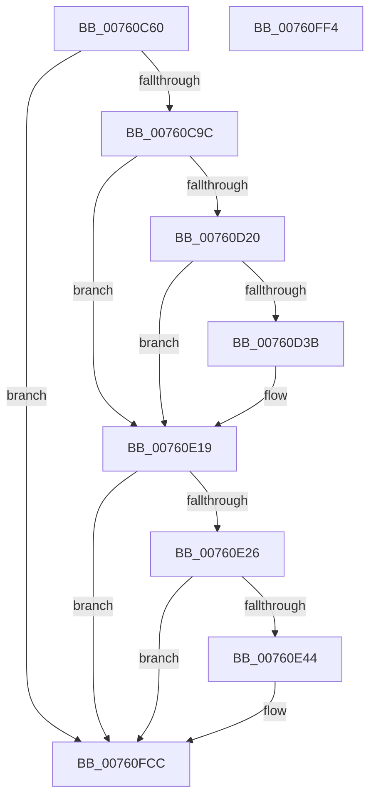

# PopDiagTraceBatteryTriggerMet

- RVA: `0x00760C60`–`0x00760FF5` (길이 `917` bytes)
- VA: `0x0000000140760C60`
- 실행 섹션: `PAGE`
- PDB 이름 있음: `예`; PDB Function 태그: `아니요`
- unwind 정보 RVA: `0x000CC738`
- 디코드: `176`개 명령, `917/917` bytes 표시
- 미해석 바이트: `0` (있으면 어셈블리에 `.byte`로 보존)

> 이 문서는 커널 이미지의 기계어와 PDB 기호를 분석해 생성했습니다. 4번과 5번은 함수 원형과 자료형을 바이너리 사용 방식에서 추정한 C 해석이며 원본 소스 복구 결과는 아닙니다.

## 1. Dependencies

- 직접 호출 지점: **5**; 고유 호출 대상: **5**
- 직접 호출자로 확인된 함수: **1**
- RIP 상대 이미지 참조: **10**

### Outgoing calls
- `0x00760D2E` → [EtwEventEnabled](../../text/39/EtwEventEnabled_function_00392450.md) (function, `0x00392450`)
- `0x00760E14` → [EtwWrite](../../text/41/EtwWrite_function_0041C720.md) (function, `0x0041C720`)
- `0x00760E37` → [tlgKeywordOn](../../text/42/tlgKeywordOn_function_0042EAA0.md) (function, `0x0042EAA0`)
- `0x00760FC7` → [tlgWriteTransfer_EtwWriteTransfer](../../text/42/tlgWriteTransfer_EtwWriteTransfer_function_004260E0.md) (function, `0x004260E0`)
- `0x00760FD6` → [_security_check_cookie](../../text/6A/_security_check_cookie_function_006AC640.md) (function, `0x006AC640`)

### Direct callers
- [PopBatteryApplyCompositeState](../AE/PopBatteryApplyCompositeState_function_00AE0CD0.md) at `0x00AE11E3`

### Static image references
- `0x00760C7E` → RVA `0x00E0A740` (`.data`; read)
- `0x00760C9C` → RVA `0x00F0C034` (`.data`; read)
- `0x00760CA4` → RVA `0x00F0C20C` (`.data`; read)
- `0x00760CB5` → RVA `0x00F0C060` (`.data`; read)
- `0x00760CC9` → RVA `0x00F0C180` (`.data`; read)
- `0x00760D0F` → RVA `0x00E67858` (`.data`; read)
- `0x00760D20` → RVA `0x00F0B408` (`.data`; read)
- `0x00760D27` → RVA `0x00022790` (`.rdata`; read)
- `0x00760E19` → RVA `0x00E07748` (`.data`; read)
- `0x00760E48` → RVA `0x00049C05` (`.rdata`; read)

## 2. Other-region calls and transfers

- 다른 실행 섹션으로 향하는 call: **5**
  - `0x00760D2E` → [EtwEventEnabled](../../text/39/EtwEventEnabled_function_00392450.md) (`PAGE` → `.text`)
  - `0x00760E14` → [EtwWrite](../../text/41/EtwWrite_function_0041C720.md) (`PAGE` → `.text`)
  - `0x00760E37` → [tlgKeywordOn](../../text/42/tlgKeywordOn_function_0042EAA0.md) (`PAGE` → `.text`)
  - `0x00760FC7` → [tlgWriteTransfer_EtwWriteTransfer](../../text/42/tlgWriteTransfer_EtwWriteTransfer_function_004260E0.md) (`PAGE` → `.text`)
  - `0x00760FD6` → [_security_check_cookie](../../text/6A/_security_check_cookie_function_006AC640.md) (`PAGE` → `.text`)
- 별도 외부 분기/꼬리 이동을 확인하지 못했습니다.

## 3. Assembly (complete function range)

```asm
00760C60  48 8B C4                        mov rax, rsp
00760C63  48 89 58 08                     mov qword ptr [rax + 8], rbx
00760C67  48 89 70 10                     mov qword ptr [rax + 0x10], rsi
00760C6B  48 89 78 18                     mov qword ptr [rax + 0x18], rdi
00760C6F  55                              push rbp
00760C70  48 8D A8 C8 FE FF FF            lea rbp, [rax - 0x138]
00760C77  48 81 EC 30 02 00 00            sub rsp, 0x230
00760C7E  48 8B 05 BB 9A 6A 00            mov rax, qword ptr [rip + 0x6a9abb]
00760C85  48 33 C4                        xor rax, rsp
00760C88  48 89 85 20 01 00 00            mov qword ptr [rbp + 0x120], rax
00760C8F  45 8B 08                        mov r9d, dword ptr [r8]
00760C92  41 83 F9 01                     cmp r9d, 1
00760C96  0F 87 30 03 00 00               ja 0x140760fcc
00760C9C  8B 05 92 B3 7A 00               mov eax, dword ptr [rip + 0x7ab392]
00760CA2  33 FF                           xor edi, edi
00760CA4  8B 1D 62 B5 7A 00               mov ebx, dword ptr [rip + 0x7ab562]
00760CAA  89 44 24 34                     mov dword ptr [rsp + 0x34], eax
00760CAE  8B 41 04                        mov eax, dword ptr [rcx + 4]
00760CB1  89 44 24 40                     mov dword ptr [rsp + 0x40], eax
00760CB5  8B 05 A5 B3 7A 00               mov eax, dword ptr [rip + 0x7ab3a5]
00760CBB  8D 8B F4 01 00 00               lea ecx, [rbx + 0x1f4]
00760CC1  83 E0 01                        and eax, 1
00760CC4  44 89 4C 24 30                  mov dword ptr [rsp + 0x30], r9d
00760CC9  40 38 3D B0 B4 7A 00            cmp byte ptr [rip + 0x7ab4b0], dil
00760CD0  89 44 24 3C                     mov dword ptr [rsp + 0x3c], eax
00760CD4  8B C7                           mov eax, edi
00760CD6  0F 95 C0                        setne al
00760CD9  40 38 3A                        cmp byte ptr [rdx], dil
00760CDC  89 44 24 44                     mov dword ptr [rsp + 0x44], eax
00760CE0  8B C7                           mov eax, edi
00760CE2  0F 95 C0                        setne al
00760CE5  89 44 24 48                     mov dword ptr [rsp + 0x48], eax
00760CE9  8B 42 08                        mov eax, dword ptr [rdx + 8]
00760CEC  89 44 24 4C                     mov dword ptr [rsp + 0x4c], eax
00760CF0  8B 42 04                        mov eax, dword ptr [rdx + 4]
00760CF3  89 44 24 50                     mov dword ptr [rsp + 0x50], eax
00760CF7  8B 42 10                        mov eax, dword ptr [rdx + 0x10]
00760CFA  89 44 24 54                     mov dword ptr [rsp + 0x54], eax
00760CFE  8B 42 14                        mov eax, dword ptr [rdx + 0x14]
00760D01  89 44 24 58                     mov dword ptr [rsp + 0x58], eax
00760D05  B8 D3 4D 62 10                  mov eax, 0x10624dd3
00760D0A  F7 E1                           mul ecx
00760D0C  C1 EA 06                        shr edx, 6
00760D0F  40 38 3D 42 6B 70 00            cmp byte ptr [rip + 0x706b42], dil
00760D16  89 54 24 38                     mov dword ptr [rsp + 0x38], edx
00760D1A  0F 84 F9 00 00 00               je 0x140760e19
00760D20  48 8B 0D E1 A6 7A 00            mov rcx, qword ptr [rip + 0x7aa6e1]
00760D27  48 8D 15 62 1A 8C FF            lea rdx, [rip - 0x73e59e]
00760D2E  E8 1D 17 C3 FF                  call 0x140392450
00760D33  84 C0                           test al, al
00760D35  0F 84 DE 00 00 00               je 0x140760e19
00760D3B  48 8B 0D C6 A6 7A 00            mov rcx, qword ptr [rip + 0x7aa6c6]
00760D42  48 8D 44 24 30                  lea rax, [rsp + 0x30]
00760D47  48 89 45 90                     mov qword ptr [rbp - 0x70], rax
00760D4B  44 8D 4F 0B                     lea r9d, [rdi + 0xb]
00760D4F  48 8D 44 24 34                  lea rax, [rsp + 0x34]
00760D54  48 C7 45 98 04 00 00 00         mov qword ptr [rbp - 0x68], 4
00760D5C  48 89 45 A0                     mov qword ptr [rbp - 0x60], rax
00760D60  48 8D 15 29 1A 8C FF            lea rdx, [rip - 0x73e5d7]
00760D67  48 8D 44 24 38                  lea rax, [rsp + 0x38]
00760D6C  48 C7 45 A8 04 00 00 00         mov qword ptr [rbp - 0x58], 4
00760D74  48 89 45 B0                     mov qword ptr [rbp - 0x50], rax
00760D78  45 33 C0                        xor r8d, r8d
00760D7B  48 8D 44 24 3C                  lea rax, [rsp + 0x3c]
00760D80  48 C7 45 B8 04 00 00 00         mov qword ptr [rbp - 0x48], 4
00760D88  48 89 45 C0                     mov qword ptr [rbp - 0x40], rax
00760D8C  48 8D 44 24 40                  lea rax, [rsp + 0x40]
00760D91  48 89 45 D0                     mov qword ptr [rbp - 0x30], rax
00760D95  48 8D 44 24 44                  lea rax, [rsp + 0x44]
00760D9A  48 89 45 E0                     mov qword ptr [rbp - 0x20], rax
00760D9E  48 8D 44 24 48                  lea rax, [rsp + 0x48]
00760DA3  48 89 45 F0                     mov qword ptr [rbp - 0x10], rax
00760DA7  48 8D 44 24 4C                  lea rax, [rsp + 0x4c]
00760DAC  48 89 45 00                     mov qword ptr [rbp], rax
00760DB0  48 8D 44 24 50                  lea rax, [rsp + 0x50]
00760DB5  48 89 45 10                     mov qword ptr [rbp + 0x10], rax
00760DB9  48 8D 44 24 54                  lea rax, [rsp + 0x54]
00760DBE  48 89 45 20                     mov qword ptr [rbp + 0x20], rax
00760DC2  48 8D 44 24 58                  lea rax, [rsp + 0x58]
00760DC7  48 89 45 30                     mov qword ptr [rbp + 0x30], rax
00760DCB  48 8D 45 90                     lea rax, [rbp - 0x70]
00760DCF  48 89 44 24 20                  mov qword ptr [rsp + 0x20], rax
00760DD4  48 C7 45 C8 04 00 00 00         mov qword ptr [rbp - 0x38], 4
00760DDC  48 C7 45 D8 04 00 00 00         mov qword ptr [rbp - 0x28], 4
00760DE4  48 C7 45 E8 04 00 00 00         mov qword ptr [rbp - 0x18], 4
00760DEC  48 C7 45 F8 04 00 00 00         mov qword ptr [rbp - 8], 4
00760DF4  48 C7 45 08 04 00 00 00         mov qword ptr [rbp + 8], 4
00760DFC  48 C7 45 18 04 00 00 00         mov qword ptr [rbp + 0x18], 4
00760E04  48 C7 45 28 04 00 00 00         mov qword ptr [rbp + 0x28], 4
00760E0C  48 C7 45 38 04 00 00 00         mov qword ptr [rbp + 0x38], 4
00760E14  E8 07 B9 CB FF                  call 0x14041c720
00760E19  83 3D 28 69 6A 00 05            cmp dword ptr [rip + 0x6a6928], 5
00760E20  0F 86 A6 01 00 00               jbe 0x140760fcc
00760E26  48 BA 00 00 00 00 00 40 00 00   movabs rdx, 0x400000000000
00760E30  48 8D 0D 11 69 6A 00            lea rcx, [rip + 0x6a6911]
00760E37  E8 64 DC CC FF                  call 0x14042eaa0
00760E3C  84 C0                           test al, al
00760E3E  0F 84 88 01 00 00               je 0x140760fcc
00760E44  8B 44 24 30                     mov eax, dword ptr [rsp + 0x30]
00760E48  48 8D 15 B6 8D 8E FF            lea rdx, [rip - 0x71724a]
00760E4F  89 44 24 5C                     mov dword ptr [rsp + 0x5c], eax
00760E53  48 8D 0D EE 68 6A 00            lea rcx, [rip + 0x6a68ee]
00760E5A  48 8D 44 24 5C                  lea rax, [rsp + 0x5c]
00760E5F  48 C7 45 68 04 00 00 00         mov qword ptr [rbp + 0x68], 4
00760E67  48 89 45 60                     mov qword ptr [rbp + 0x60], rax
00760E6B  45 33 C9                        xor r9d, r9d
00760E6E  8B 44 24 34                     mov eax, dword ptr [rsp + 0x34]
00760E72  45 33 C0                        xor r8d, r8d
00760E75  89 44 24 60                     mov dword ptr [rsp + 0x60], eax
00760E79  48 8D 44 24 60                  lea rax, [rsp + 0x60]
00760E7E  48 89 45 70                     mov qword ptr [rbp + 0x70], rax
00760E82  8B 44 24 38                     mov eax, dword ptr [rsp + 0x38]
00760E86  89 44 24 64                     mov dword ptr [rsp + 0x64], eax
00760E8A  48 8D 44 24 64                  lea rax, [rsp + 0x64]
00760E8F  48 89 85 80 00 00 00            mov qword ptr [rbp + 0x80], rax
00760E96  48 8D 44 24 68                  lea rax, [rsp + 0x68]
00760E9B  48 89 85 90 00 00 00            mov qword ptr [rbp + 0x90], rax
00760EA2  8B 44 24 3C                     mov eax, dword ptr [rsp + 0x3c]
00760EA6  89 44 24 6C                     mov dword ptr [rsp + 0x6c], eax
00760EAA  48 8D 44 24 6C                  lea rax, [rsp + 0x6c]
00760EAF  48 89 85 A0 00 00 00            mov qword ptr [rbp + 0xa0], rax
00760EB6  8B 44 24 40                     mov eax, dword ptr [rsp + 0x40]
00760EBA  89 44 24 70                     mov dword ptr [rsp + 0x70], eax
00760EBE  48 8D 44 24 70                  lea rax, [rsp + 0x70]
00760EC3  48 89 85 B0 00 00 00            mov qword ptr [rbp + 0xb0], rax
00760ECA  8B 44 24 44                     mov eax, dword ptr [rsp + 0x44]
00760ECE  89 44 24 74                     mov dword ptr [rsp + 0x74], eax
00760ED2  48 8D 44 24 74                  lea rax, [rsp + 0x74]
00760ED7  48 89 85 C0 00 00 00            mov qword ptr [rbp + 0xc0], rax
00760EDE  8B 44 24 48                     mov eax, dword ptr [rsp + 0x48]
00760EE2  89 44 24 78                     mov dword ptr [rsp + 0x78], eax
00760EE6  48 8D 44 24 78                  lea rax, [rsp + 0x78]
00760EEB  48 89 85 D0 00 00 00            mov qword ptr [rbp + 0xd0], rax
00760EF2  8B 44 24 4C                     mov eax, dword ptr [rsp + 0x4c]
00760EF6  89 44 24 7C                     mov dword ptr [rsp + 0x7c], eax
00760EFA  48 8D 44 24 7C                  lea rax, [rsp + 0x7c]
00760EFF  48 89 85 E0 00 00 00            mov qword ptr [rbp + 0xe0], rax
00760F06  8B 44 24 50                     mov eax, dword ptr [rsp + 0x50]
00760F0A  89 45 80                        mov dword ptr [rbp - 0x80], eax
00760F0D  48 8D 45 80                     lea rax, [rbp - 0x80]
00760F11  48 89 85 F0 00 00 00            mov qword ptr [rbp + 0xf0], rax
00760F18  8B 44 24 54                     mov eax, dword ptr [rsp + 0x54]
00760F1C  89 45 84                        mov dword ptr [rbp - 0x7c], eax
00760F1F  48 8D 45 84                     lea rax, [rbp - 0x7c]
00760F23  48 89 85 00 01 00 00            mov qword ptr [rbp + 0x100], rax
00760F2A  8B 44 24 58                     mov eax, dword ptr [rsp + 0x58]
00760F2E  89 45 88                        mov dword ptr [rbp - 0x78], eax
00760F31  48 8D 45 88                     lea rax, [rbp - 0x78]
00760F35  48 89 85 10 01 00 00            mov qword ptr [rbp + 0x110], rax
00760F3C  48 8D 45 40                     lea rax, [rbp + 0x40]
00760F40  48 89 44 24 28                  mov qword ptr [rsp + 0x28], rax
00760F45  C7 44 24 20 0E 00 00 00         mov dword ptr [rsp + 0x20], 0xe
00760F4D  48 C7 45 78 04 00 00 00         mov qword ptr [rbp + 0x78], 4
00760F55  48 C7 85 88 00 00 00 04 00 00 00  mov qword ptr [rbp + 0x88], 4
00760F60  89 5C 24 68                     mov dword ptr [rsp + 0x68], ebx
00760F64  48 C7 85 98 00 00 00 04 00 00 00  mov qword ptr [rbp + 0x98], 4
00760F6F  48 C7 85 A8 00 00 00 04 00 00 00  mov qword ptr [rbp + 0xa8], 4
00760F7A  48 C7 85 B8 00 00 00 04 00 00 00  mov qword ptr [rbp + 0xb8], 4
00760F85  48 C7 85 C8 00 00 00 04 00 00 00  mov qword ptr [rbp + 0xc8], 4
00760F90  48 C7 85 D8 00 00 00 04 00 00 00  mov qword ptr [rbp + 0xd8], 4
00760F9B  48 C7 85 E8 00 00 00 04 00 00 00  mov qword ptr [rbp + 0xe8], 4
00760FA6  48 C7 85 F8 00 00 00 04 00 00 00  mov qword ptr [rbp + 0xf8], 4
00760FB1  48 C7 85 08 01 00 00 04 00 00 00  mov qword ptr [rbp + 0x108], 4
00760FBC  48 C7 85 18 01 00 00 04 00 00 00  mov qword ptr [rbp + 0x118], 4
00760FC7  E8 14 51 CC FF                  call 0x1404260e0
00760FCC  48 8B 8D 20 01 00 00            mov rcx, qword ptr [rbp + 0x120]
00760FD3  48 33 CC                        xor rcx, rsp
00760FD6  E8 65 B6 F4 FF                  call 0x1406ac640
00760FDB  4C 8D 9C 24 30 02 00 00         lea r11, [rsp + 0x230]
00760FE3  49 8B 5B 10                     mov rbx, qword ptr [r11 + 0x10]
00760FE7  49 8B 73 18                     mov rsi, qword ptr [r11 + 0x18]
00760FEB  49 8B 7B 20                     mov rdi, qword ptr [r11 + 0x20]
00760FEF  49 8B E3                        mov rsp, r11
00760FF2  5D                              pop rbp
00760FF3  C3                              ret
00760FF4  CC                              int3
```

## 4. C-style interpretation (structured pseudocode)

```c
__int64 __fastcall PopDiagTraceBatteryTriggerMet(__int64 a1, __int64 a2, __int64 a3)
{
    __int64 result;
    __int64 v_rdi;
    __int64 v_rsp;
    unsigned int v_stack_m1BC;
    unsigned int v_stack_m1C0;
    unsigned int v_stack_m1C4;
    unsigned int v_stack_m1C8;
    unsigned int v_stack_m1CC;
    unsigned __int64 v_stack_m1D0;
    unsigned int v_stack_m1D4;
    unsigned int v_stack_m1D8;
    unsigned int v_stack_m1DC;
    unsigned int v_stack_m1E0;
    unsigned int v_stack_m1E4;
    unsigned int v_stack_m1E8;
    unsigned int v_stack_m1EC;
    unsigned int v_stack_m1F0;
    unsigned int v_stack_m1F4;
    unsigned int v_stack_m1F8;
    unsigned int v_stack_m1FC;
    unsigned int v_stack_m200;
    unsigned int v_stack_m204;
    unsigned int v_stack_m208;
    unsigned __int64 v_stack_m210;
    unsigned __int64 v_stack_m218;
    unsigned __int64 v_stack_m8;

    *(unsigned __int64 *)(v_rsp + 8) = v_rbx;
    *(unsigned __int64 *)(v_rsp + 16) = v_rsi;
    *(unsigned __int64 *)(v_rsp + 24) = v_rdi;
    v_rsp = (v_rsp) - (560);
    result = (*(unsigned __int64 *)(v_rip + 6986427)) ^ (v_rsp);
    *(unsigned __int64 *)(v_rsp - 312 + 288) = result;
    if (((unsigned int)((unsigned int)(*(unsigned int *)(a3)))) > 1) goto loc_00760FCC;
    v_rdi = 0;
    v_stack_m204 = (unsigned int)((unsigned int)(*(unsigned int *)(v_rip + 8041362)));
    v_stack_m1F8 = (unsigned int)((unsigned int)(*(unsigned int *)(a1 + 4)));
    result = (unsigned int)(((unsigned int)(*(unsigned int *)(v_rip + 8041381))) & (1));
    v_stack_m208 = (unsigned int)((unsigned int)(*(unsigned int *)(a3)));
    v_stack_m1FC = (unsigned int)(result);
    result = ((*(unsigned __int8 *)(v_rip + 8041648)) != 0) ? 1 : 0;
    v_stack_m1F4 = (unsigned int)(result);
    result = ((*(unsigned __int8 *)(a2)) != 0) ? 1 : 0;
    v_stack_m1F0 = (unsigned int)(result);
    v_stack_m1EC = (unsigned int)((unsigned int)(*(unsigned int *)(a2 + 8)));
    v_stack_m1E8 = (unsigned int)((unsigned int)(*(unsigned int *)(a2 + 4)));
    v_stack_m1E4 = (unsigned int)((unsigned int)(*(unsigned int *)(a2 + 16)));
    v_stack_m1E0 = (unsigned int)((unsigned int)(*(unsigned int *)(a2 + 20)));
    a2 = (unsigned int)((a2) >> (6));
    v_stack_m200 = (unsigned int)(a2);
    if ((*(unsigned __int8 *)(v_rip + 7367490)) == 0) goto loc_00760E19;
    result = EtwEventEnabled(*(unsigned __int64 *)(v_rip + 8038113), v_rip - 7595422, a3, (unsigned int)(*(unsigned int *)(a3)));
    if ((unsigned __int8)(result) != 0) {
        a1 = *(unsigned __int64 *)(v_rip + 8038086);
        result = v_stack_m208;
        *(unsigned __int64 *)(v_rsp - 312 - 112) = result;
        a4 = v_rdi + 11;
        result = v_stack_m204;
        *(unsigned __int64 *)(v_rsp - 312 - 104) = 4;
        *(unsigned __int64 *)(v_rsp - 312 - 96) = result;
        a2 = v_rip - 7595479;
        result = v_stack_m200;
        *(unsigned __int64 *)(v_rsp - 312 - 88) = 4;
        *(unsigned __int64 *)(v_rsp - 312 - 80) = result;
        a3 = 0;
        result = v_stack_m1FC;
        *(unsigned __int64 *)(v_rsp - 312 - 72) = 4;
        *(unsigned __int64 *)(v_rsp - 312 - 64) = result;
        result = v_stack_m1F8;
        *(unsigned __int64 *)(v_rsp - 312 - 48) = result;
        result = v_stack_m1F4;
        *(unsigned __int64 *)(v_rsp - 312 - 32) = result;
        result = v_stack_m1F0;
        *(unsigned __int64 *)(v_rsp - 312 - 16) = result;
        result = v_stack_m1EC;
        *(unsigned __int64 *)(v_rsp - 312) = result;
        result = v_stack_m1E8;
        *(unsigned __int64 *)(v_rsp - 312 + 16) = result;
        result = v_stack_m1E4;
        *(unsigned __int64 *)(v_rsp - 312 + 32) = result;
        result = v_stack_m1E0;
        *(unsigned __int64 *)(v_rsp - 312 + 48) = result;
        result = v_rsp - 312 - 112;
        v_stack_m218 = result;
        *(unsigned __int64 *)(v_rsp - 312 - 56) = 4;
        *(unsigned __int64 *)(v_rsp - 312 - 40) = 4;
        *(unsigned __int64 *)(v_rsp - 312 - 24) = 4;
        *(unsigned __int64 *)(v_rsp - 312 - 8) = 4;
        *(unsigned __int64 *)(v_rsp - 312 + 8) = 4;
        *(unsigned __int64 *)(v_rsp - 312 + 24) = 4;
        *(unsigned __int64 *)(v_rsp - 312 + 40) = 4;
        *(unsigned __int64 *)(v_rsp - 312 + 56) = 4;
        result = EtwWrite(a1, a2, a3, a4);
    }
    if ((*(unsigned int *)(v_rip + 6973736)) <= 5) goto loc_00760FCC;
    result = tlgKeywordOn(v_rip + 6973713, a2, a3, a4);
    if ((unsigned __int8)(result) != 0) {
        result = v_stack_m208;
        a2 = v_rip - 7434826;
        v_stack_m1DC = (unsigned int)(result);
        a1 = v_rip + 6973678;
        result = v_stack_m1DC;
        *(unsigned __int64 *)(v_rsp - 312 + 104) = 4;
        *(unsigned __int64 *)(v_rsp - 312 + 96) = result;
        a4 = 0;
        result = v_stack_m204;
        a3 = 0;
        v_stack_m1D8 = (unsigned int)(result);
        result = v_stack_m1D8;
        *(unsigned __int64 *)(v_rsp - 312 + 112) = result;
        result = v_stack_m200;
        v_stack_m1D4 = (unsigned int)(result);
        result = v_stack_m1D4;
        *(unsigned __int64 *)(v_rsp - 312 + 128) = result;
        result = v_stack_m1D0;
        *(unsigned __int64 *)(v_rsp - 312 + 144) = result;
        result = v_stack_m1FC;
        v_stack_m1CC = (unsigned int)(result);
        result = v_stack_m1CC;
        *(unsigned __int64 *)(v_rsp - 312 + 160) = result;
        result = v_stack_m1F8;
        v_stack_m1C8 = (unsigned int)(result);
        result = v_stack_m1C8;
        *(unsigned __int64 *)(v_rsp - 312 + 176) = result;
        result = v_stack_m1F4;
        v_stack_m1C4 = (unsigned int)(result);
        result = v_stack_m1C4;
        *(unsigned __int64 *)(v_rsp - 312 + 192) = result;
        result = v_stack_m1F0;
        v_stack_m1C0 = (unsigned int)(result);
        result = v_stack_m1C0;
        *(unsigned __int64 *)(v_rsp - 312 + 208) = result;
        result = v_stack_m1EC;
        v_stack_m1BC = (unsigned int)(result);
        result = v_stack_m1BC;
        *(unsigned __int64 *)(v_rsp - 312 + 224) = result;
        result = v_stack_m1E8;
        *(unsigned int *)(v_rsp - 312 - 128) = (unsigned int)(result);
        result = v_rsp - 312 - 128;
        *(unsigned __int64 *)(v_rsp - 312 + 240) = result;
        result = v_stack_m1E4;
        *(unsigned int *)(v_rsp - 312 - 124) = (unsigned int)(result);
        result = v_rsp - 312 - 124;
        *(unsigned __int64 *)(v_rsp - 312 + 256) = result;
        result = v_stack_m1E0;
        *(unsigned int *)(v_rsp - 312 - 120) = (unsigned int)(result);
        result = v_rsp - 312 - 120;
        *(unsigned __int64 *)(v_rsp - 312 + 272) = result;
        result = v_rsp - 312 + 64;
        v_stack_m210 = result;
        v_stack_m218 = 14;
        *(unsigned __int64 *)(v_rsp - 312 + 120) = 4;
        *(unsigned __int64 *)(v_rsp - 312 + 136) = 4;
        v_stack_m1D0 = (unsigned int)((unsigned int)(*(unsigned int *)(v_rip + 8041826)));
        *(unsigned __int64 *)(v_rsp - 312 + 152) = 4;
        *(unsigned __int64 *)(v_rsp - 312 + 168) = 4;
        *(unsigned __int64 *)(v_rsp - 312 + 184) = 4;
        *(unsigned __int64 *)(v_rsp - 312 + 200) = 4;
        *(unsigned __int64 *)(v_rsp - 312 + 216) = 4;
        *(unsigned __int64 *)(v_rsp - 312 + 232) = 4;
        *(unsigned __int64 *)(v_rsp - 312 + 248) = 4;
        *(unsigned __int64 *)(v_rsp - 312 + 264) = 4;
        *(unsigned __int64 *)(v_rsp - 312 + 280) = 4;
        result = tlgWriteTransfer_EtwWriteTransfer(a1, a2, a3, a4);
    }
    a1 = (*(unsigned __int64 *)(v_rsp - 312 + 288)) ^ (v_rsp);
    result = _security_check_cookie(a1, a2, a3, a4);
    return result;
}
```

## 5. (Beta) C Style

```c
int64_t PopDiagTraceBatteryTriggerMet(void *Arg1, void *Arg2, void *Arg3)
{
    uint8_t *arg1 = (uint8_t *)Arg1;
    uint8_t *arg2 = (uint8_t *)Arg2;
    uint8_t *arg3 = (uint8_t *)Arg3;

    int64_t result;
    int64_t local_rdi;
    int64_t local_rsp;
    uint32_t v_stack_m1BC;
    uint32_t v_stack_m1C0;
    uint32_t v_stack_m1C4;
    uint32_t v_stack_m1C8;
    uint32_t v_stack_m1CC;
    uint64_t v_stack_m1D0;
    uint32_t v_stack_m1D4;
    uint32_t v_stack_m1D8;
    uint32_t v_stack_m1DC;
    uint32_t v_stack_m1E0;
    uint32_t v_stack_m1E4;
    uint32_t v_stack_m1E8;
    uint32_t v_stack_m1EC;
    uint32_t v_stack_m1F0;
    uint32_t v_stack_m1F4;
    uint32_t v_stack_m1F8;
    uint32_t v_stack_m1FC;
    uint32_t v_stack_m200;
    uint32_t v_stack_m204;
    uint32_t v_stack_m208;
    uint64_t v_stack_m210;
    uint64_t v_stack_m218;
    uint64_t v_stack_m8;

    *(uint64_t *)(local_rsp + 0x8) = local_rbx;
    *(uint64_t *)(local_rsp + 0x10) = local_rsi;
    *(uint64_t *)(local_rsp + 0x18) = local_rdi;
    local_rsp = (local_rsp) - (560);
    result = (*(uint64_t *)(v_rip + 0x6A9ABB)) ^ (local_rsp);
    *(uint64_t *)(local_rsp - 0x138 + 0x120) = result;
    if (((uint32_t)((uint32_t)(*(uint32_t *)(arg3)))) > 1) goto loc_00760FCC;
    local_rdi = 0;
    v_stack_m204 = (uint32_t)((uint32_t)(*(uint32_t *)(v_rip + 0x7AB392)));
    v_stack_m1F8 = (uint32_t)((uint32_t)(*(uint32_t *)(arg1 + 0x4)));
    result = (uint32_t)(((uint32_t)(*(uint32_t *)(v_rip + 0x7AB3A5))) & (1));
    v_stack_m208 = (uint32_t)((uint32_t)(*(uint32_t *)(arg3)));
    v_stack_m1FC = (uint32_t)(result);
    result = ((*(uint8_t *)(v_rip + 0x7AB4B0)) != 0) ? 1 : 0;
    v_stack_m1F4 = (uint32_t)(result);
    result = ((*(uint8_t *)(arg2)) != 0) ? 1 : 0;
    v_stack_m1F0 = (uint32_t)(result);
    v_stack_m1EC = (uint32_t)((uint32_t)(*(uint32_t *)(arg2 + 0x8)));
    v_stack_m1E8 = (uint32_t)((uint32_t)(*(uint32_t *)(arg2 + 0x4)));
    v_stack_m1E4 = (uint32_t)((uint32_t)(*(uint32_t *)(arg2 + 0x10)));
    v_stack_m1E0 = (uint32_t)((uint32_t)(*(uint32_t *)(arg2 + 0x14)));
    Arg2 = (uint32_t)((Arg2) >> (6));
    v_stack_m200 = (uint32_t)(Arg2);
    if ((*(uint8_t *)(v_rip + 0x706B42)) == 0) goto loc_00760E19;
    result = EtwEventEnabled(*(uint64_t *)(v_rip + 0x7AA6E1), v_rip - 7595422, Arg3, (uint32_t)(*(uint32_t *)(arg3)));
    if ((uint8_t)(result) != 0) {
        Arg1 = *(uint64_t *)(v_rip + 0x7AA6C6);
        result = v_stack_m208;
        *(uint64_t *)(local_rsp - 0x138 - 0x70) = result;
        a4 = local_rdi + 11;
        result = v_stack_m204;
        *(uint64_t *)(local_rsp - 0x138 - 0x68) = 4;
        *(uint64_t *)(local_rsp - 0x138 - 0x60) = result;
        Arg2 = v_rip - 7595479;
        result = v_stack_m200;
        *(uint64_t *)(local_rsp - 0x138 - 0x58) = 4;
        *(uint64_t *)(local_rsp - 0x138 - 0x50) = result;
        Arg3 = 0;
        result = v_stack_m1FC;
        *(uint64_t *)(local_rsp - 0x138 - 0x48) = 4;
        *(uint64_t *)(local_rsp - 0x138 - 0x40) = result;
        result = v_stack_m1F8;
        *(uint64_t *)(local_rsp - 0x138 - 0x30) = result;
        result = v_stack_m1F4;
        *(uint64_t *)(local_rsp - 0x138 - 0x20) = result;
        result = v_stack_m1F0;
        *(uint64_t *)(local_rsp - 0x138 - 0x10) = result;
        result = v_stack_m1EC;
        *(uint64_t *)(local_rsp - 0x138) = result;
        result = v_stack_m1E8;
        *(uint64_t *)(local_rsp - 0x138 + 0x10) = result;
        result = v_stack_m1E4;
        *(uint64_t *)(local_rsp - 0x138 + 0x20) = result;
        result = v_stack_m1E0;
        *(uint64_t *)(local_rsp - 0x138 + 0x30) = result;
        result = local_rsp - 312 - 112;
        v_stack_m218 = result;
        *(uint64_t *)(local_rsp - 0x138 - 0x38) = 4;
        *(uint64_t *)(local_rsp - 0x138 - 0x28) = 4;
        *(uint64_t *)(local_rsp - 0x138 - 0x18) = 4;
        *(uint64_t *)(local_rsp - 0x138 - 0x8) = 4;
        *(uint64_t *)(local_rsp - 0x138 + 0x8) = 4;
        *(uint64_t *)(local_rsp - 0x138 + 0x18) = 4;
        *(uint64_t *)(local_rsp - 0x138 + 0x28) = 4;
        *(uint64_t *)(local_rsp - 0x138 + 0x38) = 4;
        result = EtwWrite(Arg1, Arg2, Arg3, a4);
    }
    if ((*(uint32_t *)(v_rip + 0x6A6928)) <= 5) goto loc_00760FCC;
    result = tlgKeywordOn(v_rip + 6973713, Arg2, Arg3, a4);
    if ((uint8_t)(result) != 0) {
        result = v_stack_m208;
        Arg2 = v_rip - 7434826;
        v_stack_m1DC = (uint32_t)(result);
        Arg1 = v_rip + 6973678;
        result = v_stack_m1DC;
        *(uint64_t *)(local_rsp - 0x138 + 0x68) = 4;
        *(uint64_t *)(local_rsp - 0x138 + 0x60) = result;
        a4 = 0;
        result = v_stack_m204;
        Arg3 = 0;
        v_stack_m1D8 = (uint32_t)(result);
        result = v_stack_m1D8;
        *(uint64_t *)(local_rsp - 0x138 + 0x70) = result;
        result = v_stack_m200;
        v_stack_m1D4 = (uint32_t)(result);
        result = v_stack_m1D4;
        *(uint64_t *)(local_rsp - 0x138 + 0x80) = result;
        result = v_stack_m1D0;
        *(uint64_t *)(local_rsp - 0x138 + 0x90) = result;
        result = v_stack_m1FC;
        v_stack_m1CC = (uint32_t)(result);
        result = v_stack_m1CC;
        *(uint64_t *)(local_rsp - 0x138 + 0xA0) = result;
        result = v_stack_m1F8;
        v_stack_m1C8 = (uint32_t)(result);
        result = v_stack_m1C8;
        *(uint64_t *)(local_rsp - 0x138 + 0xB0) = result;
        result = v_stack_m1F4;
        v_stack_m1C4 = (uint32_t)(result);
        result = v_stack_m1C4;
        *(uint64_t *)(local_rsp - 0x138 + 0xC0) = result;
        result = v_stack_m1F0;
        v_stack_m1C0 = (uint32_t)(result);
        result = v_stack_m1C0;
        *(uint64_t *)(local_rsp - 0x138 + 0xD0) = result;
        result = v_stack_m1EC;
        v_stack_m1BC = (uint32_t)(result);
        result = v_stack_m1BC;
        *(uint64_t *)(local_rsp - 0x138 + 0xE0) = result;
        result = v_stack_m1E8;
        *(uint32_t *)(local_rsp - 0x138 - 0x80) = (uint32_t)(result);
        result = local_rsp - 312 - 128;
        *(uint64_t *)(local_rsp - 0x138 + 0xF0) = result;
        result = v_stack_m1E4;
        *(uint32_t *)(local_rsp - 0x138 - 0x7C) = (uint32_t)(result);
        result = local_rsp - 312 - 124;
        *(uint64_t *)(local_rsp - 0x138 + 0x100) = result;
        result = v_stack_m1E0;
        *(uint32_t *)(local_rsp - 0x138 - 0x78) = (uint32_t)(result);
        result = local_rsp - 312 - 120;
        *(uint64_t *)(local_rsp - 0x138 + 0x110) = result;
        result = local_rsp - 312 + 64;
        v_stack_m210 = result;
        v_stack_m218 = 14;
        *(uint64_t *)(local_rsp - 0x138 + 0x78) = 4;
        *(uint64_t *)(local_rsp - 0x138 + 0x88) = 4;
        v_stack_m1D0 = (uint32_t)((uint32_t)(*(uint32_t *)(v_rip + 0x7AB562)));
        *(uint64_t *)(local_rsp - 0x138 + 0x98) = 4;
        *(uint64_t *)(local_rsp - 0x138 + 0xA8) = 4;
        *(uint64_t *)(local_rsp - 0x138 + 0xB8) = 4;
        *(uint64_t *)(local_rsp - 0x138 + 0xC8) = 4;
        *(uint64_t *)(local_rsp - 0x138 + 0xD8) = 4;
        *(uint64_t *)(local_rsp - 0x138 + 0xE8) = 4;
        *(uint64_t *)(local_rsp - 0x138 + 0xF8) = 4;
        *(uint64_t *)(local_rsp - 0x138 + 0x108) = 4;
        *(uint64_t *)(local_rsp - 0x138 + 0x118) = 4;
        result = tlgWriteTransfer_EtwWriteTransfer(Arg1, Arg2, Arg3, a4);
    }
    Arg1 = (*(uint64_t *)(local_rsp - 0x138 + 0x120)) ^ (local_rsp);
    result = _security_check_cookie(Arg1, Arg2, Arg3, a4);
    return result;
}
```

### 관측된 메모리 오프셋

구조체 형식이 확인되지 않은 접근은 인자 기준의 오프셋으로만 기록했습니다.

| 기준 인자 | 오프셋 표현 | 폭 (bit) | 접근 |
|---|---:|---:|---|
| `Arg1` | `+ 0x4` | `32` | `R` |
| `Arg2` | `+ 0x0` | `8` | `R` |
| `Arg2` | `+ 0x4` | `32` | `R` |
| `Arg2` | `+ 0x8` | `32` | `R` |
| `Arg2` | `+ 0x10` | `32` | `R` |
| `Arg2` | `+ 0x14` | `32` | `R` |
| `Arg3` | `+ 0x0` | `32` | `R` |

## 6. Execution-region graph

[열기: 2D/3D 그래프와 함수 탐색 컨트롤 패널](../../../control-panel.html?section=page&rva=0x00760C60&view=graph)

- 2D 그래프는 위에서 아래로 흐르고, 3D 그래프는 빈 공간을 드래그해 회전합니다. Shift+드래그는 이동, 휠은 확대·축소, 함수 노드 선택은 대상 보고서 이동입니다.

### Static fallback


