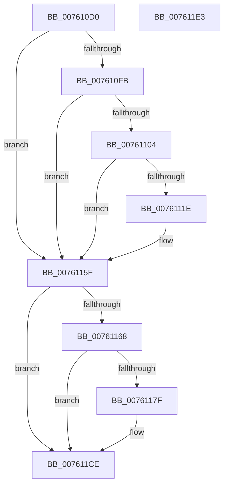

# PopDiagTraceDirectedDripsInitialization

- RVA: `0x007610D0`–`0x007611E4` (길이 `276` bytes)
- VA: `0x00000001407610D0`
- 실행 섹션: `PAGE`
- PDB 이름 있음: `예`; PDB Function 태그: `아니요`
- unwind 정보 RVA: `0x000CCB70`
- 디코드: `60`개 명령, `276/276` bytes 표시
- 미해석 바이트: `0` (있으면 어셈블리에 `.byte`로 보존)

> 이 문서는 커널 이미지의 기계어와 PDB 기호를 분석해 생성했습니다. 4번과 5번은 함수 원형과 자료형을 바이너리 사용 방식에서 추정한 C 해석이며 원본 소스 복구 결과는 아닙니다.

## 1. Dependencies

- 직접 호출 지점: **5**; 고유 호출 대상: **5**
- 직접 호출자로 확인된 함수: **1**
- RIP 상대 이미지 참조: **8**

### Outgoing calls
- `0x00761115` → [tlgKeywordOn](../../text/42/tlgKeywordOn_function_0042EAA0.md) (function, `0x0042EAA0`)
- `0x0076115A` → [tlgWriteTransfer_EtwWriteTransfer](../../text/42/tlgWriteTransfer_EtwWriteTransfer_function_004260E0.md) (function, `0x004260E0`)
- `0x00761176` → [EtwEventEnabled](../../text/39/EtwEventEnabled_function_00392450.md) (function, `0x00392450`)
- `0x007611C9` → [EtwWrite](../../text/41/EtwWrite_function_0041C720.md) (function, `0x0041C720`)
- `0x007611D5` → [_security_check_cookie](../../text/6A/_security_check_cookie_function_006AC640.md) (function, `0x006AC640`)

### Direct callers
- [PopDirectedDripsInitializePhase3](../../init/C3/PopDirectedDripsInitializePhase3_function_00C3E594.md) at `0x00C3E696`

### Static image references
- `0x007610E1` → RVA `0x00E0A740` (`.data`; read)
- `0x007610EF` → RVA `0x00E6786C` (`.data`; read)
- `0x007610FB` → RVA `0x00E07748` (`.data`; read)
- `0x0076112A` → RVA `0x0004986C` (`.rdata`; read)
- `0x0076115F` → RVA `0x00E67858` (`.data`; read)
- `0x00761168` → RVA `0x00F0B408` (`.data`; read)
- `0x0076116F` → RVA `0x00021618` (`.rdata`; read)
- `0x0076118B` → RVA `0x000211D8` (`.rdata`; read)

## 2. Other-region calls and transfers

- 다른 실행 섹션으로 향하는 call: **5**
  - `0x00761115` → [tlgKeywordOn](../../text/42/tlgKeywordOn_function_0042EAA0.md) (`PAGE` → `.text`)
  - `0x0076115A` → [tlgWriteTransfer_EtwWriteTransfer](../../text/42/tlgWriteTransfer_EtwWriteTransfer_function_004260E0.md) (`PAGE` → `.text`)
  - `0x00761176` → [EtwEventEnabled](../../text/39/EtwEventEnabled_function_00392450.md) (`PAGE` → `.text`)
  - `0x007611C9` → [EtwWrite](../../text/41/EtwWrite_function_0041C720.md) (`PAGE` → `.text`)
  - `0x007611D5` → [_security_check_cookie](../../text/6A/_security_check_cookie_function_006AC640.md) (`PAGE` → `.text`)
- 별도 외부 분기/꼬리 이동을 확인하지 못했습니다.

## 3. Assembly (complete function range)

```asm
007610D0  89 4C 24 08                     mov dword ptr [rsp + 8], ecx
007610D4  55                              push rbp
007610D5  48 8D 6C 24 A9                  lea rbp, [rsp - 0x57]
007610DA  48 81 EC 90 00 00 00            sub rsp, 0x90
007610E1  48 8B 05 58 96 6A 00            mov rax, qword ptr [rip + 0x6a9658]
007610E8  48 33 C4                        xor rax, rsp
007610EB  48 89 45 4F                     mov qword ptr [rbp + 0x4f], rax
007610EF  80 3D 76 67 70 00 00            cmp byte ptr [rip + 0x706776], 0
007610F6  44 8B C1                        mov r8d, ecx
007610F9  74 64                           je 0x14076115f
007610FB  83 3D 46 66 6A 00 05            cmp dword ptr [rip + 0x6a6646], 5
00761102  76 5B                           jbe 0x14076115f
00761104  48 BA 00 00 00 00 00 40 00 00   movabs rdx, 0x400000000000
0076110E  48 8D 0D 33 66 6A 00            lea rcx, [rip + 0x6a6633]
00761115  E8 86 D9 CC FF                  call 0x14042eaa0
0076111A  84 C0                           test al, al
0076111C  74 41                           je 0x14076115f
0076111E  83 65 4B 00                     and dword ptr [rbp + 0x4b], 0
00761122  48 8D 45 F7                     lea rax, [rbp - 9]
00761126  48 89 45 3F                     mov qword ptr [rbp + 0x3f], rax
0076112A  48 8D 15 3B 87 8E FF            lea rdx, [rip - 0x7178c5]
00761131  48 8D 45 1F                     lea rax, [rbp + 0x1f]
00761135  44 89 45 F7                     mov dword ptr [rbp - 9], r8d
00761139  48 89 44 24 28                  mov qword ptr [rsp + 0x28], rax
0076113E  48 8D 0D 03 66 6A 00            lea rcx, [rip + 0x6a6603]
00761145  45 33 C9                        xor r9d, r9d
00761148  C7 44 24 20 03 00 00 00         mov dword ptr [rsp + 0x20], 3
00761150  45 33 C0                        xor r8d, r8d
00761153  C7 45 47 04 00 00 00            mov dword ptr [rbp + 0x47], 4
0076115A  E8 81 4F CC FF                  call 0x1404260e0
0076115F  80 3D F2 66 70 00 00            cmp byte ptr [rip + 0x7066f2], 0
00761166  74 66                           je 0x1407611ce
00761168  48 8B 0D 99 A2 7A 00            mov rcx, qword ptr [rip + 0x7aa299]
0076116F  48 8D 15 A2 04 8C FF            lea rdx, [rip - 0x73fb5e]
00761176  E8 D5 12 C3 FF                  call 0x140392450
0076117B  84 C0                           test al, al
0076117D  74 4F                           je 0x1407611ce
0076117F  83 65 FB 00                     and dword ptr [rbp - 5], 0
00761183  48 8D 45 FB                     lea rax, [rbp - 5]
00761187  83 65 0B 00                     and dword ptr [rbp + 0xb], 0
0076118B  48 8D 15 46 00 8C FF            lea rdx, [rip - 0x73ffba]
00761192  83 65 1B 00                     and dword ptr [rbp + 0x1b], 0
00761196  41 B9 02 00 00 00               mov r9d, 2
0076119C  48 8B 0D 65 A2 7A 00            mov rcx, qword ptr [rip + 0x7aa265]
007611A3  45 33 C0                        xor r8d, r8d
007611A6  48 89 45 FF                     mov qword ptr [rbp - 1], rax
007611AA  48 8D 45 67                     lea rax, [rbp + 0x67]
007611AE  48 89 45 0F                     mov qword ptr [rbp + 0xf], rax
007611B2  48 8D 45 FF                     lea rax, [rbp - 1]
007611B6  48 89 44 24 20                  mov qword ptr [rsp + 0x20], rax
007611BB  C7 45 07 04 00 00 00            mov dword ptr [rbp + 7], 4
007611C2  C7 45 17 04 00 00 00            mov dword ptr [rbp + 0x17], 4
007611C9  E8 52 B5 CB FF                  call 0x14041c720
007611CE  48 8B 4D 4F                     mov rcx, qword ptr [rbp + 0x4f]
007611D2  48 33 CC                        xor rcx, rsp
007611D5  E8 66 B4 F4 FF                  call 0x1406ac640
007611DA  48 81 C4 90 00 00 00            add rsp, 0x90
007611E1  5D                              pop rbp
007611E2  C3                              ret
007611E3  CC                              int3
```

## 4. C-style interpretation (structured pseudocode)

```c
__int64 __fastcall PopDiagTraceDirectedDripsInitialization(int a1, __int64 a2, __int64 a3, int a4)
{
    __int64 result;
    __int64 v_rsp;
    unsigned __int64 v_stack_m10;
    unsigned int v_stack_m14;
    unsigned int v_stack_m18;
    unsigned __int64 v_stack_m20;
    unsigned __int64 v_stack_m40;
    unsigned int v_stack_m44;
    unsigned int v_stack_m48;
    unsigned __int64 v_stack_m50;
    unsigned int v_stack_m54;
    unsigned int v_stack_m58;
    unsigned __int64 v_stack_m5F;
    unsigned __int64 v_stack_m60;
    unsigned int v_stack_m64;
    unsigned __int64 v_stack_m68;
    unsigned __int64 v_stack_m70;
    unsigned int v_stack_m78;
    unsigned int v_stack_p8;

    v_stack_p8 = a1;
    v_rsp = (v_rsp) - (144);
    result = (*(unsigned __int64 *)(v_rip + 6985304)) ^ (v_rsp);
    v_stack_m10 = result;
    if ((*(unsigned __int8 *)(v_rip + 7366518)) == 0) goto loc_0076115F;
    if ((*(unsigned int *)(v_rip + 6972998)) <= 5) goto loc_0076115F;
    result = tlgKeywordOn(v_rip + 6972979, a2, (unsigned int)(a1), a4);
    if ((unsigned __int8)(result) != 0) {
        result = v_stack_m68;
        v_stack_m20 = result;
        a2 = v_rip - 7436485;
        result = v_stack_m40;
        v_stack_m68 = (unsigned int)((unsigned int)(a1));
        v_stack_m70 = result;
        a1 = v_rip + 6972931;
        a4 = 0;
        v_stack_m78 = 3;
        a3 = 0;
        v_stack_m18 = 4;
        result = tlgWriteTransfer_EtwWriteTransfer(a1, a2, a3, a4);
    }
    if ((*(unsigned __int8 *)(v_rip + 7366386)) == 0) goto loc_007611CE;
    result = EtwEventEnabled(*(unsigned __int64 *)(v_rip + 8037017), v_rip - 7600990, a3, a4);
    if ((unsigned __int8)(result) != 0) {
        result = v_stack_m64;
        a2 = v_rip - 7602106;
        a4 = 2;
        a1 = *(unsigned __int64 *)(v_rip + 8036965);
        a3 = 0;
        v_stack_m60 = result;
        result = v_stack_p8;
        v_stack_m50 = result;
        result = v_stack_m60;
        v_stack_m78 = result;
        v_stack_m58 = 4;
        v_stack_m48 = 4;
        result = EtwWrite(a1, a2, a3, a4);
    }
    a1 = (v_stack_m10) ^ (v_rsp);
    result = _security_check_cookie(a1, a2, a3, a4);
    v_rsp = (v_rsp) + (144);
    return result;
}
```

## 5. (Beta) C Style

```c
int64_t PopDiagTraceDirectedDripsInitialization(int32_t Arg1, int64_t Arg2, int64_t Arg3, int32_t Arg4)
{
    int64_t result;
    int64_t local_rsp;
    uint64_t v_stack_m10;
    uint32_t v_stack_m14;
    uint32_t v_stack_m18;
    uint64_t v_stack_m20;
    uint64_t v_stack_m40;
    uint32_t v_stack_m44;
    uint32_t v_stack_m48;
    uint64_t v_stack_m50;
    uint32_t v_stack_m54;
    uint32_t v_stack_m58;
    uint64_t v_stack_m5F;
    uint64_t v_stack_m60;
    uint32_t v_stack_m64;
    uint64_t v_stack_m68;
    uint64_t v_stack_m70;
    uint32_t v_stack_m78;
    uint32_t v_stack_p8;

    v_stack_p8 = Arg1;
    local_rsp = (local_rsp) - (144);
    result = (*(uint64_t *)(v_rip + 0x6A9658)) ^ (local_rsp);
    v_stack_m10 = result;
    if ((*(uint8_t *)(v_rip + 0x706776)) == 0) goto loc_0076115F;
    if ((*(uint32_t *)(v_rip + 0x6A6646)) <= 5) goto loc_0076115F;
    result = tlgKeywordOn(v_rip + 6972979, Arg2, (uint32_t)(Arg1), Arg4);
    if ((uint8_t)(result) != 0) {
        result = v_stack_m68;
        v_stack_m20 = result;
        Arg2 = v_rip - 7436485;
        result = v_stack_m40;
        v_stack_m68 = (uint32_t)((uint32_t)(Arg1));
        v_stack_m70 = result;
        Arg1 = v_rip + 6972931;
        Arg4 = 0;
        v_stack_m78 = 3;
        Arg3 = 0;
        v_stack_m18 = 4;
        result = tlgWriteTransfer_EtwWriteTransfer(Arg1, Arg2, Arg3, Arg4);
    }
    if ((*(uint8_t *)(v_rip + 0x7066F2)) == 0) goto loc_007611CE;
    result = EtwEventEnabled(*(uint64_t *)(v_rip + 0x7AA299), v_rip - 7600990, Arg3, Arg4);
    if ((uint8_t)(result) != 0) {
        result = v_stack_m64;
        Arg2 = v_rip - 7602106;
        Arg4 = 2;
        Arg1 = *(uint64_t *)(v_rip + 0x7AA265);
        Arg3 = 0;
        v_stack_m60 = result;
        result = v_stack_p8;
        v_stack_m50 = result;
        result = v_stack_m60;
        v_stack_m78 = result;
        v_stack_m58 = 4;
        v_stack_m48 = 4;
        result = EtwWrite(Arg1, Arg2, Arg3, Arg4);
    }
    Arg1 = (v_stack_m10) ^ (local_rsp);
    result = _security_check_cookie(Arg1, Arg2, Arg3, Arg4);
    local_rsp = (local_rsp) + (144);
    return result;
}
```

## 6. Execution-region graph

[열기: 2D/3D 그래프와 함수 탐색 컨트롤 패널](../../../control-panel.html?section=page&rva=0x007610D0&view=graph)

- 2D 그래프는 위에서 아래로 흐르고, 3D 그래프는 빈 공간을 드래그해 회전합니다. Shift+드래그는 이동, 휠은 확대·축소, 함수 노드 선택은 대상 보고서 이동입니다.

### Static fallback


