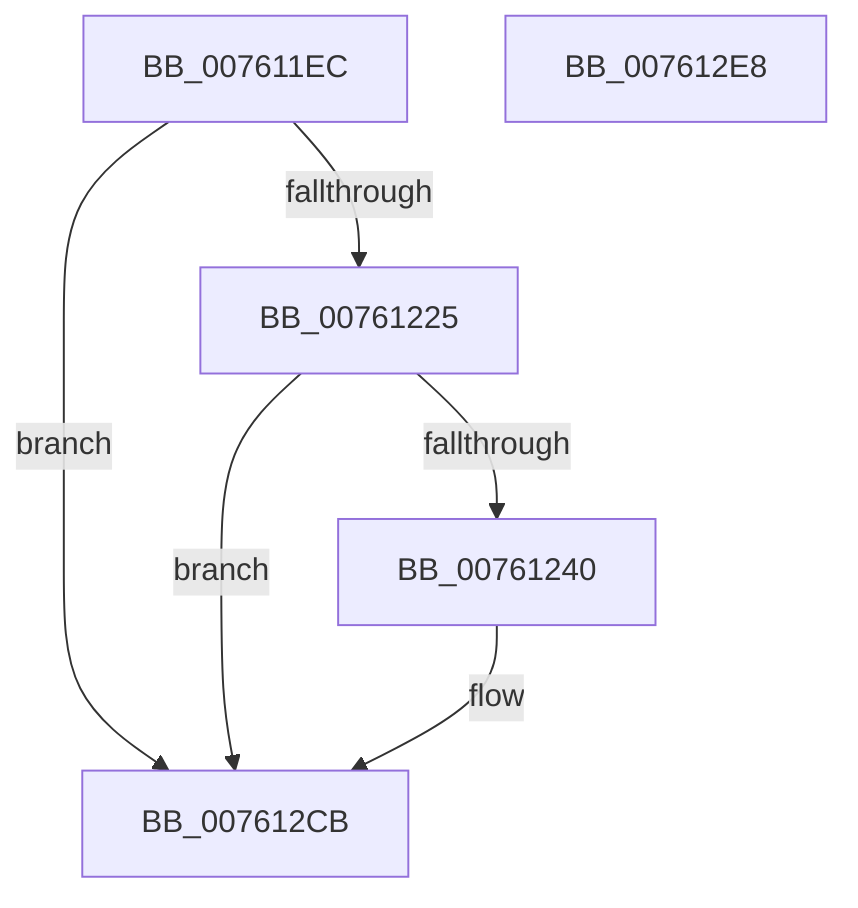

# PopDiagTraceDirectedDripsNotifyAppsAndServices

- RVA: `0x007611EC`–`0x007612E9` (길이 `253` bytes)
- VA: `0x00000001407611EC`
- 실행 섹션: `PAGE`
- PDB 이름 있음: `예`; PDB Function 태그: `아니요`
- unwind 정보 RVA: `0x000CCB88`
- 디코드: `57`개 명령, `253/253` bytes 표시
- 미해석 바이트: `0` (있으면 어셈블리에 `.byte`로 보존)

> 이 문서는 커널 이미지의 기계어와 PDB 기호를 분석해 생성했습니다. 4번과 5번은 함수 원형과 자료형을 바이너리 사용 방식에서 추정한 C 해석이며 원본 소스 복구 결과는 아닙니다.

## 1. Dependencies

- 직접 호출 지점: **3**; 고유 호출 대상: **3**
- 직접 호출자로 확인된 함수: **1**
- RIP 상대 이미지 참조: **5**

### Outgoing calls
- `0x00761233` → [EtwEventEnabled](../../text/39/EtwEventEnabled_function_00392450.md) (function, `0x00392450`)
- `0x007612C6` → [EtwWrite](../../text/41/EtwWrite_function_0041C720.md) (function, `0x0041C720`)
- `0x007612D2` → [_security_check_cookie](../../text/6A/_security_check_cookie_function_006AC640.md) (function, `0x006AC640`)

### Direct callers
- [PopDirectedDripsNotifyAppsAndServices](../75/PopDirectedDripsNotifyAppsAndServices_function_0075792C.md) at `0x00757A13`

### Static image references
- `0x00761203` → RVA `0x00E0A740` (`.data`; read)
- `0x00761215` → RVA `0x00E67858` (`.data`; read)
- `0x00761225` → RVA `0x00F0B408` (`.data`; read)
- `0x0076122C` → RVA `0x000216A8` (`.rdata`; read)
- `0x00761240` → RVA `0x00F0B410` (`.data`; read)

## 2. Other-region calls and transfers

- 다른 실행 섹션으로 향하는 call: **3**
  - `0x00761233` → [EtwEventEnabled](../../text/39/EtwEventEnabled_function_00392450.md) (`PAGE` → `.text`)
  - `0x007612C6` → [EtwWrite](../../text/41/EtwWrite_function_0041C720.md) (`PAGE` → `.text`)
  - `0x007612D2` → [_security_check_cookie](../../text/6A/_security_check_cookie_function_006AC640.md) (`PAGE` → `.text`)
- 별도 외부 분기/꼬리 이동을 확인하지 못했습니다.

## 3. Assembly (complete function range)

```asm
007611EC  48 89 5C 24 08                  mov qword ptr [rsp + 8], rbx
007611F1  4C 89 44 24 18                  mov qword ptr [rsp + 0x18], r8
007611F6  55                              push rbp
007611F7  48 8D 6C 24 A9                  lea rbp, [rsp - 0x57]
007611FC  48 81 EC A0 00 00 00            sub rsp, 0xa0
00761203  48 8B 05 36 95 6A 00            mov rax, qword ptr [rip + 0x6a9536]
0076120A  48 33 C4                        xor rax, rsp
0076120D  48 89 45 47                     mov qword ptr [rbp + 0x47], rax
00761211  83 65 EF 00                     and dword ptr [rbp - 0x11], 0
00761215  80 3D 3C 66 70 00 00            cmp byte ptr [rip + 0x70663c], 0
0076121C  0F B6 D9                        movzx ebx, cl
0076121F  0F 84 A6 00 00 00               je 0x1407612cb
00761225  48 8B 0D DC A1 7A 00            mov rcx, qword ptr [rip + 0x7aa1dc]
0076122C  48 8D 15 75 04 8C FF            lea rdx, [rip - 0x73fb8b]
00761233  E8 18 12 C3 FF                  call 0x140392450
00761238  84 C0                           test al, al
0076123A  0F 84 8B 00 00 00               je 0x1407612cb
00761240  8A 05 CA A1 7A 00               mov al, byte ptr [rip + 0x7aa1ca]
00761246  48 8D 15 5B 04 8C FF            lea rdx, [rip - 0x73fba5]
0076124D  83 65 03 00                     and dword ptr [rbp + 3], 0
00761251  B9 04 00 00 00                  mov ecx, 4
00761256  83 65 13 00                     and dword ptr [rbp + 0x13], 0
0076125A  45 33 C0                        xor r8d, r8d
0076125D  83 65 23 00                     and dword ptr [rbp + 0x23], 0
00761261  83 65 33 00                     and dword ptr [rbp + 0x33], 0
00761265  83 65 43 00                     and dword ptr [rbp + 0x43], 0
00761269  88 45 E7                        mov byte ptr [rbp - 0x19], al
0076126C  48 8D 45 E7                     lea rax, [rbp - 0x19]
00761270  48 89 45 F7                     mov qword ptr [rbp - 9], rax
00761274  48 8D 45 EB                     lea rax, [rbp - 0x15]
00761278  48 89 45 07                     mov qword ptr [rbp + 7], rax
0076127C  48 8D 45 EF                     lea rax, [rbp - 0x11]
00761280  48 89 45 17                     mov qword ptr [rbp + 0x17], rax
00761284  48 8D 45 77                     lea rax, [rbp + 0x77]
00761288  89 4D 0F                        mov dword ptr [rbp + 0xf], ecx
0076128B  89 4D 1F                        mov dword ptr [rbp + 0x1f], ecx
0076128E  B9 08 00 00 00                  mov ecx, 8
00761293  48 89 45 27                     mov qword ptr [rbp + 0x27], rax
00761297  48 8D 05 72 A1 7A 00            lea rax, [rip + 0x7aa172]
0076129E  48 89 45 37                     mov qword ptr [rbp + 0x37], rax
007612A2  48 8D 45 F7                     lea rax, [rbp - 9]
007612A6  89 4D 2F                        mov dword ptr [rbp + 0x2f], ecx
007612A9  89 4D 3F                        mov dword ptr [rbp + 0x3f], ecx
007612AC  44 8D 49 FD                     lea r9d, [rcx - 3]
007612B0  48 8B 0D 51 A1 7A 00            mov rcx, qword ptr [rip + 0x7aa151]
007612B7  48 89 44 24 20                  mov qword ptr [rsp + 0x20], rax
007612BC  89 5D EB                        mov dword ptr [rbp - 0x15], ebx
007612BF  C7 45 FF 01 00 00 00            mov dword ptr [rbp - 1], 1
007612C6  E8 55 B4 CB FF                  call 0x14041c720
007612CB  48 8B 4D 47                     mov rcx, qword ptr [rbp + 0x47]
007612CF  48 33 CC                        xor rcx, rsp
007612D2  E8 69 B3 F4 FF                  call 0x1406ac640
007612D7  48 8B 9C 24 B0 00 00 00         mov rbx, qword ptr [rsp + 0xb0]
007612DF  48 81 C4 A0 00 00 00            add rsp, 0xa0
007612E6  5D                              pop rbp
007612E7  C3                              ret
007612E8  CC                              int3
```

## 4. C-style interpretation (structured pseudocode)

```c
__int64 __fastcall PopDiagTraceDirectedDripsNotifyAppsAndServices(unsigned __int8 a1, __int64 a2, __int64 a3)
{
    __int64 result;
    __int64 v_rsp;
    unsigned __int64 v_stack_m18;
    unsigned int v_stack_m1C;
    unsigned int v_stack_m20;
    unsigned __int64 v_stack_m28;
    unsigned int v_stack_m2C;
    unsigned int v_stack_m30;
    unsigned __int64 v_stack_m38;
    unsigned int v_stack_m3C;
    unsigned int v_stack_m40;
    unsigned __int64 v_stack_m48;
    unsigned int v_stack_m4C;
    unsigned int v_stack_m50;
    unsigned __int64 v_stack_m58;
    unsigned int v_stack_m5C;
    unsigned __int64 v_stack_m5F;
    unsigned int v_stack_m60;
    unsigned __int64 v_stack_m68;
    unsigned int v_stack_m70;
    unsigned __int64 v_stack_m74;
    unsigned __int8 v_stack_m78;
    unsigned __int64 v_stack_m88;
    unsigned __int64 v_stack_p18;
    unsigned __int64 v_stack_p8;

    v_stack_p8 = v_rbx;
    v_stack_p18 = a3;
    v_rsp = (v_rsp) - (160);
    result = (*(unsigned __int64 *)(v_rip + 6985014)) ^ (v_rsp);
    v_stack_m18 = result;
    if ((*(unsigned __int8 *)(v_rip + 7366204)) == 0) goto loc_007612CB;
    result = EtwEventEnabled(*(unsigned __int64 *)(v_rip + 8036828), v_rip - 7601035, a3, a4);
    if ((unsigned __int8)(result) != 0) {
        result = *(unsigned __int8 *)(v_rip + 8036810);
        a2 = v_rip - 7601061;
        a1 = 4;
        a3 = 0;
        v_stack_m78 = (unsigned __int8)(result);
        result = v_stack_m78;
        v_stack_m68 = result;
        result = v_stack_m74;
        v_stack_m58 = result;
        result = v_stack_m70;
        v_stack_m48 = result;
        result = v_stack_p18;
        v_stack_m50 = a1;
        v_stack_m40 = a1;
        a1 = 8;
        v_stack_m38 = result;
        result = v_rip + 8036722;
        v_stack_m28 = result;
        result = v_stack_m68;
        v_stack_m30 = a1;
        v_stack_m20 = a1;
        a4 = a1 - 3;
        a1 = *(unsigned __int64 *)(v_rip + 8036689);
        v_stack_m88 = result;
        v_stack_m74 = a1;
        v_stack_m60 = 1;
        result = EtwWrite(a1, a2, a3, a4);
    }
    a1 = (v_stack_m18) ^ (v_rsp);
    result = _security_check_cookie(a1, a2, a3, a4);
    v_rsp = (v_rsp) + (160);
    return result;
}
```

## 5. (Beta) C Style

```c
int64_t PopDiagTraceDirectedDripsNotifyAppsAndServices(uint8_t Arg1, int64_t Arg2, int64_t Arg3)
{
    int64_t result;
    int64_t local_rsp;
    uint64_t v_stack_m18;
    uint32_t v_stack_m1C;
    uint32_t v_stack_m20;
    uint64_t v_stack_m28;
    uint32_t v_stack_m2C;
    uint32_t v_stack_m30;
    uint64_t v_stack_m38;
    uint32_t v_stack_m3C;
    uint32_t v_stack_m40;
    uint64_t v_stack_m48;
    uint32_t v_stack_m4C;
    uint32_t v_stack_m50;
    uint64_t v_stack_m58;
    uint32_t v_stack_m5C;
    uint64_t v_stack_m5F;
    uint32_t v_stack_m60;
    uint64_t v_stack_m68;
    uint32_t v_stack_m70;
    uint64_t v_stack_m74;
    uint8_t v_stack_m78;
    uint64_t v_stack_m88;
    uint64_t v_stack_p18;
    uint64_t v_stack_p8;

    v_stack_p8 = local_rbx;
    v_stack_p18 = Arg3;
    local_rsp = (local_rsp) - (160);
    result = (*(uint64_t *)(v_rip + 0x6A9536)) ^ (local_rsp);
    v_stack_m18 = result;
    if ((*(uint8_t *)(v_rip + 0x70663C)) == 0) goto loc_007612CB;
    result = EtwEventEnabled(*(uint64_t *)(v_rip + 0x7AA1DC), v_rip - 7601035, Arg3, a4);
    if ((uint8_t)(result) != 0) {
        result = *(uint8_t *)(v_rip + 0x7AA1CA);
        Arg2 = v_rip - 7601061;
        Arg1 = 4;
        Arg3 = 0;
        v_stack_m78 = (uint8_t)(result);
        result = v_stack_m78;
        v_stack_m68 = result;
        result = v_stack_m74;
        v_stack_m58 = result;
        result = v_stack_m70;
        v_stack_m48 = result;
        result = v_stack_p18;
        v_stack_m50 = Arg1;
        v_stack_m40 = Arg1;
        Arg1 = 8;
        v_stack_m38 = result;
        result = v_rip + 8036722;
        v_stack_m28 = result;
        result = v_stack_m68;
        v_stack_m30 = Arg1;
        v_stack_m20 = Arg1;
        a4 = Arg1 - 3;
        Arg1 = *(uint64_t *)(v_rip + 0x7AA151);
        v_stack_m88 = result;
        v_stack_m74 = Arg1;
        v_stack_m60 = 1;
        result = EtwWrite(Arg1, Arg2, Arg3, a4);
    }
    Arg1 = (v_stack_m18) ^ (local_rsp);
    result = _security_check_cookie(Arg1, Arg2, Arg3, a4);
    local_rsp = (local_rsp) + (160);
    return result;
}
```

## 6. Execution-region graph

[열기: 2D/3D 그래프와 함수 탐색 컨트롤 패널](../../../control-panel.html?section=page&rva=0x007611EC&view=graph)

- 2D 그래프는 위에서 아래로 흐르고, 3D 그래프는 빈 공간을 드래그해 회전합니다. Shift+드래그는 이동, 휠은 확대·축소, 함수 노드 선택은 대상 보고서 이동입니다.

### Static fallback


