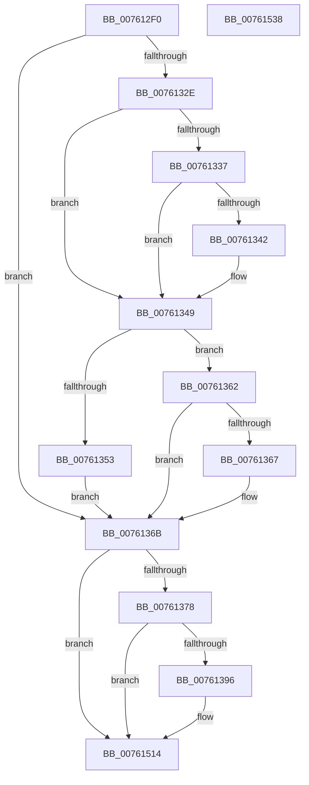

# PopDiagTraceDozeDeferralDecision

- RVA: `0x007612F0`–`0x00761539` (길이 `585` bytes)
- VA: `0x00000001407612F0`
- 실행 섹션: `PAGE`
- PDB 이름 있음: `예`; PDB Function 태그: `아니요`
- unwind 정보 RVA: `0x000CC95C`
- 디코드: `133`개 명령, `585/585` bytes 표시
- 미해석 바이트: `0` (있으면 어셈블리에 `.byte`로 보존)

> 이 문서는 커널 이미지의 기계어와 PDB 기호를 분석해 생성했습니다. 4번과 5번은 함수 원형과 자료형을 바이너리 사용 방식에서 추정한 C 해석이며 원본 소스 복구 결과는 아닙니다.

## 1. Dependencies

- 직접 호출 지점: **5**; 고유 호출 대상: **4**
- 직접 호출자로 확인된 함수: **1**
- RIP 상대 이미지 참조: **10**

### Outgoing calls
- `0x00761389` → [tlgKeywordOn](../../text/42/tlgKeywordOn_function_0042EAA0.md) (function, `0x0042EAA0`)
- `0x00761432` → [tlgCreate1Sz_wchar_t](../../text/42/tlgCreate1Sz_wchar_t_function_00426198.md) (function, `0x00426198`)
- `0x0076143E` → [tlgCreate1Sz_wchar_t](../../text/42/tlgCreate1Sz_wchar_t_function_00426198.md) (function, `0x00426198`)
- `0x0076150F` → [tlgWriteTransfer_EtwWriteTransfer](../../text/42/tlgWriteTransfer_EtwWriteTransfer_function_004260E0.md) (function, `0x004260E0`)
- `0x0076151B` → [_security_check_cookie](../../text/6A/_security_check_cookie_function_006AC640.md) (function, `0x006AC640`)

### Direct callers
- [PopDeferDoze](../75/PopDeferDoze_function_0075FF88.md) at `0x007600E6`

### Static image references
- `0x0076130A` → RVA `0x00E0A740` (`.data`; read)
- `0x0076136B` → RVA `0x00E07748` (`.data`; read)
- `0x007613BB` → RVA `0x00F0BE10` (`.data`; read)
- `0x007613EE` → RVA `0x00FC50FC` (`ALMOSTRO`; read)
- `0x00761452` → RVA `0x00049FDC` (`.rdata`; read)
- `0x0076147D` → RVA `0x00E67398` (`.data`; read)
- `0x00761490` → RVA `0x00F0CED4` (`.data`; read)
- `0x007614A4` → RVA `0x00F0CED3` (`.data`; read)
- `0x007614B7` → RVA `0x00F0CEF8` (`.data`; read)
- `0x007614CA` → RVA `0x00F0CF00` (`.data`; read)

## 2. Other-region calls and transfers

- 다른 실행 섹션으로 향하는 call: **5**
  - `0x00761389` → [tlgKeywordOn](../../text/42/tlgKeywordOn_function_0042EAA0.md) (`PAGE` → `.text`)
  - `0x00761432` → [tlgCreate1Sz_wchar_t](../../text/42/tlgCreate1Sz_wchar_t_function_00426198.md) (`PAGE` → `.text`)
  - `0x0076143E` → [tlgCreate1Sz_wchar_t](../../text/42/tlgCreate1Sz_wchar_t_function_00426198.md) (`PAGE` → `.text`)
  - `0x0076150F` → [tlgWriteTransfer_EtwWriteTransfer](../../text/42/tlgWriteTransfer_EtwWriteTransfer_function_004260E0.md) (`PAGE` → `.text`)
  - `0x0076151B` → [_security_check_cookie](../../text/6A/_security_check_cookie_function_006AC640.md) (`PAGE` → `.text`)
- 별도 외부 분기/꼬리 이동을 확인하지 못했습니다.

## 3. Assembly (complete function range)

```asm
007612F0  48 89 5C 24 08                  mov qword ptr [rsp + 8], rbx
007612F5  48 89 74 24 10                  mov qword ptr [rsp + 0x10], rsi
007612FA  55                              push rbp
007612FB  57                              push rdi
007612FC  41 56                           push r14
007612FE  48 8D 6C 24 80                  lea rbp, [rsp - 0x80]
00761303  48 81 EC 80 01 00 00            sub rsp, 0x180
0076130A  48 8B 05 2F 94 6A 00            mov rax, qword ptr [rip + 0x6a942f]
00761311  48 33 C4                        xor rax, rsp
00761314  48 89 45 70                     mov qword ptr [rbp + 0x70], rax
00761318  33 F6                           xor esi, esi
0076131A  0F B6 F9                        movzx edi, cl
0076131D  8B DA                           mov ebx, edx
0076131F  44 8B DE                        mov r11d, esi
00761322  44 8B D6                        mov r10d, esi
00761325  44 8D 76 01                     lea r14d, [rsi + 1]
00761329  4D 85 C0                        test r8, r8
0076132C  74 3D                           je 0x14076136b
0076132E  49 8B 40 20                     mov rax, qword ptr [r8 + 0x20]
00761332  48 85 C0                        test rax, rax
00761335  74 12                           je 0x140761349
00761337  4A 8D 0C 00                     lea rcx, [rax + r8]
0076133B  8B 01                           mov eax, dword ptr [rcx]
0076133D  41 84 C6                        test r14b, al
00761340  74 07                           je 0x140761349
00761342  4C 8B 59 08                     mov r11, qword ptr [rcx + 8]
00761346  4C 03 D9                        add r11, rcx
00761349  49 8B 48 10                     mov rcx, qword ptr [r8 + 0x10]
0076134D  41 39 70 08                     cmp dword ptr [r8 + 8], esi
00761351  75 0F                           jne 0x140761362
00761353  49 8D 04 08                     lea rax, [r8 + rcx]
00761357  48 F7 D9                        neg rcx
0076135A  4D 1B D2                        sbb r10, r10
0076135D  4C 23 D0                        and r10, rax
00761360  EB 09                           jmp 0x14076136b
00761362  48 85 C9                        test rcx, rcx
00761365  74 04                           je 0x14076136b
00761367  4D 8D 14 08                     lea r10, [r8 + rcx]
0076136B  83 3D D6 63 6A 00 05            cmp dword ptr [rip + 0x6a63d6], 5
00761372  0F 86 9C 01 00 00               jbe 0x140761514
00761378  48 BA 00 00 00 00 00 40 00 00   movabs rdx, 0x400000000000
00761382  48 8D 0D BF 63 6A 00            lea rcx, [rip + 0x6a63bf]
00761389  E8 12 D7 CC FF                  call 0x14042eaa0
0076138E  84 C0                           test al, al
00761390  0F 84 7E 01 00 00               je 0x140761514
00761396  48 8D 44 24 38                  lea rax, [rsp + 0x38]
0076139B  89 7C 24 38                     mov dword ptr [rsp + 0x38], edi
0076139F  48 89 45 80                     mov qword ptr [rbp - 0x80], rax
007613A3  48 8D 4D E0                     lea rcx, [rbp - 0x20]
007613A7  48 8D 44 24 3C                  lea rax, [rsp + 0x3c]
007613AC  48 C7 45 88 04 00 00 00         mov qword ptr [rbp - 0x78], 4
007613B4  48 89 45 90                     mov qword ptr [rbp - 0x70], rax
007613B8  49 8B D2                        mov rdx, r10
007613BB  48 8B 05 4E AA 7A 00            mov rax, qword ptr [rip + 0x7aaa4e]
007613C2  48 89 44 24 48                  mov qword ptr [rsp + 0x48], rax
007613C7  48 8D 44 24 48                  lea rax, [rsp + 0x48]
007613CC  48 89 45 A0                     mov qword ptr [rbp - 0x60], rax
007613D0  48 8D 44 24 50                  lea rax, [rsp + 0x50]
007613D5  48 89 45 B0                     mov qword ptr [rbp - 0x50], rax
007613D9  48 8B 85 C0 00 00 00            mov rax, qword ptr [rbp + 0xc0]
007613E0  48 89 44 24 58                  mov qword ptr [rsp + 0x58], rax
007613E5  48 8D 44 24 58                  lea rax, [rsp + 0x58]
007613EA  48 89 45 C0                     mov qword ptr [rbp - 0x40], rax
007613EE  8B 05 08 3D 86 00               mov eax, dword ptr [rip + 0x863d08]
007613F4  89 44 24 40                     mov dword ptr [rsp + 0x40], eax
007613F8  48 8D 44 24 40                  lea rax, [rsp + 0x40]
007613FD  48 89 45 D0                     mov qword ptr [rbp - 0x30], rax
00761401  89 5C 24 3C                     mov dword ptr [rsp + 0x3c], ebx
00761405  48 C7 45 98 04 00 00 00         mov qword ptr [rbp - 0x68], 4
0076140D  48 C7 45 A8 08 00 00 00         mov qword ptr [rbp - 0x58], 8
00761415  4C 89 4C 24 50                  mov qword ptr [rsp + 0x50], r9
0076141A  48 C7 45 B8 08 00 00 00         mov qword ptr [rbp - 0x48], 8
00761422  48 C7 45 C8 08 00 00 00         mov qword ptr [rbp - 0x38], 8
0076142A  48 C7 45 D8 04 00 00 00         mov qword ptr [rbp - 0x28], 4
00761432  E8 61 4D CC FF                  call 0x140426198
00761437  49 8B D3                        mov rdx, r11
0076143A  48 8D 4D F0                     lea rcx, [rbp - 0x10]
0076143E  E8 55 4D CC FF                  call 0x140426198
00761443  8A 8D C8 00 00 00               mov cl, byte ptr [rbp + 0xc8]
00761449  48 8D 44 24 30                  lea rax, [rsp + 0x30]
0076144E  48 89 45 00                     mov qword ptr [rbp], rax
00761452  48 8D 15 83 8B 8E FF            lea rdx, [rip - 0x71747d]
00761459  8A 85 D0 00 00 00               mov al, byte ptr [rbp + 0xd0]
0076145F  45 33 C9                        xor r9d, r9d
00761462  88 44 24 31                     mov byte ptr [rsp + 0x31], al
00761466  45 33 C0                        xor r8d, r8d
00761469  48 8D 44 24 31                  lea rax, [rsp + 0x31]
0076146E  88 4C 24 30                     mov byte ptr [rsp + 0x30], cl
00761472  48 89 45 10                     mov qword ptr [rbp + 0x10], rax
00761476  48 8D 0D CB 62 6A 00            lea rcx, [rip + 0x6a62cb]
0076147D  8A 05 15 5F 70 00               mov al, byte ptr [rip + 0x705f15]
00761483  88 44 24 32                     mov byte ptr [rsp + 0x32], al
00761487  48 8D 44 24 32                  lea rax, [rsp + 0x32]
0076148C  48 89 45 20                     mov qword ptr [rbp + 0x20], rax
00761490  0F B6 05 3D BA 7A 00            movzx eax, byte ptr [rip + 0x7aba3d]
00761497  89 44 24 44                     mov dword ptr [rsp + 0x44], eax
0076149B  48 8D 44 24 44                  lea rax, [rsp + 0x44]
007614A0  48 89 45 30                     mov qword ptr [rbp + 0x30], rax
007614A4  8A 05 29 BA 7A 00               mov al, byte ptr [rip + 0x7aba29]
007614AA  88 44 24 33                     mov byte ptr [rsp + 0x33], al
007614AE  48 8D 44 24 33                  lea rax, [rsp + 0x33]
007614B3  48 89 45 40                     mov qword ptr [rbp + 0x40], rax
007614B7  8A 05 3B BA 7A 00               mov al, byte ptr [rip + 0x7aba3b]
007614BD  88 44 24 34                     mov byte ptr [rsp + 0x34], al
007614C1  48 8D 44 24 34                  lea rax, [rsp + 0x34]
007614C6  48 89 45 50                     mov qword ptr [rbp + 0x50], rax
007614CA  8A 05 30 BA 7A 00               mov al, byte ptr [rip + 0x7aba30]
007614D0  88 44 24 35                     mov byte ptr [rsp + 0x35], al
007614D4  48 8D 44 24 35                  lea rax, [rsp + 0x35]
007614D9  48 89 45 60                     mov qword ptr [rbp + 0x60], rax
007614DD  48 8D 44 24 60                  lea rax, [rsp + 0x60]
007614E2  48 89 44 24 28                  mov qword ptr [rsp + 0x28], rax
007614E7  C7 44 24 20 11 00 00 00         mov dword ptr [rsp + 0x20], 0x11
007614EF  4C 89 75 08                     mov qword ptr [rbp + 8], r14
007614F3  4C 89 75 18                     mov qword ptr [rbp + 0x18], r14
007614F7  4C 89 75 28                     mov qword ptr [rbp + 0x28], r14
007614FB  48 C7 45 38 04 00 00 00         mov qword ptr [rbp + 0x38], 4
00761503  4C 89 75 48                     mov qword ptr [rbp + 0x48], r14
00761507  4C 89 75 58                     mov qword ptr [rbp + 0x58], r14
0076150B  4C 89 75 68                     mov qword ptr [rbp + 0x68], r14
0076150F  E8 CC 4B CC FF                  call 0x1404260e0
00761514  48 8B 4D 70                     mov rcx, qword ptr [rbp + 0x70]
00761518  48 33 CC                        xor rcx, rsp
0076151B  E8 20 B1 F4 FF                  call 0x1406ac640
00761520  4C 8D 9C 24 80 01 00 00         lea r11, [rsp + 0x180]
00761528  49 8B 5B 20                     mov rbx, qword ptr [r11 + 0x20]
0076152C  49 8B 73 28                     mov rsi, qword ptr [r11 + 0x28]
00761530  49 8B E3                        mov rsp, r11
00761533  41 5E                           pop r14
00761535  5F                              pop rdi
00761536  5D                              pop rbp
00761537  C3                              ret
00761538  CC                              int3
```

## 4. C-style interpretation (structured pseudocode)

```c
__int64 __fastcall PopDiagTraceDozeDeferralDecision(unsigned __int8 a1, int a2, __int64 a3, __int64 a4, __int64 a5, unsigned __int8 a6, unsigned __int8 a7)
{
    __int64 result;
    __int64 v_r10;
    __int64 v_r11;
    __int64 v_rsi;
    __int64 v_rsp;
    unsigned __int64 v_stack_m100;
    unsigned __int64 v_stack_m108;
    unsigned __int64 v_stack_m110;
    unsigned __int64 v_stack_m118;
    unsigned __int64 v_stack_m138;
    unsigned __int64 v_stack_m140;
    unsigned __int64 v_stack_m148;
    unsigned __int64 v_stack_m150;
    unsigned int v_stack_m154;
    unsigned int v_stack_m158;
    unsigned __int64 v_stack_m15C;
    unsigned __int64 v_stack_m160;
    unsigned __int8 v_stack_m163;
    unsigned __int8 v_stack_m164;
    unsigned __int8 v_stack_m165;
    unsigned __int8 v_stack_m166;
    unsigned __int8 v_stack_m167;
    unsigned __int64 v_stack_m168;
    unsigned __int64 v_stack_m170;
    unsigned int v_stack_m178;
    unsigned __int64 v_stack_m18;
    unsigned __int64 v_stack_m28;
    unsigned __int64 v_stack_m30;
    unsigned __int64 v_stack_m38;
    unsigned __int64 v_stack_m40;
    unsigned __int64 v_stack_m48;
    unsigned __int64 v_stack_m50;
    unsigned __int64 v_stack_m58;
    unsigned __int64 v_stack_m60;
    unsigned __int64 v_stack_m68;
    unsigned __int64 v_stack_m70;
    unsigned __int64 v_stack_m78;
    unsigned __int64 v_stack_m80;
    unsigned __int64 v_stack_m88;
    unsigned __int64 v_stack_m90;
    unsigned __int64 v_stack_m98;
    unsigned __int64 v_stack_mA8;
    unsigned __int64 v_stack_mB8;
    unsigned __int64 v_stack_mC0;
    unsigned __int64 v_stack_mC8;
    unsigned __int64 v_stack_mD0;
    unsigned __int64 v_stack_mD8;
    unsigned __int64 v_stack_mE0;
    unsigned __int64 v_stack_mE8;
    unsigned __int64 v_stack_mF0;
    unsigned __int64 v_stack_mF8;
    unsigned __int64 v_stack_p10;
    unsigned __int64 v_stack_p8;

    v_stack_p8 = v_rbx;
    v_stack_p10 = v_rsi;
    v_rsp = (v_rsp) - (384);
    result = (*(unsigned __int64 *)(v_rip + 6984751)) ^ (v_rsp);
    v_stack_m28 = result;
    v_rsi = 0;
    if (a3 == 0) goto loc_0076136B;
    if (*(unsigned __int64 *)(a3 + 32) == 0) goto loc_00761349;
    v_r11 = 0;
    if ((((unsigned __int8)(v_rsi + 1)) & ((unsigned __int8)((unsigned int)(*(unsigned int *)(*(unsigned __int64 *)(a3 + 32) + a3 * 1))))) != 0) {
        v_r11 = *(unsigned __int64 *)(*(unsigned __int64 *)(a3 + 32) + a3 * 1 + 8);
        v_r11 = (v_r11) + (*(unsigned __int64 *)(a3 + 32) + a3 * 1);
    }
    if ((*(unsigned int *)(a3 + 8)) != 0) goto loc_00761362;
    a1 = -(*(unsigned __int64 *)(a3 + 16));
    v_r10 = (0) & (a3 + *(unsigned __int64 *)(a3 + 16) * 1);
    goto loc_0076136B;
loc_00761362:
    if (a1 != 0) {
        v_r10 = a3 + a1 * 1;
    }
    if ((*(unsigned int *)(v_rip + 6972374)) <= 5) goto loc_00761514;
    result = tlgKeywordOn(v_rip + 6972351, a2, a3, a4);
    if ((unsigned __int8)(result) != 0) {
        result = v_stack_m160;
        v_stack_m160 = a1;
        v_stack_m118 = result;
        a1 = v_stack_mB8;
        result = v_stack_m15C;
        v_stack_m110 = 4;
        v_stack_m108 = result;
        a2 = v_r10;
        result = *(unsigned __int64 *)(v_rip + 8038990);
        v_stack_m150 = result;
        result = v_stack_m150;
        v_stack_mF8 = result;
        result = v_stack_m148;
        v_stack_mE8 = result;
        result = a5;
        v_stack_m140 = result;
        result = v_stack_m140;
        v_stack_mD8 = result;
        result = *(unsigned int *)(v_rip + 8797448);
        v_stack_m158 = (unsigned int)(result);
        result = v_stack_m158;
        v_stack_mC8 = result;
        v_stack_m15C = (unsigned int)((unsigned int)(a2));
        v_stack_m100 = 4;
        v_stack_mF0 = 8;
        v_stack_m148 = a4;
        v_stack_mE0 = 8;
        v_stack_mD0 = 8;
        v_stack_mC0 = 4;
        result = tlgCreate1Sz_wchar_t(a1, a2, a3, a4);
        a2 = v_r11;
        a1 = v_stack_mA8;
        result = tlgCreate1Sz_wchar_t(a1, a2, a3, a4);
        a1 = a6;
        result = v_stack_m168;
        v_stack_m98 = result;
        a2 = v_rip - 7435389;
        result = a7;
        a4 = 0;
        v_stack_m167 = (unsigned __int8)(result);
        a3 = 0;
        result = v_stack_m167;
        v_stack_m168 = a1;
        v_stack_m88 = result;
        a1 = v_rip + 6972107;
        result = *(unsigned __int8 *)(v_rip + 7364373);
        v_stack_m166 = (unsigned __int8)(result);
        result = v_stack_m166;
        v_stack_m78 = result;
        result = *(unsigned __int8 *)(v_rip + 8043069);
        v_stack_m154 = (unsigned int)(result);
        result = v_stack_m154;
        v_stack_m68 = result;
        result = *(unsigned __int8 *)(v_rip + 8043049);
        v_stack_m165 = (unsigned __int8)(result);
        result = v_stack_m165;
        v_stack_m58 = result;
        result = *(unsigned __int8 *)(v_rip + 8043067);
        v_stack_m164 = (unsigned __int8)(result);
        result = v_stack_m164;
        v_stack_m48 = result;
        result = *(unsigned __int8 *)(v_rip + 8043056);
        v_stack_m163 = (unsigned __int8)(result);
        result = v_stack_m163;
        v_stack_m38 = result;
        result = v_stack_m138;
        v_stack_m170 = result;
        v_stack_m178 = 17;
        v_stack_m90 = v_rsi + 1;
        v_stack_m80 = v_rsi + 1;
        v_stack_m70 = v_rsi + 1;
        v_stack_m60 = 4;
        v_stack_m50 = v_rsi + 1;
        v_stack_m40 = v_rsi + 1;
        v_stack_m30 = v_rsi + 1;
        result = tlgWriteTransfer_EtwWriteTransfer(a1, a2, a3, a4);
    }
    a1 = (v_stack_m28) ^ (v_rsp);
    result = _security_check_cookie(a1, a2, a3, a4);
    return result;
}
```

## 5. (Beta) C Style

```c
int64_t PopDiagTraceDozeDeferralDecision(uint8_t Arg1, int32_t Arg2, int64_t Arg3, int64_t Arg4, int64_t Arg5, uint8_t Arg6, uint8_t Arg7)
{
    int64_t result;
    int64_t local_r10;
    int64_t local_r11;
    int64_t local_rsi;
    int64_t local_rsp;
    uint64_t v_stack_m100;
    uint64_t v_stack_m108;
    uint64_t v_stack_m110;
    uint64_t v_stack_m118;
    uint64_t v_stack_m138;
    uint64_t v_stack_m140;
    uint64_t v_stack_m148;
    uint64_t v_stack_m150;
    uint32_t v_stack_m154;
    uint32_t v_stack_m158;
    uint64_t v_stack_m15C;
    uint64_t v_stack_m160;
    uint8_t v_stack_m163;
    uint8_t v_stack_m164;
    uint8_t v_stack_m165;
    uint8_t v_stack_m166;
    uint8_t v_stack_m167;
    uint64_t v_stack_m168;
    uint64_t v_stack_m170;
    uint32_t v_stack_m178;
    uint64_t v_stack_m18;
    uint64_t v_stack_m28;
    uint64_t v_stack_m30;
    uint64_t v_stack_m38;
    uint64_t v_stack_m40;
    uint64_t v_stack_m48;
    uint64_t v_stack_m50;
    uint64_t v_stack_m58;
    uint64_t v_stack_m60;
    uint64_t v_stack_m68;
    uint64_t v_stack_m70;
    uint64_t v_stack_m78;
    uint64_t v_stack_m80;
    uint64_t v_stack_m88;
    uint64_t v_stack_m90;
    uint64_t v_stack_m98;
    uint64_t v_stack_mA8;
    uint64_t v_stack_mB8;
    uint64_t v_stack_mC0;
    uint64_t v_stack_mC8;
    uint64_t v_stack_mD0;
    uint64_t v_stack_mD8;
    uint64_t v_stack_mE0;
    uint64_t v_stack_mE8;
    uint64_t v_stack_mF0;
    uint64_t v_stack_mF8;
    uint64_t v_stack_p10;
    uint64_t v_stack_p8;

    v_stack_p8 = local_rbx;
    v_stack_p10 = local_rsi;
    local_rsp = (local_rsp) - (384);
    result = (*(uint64_t *)(v_rip + 0x6A942F)) ^ (local_rsp);
    v_stack_m28 = result;
    local_rsi = 0;
    if (Arg3 == 0) goto loc_0076136B;
    if (*(uint64_t *)(Arg3 + 0x20) == 0) goto loc_00761349;
    local_r11 = 0;
    if ((((uint8_t)(local_rsi + 1)) & ((uint8_t)((uint32_t)(*(uint32_t *)(*(uint64_t *)(Arg3 + 0x20) + Arg3 * 1))))) != 0) {
        local_r11 = *(uint64_t *)(*(uint64_t *)(Arg3 + 0x20) + Arg3 * 1 + 0x8);
        local_r11 = (local_r11) + (*(uint64_t *)(Arg3 + 0x20) + Arg3 * 1);
    }
    if ((*(uint32_t *)(Arg3 + 0x8)) != 0) goto loc_00761362;
    Arg1 = -(*(uint64_t *)(Arg3 + 0x10));
    local_r10 = (0) & (Arg3 + *(uint64_t *)(Arg3 + 0x10) * 1);
    goto loc_0076136B;
loc_00761362:
    if (Arg1 != 0) {
        local_r10 = Arg3 + Arg1 * 1;
    }
    if ((*(uint32_t *)(v_rip + 0x6A63D6)) <= 5) goto loc_00761514;
    result = tlgKeywordOn(v_rip + 6972351, Arg2, Arg3, Arg4);
    if ((uint8_t)(result) != 0) {
        result = v_stack_m160;
        v_stack_m160 = Arg1;
        v_stack_m118 = result;
        Arg1 = v_stack_mB8;
        result = v_stack_m15C;
        v_stack_m110 = 4;
        v_stack_m108 = result;
        Arg2 = local_r10;
        result = *(uint64_t *)(v_rip + 0x7AAA4E);
        v_stack_m150 = result;
        result = v_stack_m150;
        v_stack_mF8 = result;
        result = v_stack_m148;
        v_stack_mE8 = result;
        result = Arg5;
        v_stack_m140 = result;
        result = v_stack_m140;
        v_stack_mD8 = result;
        result = *(uint32_t *)(v_rip + 0x863D08);
        v_stack_m158 = (uint32_t)(result);
        result = v_stack_m158;
        v_stack_mC8 = result;
        v_stack_m15C = (uint32_t)((uint32_t)(Arg2));
        v_stack_m100 = 4;
        v_stack_mF0 = 8;
        v_stack_m148 = Arg4;
        v_stack_mE0 = 8;
        v_stack_mD0 = 8;
        v_stack_mC0 = 4;
        result = tlgCreate1Sz_wchar_t(Arg1, Arg2, Arg3, Arg4);
        Arg2 = local_r11;
        Arg1 = v_stack_mA8;
        result = tlgCreate1Sz_wchar_t(Arg1, Arg2, Arg3, Arg4);
        Arg1 = Arg6;
        result = v_stack_m168;
        v_stack_m98 = result;
        Arg2 = v_rip - 7435389;
        result = Arg7;
        Arg4 = 0;
        v_stack_m167 = (uint8_t)(result);
        Arg3 = 0;
        result = v_stack_m167;
        v_stack_m168 = Arg1;
        v_stack_m88 = result;
        Arg1 = v_rip + 6972107;
        result = *(uint8_t *)(v_rip + 0x705F15);
        v_stack_m166 = (uint8_t)(result);
        result = v_stack_m166;
        v_stack_m78 = result;
        result = *(uint8_t *)(v_rip + 0x7ABA3D);
        v_stack_m154 = (uint32_t)(result);
        result = v_stack_m154;
        v_stack_m68 = result;
        result = *(uint8_t *)(v_rip + 0x7ABA29);
        v_stack_m165 = (uint8_t)(result);
        result = v_stack_m165;
        v_stack_m58 = result;
        result = *(uint8_t *)(v_rip + 0x7ABA3B);
        v_stack_m164 = (uint8_t)(result);
        result = v_stack_m164;
        v_stack_m48 = result;
        result = *(uint8_t *)(v_rip + 0x7ABA30);
        v_stack_m163 = (uint8_t)(result);
        result = v_stack_m163;
        v_stack_m38 = result;
        result = v_stack_m138;
        v_stack_m170 = result;
        v_stack_m178 = 17;
        v_stack_m90 = local_rsi + 1;
        v_stack_m80 = local_rsi + 1;
        v_stack_m70 = local_rsi + 1;
        v_stack_m60 = 4;
        v_stack_m50 = local_rsi + 1;
        v_stack_m40 = local_rsi + 1;
        v_stack_m30 = local_rsi + 1;
        result = tlgWriteTransfer_EtwWriteTransfer(Arg1, Arg2, Arg3, Arg4);
    }
    Arg1 = (v_stack_m28) ^ (local_rsp);
    result = _security_check_cookie(Arg1, Arg2, Arg3, Arg4);
    return result;
}
```

## 6. Execution-region graph

[열기: 2D/3D 그래프와 함수 탐색 컨트롤 패널](../../../control-panel.html?section=page&rva=0x007612F0&view=graph)

- 2D 그래프는 위에서 아래로 흐르고, 3D 그래프는 빈 공간을 드래그해 회전합니다. Shift+드래그는 이동, 휠은 확대·축소, 함수 노드 선택은 대상 보고서 이동입니다.

### Static fallback


