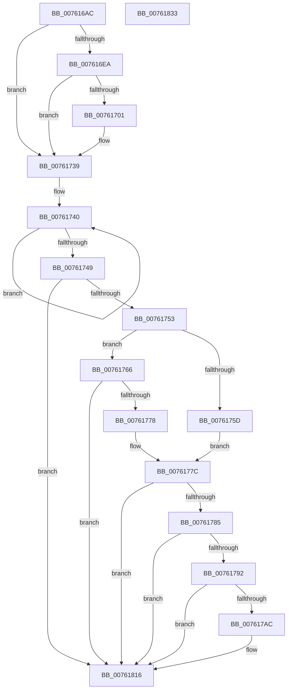

# PopDiagTraceFxDeviceUnregistration

- RVA: `0x007616AC`–`0x00761834` (길이 `392` bytes)
- VA: `0x00000001407616AC`
- 실행 섹션: `PAGE`
- PDB 이름 있음: `예`; PDB Function 태그: `아니요`
- unwind 정보 RVA: `0x000CCB38`
- 디코드: `85`개 명령, `392/392` bytes 표시
- 미해석 바이트: `0` (있으면 어셈블리에 `.byte`로 보존)

> 이 문서는 커널 이미지의 기계어와 PDB 기호를 분석해 생성했습니다. 4번과 5번은 함수 원형과 자료형을 바이너리 사용 방식에서 추정한 C 해석이며 원본 소스 복구 결과는 아닙니다.

## 1. Dependencies

- 직접 호출 지점: **6**; 고유 호출 대상: **6**
- 직접 호출자로 확인된 함수: **1**
- RIP 상대 이미지 참조: **6**

### Outgoing calls
- `0x007616DC` → [PopFxAddLogEntry](../../text/39/PopFxAddLogEntry_function_00390B94.md) (function, `0x00390B94`)
- `0x007616F8` → [EtwEventEnabled](../../text/39/EtwEventEnabled_function_00392450.md) (function, `0x00392450`)
- `0x00761734` → [EtwWrite](../../text/41/EtwWrite_function_0041C720.md) (function, `0x0041C720`)
- `0x007617A3` → [tlgKeywordOn](../../text/42/tlgKeywordOn_function_0042EAA0.md) (function, `0x0042EAA0`)
- `0x00761811` → [tlgWriteTransfer_EtwWriteTransfer](../../text/42/tlgWriteTransfer_EtwWriteTransfer_function_004260E0.md) (function, `0x004260E0`)
- `0x0076181D` → [_security_check_cookie](../../text/6A/_security_check_cookie_function_006AC640.md) (function, `0x006AC640`)

### Direct callers
- [PopFxUnregisterDevice](../A8/PopFxUnregisterDevice_function_00A8AE84.md) at `0x00A8AF19`

### Static image references
- `0x007616BE` → RVA `0x00E0A740` (`.data`; read)
- `0x007616E1` → RVA `0x00E67858` (`.data`; read)
- `0x007616EA` → RVA `0x00F0B408` (`.data`; read)
- `0x007616F1` → RVA `0x00021C98` (`.rdata`; read)
- `0x00761785` → RVA `0x00E07748` (`.data`; read)
- `0x007617B8` → RVA `0x0004AA13` (`.rdata`; read)

## 2. Other-region calls and transfers

- 다른 실행 섹션으로 향하는 call: **6**
  - `0x007616DC` → [PopFxAddLogEntry](../../text/39/PopFxAddLogEntry_function_00390B94.md) (`PAGE` → `.text`)
  - `0x007616F8` → [EtwEventEnabled](../../text/39/EtwEventEnabled_function_00392450.md) (`PAGE` → `.text`)
  - `0x00761734` → [EtwWrite](../../text/41/EtwWrite_function_0041C720.md) (`PAGE` → `.text`)
  - `0x007617A3` → [tlgKeywordOn](../../text/42/tlgKeywordOn_function_0042EAA0.md) (`PAGE` → `.text`)
  - `0x00761811` → [tlgWriteTransfer_EtwWriteTransfer](../../text/42/tlgWriteTransfer_EtwWriteTransfer_function_004260E0.md) (`PAGE` → `.text`)
  - `0x0076181D` → [_security_check_cookie](../../text/6A/_security_check_cookie_function_006AC640.md) (`PAGE` → `.text`)
- 별도 외부 분기/꼬리 이동을 확인하지 못했습니다.

## 3. Assembly (complete function range)

```asm
007616AC  48 89 5C 24 18                  mov qword ptr [rsp + 0x18], rbx
007616B1  55                              push rbp
007616B2  48 8D 6C 24 A9                  lea rbp, [rsp - 0x57]
007616B7  48 81 EC B0 00 00 00            sub rsp, 0xb0
007616BE  48 8B 05 7B 90 6A 00            mov rax, qword ptr [rip + 0x6a907b]
007616C5  48 33 C4                        xor rax, rsp
007616C8  48 89 45 47                     mov qword ptr [rbp + 0x47], rax
007616CC  45 33 C9                        xor r9d, r9d
007616CF  48 89 4D D7                     mov qword ptr [rbp - 0x29], rcx
007616D3  48 8B DA                        mov rbx, rdx
007616D6  33 D2                           xor edx, edx
007616D8  45 8D 41 02                     lea r8d, [r9 + 2]
007616DC  E8 B3 F4 C2 FF                  call 0x140390b94
007616E1  44 38 0D 70 61 70 00            cmp byte ptr [rip + 0x706170], r9b
007616E8  74 4F                           je 0x140761739
007616EA  48 8B 0D 17 9D 7A 00            mov rcx, qword ptr [rip + 0x7a9d17]
007616F1  48 8D 15 A0 05 8C FF            lea rdx, [rip - 0x73fa60]
007616F8  E8 53 0D C3 FF                  call 0x140392450
007616FD  84 C0                           test al, al
007616FF  74 38                           je 0x140761739
00761701  83 65 F3 00                     and dword ptr [rbp - 0xd], 0
00761705  48 8D 45 D7                     lea rax, [rbp - 0x29]
00761709  48 8B 0D F8 9C 7A 00            mov rcx, qword ptr [rip + 0x7a9cf8]
00761710  48 8D 15 81 05 8C FF            lea rdx, [rip - 0x73fa7f]
00761717  48 89 45 E7                     mov qword ptr [rbp - 0x19], rax
0076171B  41 B9 01 00 00 00               mov r9d, 1
00761721  48 8D 45 E7                     lea rax, [rbp - 0x19]
00761725  C7 45 EF 08 00 00 00            mov dword ptr [rbp - 0x11], 8
0076172C  45 33 C0                        xor r8d, r8d
0076172F  48 89 44 24 20                  mov qword ptr [rsp + 0x20], rax
00761734  E8 E7 AF CB FF                  call 0x14041c720
00761739  0F 0D 4B 20                     prefetchw byte ptr [rbx + 0x20]
0076173D  8B 43 20                        mov eax, dword ptr [rbx + 0x20]
00761740  8B C8                           mov ecx, eax
00761742  F0 0F B1 4B 20                  lock cmpxchg dword ptr [rbx + 0x20], ecx
00761747  75 F7                           jne 0x140761740
00761749  0F BA E0 0A                     bt eax, 0xa
0076174D  0F 83 C3 00 00 00               jae 0x140761816
00761753  48 83 BB D8 04 00 00 00         cmp qword ptr [rbx + 0x4d8], 0
0076175B  74 09                           je 0x140761766
0076175D  48 81 C3 D0 04 00 00            add rbx, 0x4d0
00761764  EB 16                           jmp 0x14076177c
00761766  48 8B 5D D7                     mov rbx, qword ptr [rbp - 0x29]
0076176A  48 83 BB 88 00 00 00 00         cmp qword ptr [rbx + 0x88], 0
00761772  0F 84 9E 00 00 00               je 0x140761816
00761778  48 83 EB 80                     sub rbx, -0x80
0076177C  48 85 DB                        test rbx, rbx
0076177F  0F 84 91 00 00 00               je 0x140761816
00761785  83 3D BC 5F 6A 00 05            cmp dword ptr [rip + 0x6a5fbc], 5
0076178C  0F 86 84 00 00 00               jbe 0x140761816
00761792  48 BA 00 00 00 00 00 40 00 00   movabs rdx, 0x400000000000
0076179C  48 8D 0D A5 5F 6A 00            lea rcx, [rip + 0x6a5fa5]
007617A3  E8 F8 D2 CC FF                  call 0x14042eaa0
007617A8  84 C0                           test al, al
007617AA  74 6A                           je 0x140761816
007617AC  83 65 23 00                     and dword ptr [rbp + 0x23], 0
007617B0  48 8D 45 2F                     lea rax, [rbp + 0x2f]
007617B4  83 65 33 00                     and dword ptr [rbp + 0x33], 0
007617B8  48 8D 15 54 92 8E FF            lea rdx, [rip - 0x716dac]
007617BF  83 65 43 00                     and dword ptr [rbp + 0x43], 0
007617C3  48 8D 0D 7E 5F 6A 00            lea rcx, [rip + 0x6a5f7e]
007617CA  48 89 45 17                     mov qword ptr [rbp + 0x17], rax
007617CE  45 33 C9                        xor r9d, r9d
007617D1  48 8B 43 08                     mov rax, qword ptr [rbx + 8]
007617D5  45 33 C0                        xor r8d, r8d
007617D8  48 89 45 27                     mov qword ptr [rbp + 0x27], rax
007617DC  0F B7 03                        movzx eax, word ptr [rbx]
007617DF  89 45 2F                        mov dword ptr [rbp + 0x2f], eax
007617E2  48 8D 45 DF                     lea rax, [rbp - 0x21]
007617E6  48 89 45 37                     mov qword ptr [rbp + 0x37], rax
007617EA  48 8D 45 F7                     lea rax, [rbp - 9]
007617EE  48 89 44 24 28                  mov qword ptr [rsp + 0x28], rax
007617F3  C7 44 24 20 05 00 00 00         mov dword ptr [rsp + 0x20], 5
007617FB  C7 45 1F 02 00 00 00            mov dword ptr [rbp + 0x1f], 2
00761802  48 C7 45 DF 00 00 00 01         mov qword ptr [rbp - 0x21], 0x1000000
0076180A  C7 45 3F 08 00 00 00            mov dword ptr [rbp + 0x3f], 8
00761811  E8 CA 48 CC FF                  call 0x1404260e0
00761816  48 8B 4D 47                     mov rcx, qword ptr [rbp + 0x47]
0076181A  48 33 CC                        xor rcx, rsp
0076181D  E8 1E AE F4 FF                  call 0x1406ac640
00761822  48 8B 9C 24 D0 00 00 00         mov rbx, qword ptr [rsp + 0xd0]
0076182A  48 81 C4 B0 00 00 00            add rsp, 0xb0
00761831  5D                              pop rbp
00761832  C3                              ret
00761833  CC                              int3
```

## 4. C-style interpretation (structured pseudocode)

```c
__int64 __fastcall PopDiagTraceFxDeviceUnregistration(__int64 a1, __int64 a2, __int64 a3, int a4)
{
    __int64 result;
    __int64 v_rbx;
    __int64 v_rsp;
    unsigned __int64 v_stack_m18;
    unsigned int v_stack_m1C;
    unsigned int v_stack_m20;
    unsigned __int64 v_stack_m28;
    unsigned int v_stack_m2C;
    unsigned __int64 v_stack_m30;
    unsigned __int64 v_stack_m38;
    unsigned int v_stack_m3C;
    unsigned int v_stack_m40;
    unsigned __int64 v_stack_m48;
    unsigned __int64 v_stack_m5F;
    unsigned __int64 v_stack_m68;
    unsigned int v_stack_m6C;
    unsigned int v_stack_m70;
    unsigned __int64 v_stack_m78;
    unsigned __int64 v_stack_m80;
    unsigned __int64 v_stack_m88;
    unsigned __int64 v_stack_m90;
    unsigned __int64 v_stack_m98;
    unsigned __int64 v_stack_p18;

    v_stack_p18 = v_rbx;
    v_rsp = (v_rsp) - (176);
    result = (*(unsigned __int64 *)(v_rip + 6983803)) ^ (v_rsp);
    v_stack_m18 = result;
    a4 = 0;
    v_stack_m88 = a1;
    a2 = 0;
    result = PopFxAddLogEntry(a1, a2, a4 + 2, a4);
    if ((*(unsigned __int8 *)(v_rip + 7364976)) == 0) goto loc_00761739;
    result = EtwEventEnabled(*(unsigned __int64 *)(v_rip + 8035607), v_rip - 7600736, a4 + 2, a4);
    if ((unsigned __int8)(result) != 0) {
        result = v_stack_m88;
        a1 = *(unsigned __int64 *)(v_rip + 8035576);
        a2 = v_rip - 7600767;
        v_stack_m78 = result;
        a4 = 1;
        result = v_stack_m78;
        v_stack_m70 = 8;
        a3 = 0;
        v_stack_m98 = result;
        result = EtwWrite(a1, a2, a3, a4);
    }
loc_00761740:
    if (condition_is_not_equal) goto loc_00761740;
    if (condition_is_above_or_equal) goto loc_00761816;
    if ((*(unsigned __int64 *)(a2 + 1240)) == 0) goto loc_00761766;
    v_rbx = (a2) + (0x4D0ULL);
    goto loc_0076177C;
loc_00761766:
    if ((*(unsigned __int64 *)(v_stack_m88 + 136)) == 0) goto loc_00761816;
    v_rbx = (v_stack_m88) - (-128);
loc_0076177C:
    if (v_rbx == 0) goto loc_00761816;
    if ((*(unsigned int *)(v_rip + 6971324)) <= 5) goto loc_00761816;
    result = tlgKeywordOn(v_rip + 6971301, a2, a3, a4);
    if ((unsigned __int8)(result) != 0) {
        result = v_stack_m30;
        a2 = v_rip - 7433644;
        a1 = v_rip + 6971262;
        v_stack_m48 = result;
        a4 = 0;
        result = *(unsigned __int64 *)(v_rbx + 8);
        a3 = 0;
        v_stack_m38 = result;
        result = *(unsigned __int16 *)(v_rbx);
        v_stack_m30 = (unsigned int)(result);
        result = v_stack_m80;
        v_stack_m28 = result;
        result = v_stack_m68;
        v_stack_m90 = result;
        v_stack_m98 = 5;
        v_stack_m40 = 2;
        v_stack_m80 = 0x1000000ULL;
        v_stack_m20 = 8;
        result = tlgWriteTransfer_EtwWriteTransfer(a1, a2, a3, a4);
    }
    a1 = (v_stack_m18) ^ (v_rsp);
    result = _security_check_cookie(a1, a2, a3, a4);
    v_rsp = (v_rsp) + (176);
    return result;
}
```

## 5. (Beta) C Style

```c
int64_t PopDiagTraceFxDeviceUnregistration(int64_t Arg1, void *Arg2, int64_t Arg3, int32_t Arg4)
{
    uint8_t *arg2 = (uint8_t *)Arg2;

    int64_t result;
    int64_t local_rbx;
    int64_t local_rsp;
    uint64_t v_stack_m18;
    uint32_t v_stack_m1C;
    uint32_t v_stack_m20;
    uint64_t v_stack_m28;
    uint32_t v_stack_m2C;
    uint64_t v_stack_m30;
    uint64_t v_stack_m38;
    uint32_t v_stack_m3C;
    uint32_t v_stack_m40;
    uint64_t v_stack_m48;
    uint64_t v_stack_m5F;
    uint64_t v_stack_m68;
    uint32_t v_stack_m6C;
    uint32_t v_stack_m70;
    uint64_t v_stack_m78;
    uint64_t v_stack_m80;
    uint64_t v_stack_m88;
    uint64_t v_stack_m90;
    uint64_t v_stack_m98;
    uint64_t v_stack_p18;

    v_stack_p18 = local_rbx;
    local_rsp = (local_rsp) - (176);
    result = (*(uint64_t *)(v_rip + 0x6A907B)) ^ (local_rsp);
    v_stack_m18 = result;
    Arg4 = 0;
    v_stack_m88 = Arg1;
    Arg2 = 0;
    result = PopFxAddLogEntry(Arg1, Arg2, Arg4 + 2, Arg4);
    if ((*(uint8_t *)(v_rip + 0x706170)) == 0) goto loc_00761739;
    result = EtwEventEnabled(*(uint64_t *)(v_rip + 0x7A9D17), v_rip - 7600736, Arg4 + 2, Arg4);
    if ((uint8_t)(result) != 0) {
        result = v_stack_m88;
        Arg1 = *(uint64_t *)(v_rip + 0x7A9CF8);
        Arg2 = v_rip - 7600767;
        v_stack_m78 = result;
        Arg4 = 1;
        result = v_stack_m78;
        v_stack_m70 = 8;
        Arg3 = 0;
        v_stack_m98 = result;
        result = EtwWrite(Arg1, Arg2, Arg3, Arg4);
    }
loc_00761740:
    if (condition_is_not_equal) goto loc_00761740;
    if (condition_is_above_or_equal) goto loc_00761816;
    if ((*(uint64_t *)(arg2 + 0x4D8)) == 0) goto loc_00761766;
    local_rbx = (Arg2) + (0x4D0ULL);
    goto loc_0076177C;
loc_00761766:
    if ((*(uint64_t *)(v_stack_m88 + 0x88)) == 0) goto loc_00761816;
    local_rbx = (v_stack_m88) - (-128);
loc_0076177C:
    if (local_rbx == 0) goto loc_00761816;
    if ((*(uint32_t *)(v_rip + 0x6A5FBC)) <= 5) goto loc_00761816;
    result = tlgKeywordOn(v_rip + 6971301, Arg2, Arg3, Arg4);
    if ((uint8_t)(result) != 0) {
        result = v_stack_m30;
        Arg2 = v_rip - 7433644;
        Arg1 = v_rip + 6971262;
        v_stack_m48 = result;
        Arg4 = 0;
        result = *(uint64_t *)(local_rbx + 0x8);
        Arg3 = 0;
        v_stack_m38 = result;
        result = *(uint16_t *)(local_rbx);
        v_stack_m30 = (uint32_t)(result);
        result = v_stack_m80;
        v_stack_m28 = result;
        result = v_stack_m68;
        v_stack_m90 = result;
        v_stack_m98 = 5;
        v_stack_m40 = 2;
        v_stack_m80 = 0x1000000ULL;
        v_stack_m20 = 8;
        result = tlgWriteTransfer_EtwWriteTransfer(Arg1, Arg2, Arg3, Arg4);
    }
    Arg1 = (v_stack_m18) ^ (local_rsp);
    result = _security_check_cookie(Arg1, Arg2, Arg3, Arg4);
    local_rsp = (local_rsp) + (176);
    return result;
}
```

### 관측된 메모리 오프셋

구조체 형식이 확인되지 않은 접근은 인자 기준의 오프셋으로만 기록했습니다.

| 기준 인자 | 오프셋 표현 | 폭 (bit) | 접근 |
|---|---:|---:|---|
| `Arg2` | `+ 0x20` | `8` | `R` |
| `Arg2` | `+ 0x20` | `32` | `R` |
| `Arg2` | `+ 0x4D8` | `64` | `R` |

## 6. Execution-region graph

[열기: 2D/3D 그래프와 함수 탐색 컨트롤 패널](../../../control-panel.html?section=page&rva=0x007616AC&view=graph)

- 2D 그래프는 위에서 아래로 흐르고, 3D 그래프는 빈 공간을 드래그해 회전합니다. Shift+드래그는 이동, 휠은 확대·축소, 함수 노드 선택은 대상 보고서 이동입니다.

### Static fallback


