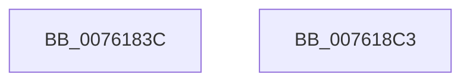

# PopDiagTraceFxPerfRegistration

- RVA: `0x0076183C`–`0x007618C4` (길이 `136` bytes)
- VA: `0x000000014076183C`
- 실행 섹션: `PAGE`
- PDB 이름 있음: `예`; PDB Function 태그: `아니요`
- unwind 정보 RVA: `0x000CC804`
- 디코드: `33`개 명령, `136/136` bytes 표시
- 미해석 바이트: `0` (있으면 어셈블리에 `.byte`로 보존)

> 이 문서는 커널 이미지의 기계어와 PDB 기호를 분석해 생성했습니다. 4번과 5번은 함수 원형과 자료형을 바이너리 사용 방식에서 추정한 C 해석이며 원본 소스 복구 결과는 아닙니다.

## 1. Dependencies

- 직접 호출 지점: **2**; 고유 호출 대상: **2**
- 직접 호출자로 확인된 함수: **1**
- RIP 상대 이미지 참조: **2**

### Outgoing calls
- `0x007618AC` → [EtwWrite](../../text/41/EtwWrite_function_0041C720.md) (function, `0x0041C720`)
- `0x007618B8` → [_security_check_cookie](../../text/6A/_security_check_cookie_function_006AC640.md) (function, `0x006AC640`)

### Direct callers
- [PopFxTracePerfRegistration](../AD/PopFxTracePerfRegistration_function_00AD81B0.md) at `0x00AD8243`

### Static image references
- `0x00761853` → RVA `0x00E0A740` (`.data`; read)
- `0x00761874` → RVA `0x00F0B408` (`.data`; read)

## 2. Other-region calls and transfers

- 다른 실행 섹션으로 향하는 call: **2**
  - `0x007618AC` → [EtwWrite](../../text/41/EtwWrite_function_0041C720.md) (`PAGE` → `.text`)
  - `0x007618B8` → [_security_check_cookie](../../text/6A/_security_check_cookie_function_006AC640.md) (`PAGE` → `.text`)
- 별도 외부 분기/꼬리 이동을 확인하지 못했습니다.

## 3. Assembly (complete function range)

```asm
0076183C  4C 8B DC                        mov r11, rsp
0076183F  45 89 4B 20                     mov dword ptr [r11 + 0x20], r9d
00761843  45 89 43 18                     mov dword ptr [r11 + 0x18], r8d
00761847  49 89 53 10                     mov qword ptr [r11 + 0x10], rdx
0076184B  55                              push rbp
0076184C  48 8B EC                        mov rbp, rsp
0076184F  48 83 EC 70                     sub rsp, 0x70
00761853  48 8B 05 E6 8E 6A 00            mov rax, qword ptr [rip + 0x6a8ee6]
0076185A  48 33 C4                        xor rax, rsp
0076185D  48 89 45 F0                     mov qword ptr [rbp - 0x10], rax
00761861  48 8D 45 18                     lea rax, [rbp + 0x18]
00761865  48 C7 45 C8 08 00 00 00         mov qword ptr [rbp - 0x38], 8
0076186D  48 89 45 C0                     mov qword ptr [rbp - 0x40], rax
00761871  48 8B D1                        mov rdx, rcx
00761874  48 8B 0D 8D 9B 7A 00            mov rcx, qword ptr [rip + 0x7a9b8d]
0076187B  48 8D 45 20                     lea rax, [rbp + 0x20]
0076187F  48 89 45 D0                     mov qword ptr [rbp - 0x30], rax
00761883  41 B9 03 00 00 00               mov r9d, 3
00761889  48 8D 45 28                     lea rax, [rbp + 0x28]
0076188D  48 C7 45 D8 04 00 00 00         mov qword ptr [rbp - 0x28], 4
00761895  48 89 45 E0                     mov qword ptr [rbp - 0x20], rax
00761899  45 33 C0                        xor r8d, r8d
0076189C  48 8D 45 C0                     lea rax, [rbp - 0x40]
007618A0  48 C7 45 E8 04 00 00 00         mov qword ptr [rbp - 0x18], 4
007618A8  49 89 43 A8                     mov qword ptr [r11 - 0x58], rax
007618AC  E8 6F AE CB FF                  call 0x14041c720
007618B1  48 8B 4D F0                     mov rcx, qword ptr [rbp - 0x10]
007618B5  48 33 CC                        xor rcx, rsp
007618B8  E8 83 AD F4 FF                  call 0x1406ac640
007618BD  48 83 C4 70                     add rsp, 0x70
007618C1  5D                              pop rbp
007618C2  C3                              ret
007618C3  CC                              int3
```

## 4. C-style interpretation (structured pseudocode)

```c
__int64 __fastcall PopDiagTraceFxPerfRegistration(__int64 a1, __int64 a2, int a3, int a4)
{
    __int64 result;
    __int64 v_rsp;
    unsigned __int64 v_stack_m18;
    unsigned __int64 v_stack_m20;
    unsigned __int64 v_stack_m28;
    unsigned __int64 v_stack_m30;
    unsigned __int64 v_stack_m38;
    unsigned __int64 v_stack_m40;
    unsigned __int64 v_stack_m48;
    unsigned __int64 v_stack_p10;
    unsigned __int64 v_stack_p18;
    unsigned __int64 v_stack_p20;

    *(unsigned int *)(v_rsp + 32) = a4;
    *(unsigned int *)(v_rsp + 24) = a3;
    *(unsigned __int64 *)(v_rsp + 16) = a2;
    v_rsp = (v_rsp) - (112);
    result = (*(unsigned __int64 *)(v_rip + 6983398)) ^ (v_rsp);
    v_stack_m18 = result;
    v_stack_m40 = 8;
    v_stack_m48 = v_stack_p10;
    v_stack_m38 = v_stack_p18;
    v_stack_m30 = 4;
    v_stack_m28 = v_stack_p20;
    a3 = 0;
    v_stack_m20 = 4;
    *(unsigned __int64 *)(v_rsp - 88) = v_stack_m48;
    result = EtwWrite(*(unsigned __int64 *)(v_rip + 8035213), a1, a3, 3);
    a1 = (v_stack_m18) ^ (v_rsp);
    result = _security_check_cookie(a1, a1, a3, 3);
    v_rsp = (v_rsp) + (112);
    return result;
}
```

## 5. (Beta) C Style

```c
int64_t PopDiagTraceFxPerfRegistration(int64_t Arg1, int64_t Arg2, int32_t Arg3, int32_t Arg4)
{
    int64_t result;
    int64_t local_rsp;
    uint64_t v_stack_m18;
    uint64_t v_stack_m20;
    uint64_t v_stack_m28;
    uint64_t v_stack_m30;
    uint64_t v_stack_m38;
    uint64_t v_stack_m40;
    uint64_t v_stack_m48;
    uint64_t v_stack_p10;
    uint64_t v_stack_p18;
    uint64_t v_stack_p20;

    *(uint32_t *)(local_rsp + 0x20) = Arg4;
    *(uint32_t *)(local_rsp + 0x18) = Arg3;
    *(uint64_t *)(local_rsp + 0x10) = Arg2;
    local_rsp = (local_rsp) - (112);
    result = (*(uint64_t *)(v_rip + 0x6A8EE6)) ^ (local_rsp);
    v_stack_m18 = result;
    v_stack_m40 = 8;
    v_stack_m48 = v_stack_p10;
    v_stack_m38 = v_stack_p18;
    v_stack_m30 = 4;
    v_stack_m28 = v_stack_p20;
    Arg3 = 0;
    v_stack_m20 = 4;
    *(uint64_t *)(local_rsp - 0x58) = v_stack_m48;
    result = EtwWrite(*(uint64_t *)(v_rip + 0x7A9B8D), Arg1, Arg3, 3);
    Arg1 = (v_stack_m18) ^ (local_rsp);
    result = _security_check_cookie(Arg1, Arg1, Arg3, 3);
    local_rsp = (local_rsp) + (112);
    return result;
}
```

## 6. Execution-region graph

[열기: 2D/3D 그래프와 함수 탐색 컨트롤 패널](../../../control-panel.html?section=page&rva=0x0076183C&view=graph)

- 2D 그래프는 위에서 아래로 흐르고, 3D 그래프는 빈 공간을 드래그해 회전합니다. Shift+드래그는 이동, 휠은 확대·축소, 함수 노드 선택은 대상 보고서 이동입니다.

### Static fallback


