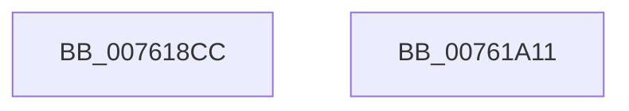

# PopDiagTraceFxPerfSetRegistration

- RVA: `0x007618CC`–`0x00761A12` (길이 `326` bytes)
- VA: `0x00000001407618CC`
- 실행 섹션: `PAGE`
- PDB 이름 있음: `예`; PDB Function 태그: `아니요`
- unwind 정보 RVA: `0x000CC7EC`
- 디코드: `71`개 명령, `326/326` bytes 표시
- 미해석 바이트: `0` (있으면 어셈블리에 `.byte`로 보존)

> 이 문서는 커널 이미지의 기계어와 PDB 기호를 분석해 생성했습니다. 4번과 5번은 함수 원형과 자료형을 바이너리 사용 방식에서 추정한 C 해석이며 원본 소스 복구 결과는 아닙니다.

## 1. Dependencies

- 직접 호출 지점: **2**; 고유 호출 대상: **2**
- 직접 호출자로 확인된 함수: **1**
- RIP 상대 이미지 참조: **2**

### Outgoing calls
- `0x007619F7` → [EtwWrite](../../text/41/EtwWrite_function_0041C720.md) (function, `0x0041C720`)
- `0x00761A03` → [_security_check_cookie](../../text/6A/_security_check_cookie_function_006AC640.md) (function, `0x006AC640`)

### Direct callers
- [PopFxTracePerfRegistration](../AD/PopFxTracePerfRegistration_function_00AD81B0.md) at `0x00AD83A8`

### Static image references
- `0x007618E7` → RVA `0x00E0A740` (`.data`; read)
- `0x0076195F` → RVA `0x00F0B408` (`.data`; read)

## 2. Other-region calls and transfers

- 다른 실행 섹션으로 향하는 call: **2**
  - `0x007619F7` → [EtwWrite](../../text/41/EtwWrite_function_0041C720.md) (`PAGE` → `.text`)
  - `0x00761A03` → [_security_check_cookie](../../text/6A/_security_check_cookie_function_006AC640.md) (`PAGE` → `.text`)
- 별도 외부 분기/꼬리 이동을 확인하지 못했습니다.

## 3. Assembly (complete function range)

```asm
007618CC  48 8B C4                        mov rax, rsp
007618CF  44 89 48 20                     mov dword ptr [rax + 0x20], r9d
007618D3  44 89 40 18                     mov dword ptr [rax + 0x18], r8d
007618D7  48 89 50 10                     mov qword ptr [rax + 0x10], rdx
007618DB  55                              push rbp
007618DC  48 8D 68 E8                     lea rbp, [rax - 0x18]
007618E0  48 81 EC 10 01 00 00            sub rsp, 0x110
007618E7  48 8B 05 52 8E 6A 00            mov rax, qword ptr [rip + 0x6a8e52]
007618EE  48 33 C4                        xor rax, rsp
007618F1  48 89 45 00                     mov qword ptr [rbp], rax
007618F5  4C 8B D1                        mov r10, rcx
007618F8  48 C7 44 24 48 08 00 00 00      mov qword ptr [rsp + 0x48], 8
00761901  48 8B 4D 60                     mov rcx, qword ptr [rbp + 0x60]
00761905  45 33 C9                        xor r9d, r9d
00761908  44 89 4D 8C                     mov dword ptr [rbp - 0x74], r9d
0076190C  45 33 C0                        xor r8d, r8d
0076190F  44 89 4D EC                     mov dword ptr [rbp - 0x14], r9d
00761913  41 B9 0C 00 00 00               mov r9d, 0xc
00761919  48 C7 44 24 58 04 00 00 00      mov qword ptr [rsp + 0x58], 4
00761922  0F B7 11                        movzx edx, word ptr [rcx]
00761925  0F B7 C2                        movzx eax, dx
00761928  89 55 88                        mov dword ptr [rbp - 0x78], edx
0076192B  66 D1 E8                        shr ax, 1
0076192E  49 8B D2                        mov rdx, r10
00761931  66 89 44 24 30                  mov word ptr [rsp + 0x30], ax
00761936  48 8D 45 28                     lea rax, [rbp + 0x28]
0076193A  48 89 44 24 40                  mov qword ptr [rsp + 0x40], rax
0076193F  48 8D 45 30                     lea rax, [rbp + 0x30]
00761943  48 89 44 24 50                  mov qword ptr [rsp + 0x50], rax
00761948  48 8D 45 38                     lea rax, [rbp + 0x38]
0076194C  48 89 44 24 60                  mov qword ptr [rsp + 0x60], rax
00761951  48 8D 44 24 30                  lea rax, [rsp + 0x30]
00761956  48 89 44 24 70                  mov qword ptr [rsp + 0x70], rax
0076195B  48 8B 41 08                     mov rax, qword ptr [rcx + 8]
0076195F  48 8B 0D A2 9A 7A 00            mov rcx, qword ptr [rip + 0x7a9aa2]
00761966  48 89 45 80                     mov qword ptr [rbp - 0x80], rax
0076196A  48 8D 45 40                     lea rax, [rbp + 0x40]
0076196E  48 89 45 90                     mov qword ptr [rbp - 0x70], rax
00761972  48 8D 45 48                     lea rax, [rbp + 0x48]
00761976  48 89 45 A0                     mov qword ptr [rbp - 0x60], rax
0076197A  48 8D 45 50                     lea rax, [rbp + 0x50]
0076197E  48 89 45 B0                     mov qword ptr [rbp - 0x50], rax
00761982  48 8D 45 58                     lea rax, [rbp + 0x58]
00761986  48 89 45 C0                     mov qword ptr [rbp - 0x40], rax
0076198A  48 8D 45 68                     lea rax, [rbp + 0x68]
0076198E  48 89 45 D0                     mov qword ptr [rbp - 0x30], rax
00761992  48 8B 45 70                     mov rax, qword ptr [rbp + 0x70]
00761996  48 89 45 E0                     mov qword ptr [rbp - 0x20], rax
0076199A  8B 45 68                        mov eax, dword ptr [rbp + 0x68]
0076199D  C1 E0 03                        shl eax, 3
007619A0  89 45 E8                        mov dword ptr [rbp - 0x18], eax
007619A3  48 8D 45 78                     lea rax, [rbp + 0x78]
007619A7  48 89 45 F0                     mov qword ptr [rbp - 0x10], rax
007619AB  48 8D 44 24 40                  lea rax, [rsp + 0x40]
007619B0  48 89 44 24 20                  mov qword ptr [rsp + 0x20], rax
007619B5  48 C7 44 24 68 04 00 00 00      mov qword ptr [rsp + 0x68], 4
007619BE  48 C7 44 24 78 02 00 00 00      mov qword ptr [rsp + 0x78], 2
007619C7  48 C7 45 98 04 00 00 00         mov qword ptr [rbp - 0x68], 4
007619CF  48 C7 45 A8 04 00 00 00         mov qword ptr [rbp - 0x58], 4
007619D7  48 C7 45 B8 08 00 00 00         mov qword ptr [rbp - 0x48], 8
007619DF  48 C7 45 C8 08 00 00 00         mov qword ptr [rbp - 0x38], 8
007619E7  48 C7 45 D8 04 00 00 00         mov qword ptr [rbp - 0x28], 4
007619EF  48 C7 45 F8 08 00 00 00         mov qword ptr [rbp - 8], 8
007619F7  E8 24 AD CB FF                  call 0x14041c720
007619FC  48 8B 4D 00                     mov rcx, qword ptr [rbp]
00761A00  48 33 CC                        xor rcx, rsp
00761A03  E8 38 AC F4 FF                  call 0x1406ac640
00761A08  48 81 C4 10 01 00 00            add rsp, 0x110
00761A0F  5D                              pop rbp
00761A10  C3                              ret
00761A11  CC                              int3
```

## 4. C-style interpretation (structured pseudocode)

```c
__int64 __fastcall PopDiagTraceFxPerfSetRegistration(__int64 a1, __int64 a2, int a3, int a4)
{
    __int64 result;
    __int64 v_rsp;
    unsigned __int64 v_stack_mA0;
    unsigned __int64 v_stack_mA8;
    unsigned __int64 v_stack_mB0;
    unsigned __int64 v_stack_mB8;
    unsigned __int64 v_stack_mC0;
    unsigned __int64 v_stack_mC8;
    unsigned __int64 v_stack_mD0;
    unsigned __int64 v_stack_mD8;
    unsigned __int16 v_stack_mE8;
    unsigned __int64 v_stack_mF8;

    *(unsigned int *)(v_rsp + 32) = a4;
    *(unsigned int *)(v_rsp + 24) = a3;
    *(unsigned __int64 *)(v_rsp + 16) = a2;
    v_rsp = (v_rsp) - (272);
    result = (*(unsigned __int64 *)(v_rip + 6983250)) ^ (v_rsp);
    *(unsigned __int64 *)(v_rsp - 24) = result;
    v_stack_mD0 = 8;
    a4 = 0;
    *(unsigned int *)(v_rsp - 24 - 116) = 0;
    a3 = 0;
    *(unsigned int *)(v_rsp - 24 - 20) = 0;
    v_stack_mC0 = 4;
    *(unsigned int *)(v_rsp - 24 - 120) = (unsigned int)(*(unsigned __int16 *)(*(unsigned __int64 *)(v_rsp - 24 + 96)));
    result = (unsigned __int16)(((unsigned __int16)(*(unsigned __int16 *)(*(unsigned __int64 *)(v_rsp - 24 + 96)))) >> (1));
    v_stack_mE8 = (unsigned __int16)(result);
    v_stack_mD8 = v_rsp - 24 + 40;
    v_stack_mC8 = v_rsp - 24 + 48;
    v_stack_mB8 = v_rsp - 24 + 56;
    v_stack_mA8 = v_stack_mE8;
    *(unsigned __int64 *)(v_rsp - 24 - 128) = *(unsigned __int64 *)(*(unsigned __int64 *)(v_rsp - 24 + 96) + 8);
    *(unsigned __int64 *)(v_rsp - 24 - 112) = v_rsp - 24 + 64;
    *(unsigned __int64 *)(v_rsp - 24 - 96) = v_rsp - 24 + 72;
    *(unsigned __int64 *)(v_rsp - 24 - 80) = v_rsp - 24 + 80;
    *(unsigned __int64 *)(v_rsp - 24 - 64) = v_rsp - 24 + 88;
    *(unsigned __int64 *)(v_rsp - 24 - 48) = v_rsp - 24 + 104;
    *(unsigned __int64 *)(v_rsp - 24 - 32) = *(unsigned __int64 *)(v_rsp - 24 + 112);
    result = (unsigned int)(((unsigned int)(*(unsigned int *)(v_rsp - 24 + 104))) << (3));
    *(unsigned int *)(v_rsp - 24 - 24) = (unsigned int)(result);
    *(unsigned __int64 *)(v_rsp - 24 - 16) = v_rsp - 24 + 120;
    v_stack_mF8 = v_stack_mD8;
    v_stack_mB0 = 4;
    v_stack_mA0 = 2;
    *(unsigned __int64 *)(v_rsp - 24 - 104) = 4;
    *(unsigned __int64 *)(v_rsp - 24 - 88) = 4;
    *(unsigned __int64 *)(v_rsp - 24 - 72) = 8;
    *(unsigned __int64 *)(v_rsp - 24 - 56) = 8;
    *(unsigned __int64 *)(v_rsp - 24 - 40) = 4;
    *(unsigned __int64 *)(v_rsp - 24 - 8) = 8;
    result = EtwWrite(*(unsigned __int64 *)(v_rip + 8034978), a1, a3, 12);
    a1 = (*(unsigned __int64 *)(v_rsp - 24)) ^ (v_rsp);
    result = _security_check_cookie(a1, a1, a3, 12);
    v_rsp = (v_rsp) + (272);
    return result;
}
```

## 5. (Beta) C Style

```c
int64_t PopDiagTraceFxPerfSetRegistration(int64_t Arg1, int64_t Arg2, int32_t Arg3, int32_t Arg4)
{
    int64_t result;
    int64_t local_rsp;
    uint64_t v_stack_mA0;
    uint64_t v_stack_mA8;
    uint64_t v_stack_mB0;
    uint64_t v_stack_mB8;
    uint64_t v_stack_mC0;
    uint64_t v_stack_mC8;
    uint64_t v_stack_mD0;
    uint64_t v_stack_mD8;
    uint16_t v_stack_mE8;
    uint64_t v_stack_mF8;

    *(uint32_t *)(local_rsp + 0x20) = Arg4;
    *(uint32_t *)(local_rsp + 0x18) = Arg3;
    *(uint64_t *)(local_rsp + 0x10) = Arg2;
    local_rsp = (local_rsp) - (272);
    result = (*(uint64_t *)(v_rip + 0x6A8E52)) ^ (local_rsp);
    *(uint64_t *)(local_rsp - 0x18) = result;
    v_stack_mD0 = 8;
    Arg4 = 0;
    *(uint32_t *)(local_rsp - 0x18 - 0x74) = 0;
    Arg3 = 0;
    *(uint32_t *)(local_rsp - 0x18 - 0x14) = 0;
    v_stack_mC0 = 4;
    *(uint32_t *)(local_rsp - 0x18 - 0x78) = (uint32_t)(*(uint16_t *)(*(uint64_t *)(local_rsp - 0x18 + 0x60)));
    result = (uint16_t)(((uint16_t)(*(uint16_t *)(*(uint64_t *)(local_rsp - 0x18 + 0x60)))) >> (1));
    v_stack_mE8 = (uint16_t)(result);
    v_stack_mD8 = local_rsp - 24 + 40;
    v_stack_mC8 = local_rsp - 24 + 48;
    v_stack_mB8 = local_rsp - 24 + 56;
    v_stack_mA8 = v_stack_mE8;
    *(uint64_t *)(local_rsp - 0x18 - 0x80) = *(uint64_t *)(*(uint64_t *)(local_rsp - 0x18 + 0x60) + 0x8);
    *(uint64_t *)(local_rsp - 0x18 - 0x70) = local_rsp - 24 + 64;
    *(uint64_t *)(local_rsp - 0x18 - 0x60) = local_rsp - 24 + 72;
    *(uint64_t *)(local_rsp - 0x18 - 0x50) = local_rsp - 24 + 80;
    *(uint64_t *)(local_rsp - 0x18 - 0x40) = local_rsp - 24 + 88;
    *(uint64_t *)(local_rsp - 0x18 - 0x30) = local_rsp - 24 + 104;
    *(uint64_t *)(local_rsp - 0x18 - 0x20) = *(uint64_t *)(local_rsp - 0x18 + 0x70);
    result = (uint32_t)(((uint32_t)(*(uint32_t *)(local_rsp - 0x18 + 0x68))) << (3));
    *(uint32_t *)(local_rsp - 0x18 - 0x18) = (uint32_t)(result);
    *(uint64_t *)(local_rsp - 0x18 - 0x10) = local_rsp - 24 + 120;
    v_stack_mF8 = v_stack_mD8;
    v_stack_mB0 = 4;
    v_stack_mA0 = 2;
    *(uint64_t *)(local_rsp - 0x18 - 0x68) = 4;
    *(uint64_t *)(local_rsp - 0x18 - 0x58) = 4;
    *(uint64_t *)(local_rsp - 0x18 - 0x48) = 8;
    *(uint64_t *)(local_rsp - 0x18 - 0x38) = 8;
    *(uint64_t *)(local_rsp - 0x18 - 0x28) = 4;
    *(uint64_t *)(local_rsp - 0x18 - 0x8) = 8;
    result = EtwWrite(*(uint64_t *)(v_rip + 0x7A9AA2), Arg1, Arg3, 12);
    Arg1 = (*(uint64_t *)(local_rsp - 0x18)) ^ (local_rsp);
    result = _security_check_cookie(Arg1, Arg1, Arg3, 12);
    local_rsp = (local_rsp) + (272);
    return result;
}
```

## 6. Execution-region graph

[열기: 2D/3D 그래프와 함수 탐색 컨트롤 패널](../../../control-panel.html?section=page&rva=0x007618CC&view=graph)

- 2D 그래프는 위에서 아래로 흐르고, 3D 그래프는 빈 공간을 드래그해 회전합니다. Shift+드래그는 이동, 휠은 확대·축소, 함수 노드 선택은 대상 보고서 이동입니다.

### Static fallback


