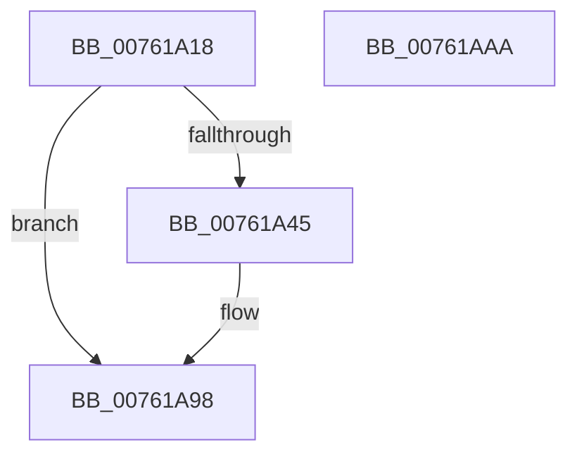

# PopDiagTraceHibernateRevoked

- RVA: `0x00761A18`–`0x00761AAB` (길이 `147` bytes)
- VA: `0x0000000140761A18`
- 실행 섹션: `PAGE`
- PDB 이름 있음: `예`; PDB Function 태그: `아니요`
- unwind 정보 RVA: `0x000CCAAC`
- 디코드: `35`개 명령, `147/147` bytes 표시
- 미해석 바이트: `0` (있으면 어셈블리에 `.byte`로 보존)

> 이 문서는 커널 이미지의 기계어와 PDB 기호를 분석해 생성했습니다. 4번과 5번은 함수 원형과 자료형을 바이너리 사용 방식에서 추정한 C 해석이며 원본 소스 복구 결과는 아닙니다.

## 1. Dependencies

- 직접 호출 지점: **2**; 고유 호출 대상: **2**
- 직접 호출자로 확인된 함수: **1**
- RIP 상대 이미지 참조: **4**

### Outgoing calls
- `0x00761A93` → [EtwWrite](../../text/41/EtwWrite_function_0041C720.md) (function, `0x0041C720`)
- `0x00761A9F` → [_security_check_cookie](../../text/6A/_security_check_cookie_function_006AC640.md) (function, `0x006AC640`)

### Direct callers
- [PopValidateWinresume](../75/PopValidateWinresume_function_0075DFF4.md) at `0x0075E316`

### Static image references
- `0x00761A2D` → RVA `0x00E0A740` (`.data`; read)
- `0x00761A3D` → RVA `0x00E67858` (`.data`; read)
- `0x00761A45` → RVA `0x00F0B408` (`.data`; read)
- `0x00761A68` → RVA `0x00020D80` (`.rdata`; read)

## 2. Other-region calls and transfers

- 다른 실행 섹션으로 향하는 call: **2**
  - `0x00761A93` → [EtwWrite](../../text/41/EtwWrite_function_0041C720.md) (`PAGE` → `.text`)
  - `0x00761A9F` → [_security_check_cookie](../../text/6A/_security_check_cookie_function_006AC640.md) (`PAGE` → `.text`)
- 별도 외부 분기/꼬리 이동을 확인하지 못했습니다.

## 3. Assembly (complete function range)

```asm
00761A18  44 89 44 24 18                  mov dword ptr [rsp + 0x18], r8d
00761A1D  89 54 24 10                     mov dword ptr [rsp + 0x10], edx
00761A21  89 4C 24 08                     mov dword ptr [rsp + 8], ecx
00761A25  55                              push rbp
00761A26  48 8B EC                        mov rbp, rsp
00761A29  48 83 EC 70                     sub rsp, 0x70
00761A2D  48 8B 05 0C 8D 6A 00            mov rax, qword ptr [rip + 0x6a8d0c]
00761A34  48 33 C4                        xor rax, rsp
00761A37  48 89 45 F0                     mov qword ptr [rbp - 0x10], rax
00761A3B  33 D2                           xor edx, edx
00761A3D  38 15 15 5E 70 00               cmp byte ptr [rip + 0x705e15], dl
00761A43  74 53                           je 0x140761a98
00761A45  48 8B 0D BC 99 7A 00            mov rcx, qword ptr [rip + 0x7a99bc]
00761A4C  48 8D 45 10                     lea rax, [rbp + 0x10]
00761A50  48 89 45 C0                     mov qword ptr [rbp - 0x40], rax
00761A54  44 8D 4A 03                     lea r9d, [rdx + 3]
00761A58  48 8D 45 18                     lea rax, [rbp + 0x18]
00761A5C  48 C7 45 C8 04 00 00 00         mov qword ptr [rbp - 0x38], 4
00761A64  48 89 45 D0                     mov qword ptr [rbp - 0x30], rax
00761A68  48 8D 15 11 F3 8B FF            lea rdx, [rip - 0x740cef]
00761A6F  48 8D 45 20                     lea rax, [rbp + 0x20]
00761A73  48 C7 45 D8 04 00 00 00         mov qword ptr [rbp - 0x28], 4
00761A7B  48 89 45 E0                     mov qword ptr [rbp - 0x20], rax
00761A7F  45 33 C0                        xor r8d, r8d
00761A82  48 8D 45 C0                     lea rax, [rbp - 0x40]
00761A86  48 C7 45 E8 04 00 00 00         mov qword ptr [rbp - 0x18], 4
00761A8E  48 89 44 24 20                  mov qword ptr [rsp + 0x20], rax
00761A93  E8 88 AC CB FF                  call 0x14041c720
00761A98  48 8B 4D F0                     mov rcx, qword ptr [rbp - 0x10]
00761A9C  48 33 CC                        xor rcx, rsp
00761A9F  E8 9C AB F4 FF                  call 0x1406ac640
00761AA4  48 83 C4 70                     add rsp, 0x70
00761AA8  5D                              pop rbp
00761AA9  C3                              ret
00761AAA  CC                              int3
```

## 4. C-style interpretation (structured pseudocode)

```c
__int64 __fastcall PopDiagTraceHibernateRevoked(int a1, int a2, int a3)
{
    __int64 result;
    __int64 v_rsp;
    unsigned __int64 v_stack_m18;
    unsigned __int64 v_stack_m20;
    unsigned __int64 v_stack_m28;
    unsigned __int64 v_stack_m30;
    unsigned __int64 v_stack_m38;
    unsigned __int64 v_stack_m40;
    unsigned __int64 v_stack_m48;
    unsigned __int64 v_stack_m58;
    unsigned int v_stack_p10;
    unsigned int v_stack_p18;
    unsigned int v_stack_p8;

    v_stack_p18 = a3;
    v_stack_p10 = a2;
    v_stack_p8 = a1;
    v_rsp = (v_rsp) - (112);
    result = (*(unsigned __int64 *)(v_rip + 6982924)) ^ (v_rsp);
    v_stack_m18 = result;
    a2 = 0;
    if ((*(unsigned __int8 *)(v_rip + 7364117)) != 0) {
        a1 = *(unsigned __int64 *)(v_rip + 8034748);
        result = v_stack_p8;
        v_stack_m48 = result;
        a4 = a2 + 3;
        result = v_stack_p10;
        v_stack_m40 = 4;
        v_stack_m38 = result;
        a2 = v_rip - 7605487;
        result = v_stack_p18;
        v_stack_m30 = 4;
        v_stack_m28 = result;
        a3 = 0;
        result = v_stack_m48;
        v_stack_m20 = 4;
        v_stack_m58 = result;
        result = EtwWrite(a1, a2, a3, a4);
    }
    a1 = (v_stack_m18) ^ (v_rsp);
    result = _security_check_cookie(a1, a2, a3, a4);
    v_rsp = (v_rsp) + (112);
    return result;
}
```

## 5. (Beta) C Style

```c
int64_t PopDiagTraceHibernateRevoked(int32_t Arg1, int32_t Arg2, int32_t Arg3)
{
    int64_t result;
    int64_t local_rsp;
    uint64_t v_stack_m18;
    uint64_t v_stack_m20;
    uint64_t v_stack_m28;
    uint64_t v_stack_m30;
    uint64_t v_stack_m38;
    uint64_t v_stack_m40;
    uint64_t v_stack_m48;
    uint64_t v_stack_m58;
    uint32_t v_stack_p10;
    uint32_t v_stack_p18;
    uint32_t v_stack_p8;

    v_stack_p18 = Arg3;
    v_stack_p10 = Arg2;
    v_stack_p8 = Arg1;
    local_rsp = (local_rsp) - (112);
    result = (*(uint64_t *)(v_rip + 0x6A8D0C)) ^ (local_rsp);
    v_stack_m18 = result;
    Arg2 = 0;
    if ((*(uint8_t *)(v_rip + 0x705E15)) != 0) {
        Arg1 = *(uint64_t *)(v_rip + 0x7A99BC);
        result = v_stack_p8;
        v_stack_m48 = result;
        a4 = Arg2 + 3;
        result = v_stack_p10;
        v_stack_m40 = 4;
        v_stack_m38 = result;
        Arg2 = v_rip - 7605487;
        result = v_stack_p18;
        v_stack_m30 = 4;
        v_stack_m28 = result;
        Arg3 = 0;
        result = v_stack_m48;
        v_stack_m20 = 4;
        v_stack_m58 = result;
        result = EtwWrite(Arg1, Arg2, Arg3, a4);
    }
    Arg1 = (v_stack_m18) ^ (local_rsp);
    result = _security_check_cookie(Arg1, Arg2, Arg3, a4);
    local_rsp = (local_rsp) + (112);
    return result;
}
```

## 6. Execution-region graph

[열기: 2D/3D 그래프와 함수 탐색 컨트롤 패널](../../../control-panel.html?section=page&rva=0x00761A18&view=graph)

- 2D 그래프는 위에서 아래로 흐르고, 3D 그래프는 빈 공간을 드래그해 회전합니다. Shift+드래그는 이동, 휠은 확대·축소, 함수 노드 선택은 대상 보고서 이동입니다.

### Static fallback


