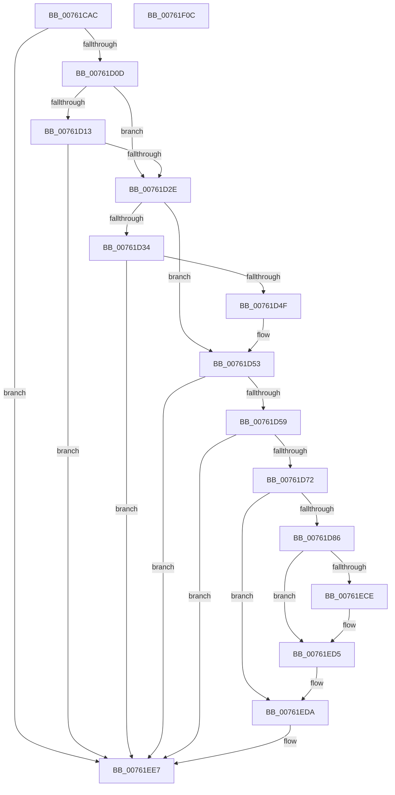

# PopDiagTracePassiveCooling

- RVA: `0x00761CAC`–`0x00761F0D` (길이 `609` bytes)
- VA: `0x0000000140761CAC`
- 실행 섹션: `PAGE`
- PDB 이름 있음: `예`; PDB Function 태그: `아니요`
- unwind 정보 RVA: `0x000CC9C8`
- 디코드: `132`개 명령, `609/609` bytes 표시
- 미해석 바이트: `0` (있으면 어셈블리에 `.byte`로 보존)

> 이 문서는 커널 이미지의 기계어와 PDB 기호를 분석해 생성했습니다. 4번과 5번은 함수 원형과 자료형을 바이너리 사용 방식에서 추정한 C 해석이며 원본 소스 복구 결과는 아닙니다.

## 1. Dependencies

- 직접 호출 지점: **7**; 고유 호출 대상: **6**
- 직접 호출자로 확인된 함수: **2**
- RIP 상대 이미지 참조: **5**

### Outgoing calls
- `0x00761D21` → [EtwEventEnabled](../../text/39/EtwEventEnabled_function_00392450.md) (function, `0x00392450`)
- `0x00761D42` → [EtwEventEnabled](../../text/39/EtwEventEnabled_function_00392450.md) (function, `0x00392450`)
- `0x00761D61` → [IoGetDeviceAttachmentBaseRefWithTag](../../text/27/IoGetDeviceAttachmentBaseRefWithTag_function_00272788.md) (function, `0x00272788`)
- `0x00761DDE` → [ExSystemTimeToLocalTime](../../text/2F/ExSystemTimeToLocalTime_function_002FE1C0.md) (function, `0x002FE1C0`)
- `0x00761ED5` → [EtwWrite](../../text/41/EtwWrite_function_0041C720.md) (function, `0x0041C720`)
- `0x00761EE2` → [ObfDereferenceObjectWithTag](../../text/2F/ObfDereferenceObjectWithTag_function_002F78E0.md) (function, `0x002F78E0`)
- `0x00761EEE` → [_security_check_cookie](../../text/6A/_security_check_cookie_function_006AC640.md) (function, `0x006AC640`)

### Direct callers
- [PopThermalWorker](../A4/PopThermalWorker_function_00A4E200.md) at `0x00A4E5CB`
- [PopThermalWorker](../A4/PopThermalWorker_function_00A4E200.md) at `0x00A4E5F8`
- [sub_00B3BE18](../B3/Unknown_function_00B3BE18.md) at `0x00B3BF94`

### Static image references
- `0x00761CCB` → RVA `0x00E0A740` (`.data`; read)
- `0x00761CDF` → RVA `0x00E67858` (`.data`; read)
- `0x00761D13` → RVA `0x00F0B408` (`.data`; read)
- `0x00761D1A` → RVA `0x000227F0` (`.rdata`; read)
- `0x00761D3B` → RVA `0x00023328` (`.rdata`; read)

## 2. Other-region calls and transfers

- 다른 실행 섹션으로 향하는 call: **7**
  - `0x00761D21` → [EtwEventEnabled](../../text/39/EtwEventEnabled_function_00392450.md) (`PAGE` → `.text`)
  - `0x00761D42` → [EtwEventEnabled](../../text/39/EtwEventEnabled_function_00392450.md) (`PAGE` → `.text`)
  - `0x00761D61` → [IoGetDeviceAttachmentBaseRefWithTag](../../text/27/IoGetDeviceAttachmentBaseRefWithTag_function_00272788.md) (`PAGE` → `.text`)
  - `0x00761DDE` → [ExSystemTimeToLocalTime](../../text/2F/ExSystemTimeToLocalTime_function_002FE1C0.md) (`PAGE` → `.text`)
  - `0x00761ED5` → [EtwWrite](../../text/41/EtwWrite_function_0041C720.md) (`PAGE` → `.text`)
  - `0x00761EE2` → [ObfDereferenceObjectWithTag](../../text/2F/ObfDereferenceObjectWithTag_function_002F78E0.md) (`PAGE` → `.text`)
  - `0x00761EEE` → [_security_check_cookie](../../text/6A/_security_check_cookie_function_006AC640.md) (`PAGE` → `.text`)
- 별도 외부 분기/꼬리 이동을 확인하지 못했습니다.

## 3. Assembly (complete function range)

```asm
00761CAC  48 8B C4                        mov rax, rsp
00761CAF  48 89 70 08                     mov qword ptr [rax + 8], rsi
00761CB3  48 89 78 18                     mov qword ptr [rax + 0x18], rdi
00761CB7  44 89 48 20                     mov dword ptr [rax + 0x20], r9d
00761CBB  55                              push rbp
00761CBC  41 54                           push r12
00761CBE  41 56                           push r14
00761CC0  48 8D 68 D8                     lea rbp, [rax - 0x28]
00761CC4  48 81 EC 10 01 00 00            sub rsp, 0x110
00761CCB  48 8B 05 6E 8A 6A 00            mov rax, qword ptr [rip + 0x6a8a6e]
00761CD2  48 33 C4                        xor rax, rsp
00761CD5  48 89 45 00                     mov qword ptr [rbp], rax
00761CD9  45 33 E4                        xor r12d, r12d
00761CDC  45 8A F0                        mov r14b, r8b
00761CDF  44 38 25 72 5B 70 00            cmp byte ptr [rip + 0x705b72], r12b
00761CE6  48 8B FA                        mov rdi, rdx
00761CE9  48 8B F1                        mov rsi, rcx
00761CEC  44 89 64 24 3C                  mov dword ptr [rsp + 0x3c], r12d
00761CF1  66 44 89 64 24 30               mov word ptr [rsp + 0x30], r12w
00761CF7  4C 89 64 24 40                  mov qword ptr [rsp + 0x40], r12
00761CFC  44 89 64 24 38                  mov dword ptr [rsp + 0x38], r12d
00761D01  66 44 89 64 24 34               mov word ptr [rsp + 0x34], r12w
00761D07  0F 84 DA 01 00 00               je 0x140761ee7
00761D0D  44 39 65 50                     cmp dword ptr [rbp + 0x50], r12d
00761D11  75 1B                           jne 0x140761d2e
00761D13  48 8B 0D EE 96 7A 00            mov rcx, qword ptr [rip + 0x7a96ee]
00761D1A  48 8D 15 CF 0A 8C FF            lea rdx, [rip - 0x73f531]
00761D21  E8 2A 07 C3 FF                  call 0x140392450
00761D26  84 C0                           test al, al
00761D28  0F 84 B9 01 00 00               je 0x140761ee7
00761D2E  83 7D 50 01                     cmp dword ptr [rbp + 0x50], 1
00761D32  75 1F                           jne 0x140761d53
00761D34  48 8B 0D CD 96 7A 00            mov rcx, qword ptr [rip + 0x7a96cd]
00761D3B  48 8D 15 E6 15 8C FF            lea rdx, [rip - 0x73ea1a]
00761D42  E8 09 07 C3 FF                  call 0x140392450
00761D47  84 C0                           test al, al
00761D49  0F 84 98 01 00 00               je 0x140761ee7
00761D4F  83 7D 50 01                     cmp dword ptr [rbp + 0x50], 1
00761D53  0F 87 8E 01 00 00               ja 0x140761ee7
00761D59  BA 50 6F 44 67                  mov edx, 0x67446f50
00761D5E  48 8B CF                        mov rcx, rdi
00761D61  E8 22 0A B1 FF                  call 0x140272788
00761D66  48 8B F8                        mov rdi, rax
00761D69  48 85 C0                        test rax, rax
00761D6C  0F 84 75 01 00 00               je 0x140761ee7
00761D72  48 8B 88 38 01 00 00            mov rcx, qword ptr [rax + 0x138]
00761D79  48 8B 41 28                     mov rax, qword ptr [rcx + 0x28]
00761D7D  48 85 C0                        test rax, rax
00761D80  0F 84 54 01 00 00               je 0x140761eda
00761D86  0F B7 88 80 00 00 00            movzx ecx, word ptr [rax + 0x80]
00761D8D  66 D1 E9                        shr cx, 1
00761D90  0F B7 D1                        movzx edx, cx
00761D93  48 8D 4C 24 30                  lea rcx, [rsp + 0x30]
00761D98  66 89 54 24 30                  mov word ptr [rsp + 0x30], dx
00761D9D  03 D2                           add edx, edx
00761D9F  48 89 4C 24 50                  mov qword ptr [rsp + 0x50], rcx
00761DA4  48 8D 4C 24 48                  lea rcx, [rsp + 0x48]
00761DA9  48 C7 44 24 58 02 00 00 00      mov qword ptr [rsp + 0x58], 2
00761DB2  48 8B 80 88 00 00 00            mov rax, qword ptr [rax + 0x88]
00761DB9  48 89 44 24 60                  mov qword ptr [rsp + 0x60], rax
00761DBE  48 B8 14 00 00 00 80 F7 FF FF   movabs rax, 0xfffff78000000014
00761DC8  89 54 24 68                     mov dword ptr [rsp + 0x68], edx
00761DCC  48 8D 54 24 40                  lea rdx, [rsp + 0x40]
00761DD1  44 89 64 24 6C                  mov dword ptr [rsp + 0x6c], r12d
00761DD6  48 8B 00                        mov rax, qword ptr [rax]
00761DD9  48 89 44 24 48                  mov qword ptr [rsp + 0x48], rax
00761DDE  E8 DD C3 B9 FF                  call 0x1402fe1c0
00761DE3  48 8D 44 24 40                  lea rax, [rsp + 0x40]
00761DE8  48 C7 44 24 78 08 00 00 00      mov qword ptr [rsp + 0x78], 8
00761DF1  48 89 44 24 70                  mov qword ptr [rsp + 0x70], rax
00761DF6  48 8D 4C 24 38                  lea rcx, [rsp + 0x38]
00761DFB  41 8B C4                        mov eax, r12d
00761DFE  48 89 4D 90                     mov qword ptr [rbp - 0x70], rcx
00761E02  48 8B 0D FF 95 7A 00            mov rcx, qword ptr [rip + 0x7a95ff]
00761E09  41 B8 CD CC CC CC               mov r8d, 0xcccccccd
00761E0F  45 84 F6                        test r14b, r14b
00761E12  48 C7 45 88 02 00 00 00         mov qword ptr [rbp - 0x78], 2
00761E1A  48 C7 45 98 04 00 00 00         mov qword ptr [rbp - 0x68], 4
00761E22  41 B9 0B 00 00 00               mov r9d, 0xb
00761E28  0F 95 C0                        setne al
00761E2B  48 C7 45 A8 04 00 00 00         mov qword ptr [rbp - 0x58], 4
00761E33  66 89 44 24 34                  mov word ptr [rsp + 0x34], ax
00761E38  48 8D 44 24 34                  lea rax, [rsp + 0x34]
00761E3D  48 89 45 80                     mov qword ptr [rbp - 0x80], rax
00761E41  41 8B C0                        mov eax, r8d
00761E44  F7 66 14                        mul dword ptr [rsi + 0x14]
00761E47  41 8B C0                        mov eax, r8d
00761E4A  48 C7 45 B8 04 00 00 00         mov qword ptr [rbp - 0x48], 4
00761E52  C1 EA 03                        shr edx, 3
00761E55  45 33 C0                        xor r8d, r8d
00761E58  89 54 24 38                     mov dword ptr [rsp + 0x38], edx
00761E5C  F7 66 10                        mul dword ptr [rsi + 0x10]
00761E5F  48 8D 44 24 3C                  lea rax, [rsp + 0x3c]
00761E64  48 C7 45 C8 04 00 00 00         mov qword ptr [rbp - 0x38], 4
00761E6C  48 89 45 A0                     mov qword ptr [rbp - 0x60], rax
00761E70  48 8D 46 04                     lea rax, [rsi + 4]
00761E74  48 89 45 B0                     mov qword ptr [rbp - 0x50], rax
00761E78  48 8D 46 08                     lea rax, [rsi + 8]
00761E7C  48 89 45 C0                     mov qword ptr [rbp - 0x40], rax
00761E80  48 8D 46 0C                     lea rax, [rsi + 0xc]
00761E84  48 89 45 D0                     mov qword ptr [rbp - 0x30], rax
00761E88  48 8D 45 48                     lea rax, [rbp + 0x48]
00761E8C  C1 EA 03                        shr edx, 3
00761E8F  48 89 45 E0                     mov qword ptr [rbp - 0x20], rax
00761E93  48 8D 46 50                     lea rax, [rsi + 0x50]
00761E97  48 89 45 F0                     mov qword ptr [rbp - 0x10], rax
00761E9B  48 8D 44 24 50                  lea rax, [rsp + 0x50]
00761EA0  89 54 24 3C                     mov dword ptr [rsp + 0x3c], edx
00761EA4  48 8D 15 45 09 8C FF            lea rdx, [rip - 0x73f6bb]
00761EAB  48 89 44 24 20                  mov qword ptr [rsp + 0x20], rax
00761EB0  48 C7 45 D8 04 00 00 00         mov qword ptr [rbp - 0x28], 4
00761EB8  48 C7 45 E8 04 00 00 00         mov qword ptr [rbp - 0x18], 4
00761EC0  48 C7 45 F8 04 00 00 00         mov qword ptr [rbp - 8], 4
00761EC8  44 39 65 50                     cmp dword ptr [rbp + 0x50], r12d
00761ECC  74 07                           je 0x140761ed5
00761ECE  48 8D 15 53 14 8C FF            lea rdx, [rip - 0x73ebad]
00761ED5  E8 46 A8 CB FF                  call 0x14041c720
00761EDA  BA 50 6F 44 67                  mov edx, 0x67446f50
00761EDF  48 8B CF                        mov rcx, rdi
00761EE2  E8 F9 59 B9 FF                  call 0x1402f78e0
00761EE7  48 8B 4D 00                     mov rcx, qword ptr [rbp]
00761EEB  48 33 CC                        xor rcx, rsp
00761EEE  E8 4D A7 F4 FF                  call 0x1406ac640
00761EF3  4C 8D 9C 24 10 01 00 00         lea r11, [rsp + 0x110]
00761EFB  49 8B 73 20                     mov rsi, qword ptr [r11 + 0x20]
00761EFF  49 8B 7B 30                     mov rdi, qword ptr [r11 + 0x30]
00761F03  49 8B E3                        mov rsp, r11
00761F06  41 5E                           pop r14
00761F08  41 5C                           pop r12
00761F0A  5D                              pop rbp
00761F0B  C3                              ret
00761F0C  CC                              int3
```

## 4. C-style interpretation (structured pseudocode)

```c
__int64 __fastcall PopDiagTracePassiveCooling(__int64 a1, __int64 a2, unsigned __int8 a3, int a4)
{
    __int64 result;
    __int64 v_r12;
    __int64 v_rsp;
    unsigned __int64 v_stack_m108;
    unsigned __int64 v_stack_m18;
    unsigned __int64 v_stack_mB0;
    unsigned __int64 v_stack_mB8;
    unsigned int v_stack_mBC;
    unsigned int v_stack_mC0;
    unsigned __int64 v_stack_mC8;
    unsigned __int64 v_stack_mD0;
    unsigned __int64 v_stack_mD8;
    unsigned __int64 v_stack_mE0;
    unsigned __int64 v_stack_mE8;
    unsigned int v_stack_mEC;
    unsigned int v_stack_mF0;
    unsigned __int16 v_stack_mF4;
    unsigned __int16 v_stack_mF8;

    *(unsigned __int64 *)(v_rsp + 8) = v_rsi;
    *(unsigned __int64 *)(v_rsp + 24) = v_rdi;
    *(unsigned int *)(v_rsp + 32) = a4;
    v_rsp = (v_rsp) - (272);
    result = (*(unsigned __int64 *)(v_rip + 6982254)) ^ (v_rsp);
    *(unsigned __int64 *)(v_rsp - 40) = result;
    v_r12 = 0;
    v_stack_mEC = 0;
    v_stack_mF8 = 0;
    v_stack_mE8 = 0;
    v_stack_mF0 = 0;
    v_stack_mF4 = 0;
    if ((*(unsigned __int8 *)(v_rip + 7363442)) == 0) goto loc_00761EE7;
    if ((*(unsigned int *)(v_rsp - 40 + 80)) != 0) goto loc_00761D2E;
    result = EtwEventEnabled(*(unsigned __int64 *)(v_rip + 8034030), v_rip - 7599409, a3, a4);
    if ((unsigned __int8)(result) == 0) goto loc_00761EE7;
loc_00761D2E:
    if ((*(unsigned int *)(v_rsp - 40 + 80)) != 1) goto loc_00761D53;
    result = EtwEventEnabled(*(unsigned __int64 *)(v_rip + 8033997), v_rip - 7596570, a3, a4);
    if ((unsigned __int8)(result) == 0) goto loc_00761EE7;
loc_00761D53:
    if ((*(unsigned int *)(v_rsp - 40 + 80)) > 1) goto loc_00761EE7;
    result = IoGetDeviceAttachmentBaseRefWithTag(a2, (unsigned int)(0x67446F50ULL), a3, a4);
    if (result == 0) goto loc_00761EE7;
    if (*(unsigned __int64 *)(*(unsigned __int64 *)(result + 312) + 40) == 0) goto loc_00761EDA;
    a1 = (unsigned __int16)((*(unsigned __int16 *)(*(unsigned __int64 *)(*(unsigned __int64 *)(result + 312) + 40) + 128)) >> (1));
    v_stack_mF8 = (unsigned __int16)((unsigned __int16)(a1));
    a2 = (unsigned int)(((unsigned __int16)(a1)) + ((unsigned int)((unsigned __int16)(a1))));
    v_stack_mD8 = v_stack_mF8;
    v_stack_mD0 = 2;
    v_stack_mC8 = *(unsigned __int64 *)(*(unsigned __int64 *)(*(unsigned __int64 *)(result + 312) + 40) + 136);
    v_stack_mC0 = (unsigned int)(a2);
    v_stack_mBC = 0;
    v_stack_mE0 = *(unsigned __int64 *)(*(unsigned __int64 *)(*(unsigned __int64 *)(*(unsigned __int64 *)(result + 312) + 40) + 136));
    result = ExSystemTimeToLocalTime(v_stack_mE0, v_stack_mE8, a3, a4);
    v_stack_mB0 = 8;
    v_stack_mB8 = v_stack_mE8;
    *(unsigned __int64 *)(v_rsp - 40 - 112) = v_stack_mF0;
    *(unsigned __int64 *)(v_rsp - 40 - 120) = 2;
    *(unsigned __int64 *)(v_rsp - 40 - 104) = 4;
    result = (a3 != 0) ? 1 : 0;
    *(unsigned __int64 *)(v_rsp - 40 - 88) = 4;
    v_stack_mF4 = (unsigned __int16)(result);
    *(unsigned __int64 *)(v_rsp - 40 - 128) = v_stack_mF4;
    *(unsigned __int64 *)(v_rsp - 40 - 72) = 4;
    a2 = (unsigned int)((v_stack_mE8) >> (3));
    a3 = 0;
    v_stack_mF0 = (unsigned int)(a2);
    *(unsigned __int64 *)(v_rsp - 40 - 56) = 4;
    *(unsigned __int64 *)(v_rsp - 40 - 96) = v_stack_mEC;
    *(unsigned __int64 *)(v_rsp - 40 - 80) = a1 + 4;
    *(unsigned __int64 *)(v_rsp - 40 - 64) = a1 + 8;
    *(unsigned __int64 *)(v_rsp - 40 - 48) = a1 + 12;
    a2 = (unsigned int)((a2) >> (3));
    *(unsigned __int64 *)(v_rsp - 40 - 32) = v_rsp - 40 + 72;
    *(unsigned __int64 *)(v_rsp - 40 - 16) = a1 + 80;
    v_stack_mEC = (unsigned int)(a2);
    v_stack_m108 = v_stack_mD8;
    *(unsigned __int64 *)(v_rsp - 40 - 40) = 4;
    *(unsigned __int64 *)(v_rsp - 40 - 24) = 4;
    *(unsigned __int64 *)(v_rsp - 40 - 8) = 4;
    if ((*(unsigned int *)(v_rsp - 40 + 80)) != 0) {
        a2 = v_rip - 7596973;
    }
    result = EtwWrite(*(unsigned __int64 *)(v_rip + 8033791), a2, a3, 11);
loc_00761EDA:
    result = ObfDereferenceObjectWithTag(result, (unsigned int)(0x67446F50ULL), a3, 11);
loc_00761EE7:
    a1 = (*(unsigned __int64 *)(v_rsp - 40)) ^ (v_rsp);
    result = _security_check_cookie(a1, (unsigned int)(0x67446F50ULL), a3, 11);
    return result;
}
```

## 5. (Beta) C Style

```c
int64_t PopDiagTracePassiveCooling(void *Arg1, int64_t Arg2, uint8_t Arg3, int32_t Arg4)
{
    uint8_t *arg1 = (uint8_t *)Arg1;

    int64_t result;
    int64_t local_r12;
    int64_t local_rsp;
    uint64_t v_stack_m108;
    uint64_t v_stack_m18;
    uint64_t v_stack_mB0;
    uint64_t v_stack_mB8;
    uint32_t v_stack_mBC;
    uint32_t v_stack_mC0;
    uint64_t v_stack_mC8;
    uint64_t v_stack_mD0;
    uint64_t v_stack_mD8;
    uint64_t v_stack_mE0;
    uint64_t v_stack_mE8;
    uint32_t v_stack_mEC;
    uint32_t v_stack_mF0;
    uint16_t v_stack_mF4;
    uint16_t v_stack_mF8;

    *(uint64_t *)(local_rsp + 0x8) = local_rsi;
    *(uint64_t *)(local_rsp + 0x18) = local_rdi;
    *(uint32_t *)(local_rsp + 0x20) = Arg4;
    local_rsp = (local_rsp) - (272);
    result = (*(uint64_t *)(v_rip + 0x6A8A6E)) ^ (local_rsp);
    *(uint64_t *)(local_rsp - 0x28) = result;
    local_r12 = 0;
    v_stack_mEC = 0;
    v_stack_mF8 = 0;
    v_stack_mE8 = 0;
    v_stack_mF0 = 0;
    v_stack_mF4 = 0;
    if ((*(uint8_t *)(v_rip + 0x705B72)) == 0) goto loc_00761EE7;
    if ((*(uint32_t *)(local_rsp - 0x28 + 0x50)) != 0) goto loc_00761D2E;
    result = EtwEventEnabled(*(uint64_t *)(v_rip + 0x7A96EE), v_rip - 7599409, Arg3, Arg4);
    if ((uint8_t)(result) == 0) goto loc_00761EE7;
loc_00761D2E:
    if ((*(uint32_t *)(local_rsp - 0x28 + 0x50)) != 1) goto loc_00761D53;
    result = EtwEventEnabled(*(uint64_t *)(v_rip + 0x7A96CD), v_rip - 7596570, Arg3, Arg4);
    if ((uint8_t)(result) == 0) goto loc_00761EE7;
loc_00761D53:
    if ((*(uint32_t *)(local_rsp - 0x28 + 0x50)) > 1) goto loc_00761EE7;
    result = IoGetDeviceAttachmentBaseRefWithTag(Arg2, (uint32_t)(0x67446F50ULL), Arg3, Arg4);
    if (result == 0) goto loc_00761EE7;
    if (*(uint64_t *)(*(uint64_t *)(result + 0x138) + 0x28) == 0) goto loc_00761EDA;
    Arg1 = (uint16_t)((*(uint16_t *)(*(uint64_t *)(*(uint64_t *)(result + 0x138) + 0x28) + 0x80)) >> (1));
    v_stack_mF8 = (uint16_t)((uint16_t)(Arg1));
    Arg2 = (uint32_t)(((uint16_t)(Arg1)) + ((uint32_t)((uint16_t)(Arg1))));
    v_stack_mD8 = v_stack_mF8;
    v_stack_mD0 = 2;
    v_stack_mC8 = *(uint64_t *)(*(uint64_t *)(*(uint64_t *)(result + 0x138) + 0x28) + 0x88);
    v_stack_mC0 = (uint32_t)(Arg2);
    v_stack_mBC = 0;
    v_stack_mE0 = *(uint64_t *)(*(uint64_t *)(*(uint64_t *)(*(uint64_t *)(result + 0x138) + 0x28) + 0x88));
    result = ExSystemTimeToLocalTime(v_stack_mE0, v_stack_mE8, Arg3, Arg4);
    v_stack_mB0 = 8;
    v_stack_mB8 = v_stack_mE8;
    *(uint64_t *)(local_rsp - 0x28 - 0x70) = v_stack_mF0;
    *(uint64_t *)(local_rsp - 0x28 - 0x78) = 2;
    *(uint64_t *)(local_rsp - 0x28 - 0x68) = 4;
    result = (Arg3 != 0) ? 1 : 0;
    *(uint64_t *)(local_rsp - 0x28 - 0x58) = 4;
    v_stack_mF4 = (uint16_t)(result);
    *(uint64_t *)(local_rsp - 0x28 - 0x80) = v_stack_mF4;
    *(uint64_t *)(local_rsp - 0x28 - 0x48) = 4;
    Arg2 = (uint32_t)((v_stack_mE8) >> (3));
    Arg3 = 0;
    v_stack_mF0 = (uint32_t)(Arg2);
    *(uint64_t *)(local_rsp - 0x28 - 0x38) = 4;
    *(uint64_t *)(local_rsp - 0x28 - 0x60) = v_stack_mEC;
    *(void **)(local_rsp - 0x28 - 0x50) = Arg1 + 4;
    *(void **)(local_rsp - 0x28 - 0x40) = Arg1 + 8;
    *(void **)(local_rsp - 0x28 - 0x30) = Arg1 + 12;
    Arg2 = (uint32_t)((Arg2) >> (3));
    *(uint64_t *)(local_rsp - 0x28 - 0x20) = local_rsp - 40 + 72;
    *(void **)(local_rsp - 0x28 - 0x10) = Arg1 + 80;
    v_stack_mEC = (uint32_t)(Arg2);
    v_stack_m108 = v_stack_mD8;
    *(uint64_t *)(local_rsp - 0x28 - 0x28) = 4;
    *(uint64_t *)(local_rsp - 0x28 - 0x18) = 4;
    *(uint64_t *)(local_rsp - 0x28 - 0x8) = 4;
    if ((*(uint32_t *)(local_rsp - 0x28 + 0x50)) != 0) {
        Arg2 = v_rip - 7596973;
    }
    result = EtwWrite(*(uint64_t *)(v_rip + 0x7A95FF), Arg2, Arg3, 11);
loc_00761EDA:
    result = ObfDereferenceObjectWithTag(result, (uint32_t)(0x67446F50ULL), Arg3, 11);
loc_00761EE7:
    Arg1 = (*(uint64_t *)(local_rsp - 0x28)) ^ (local_rsp);
    result = _security_check_cookie(Arg1, (uint32_t)(0x67446F50ULL), Arg3, 11);
    return result;
}
```

### 관측된 메모리 오프셋

구조체 형식이 확인되지 않은 접근은 인자 기준의 오프셋으로만 기록했습니다.

| 기준 인자 | 오프셋 표현 | 폭 (bit) | 접근 |
|---|---:|---:|---|
| `Arg1` | `+ 0x4` | `64` | `R` |
| `Arg1` | `+ 0x8` | `64` | `R` |
| `Arg1` | `+ 0xC` | `64` | `R` |
| `Arg1` | `+ 0x10` | `32` | `R` |
| `Arg1` | `+ 0x14` | `32` | `R` |
| `Arg1` | `+ 0x50` | `64` | `R` |

## 6. Execution-region graph

[열기: 2D/3D 그래프와 함수 탐색 컨트롤 패널](../../../control-panel.html?section=page&rva=0x00761CAC&view=graph)

- 2D 그래프는 위에서 아래로 흐르고, 3D 그래프는 빈 공간을 드래그해 회전합니다. Shift+드래그는 이동, 휠은 확대·축소, 함수 노드 선택은 대상 보고서 이동입니다.

### Static fallback


