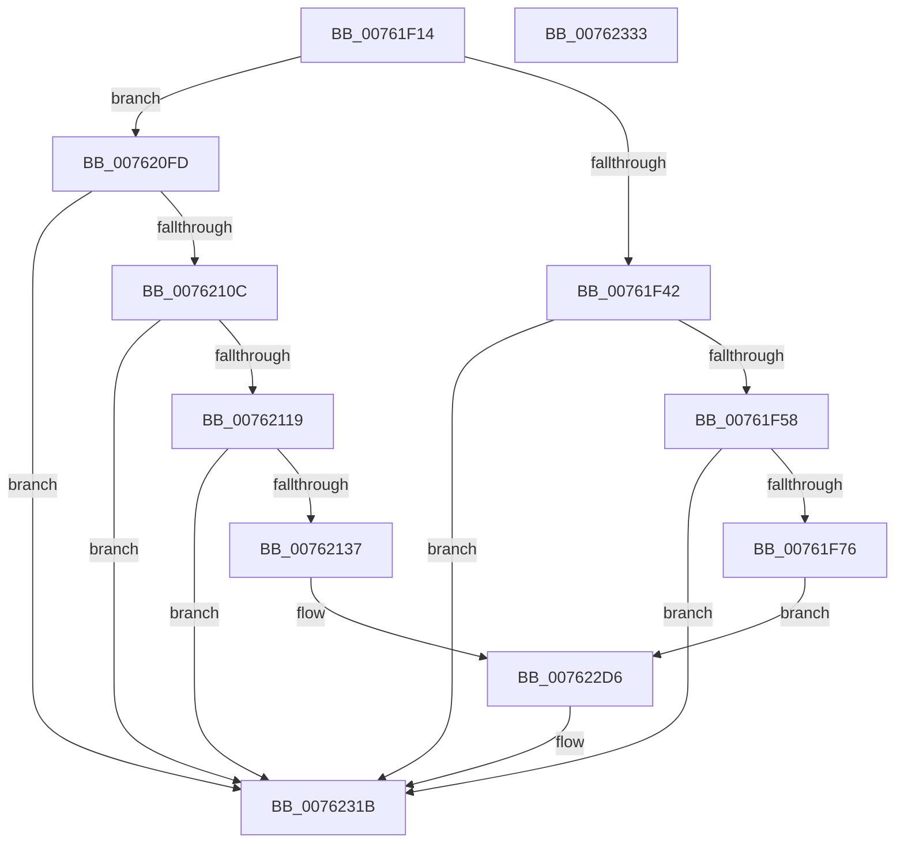

# PopDiagTracePowerButtonBugcheck

- RVA: `0x00761F14`–`0x00762334` (길이 `1,056` bytes)
- VA: `0x0000000140761F14`
- 실행 섹션: `PAGE`
- PDB 이름 있음: `예`; PDB Function 태그: `아니요`
- unwind 정보 RVA: `0x000CC920`
- 디코드: `194`개 명령, `1,056/1,056` bytes 표시
- 미해석 바이트: `0` (있으면 어셈블리에 `.byte`로 보존)

> 이 문서는 커널 이미지의 기계어와 PDB 기호를 분석해 생성했습니다. 4번과 5번은 함수 원형과 자료형을 바이너리 사용 방식에서 추정한 C 해석이며 원본 소스 복구 결과는 아닙니다.

## 1. Dependencies

- 직접 호출 지점: **5**; 고유 호출 대상: **4**
- 직접 호출자로 확인된 함수: **1**
- RIP 상대 이미지 참조: **18**

### Outgoing calls
- `0x00761F46` → [PopRecordLongPowerButtonPressDetected](../75/PopRecordLongPowerButtonPressDetected_function_007543BC.md) (function, `0x007543BC`)
- `0x00761F69` → [tlgKeywordOn](../../text/42/tlgKeywordOn_function_0042EAA0.md) (function, `0x0042EAA0`)
- `0x0076212A` → [tlgKeywordOn](../../text/42/tlgKeywordOn_function_0042EAA0.md) (function, `0x0042EAA0`)
- `0x00762316` → [tlgWriteTransfer_EtwWriteTransfer](../../text/42/tlgWriteTransfer_EtwWriteTransfer_function_004260E0.md) (function, `0x004260E0`)
- `0x00762325` → [_security_check_cookie](../../text/6A/_security_check_cookie_function_006AC640.md) (function, `0x006AC640`)

### Direct callers
- [PopPowerButtonWorkCallback](../../text/5D/PopPowerButtonWorkCallback_function_005D9A70.md) at `0x005D9C25`

### Static image references
- `0x00761F25` → RVA `0x00E0A740` (`.data`; read)
- `0x00761F4B` → RVA `0x00E07748` (`.data`; read)
- `0x00761F87` → RVA `0x0004BE9B` (`.rdata`; read)
- `0x00761F8E` → RVA `0x00F08528` (`.data`; read)
- `0x00761FA1` → RVA `0x00F08524` (`.data`; read)
- `0x00761FB4` → RVA `0x00F08588` (`.data`; read)
- `0x00761FC7` → RVA `0x00F08530` (`.data`; read)
- `0x00761FDC` → RVA `0x00F08538` (`.data`; read)
- `0x00761FEF` → RVA `0x00F0853C` (`.data`; read)
- `0x00762002` → RVA `0x00F08540` (`.data`; read)
- `0x00762017` → RVA `0x00F0858C` (`.data`; read)
- `0x0076202A` → RVA `0x00F08598` (`.data`; read)
- `0x0076203D` → RVA `0x00F08590` (`.data`; read)
- `0x00762050` → RVA `0x00F08594` (`.data`; read)
- `0x00762063` → RVA `0x00F085A8` (`.data`; read)
- `0x00762076` → RVA `0x00F0859C` (`.data`; read)
- `0x00762089` → RVA `0x00F085A4` (`.data`; read)
- `0x00762145` → RVA `0x0004B648` (`.rdata`; read)

## 2. Other-region calls and transfers

- 다른 실행 섹션으로 향하는 call: **4**
  - `0x00761F69` → [tlgKeywordOn](../../text/42/tlgKeywordOn_function_0042EAA0.md) (`PAGE` → `.text`)
  - `0x0076212A` → [tlgKeywordOn](../../text/42/tlgKeywordOn_function_0042EAA0.md) (`PAGE` → `.text`)
  - `0x00762316` → [tlgWriteTransfer_EtwWriteTransfer](../../text/42/tlgWriteTransfer_EtwWriteTransfer_function_004260E0.md) (`PAGE` → `.text`)
  - `0x00762325` → [_security_check_cookie](../../text/6A/_security_check_cookie_function_006AC640.md) (`PAGE` → `.text`)
- 별도 외부 분기/꼬리 이동을 확인하지 못했습니다.

## 3. Assembly (complete function range)

```asm
00761F14  40 55                           push rbp
00761F16  48 8D AC 24 50 FF FF FF         lea rbp, [rsp - 0xb0]
00761F1E  48 81 EC B0 01 00 00            sub rsp, 0x1b0
00761F25  48 8B 05 14 88 6A 00            mov rax, qword ptr [rip + 0x6a8814]
00761F2C  48 33 C4                        xor rax, rsp
00761F2F  48 89 85 A0 00 00 00            mov qword ptr [rbp + 0xa0], rax
00761F36  81 F9 58 1B 00 00               cmp ecx, 0x1b58
00761F3C  0F 85 BB 01 00 00               jne 0x1407620fd
00761F42  B2 01                           mov dl, 1
00761F44  8A CA                           mov cl, dl
00761F46  E8 71 24 FF FF                  call 0x1407543bc
00761F4B  83 3D F6 57 6A 00 05            cmp dword ptr [rip + 0x6a57f6], 5
00761F52  0F 86 C3 03 00 00               jbe 0x14076231b
00761F58  48 BA 00 00 00 00 00 40 00 00   movabs rdx, 0x400000000000
00761F62  48 8D 0D DF 57 6A 00            lea rcx, [rip + 0x6a57df]
00761F69  E8 32 CB CC FF                  call 0x14042eaa0
00761F6E  84 C0                           test al, al
00761F70  0F 84 A5 03 00 00               je 0x14076231b
00761F76  48 8D 44 24 34                  lea rax, [rsp + 0x34]
00761F7B  C7 44 24 34 58 1B 00 00         mov dword ptr [rsp + 0x34], 0x1b58
00761F83  48 89 45 A0                     mov qword ptr [rbp - 0x60], rax
00761F87  48 8D 15 0D 9F 8E FF            lea rdx, [rip - 0x7160f3]
00761F8E  8B 05 94 65 7A 00               mov eax, dword ptr [rip + 0x7a6594]
00761F94  89 44 24 38                     mov dword ptr [rsp + 0x38], eax
00761F98  48 8D 44 24 38                  lea rax, [rsp + 0x38]
00761F9D  48 89 45 B0                     mov qword ptr [rbp - 0x50], rax
00761FA1  8B 05 7D 65 7A 00               mov eax, dword ptr [rip + 0x7a657d]
00761FA7  89 44 24 3C                     mov dword ptr [rsp + 0x3c], eax
00761FAB  48 8D 44 24 3C                  lea rax, [rsp + 0x3c]
00761FB0  48 89 45 C0                     mov qword ptr [rbp - 0x40], rax
00761FB4  8A 05 CE 65 7A 00               mov al, byte ptr [rip + 0x7a65ce]
00761FBA  88 44 24 30                     mov byte ptr [rsp + 0x30], al
00761FBE  48 8D 44 24 30                  lea rax, [rsp + 0x30]
00761FC3  48 89 45 D0                     mov qword ptr [rbp - 0x30], rax
00761FC7  48 8B 05 62 65 7A 00            mov rax, qword ptr [rip + 0x7a6562]
00761FCE  48 89 44 24 60                  mov qword ptr [rsp + 0x60], rax
00761FD3  48 8D 44 24 60                  lea rax, [rsp + 0x60]
00761FD8  48 89 45 E0                     mov qword ptr [rbp - 0x20], rax
00761FDC  8B 05 56 65 7A 00               mov eax, dword ptr [rip + 0x7a6556]
00761FE2  89 44 24 40                     mov dword ptr [rsp + 0x40], eax
00761FE6  48 8D 44 24 40                  lea rax, [rsp + 0x40]
00761FEB  48 89 45 F0                     mov qword ptr [rbp - 0x10], rax
00761FEF  8B 05 47 65 7A 00               mov eax, dword ptr [rip + 0x7a6547]
00761FF5  89 44 24 44                     mov dword ptr [rsp + 0x44], eax
00761FF9  48 8D 44 24 44                  lea rax, [rsp + 0x44]
00761FFE  48 89 45 00                     mov qword ptr [rbp], rax
00762002  48 8B 05 37 65 7A 00            mov rax, qword ptr [rip + 0x7a6537]
00762009  48 89 44 24 68                  mov qword ptr [rsp + 0x68], rax
0076200E  48 8D 44 24 68                  lea rax, [rsp + 0x68]
00762013  48 89 45 10                     mov qword ptr [rbp + 0x10], rax
00762017  8B 05 6F 65 7A 00               mov eax, dword ptr [rip + 0x7a656f]
0076201D  89 44 24 48                     mov dword ptr [rsp + 0x48], eax
00762021  48 8D 44 24 48                  lea rax, [rsp + 0x48]
00762026  48 89 45 20                     mov qword ptr [rbp + 0x20], rax
0076202A  8A 05 68 65 7A 00               mov al, byte ptr [rip + 0x7a6568]
00762030  88 44 24 31                     mov byte ptr [rsp + 0x31], al
00762034  48 8D 44 24 31                  lea rax, [rsp + 0x31]
00762039  48 89 45 30                     mov qword ptr [rbp + 0x30], rax
0076203D  8B 05 4D 65 7A 00               mov eax, dword ptr [rip + 0x7a654d]
00762043  89 44 24 4C                     mov dword ptr [rsp + 0x4c], eax
00762047  48 8D 44 24 4C                  lea rax, [rsp + 0x4c]
0076204C  48 89 45 40                     mov qword ptr [rbp + 0x40], rax
00762050  8B 05 3E 65 7A 00               mov eax, dword ptr [rip + 0x7a653e]
00762056  89 44 24 50                     mov dword ptr [rsp + 0x50], eax
0076205A  48 8D 44 24 50                  lea rax, [rsp + 0x50]
0076205F  48 89 45 50                     mov qword ptr [rbp + 0x50], rax
00762063  8B 05 3F 65 7A 00               mov eax, dword ptr [rip + 0x7a653f]
00762069  89 44 24 54                     mov dword ptr [rsp + 0x54], eax
0076206D  48 8D 44 24 54                  lea rax, [rsp + 0x54]
00762072  48 89 45 60                     mov qword ptr [rbp + 0x60], rax
00762076  8B 05 20 65 7A 00               mov eax, dword ptr [rip + 0x7a6520]
0076207C  89 44 24 58                     mov dword ptr [rsp + 0x58], eax
00762080  48 8D 44 24 58                  lea rax, [rsp + 0x58]
00762085  48 89 45 70                     mov qword ptr [rbp + 0x70], rax
00762089  8B 05 15 65 7A 00               mov eax, dword ptr [rip + 0x7a6515]
0076208F  89 44 24 5C                     mov dword ptr [rsp + 0x5c], eax
00762093  48 8D 44 24 5C                  lea rax, [rsp + 0x5c]
00762098  48 89 85 80 00 00 00            mov qword ptr [rbp + 0x80], rax
0076209F  48 8D 45 80                     lea rax, [rbp - 0x80]
007620A3  48 89 44 24 28                  mov qword ptr [rsp + 0x28], rax
007620A8  C7 44 24 20 11 00 00 00         mov dword ptr [rsp + 0x20], 0x11
007620B0  48 C7 45 A8 04 00 00 00         mov qword ptr [rbp - 0x58], 4
007620B8  48 C7 45 B8 04 00 00 00         mov qword ptr [rbp - 0x48], 4
007620C0  48 C7 45 C8 04 00 00 00         mov qword ptr [rbp - 0x38], 4
007620C8  48 C7 45 D8 01 00 00 00         mov qword ptr [rbp - 0x28], 1
007620D0  48 C7 45 E8 08 00 00 00         mov qword ptr [rbp - 0x18], 8
007620D8  48 C7 45 F8 04 00 00 00         mov qword ptr [rbp - 8], 4
007620E0  48 C7 45 08 04 00 00 00         mov qword ptr [rbp + 8], 4
007620E8  48 C7 45 18 08 00 00 00         mov qword ptr [rbp + 0x18], 8
007620F0  48 C7 45 28 04 00 00 00         mov qword ptr [rbp + 0x28], 4
007620F8  E9 D9 01 00 00                  jmp 0x1407622d6
007620FD  41 B8 98 3A 00 00               mov r8d, 0x3a98
00762103  41 3B C8                        cmp ecx, r8d
00762106  0F 85 0F 02 00 00               jne 0x14076231b
0076210C  83 3D 35 56 6A 00 05            cmp dword ptr [rip + 0x6a5635], 5
00762113  0F 86 02 02 00 00               jbe 0x14076231b
00762119  48 BA 00 00 00 00 00 80 00 00   movabs rdx, 0x800000000000
00762123  48 8D 0D 1E 56 6A 00            lea rcx, [rip + 0x6a561e]
0076212A  E8 71 C9 CC FF                  call 0x14042eaa0
0076212F  84 C0                           test al, al
00762131  0F 84 E4 01 00 00               je 0x14076231b
00762137  48 8D 44 24 5C                  lea rax, [rsp + 0x5c]
0076213C  44 89 44 24 5C                  mov dword ptr [rsp + 0x5c], r8d
00762141  48 89 45 A0                     mov qword ptr [rbp - 0x60], rax
00762145  48 8D 15 FC 94 8E FF            lea rdx, [rip - 0x716b04]
0076214C  8B 05 D6 63 7A 00               mov eax, dword ptr [rip + 0x7a63d6]
00762152  89 44 24 58                     mov dword ptr [rsp + 0x58], eax
00762156  48 8D 44 24 58                  lea rax, [rsp + 0x58]
0076215B  48 89 45 B0                     mov qword ptr [rbp - 0x50], rax
0076215F  8B 05 BF 63 7A 00               mov eax, dword ptr [rip + 0x7a63bf]
00762165  89 44 24 54                     mov dword ptr [rsp + 0x54], eax
00762169  48 8D 44 24 54                  lea rax, [rsp + 0x54]
0076216E  48 89 45 C0                     mov qword ptr [rbp - 0x40], rax
00762172  8A 05 10 64 7A 00               mov al, byte ptr [rip + 0x7a6410]
00762178  88 44 24 31                     mov byte ptr [rsp + 0x31], al
0076217C  48 8D 44 24 31                  lea rax, [rsp + 0x31]
00762181  48 89 45 D0                     mov qword ptr [rbp - 0x30], rax
00762185  48 8B 05 A4 63 7A 00            mov rax, qword ptr [rip + 0x7a63a4]
0076218C  48 89 44 24 68                  mov qword ptr [rsp + 0x68], rax
00762191  48 8D 44 24 68                  lea rax, [rsp + 0x68]
00762196  48 89 45 E0                     mov qword ptr [rbp - 0x20], rax
0076219A  8B 05 98 63 7A 00               mov eax, dword ptr [rip + 0x7a6398]
007621A0  89 44 24 50                     mov dword ptr [rsp + 0x50], eax
007621A4  48 8D 44 24 50                  lea rax, [rsp + 0x50]
007621A9  48 89 45 F0                     mov qword ptr [rbp - 0x10], rax
007621AD  8B 05 89 63 7A 00               mov eax, dword ptr [rip + 0x7a6389]
007621B3  89 44 24 4C                     mov dword ptr [rsp + 0x4c], eax
007621B7  48 8D 44 24 4C                  lea rax, [rsp + 0x4c]
007621BC  48 89 45 00                     mov qword ptr [rbp], rax
007621C0  48 8B 05 79 63 7A 00            mov rax, qword ptr [rip + 0x7a6379]
007621C7  48 89 44 24 60                  mov qword ptr [rsp + 0x60], rax
007621CC  48 8D 44 24 60                  lea rax, [rsp + 0x60]
007621D1  48 89 45 10                     mov qword ptr [rbp + 0x10], rax
007621D5  8B 05 B1 63 7A 00               mov eax, dword ptr [rip + 0x7a63b1]
007621DB  89 44 24 48                     mov dword ptr [rsp + 0x48], eax
007621DF  48 8D 44 24 48                  lea rax, [rsp + 0x48]
007621E4  48 89 45 20                     mov qword ptr [rbp + 0x20], rax
007621E8  8A 05 AA 63 7A 00               mov al, byte ptr [rip + 0x7a63aa]
007621EE  88 44 24 30                     mov byte ptr [rsp + 0x30], al
007621F2  48 8D 44 24 30                  lea rax, [rsp + 0x30]
007621F7  48 89 45 30                     mov qword ptr [rbp + 0x30], rax
007621FB  8B 05 8F 63 7A 00               mov eax, dword ptr [rip + 0x7a638f]
00762201  89 44 24 44                     mov dword ptr [rsp + 0x44], eax
00762205  48 8D 44 24 44                  lea rax, [rsp + 0x44]
0076220A  48 89 45 40                     mov qword ptr [rbp + 0x40], rax
0076220E  8B 05 80 63 7A 00               mov eax, dword ptr [rip + 0x7a6380]
00762214  89 44 24 40                     mov dword ptr [rsp + 0x40], eax
00762218  48 8D 44 24 40                  lea rax, [rsp + 0x40]
0076221D  48 89 45 50                     mov qword ptr [rbp + 0x50], rax
00762221  8B 05 81 63 7A 00               mov eax, dword ptr [rip + 0x7a6381]
00762227  89 44 24 3C                     mov dword ptr [rsp + 0x3c], eax
0076222B  48 8D 44 24 3C                  lea rax, [rsp + 0x3c]
00762230  48 89 45 60                     mov qword ptr [rbp + 0x60], rax
00762234  8B 05 62 63 7A 00               mov eax, dword ptr [rip + 0x7a6362]
0076223A  89 44 24 38                     mov dword ptr [rsp + 0x38], eax
0076223E  48 8D 44 24 38                  lea rax, [rsp + 0x38]
00762243  48 89 45 70                     mov qword ptr [rbp + 0x70], rax
00762247  8B 05 57 63 7A 00               mov eax, dword ptr [rip + 0x7a6357]
0076224D  89 44 24 34                     mov dword ptr [rsp + 0x34], eax
00762251  48 8D 44 24 34                  lea rax, [rsp + 0x34]
00762256  48 89 85 80 00 00 00            mov qword ptr [rbp + 0x80], rax
0076225D  48 8D 44 24 70                  lea rax, [rsp + 0x70]
00762262  48 89 85 90 00 00 00            mov qword ptr [rbp + 0x90], rax
00762269  48 8D 45 80                     lea rax, [rbp - 0x80]
0076226D  48 89 44 24 28                  mov qword ptr [rsp + 0x28], rax
00762272  C7 44 24 20 12 00 00 00         mov dword ptr [rsp + 0x20], 0x12
0076227A  48 C7 45 A8 04 00 00 00         mov qword ptr [rbp - 0x58], 4
00762282  48 C7 45 B8 04 00 00 00         mov qword ptr [rbp - 0x48], 4
0076228A  48 C7 45 C8 04 00 00 00         mov qword ptr [rbp - 0x38], 4
00762292  48 C7 45 D8 01 00 00 00         mov qword ptr [rbp - 0x28], 1
0076229A  48 C7 45 E8 08 00 00 00         mov qword ptr [rbp - 0x18], 8
007622A2  48 C7 45 F8 04 00 00 00         mov qword ptr [rbp - 8], 4
007622AA  48 C7 45 08 04 00 00 00         mov qword ptr [rbp + 8], 4
007622B2  48 C7 45 18 08 00 00 00         mov qword ptr [rbp + 0x18], 8
007622BA  48 C7 45 28 04 00 00 00         mov qword ptr [rbp + 0x28], 4
007622C2  48 C7 44 24 70 00 00 00 01      mov qword ptr [rsp + 0x70], 0x1000000
007622CB  48 C7 85 98 00 00 00 08 00 00 00  mov qword ptr [rbp + 0x98], 8
007622D6  45 33 C9                        xor r9d, r9d
007622D9  48 C7 45 48 04 00 00 00         mov qword ptr [rbp + 0x48], 4
007622E1  45 33 C0                        xor r8d, r8d
007622E4  48 C7 45 38 01 00 00 00         mov qword ptr [rbp + 0x38], 1
007622EC  48 8D 0D 55 54 6A 00            lea rcx, [rip + 0x6a5455]
007622F3  48 C7 45 58 04 00 00 00         mov qword ptr [rbp + 0x58], 4
007622FB  48 C7 45 68 04 00 00 00         mov qword ptr [rbp + 0x68], 4
00762303  48 C7 45 78 04 00 00 00         mov qword ptr [rbp + 0x78], 4
0076230B  48 C7 85 88 00 00 00 04 00 00 00  mov qword ptr [rbp + 0x88], 4
00762316  E8 C5 3D CC FF                  call 0x1404260e0
0076231B  48 8B 8D A0 00 00 00            mov rcx, qword ptr [rbp + 0xa0]
00762322  48 33 CC                        xor rcx, rsp
00762325  E8 16 A3 F4 FF                  call 0x1406ac640
0076232A  48 81 C4 B0 01 00 00            add rsp, 0x1b0
00762331  5D                              pop rbp
00762332  C3                              ret
00762333  CC                              int3
```

## 4. C-style interpretation (structured pseudocode)

```c
__int64 __fastcall PopDiagTracePowerButtonBugcheck(int a1, __int64 a2, __int64 a3, int a4)
{
    __int64 result;
    __int64 v_rsp;
    unsigned __int64 v_stack_m100;
    unsigned __int64 v_stack_m108;
    unsigned __int64 v_stack_m110;
    unsigned __int64 v_stack_m118;
    unsigned __int64 v_stack_m138;
    unsigned __int64 v_stack_m148;
    unsigned __int64 v_stack_m150;
    unsigned __int64 v_stack_m158;
    unsigned int v_stack_m15C;
    unsigned int v_stack_m160;
    unsigned int v_stack_m164;
    unsigned int v_stack_m168;
    unsigned int v_stack_m16C;
    unsigned int v_stack_m170;
    unsigned int v_stack_m174;
    unsigned int v_stack_m178;
    unsigned int v_stack_m17C;
    unsigned __int64 v_stack_m18;
    unsigned int v_stack_m180;
    unsigned __int64 v_stack_m184;
    unsigned __int8 v_stack_m187;
    unsigned __int8 v_stack_m188;
    unsigned __int64 v_stack_m190;
    unsigned int v_stack_m198;
    unsigned __int64 v_stack_m20;
    unsigned __int64 v_stack_m28;
    unsigned __int64 v_stack_m30;
    unsigned __int64 v_stack_m38;
    unsigned __int64 v_stack_m40;
    unsigned __int64 v_stack_m48;
    unsigned __int64 v_stack_m50;
    unsigned __int64 v_stack_m58;
    unsigned __int64 v_stack_m60;
    unsigned __int64 v_stack_m68;
    unsigned __int64 v_stack_m70;
    unsigned __int64 v_stack_m78;
    unsigned __int64 v_stack_m80;
    unsigned __int64 v_stack_m88;
    unsigned __int64 v_stack_m90;
    unsigned __int64 v_stack_m98;
    unsigned __int64 v_stack_mA0;
    unsigned __int64 v_stack_mA8;
    unsigned __int64 v_stack_mB0;
    unsigned __int64 v_stack_mB8;
    unsigned __int64 v_stack_mC0;
    unsigned __int64 v_stack_mC8;
    unsigned __int64 v_stack_mD0;
    unsigned __int64 v_stack_mD8;
    unsigned __int64 v_stack_mE0;
    unsigned __int64 v_stack_mE8;
    unsigned __int64 v_stack_mF0;
    unsigned __int64 v_stack_mF8;

    v_rsp = (v_rsp) - (432);
    result = (*(unsigned __int64 *)(v_rip + 6981652)) ^ (v_rsp);
    v_stack_m18 = result;
    if (a1 != 0x1B58ULL) goto loc_007620FD;
    result = PopRecordLongPowerButtonPressDetected(1, 1, a3, a4);
    if ((*(unsigned int *)(v_rip + 6969334)) <= 5) goto loc_0076231B;
    result = tlgKeywordOn(v_rip + 6969311, 1, a3, a4);
    if ((unsigned __int8)(result) == 0) goto loc_0076231B;
    v_stack_m184 = 0x1B58ULL;
    v_stack_m118 = v_stack_m184;
    v_stack_m180 = (unsigned int)((unsigned int)(*(unsigned int *)(v_rip + 8021396)));
    v_stack_m108 = v_stack_m180;
    v_stack_m17C = (unsigned int)((unsigned int)(*(unsigned int *)(v_rip + 8021373)));
    v_stack_mF8 = v_stack_m17C;
    v_stack_m188 = (unsigned __int8)(*(unsigned __int8 *)(v_rip + 8021454));
    v_stack_mE8 = v_stack_m188;
    v_stack_m158 = *(unsigned __int64 *)(v_rip + 8021346);
    v_stack_mD8 = v_stack_m158;
    v_stack_m178 = (unsigned int)((unsigned int)(*(unsigned int *)(v_rip + 8021334)));
    v_stack_mC8 = v_stack_m178;
    v_stack_m174 = (unsigned int)((unsigned int)(*(unsigned int *)(v_rip + 8021319)));
    v_stack_mB8 = v_stack_m174;
    v_stack_m150 = *(unsigned __int64 *)(v_rip + 8021303);
    v_stack_mA8 = v_stack_m150;
    v_stack_m170 = (unsigned int)((unsigned int)(*(unsigned int *)(v_rip + 8021359)));
    v_stack_m98 = v_stack_m170;
    v_stack_m187 = (unsigned __int8)(*(unsigned __int8 *)(v_rip + 8021352));
    v_stack_m88 = v_stack_m187;
    v_stack_m16C = (unsigned int)((unsigned int)(*(unsigned int *)(v_rip + 8021325)));
    v_stack_m78 = v_stack_m16C;
    v_stack_m168 = (unsigned int)((unsigned int)(*(unsigned int *)(v_rip + 8021310)));
    v_stack_m68 = v_stack_m168;
    v_stack_m164 = (unsigned int)((unsigned int)(*(unsigned int *)(v_rip + 8021311)));
    v_stack_m58 = v_stack_m164;
    v_stack_m160 = (unsigned int)((unsigned int)(*(unsigned int *)(v_rip + 8021280)));
    v_stack_m48 = v_stack_m160;
    v_stack_m15C = (unsigned int)((unsigned int)(*(unsigned int *)(v_rip + 8021269)));
    v_stack_m38 = v_stack_m15C;
    v_stack_m190 = v_stack_m138;
    v_stack_m198 = 17;
    v_stack_m110 = 4;
    v_stack_m100 = 4;
    v_stack_mF0 = 4;
    v_stack_mE0 = 1;
    v_stack_mD0 = 8;
    v_stack_mC0 = 4;
    v_stack_mB0 = 4;
    v_stack_mA0 = 8;
    v_stack_m90 = 4;
    goto loc_007622D6;
loc_007620FD:
    if (((unsigned int)(v_rip + 6969311)) != ((unsigned int)((unsigned int)(0x3A98ULL)))) goto loc_0076231B;
    if ((*(unsigned int *)(v_rip + 6968885)) <= 5) goto loc_0076231B;
    result = tlgKeywordOn(v_rip + 6968862, v_rip - 7430387, (unsigned int)(0x3A98ULL), a4);
    if ((unsigned __int8)(result) == 0) goto loc_0076231B;
    v_stack_m15C = (unsigned int)((unsigned int)(0x3A98ULL));
    v_stack_m118 = v_stack_m15C;
    v_stack_m160 = (unsigned int)((unsigned int)(*(unsigned int *)(v_rip + 8020950)));
    v_stack_m108 = v_stack_m160;
    v_stack_m164 = (unsigned int)((unsigned int)(*(unsigned int *)(v_rip + 8020927)));
    v_stack_mF8 = v_stack_m164;
    v_stack_m187 = (unsigned __int8)(*(unsigned __int8 *)(v_rip + 8021008));
    v_stack_mE8 = v_stack_m187;
    v_stack_m150 = *(unsigned __int64 *)(v_rip + 8020900);
    v_stack_mD8 = v_stack_m150;
    v_stack_m168 = (unsigned int)((unsigned int)(*(unsigned int *)(v_rip + 8020888)));
    v_stack_mC8 = v_stack_m168;
    v_stack_m16C = (unsigned int)((unsigned int)(*(unsigned int *)(v_rip + 8020873)));
    v_stack_mB8 = v_stack_m16C;
    v_stack_m158 = *(unsigned __int64 *)(v_rip + 8020857);
    v_stack_mA8 = v_stack_m158;
    v_stack_m170 = (unsigned int)((unsigned int)(*(unsigned int *)(v_rip + 8020913)));
    v_stack_m98 = v_stack_m170;
    v_stack_m188 = (unsigned __int8)(*(unsigned __int8 *)(v_rip + 8020906));
    v_stack_m88 = v_stack_m188;
    v_stack_m174 = (unsigned int)((unsigned int)(*(unsigned int *)(v_rip + 8020879)));
    v_stack_m78 = v_stack_m174;
    v_stack_m178 = (unsigned int)((unsigned int)(*(unsigned int *)(v_rip + 8020864)));
    v_stack_m68 = v_stack_m178;
    v_stack_m17C = (unsigned int)((unsigned int)(*(unsigned int *)(v_rip + 8020865)));
    v_stack_m58 = v_stack_m17C;
    v_stack_m180 = (unsigned int)((unsigned int)(*(unsigned int *)(v_rip + 8020834)));
    v_stack_m48 = v_stack_m180;
    v_stack_m184 = (unsigned int)((unsigned int)(*(unsigned int *)(v_rip + 8020823)));
    v_stack_m38 = v_stack_m184;
    v_stack_m28 = v_stack_m148;
    v_stack_m190 = v_stack_m138;
    v_stack_m198 = 18;
    v_stack_m110 = 4;
    v_stack_m100 = 4;
    v_stack_mF0 = 4;
    v_stack_mE0 = 1;
    v_stack_mD0 = 8;
    v_stack_mC0 = 4;
    v_stack_mB0 = 4;
    v_stack_mA0 = 8;
    v_stack_m90 = 4;
    v_stack_m148 = 0x1000000ULL;
    v_stack_m20 = 8;
loc_007622D6:
    a4 = 0;
    v_stack_m70 = 4;
    a3 = 0;
    v_stack_m80 = 1;
    v_stack_m60 = 4;
    v_stack_m50 = 4;
    v_stack_m40 = 4;
    v_stack_m30 = 4;
    result = tlgWriteTransfer_EtwWriteTransfer(v_rip + 6968405, v_rip - 7432964, a3, a4);
loc_0076231B:
    a1 = (v_stack_m18) ^ (v_rsp);
    result = _security_check_cookie(a1, v_rip - 7432964, a3, a4);
    v_rsp = (v_rsp) + (432);
    return result;
}
```

## 5. (Beta) C Style

```c
int64_t PopDiagTracePowerButtonBugcheck(int32_t Arg1, int64_t Arg2, int64_t Arg3, int32_t Arg4)
{
    int64_t result;
    int64_t local_rsp;
    uint64_t v_stack_m100;
    uint64_t v_stack_m108;
    uint64_t v_stack_m110;
    uint64_t v_stack_m118;
    uint64_t v_stack_m138;
    uint64_t v_stack_m148;
    uint64_t v_stack_m150;
    uint64_t v_stack_m158;
    uint32_t v_stack_m15C;
    uint32_t v_stack_m160;
    uint32_t v_stack_m164;
    uint32_t v_stack_m168;
    uint32_t v_stack_m16C;
    uint32_t v_stack_m170;
    uint32_t v_stack_m174;
    uint32_t v_stack_m178;
    uint32_t v_stack_m17C;
    uint64_t v_stack_m18;
    uint32_t v_stack_m180;
    uint64_t v_stack_m184;
    uint8_t v_stack_m187;
    uint8_t v_stack_m188;
    uint64_t v_stack_m190;
    uint32_t v_stack_m198;
    uint64_t v_stack_m20;
    uint64_t v_stack_m28;
    uint64_t v_stack_m30;
    uint64_t v_stack_m38;
    uint64_t v_stack_m40;
    uint64_t v_stack_m48;
    uint64_t v_stack_m50;
    uint64_t v_stack_m58;
    uint64_t v_stack_m60;
    uint64_t v_stack_m68;
    uint64_t v_stack_m70;
    uint64_t v_stack_m78;
    uint64_t v_stack_m80;
    uint64_t v_stack_m88;
    uint64_t v_stack_m90;
    uint64_t v_stack_m98;
    uint64_t v_stack_mA0;
    uint64_t v_stack_mA8;
    uint64_t v_stack_mB0;
    uint64_t v_stack_mB8;
    uint64_t v_stack_mC0;
    uint64_t v_stack_mC8;
    uint64_t v_stack_mD0;
    uint64_t v_stack_mD8;
    uint64_t v_stack_mE0;
    uint64_t v_stack_mE8;
    uint64_t v_stack_mF0;
    uint64_t v_stack_mF8;

    local_rsp = (local_rsp) - (432);
    result = (*(uint64_t *)(v_rip + 0x6A8814)) ^ (local_rsp);
    v_stack_m18 = result;
    if (Arg1 != 0x1B58ULL) goto loc_007620FD;
    result = PopRecordLongPowerButtonPressDetected(1, 1, Arg3, Arg4);
    if ((*(uint32_t *)(v_rip + 0x6A57F6)) <= 5) goto loc_0076231B;
    result = tlgKeywordOn(v_rip + 6969311, 1, Arg3, Arg4);
    if ((uint8_t)(result) == 0) goto loc_0076231B;
    v_stack_m184 = 0x1B58ULL;
    v_stack_m118 = v_stack_m184;
    v_stack_m180 = (uint32_t)((uint32_t)(*(uint32_t *)(v_rip + 0x7A6594)));
    v_stack_m108 = v_stack_m180;
    v_stack_m17C = (uint32_t)((uint32_t)(*(uint32_t *)(v_rip + 0x7A657D)));
    v_stack_mF8 = v_stack_m17C;
    v_stack_m188 = (uint8_t)(*(uint8_t *)(v_rip + 0x7A65CE));
    v_stack_mE8 = v_stack_m188;
    v_stack_m158 = *(uint64_t *)(v_rip + 0x7A6562);
    v_stack_mD8 = v_stack_m158;
    v_stack_m178 = (uint32_t)((uint32_t)(*(uint32_t *)(v_rip + 0x7A6556)));
    v_stack_mC8 = v_stack_m178;
    v_stack_m174 = (uint32_t)((uint32_t)(*(uint32_t *)(v_rip + 0x7A6547)));
    v_stack_mB8 = v_stack_m174;
    v_stack_m150 = *(uint64_t *)(v_rip + 0x7A6537);
    v_stack_mA8 = v_stack_m150;
    v_stack_m170 = (uint32_t)((uint32_t)(*(uint32_t *)(v_rip + 0x7A656F)));
    v_stack_m98 = v_stack_m170;
    v_stack_m187 = (uint8_t)(*(uint8_t *)(v_rip + 0x7A6568));
    v_stack_m88 = v_stack_m187;
    v_stack_m16C = (uint32_t)((uint32_t)(*(uint32_t *)(v_rip + 0x7A654D)));
    v_stack_m78 = v_stack_m16C;
    v_stack_m168 = (uint32_t)((uint32_t)(*(uint32_t *)(v_rip + 0x7A653E)));
    v_stack_m68 = v_stack_m168;
    v_stack_m164 = (uint32_t)((uint32_t)(*(uint32_t *)(v_rip + 0x7A653F)));
    v_stack_m58 = v_stack_m164;
    v_stack_m160 = (uint32_t)((uint32_t)(*(uint32_t *)(v_rip + 0x7A6520)));
    v_stack_m48 = v_stack_m160;
    v_stack_m15C = (uint32_t)((uint32_t)(*(uint32_t *)(v_rip + 0x7A6515)));
    v_stack_m38 = v_stack_m15C;
    v_stack_m190 = v_stack_m138;
    v_stack_m198 = 17;
    v_stack_m110 = 4;
    v_stack_m100 = 4;
    v_stack_mF0 = 4;
    v_stack_mE0 = 1;
    v_stack_mD0 = 8;
    v_stack_mC0 = 4;
    v_stack_mB0 = 4;
    v_stack_mA0 = 8;
    v_stack_m90 = 4;
    goto loc_007622D6;
loc_007620FD:
    if (((uint32_t)(v_rip + 6969311)) != ((uint32_t)((uint32_t)(0x3A98ULL)))) goto loc_0076231B;
    if ((*(uint32_t *)(v_rip + 0x6A5635)) <= 5) goto loc_0076231B;
    result = tlgKeywordOn(v_rip + 6968862, v_rip - 7430387, (uint32_t)(0x3A98ULL), Arg4);
    if ((uint8_t)(result) == 0) goto loc_0076231B;
    v_stack_m15C = (uint32_t)((uint32_t)(0x3A98ULL));
    v_stack_m118 = v_stack_m15C;
    v_stack_m160 = (uint32_t)((uint32_t)(*(uint32_t *)(v_rip + 0x7A63D6)));
    v_stack_m108 = v_stack_m160;
    v_stack_m164 = (uint32_t)((uint32_t)(*(uint32_t *)(v_rip + 0x7A63BF)));
    v_stack_mF8 = v_stack_m164;
    v_stack_m187 = (uint8_t)(*(uint8_t *)(v_rip + 0x7A6410));
    v_stack_mE8 = v_stack_m187;
    v_stack_m150 = *(uint64_t *)(v_rip + 0x7A63A4);
    v_stack_mD8 = v_stack_m150;
    v_stack_m168 = (uint32_t)((uint32_t)(*(uint32_t *)(v_rip + 0x7A6398)));
    v_stack_mC8 = v_stack_m168;
    v_stack_m16C = (uint32_t)((uint32_t)(*(uint32_t *)(v_rip + 0x7A6389)));
    v_stack_mB8 = v_stack_m16C;
    v_stack_m158 = *(uint64_t *)(v_rip + 0x7A6379);
    v_stack_mA8 = v_stack_m158;
    v_stack_m170 = (uint32_t)((uint32_t)(*(uint32_t *)(v_rip + 0x7A63B1)));
    v_stack_m98 = v_stack_m170;
    v_stack_m188 = (uint8_t)(*(uint8_t *)(v_rip + 0x7A63AA));
    v_stack_m88 = v_stack_m188;
    v_stack_m174 = (uint32_t)((uint32_t)(*(uint32_t *)(v_rip + 0x7A638F)));
    v_stack_m78 = v_stack_m174;
    v_stack_m178 = (uint32_t)((uint32_t)(*(uint32_t *)(v_rip + 0x7A6380)));
    v_stack_m68 = v_stack_m178;
    v_stack_m17C = (uint32_t)((uint32_t)(*(uint32_t *)(v_rip + 0x7A6381)));
    v_stack_m58 = v_stack_m17C;
    v_stack_m180 = (uint32_t)((uint32_t)(*(uint32_t *)(v_rip + 0x7A6362)));
    v_stack_m48 = v_stack_m180;
    v_stack_m184 = (uint32_t)((uint32_t)(*(uint32_t *)(v_rip + 0x7A6357)));
    v_stack_m38 = v_stack_m184;
    v_stack_m28 = v_stack_m148;
    v_stack_m190 = v_stack_m138;
    v_stack_m198 = 18;
    v_stack_m110 = 4;
    v_stack_m100 = 4;
    v_stack_mF0 = 4;
    v_stack_mE0 = 1;
    v_stack_mD0 = 8;
    v_stack_mC0 = 4;
    v_stack_mB0 = 4;
    v_stack_mA0 = 8;
    v_stack_m90 = 4;
    v_stack_m148 = 0x1000000ULL;
    v_stack_m20 = 8;
loc_007622D6:
    Arg4 = 0;
    v_stack_m70 = 4;
    Arg3 = 0;
    v_stack_m80 = 1;
    v_stack_m60 = 4;
    v_stack_m50 = 4;
    v_stack_m40 = 4;
    v_stack_m30 = 4;
    result = tlgWriteTransfer_EtwWriteTransfer(v_rip + 6968405, v_rip - 7432964, Arg3, Arg4);
loc_0076231B:
    Arg1 = (v_stack_m18) ^ (local_rsp);
    result = _security_check_cookie(Arg1, v_rip - 7432964, Arg3, Arg4);
    local_rsp = (local_rsp) + (432);
    return result;
}
```

## 6. Execution-region graph

[열기: 2D/3D 그래프와 함수 탐색 컨트롤 패널](../../../control-panel.html?section=page&rva=0x00761F14&view=graph)

- 2D 그래프는 위에서 아래로 흐르고, 3D 그래프는 빈 공간을 드래그해 회전합니다. Shift+드래그는 이동, 휠은 확대·축소, 함수 노드 선택은 대상 보고서 이동입니다.

### Static fallback


