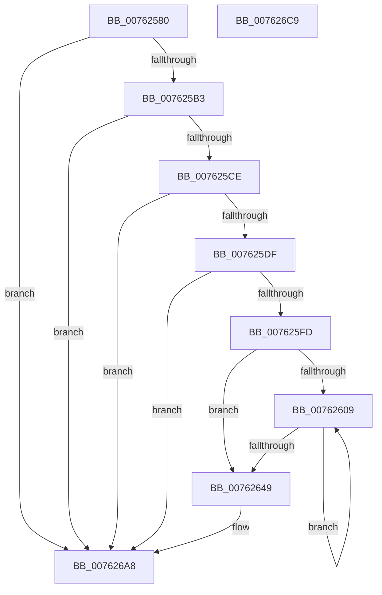

# PopDiagTracePowerLimitExtensionValueUpdate

- RVA: `0x00762580`–`0x007626CA` (길이 `330` bytes)
- VA: `0x0000000140762580`
- 실행 섹션: `PAGE`
- PDB 이름 있음: `예`; PDB Function 태그: `아니요`
- unwind 정보 RVA: `0x000CCBCC`
- 디코드: `83`개 명령, `330/330` bytes 표시
- 미해석 바이트: `0` (있으면 어셈블리에 `.byte`로 보존)

> 이 문서는 커널 이미지의 기계어와 PDB 기호를 분석해 생성했습니다. 4번과 5번은 함수 원형과 자료형을 바이너리 사용 방식에서 추정한 C 해석이며 원본 소스 복구 결과는 아닙니다.

## 1. Dependencies

- 직접 호출 지점: **5**; 고유 호출 대상: **5**
- 직접 호출자로 확인된 함수: **1**
- RIP 상대 이미지 참조: **4**

### Outgoing calls
- `0x007625C1` → [EtwEventEnabled](../../text/39/EtwEventEnabled_function_00392450.md) (function, `0x00392450`)
- `0x007625EC` → [ExAllocatePool2](../../poolcode/B8/ExAllocatePool2_function_00B820F0.md) (function, `0x00B820F0`)
- `0x00762696` → [EtwWrite](../../text/41/EtwWrite_function_0041C720.md) (function, `0x0041C720`)
- `0x007626A3` → [ExFreePoolWithTag](../../poolcode/B8/ExFreePoolWithTag_function_00B82870.md) (function, `0x00B82870`)
- `0x007626AF` → [_security_check_cookie](../../text/6A/_security_check_cookie_function_006AC640.md) (function, `0x006AC640`)

### Direct callers
- [PopEvaluatePowerLimitChange](../75/PopEvaluatePowerLimitChange_function_00756224.md) at `0x00756455`

### Static image references
- `0x00762595` → RVA `0x00E0A740` (`.data`; read)
- `0x007625A3` → RVA `0x00E67858` (`.data`; read)
- `0x007625B3` → RVA `0x00F0B408` (`.data`; read)
- `0x007625BA` → RVA `0x00021E20` (`.rdata`; read)

## 2. Other-region calls and transfers

- 다른 실행 섹션으로 향하는 call: **5**
  - `0x007625C1` → [EtwEventEnabled](../../text/39/EtwEventEnabled_function_00392450.md) (`PAGE` → `.text`)
  - `0x007625EC` → [ExAllocatePool2](../../poolcode/B8/ExAllocatePool2_function_00B820F0.md) (`PAGE` → `POOLCODE`)
  - `0x00762696` → [EtwWrite](../../text/41/EtwWrite_function_0041C720.md) (`PAGE` → `.text`)
  - `0x007626A3` → [ExFreePoolWithTag](../../poolcode/B8/ExFreePoolWithTag_function_00B82870.md) (`PAGE` → `POOLCODE`)
  - `0x007626AF` → [_security_check_cookie](../../text/6A/_security_check_cookie_function_006AC640.md) (`PAGE` → `.text`)
- 별도 외부 분기/꼬리 이동을 확인하지 못했습니다.

## 3. Assembly (complete function range)

```asm
00762580  48 89 5C 24 10                  mov qword ptr [rsp + 0x10], rbx
00762585  48 89 74 24 18                  mov qword ptr [rsp + 0x18], rsi
0076258A  55                              push rbp
0076258B  57                              push rdi
0076258C  41 56                           push r14
0076258E  48 8B EC                        mov rbp, rsp
00762591  48 83 EC 70                     sub rsp, 0x70
00762595  48 8B 05 A4 81 6A 00            mov rax, qword ptr [rip + 0x6a81a4]
0076259C  48 33 C4                        xor rax, rsp
0076259F  48 89 45 F8                     mov qword ptr [rbp - 8], rax
007625A3  80 3D AE 52 70 00 00            cmp byte ptr [rip + 0x7052ae], 0
007625AA  48 8B F9                        mov rdi, rcx
007625AD  0F 84 F5 00 00 00               je 0x1407626a8
007625B3  48 8B 0D 4E 8E 7A 00            mov rcx, qword ptr [rip + 0x7a8e4e]
007625BA  48 8D 15 5F F8 8B FF            lea rdx, [rip - 0x7407a1]
007625C1  E8 8A FE C2 FF                  call 0x140392450
007625C6  84 C0                           test al, al
007625C8  0F 84 DA 00 00 00               je 0x1407626a8
007625CE  48 8D 77 48                     lea rsi, [rdi + 0x48]
007625D2  8B 1E                           mov ebx, dword ptr [rsi]
007625D4  C1 E3 04                        shl ebx, 4
007625D7  85 DB                           test ebx, ebx
007625D9  0F 84 C9 00 00 00               je 0x1407626a8
007625DF  8B D3                           mov edx, ebx
007625E1  B9 00 01 00 00                  mov ecx, 0x100
007625E6  41 B8 50 64 69 67               mov r8d, 0x67696450
007625EC  E8 FF FA 41 00                  call 0x140b820f0
007625F1  4C 8B F0                        mov r14, rax
007625F4  48 85 C0                        test rax, rax
007625F7  0F 84 AB 00 00 00               je 0x1407626a8
007625FD  45 33 C0                        xor r8d, r8d
00762600  48 89 7D C0                     mov qword ptr [rbp - 0x40], rdi
00762604  44 39 06                        cmp dword ptr [rsi], r8d
00762607  76 40                           jbe 0x140762649
00762609  48 8B 47 58                     mov rax, qword ptr [rdi + 0x58]
0076260D  41 8B D0                        mov edx, r8d
00762610  41 FF C0                        inc r8d
00762613  48 03 D2                        add rdx, rdx
00762616  8B 0C D0                        mov ecx, dword ptr [rax + rdx*8]
00762619  41 89 0C D6                     mov dword ptr [r14 + rdx*8], ecx
0076261D  48 8B 47 58                     mov rax, qword ptr [rdi + 0x58]
00762621  8B 4C D0 04                     mov ecx, dword ptr [rax + rdx*8 + 4]
00762625  41 89 4C D6 04                  mov dword ptr [r14 + rdx*8 + 4], ecx
0076262A  48 8B 47 58                     mov rax, qword ptr [rdi + 0x58]
0076262E  8B 4C D0 08                     mov ecx, dword ptr [rax + rdx*8 + 8]
00762632  41 89 4C D6 08                  mov dword ptr [r14 + rdx*8 + 8], ecx
00762637  48 8B 47 58                     mov rax, qword ptr [rdi + 0x58]
0076263B  8B 4C D0 0C                     mov ecx, dword ptr [rax + rdx*8 + 0xc]
0076263F  41 89 4C D6 0C                  mov dword ptr [r14 + rdx*8 + 0xc], ecx
00762644  44 3B 06                        cmp r8d, dword ptr [rsi]
00762647  72 C0                           jb 0x140762609
00762649  83 65 D4 00                     and dword ptr [rbp - 0x2c], 0
0076264D  48 8D 45 C0                     lea rax, [rbp - 0x40]
00762651  83 65 E4 00                     and dword ptr [rbp - 0x1c], 0
00762655  48 8D 15 C4 F7 8B FF            lea rdx, [rip - 0x74083c]
0076265C  83 65 F4 00                     and dword ptr [rbp - 0xc], 0
00762660  41 B9 03 00 00 00               mov r9d, 3
00762666  48 8B 0D 9B 8D 7A 00            mov rcx, qword ptr [rip + 0x7a8d9b]
0076266D  45 33 C0                        xor r8d, r8d
00762670  48 89 45 C8                     mov qword ptr [rbp - 0x38], rax
00762674  48 8D 45 C8                     lea rax, [rbp - 0x38]
00762678  48 89 44 24 20                  mov qword ptr [rsp + 0x20], rax
0076267D  C7 45 D0 08 00 00 00            mov dword ptr [rbp - 0x30], 8
00762684  48 89 75 D8                     mov qword ptr [rbp - 0x28], rsi
00762688  C7 45 E0 04 00 00 00            mov dword ptr [rbp - 0x20], 4
0076268F  4C 89 75 E8                     mov qword ptr [rbp - 0x18], r14
00762693  89 5D F0                        mov dword ptr [rbp - 0x10], ebx
00762696  E8 85 A0 CB FF                  call 0x14041c720
0076269B  BA 50 64 69 67                  mov edx, 0x67696450
007626A0  49 8B CE                        mov rcx, r14
007626A3  E8 C8 01 42 00                  call 0x140b82870
007626A8  48 8B 4D F8                     mov rcx, qword ptr [rbp - 8]
007626AC  48 33 CC                        xor rcx, rsp
007626AF  E8 8C 9F F4 FF                  call 0x1406ac640
007626B4  4C 8D 5C 24 70                  lea r11, [rsp + 0x70]
007626B9  49 8B 5B 28                     mov rbx, qword ptr [r11 + 0x28]
007626BD  49 8B 73 30                     mov rsi, qword ptr [r11 + 0x30]
007626C1  49 8B E3                        mov rsp, r11
007626C4  41 5E                           pop r14
007626C6  5F                              pop rdi
007626C7  5D                              pop rbp
007626C8  C3                              ret
007626C9  CC                              int3
```

## 4. C-style interpretation (structured pseudocode)

```c
__int64 __fastcall PopDiagTracePowerLimitExtensionValueUpdate(__int64 a1)
{
    __int64 result;
    __int64 v_rbx;
    __int64 v_rsp;
    unsigned __int64 v_stack_m18;
    unsigned __int64 v_stack_m20;
    unsigned int v_stack_m24;
    unsigned int v_stack_m28;
    unsigned __int64 v_stack_m30;
    unsigned int v_stack_m34;
    unsigned int v_stack_m38;
    unsigned __int64 v_stack_m40;
    unsigned int v_stack_m44;
    unsigned int v_stack_m48;
    unsigned __int64 v_stack_m50;
    unsigned __int64 v_stack_m58;
    unsigned __int64 v_stack_m68;
    unsigned __int64 v_stack_p10;
    unsigned __int64 v_stack_p18;

    v_stack_p10 = v_rbx;
    v_stack_p18 = v_rsi;
    v_rsp = (v_rsp) - (112);
    result = (*(unsigned __int64 *)(v_rip + 6980004)) ^ (v_rsp);
    v_stack_m20 = result;
    if ((*(unsigned __int8 *)(v_rip + 7361198)) == 0) goto loc_007626A8;
    result = EtwEventEnabled(*(unsigned __int64 *)(v_rip + 8031822), v_rip - 7604129, a3, a4);
    if ((unsigned __int8)(result) == 0) goto loc_007626A8;
    v_rbx = (unsigned int)(((unsigned int)(*(unsigned int *)(a1 + 72))) << (4));
    if ((unsigned int)(v_rbx) == 0) goto loc_007626A8;
    result = ExAllocatePool2(256, (unsigned int)((unsigned int)(v_rbx)), (unsigned int)(0x67696450ULL), a4);
    if (result == 0) goto loc_007626A8;
    a3 = 0;
    v_stack_m58 = a1;
    if ((*(unsigned int *)(a1 + 72)) <= 0) goto loc_00762649;
loc_00762609:
    a3 = (unsigned int)((a3) + 1);
    a2 = (0) + (0);
    *(unsigned int *)(result + a2 * 8) = (unsigned int)((unsigned int)(*(unsigned int *)(*(unsigned __int64 *)(a1 + 88) + a2 * 8)));
    *(unsigned int *)(result + a2 * 8 + 4) = (unsigned int)((unsigned int)(*(unsigned int *)(*(unsigned __int64 *)(a1 + 88) + a2 * 8 + 4)));
    *(unsigned int *)(result + a2 * 8 + 8) = (unsigned int)((unsigned int)(*(unsigned int *)(*(unsigned __int64 *)(a1 + 88) + a2 * 8 + 8)));
    *(unsigned int *)(result + a2 * 8 + 12) = (unsigned int)((unsigned int)(*(unsigned int *)(*(unsigned __int64 *)(a1 + 88) + a2 * 8 + 12)));
    if (((unsigned int)(a3)) < (*(unsigned int *)(a1 + 72))) goto loc_00762609;
loc_00762649:
    a3 = 0;
    v_stack_m50 = v_stack_m58;
    v_stack_m68 = v_stack_m50;
    v_stack_m48 = 8;
    v_stack_m40 = a1 + 72;
    v_stack_m38 = 4;
    v_stack_m30 = result;
    v_stack_m28 = (unsigned int)(v_rbx);
    result = EtwWrite(*(unsigned __int64 *)(v_rip + 8031643), v_rip - 7604284, a3, 3);
    result = ExFreePoolWithTag(result, (unsigned int)(0x67696450ULL), a3, 3);
loc_007626A8:
    a1 = (v_stack_m20) ^ (v_rsp);
    result = _security_check_cookie(a1, (unsigned int)(0x67696450ULL), a3, 3);
    return result;
}
```

## 5. (Beta) C Style

```c
int64_t PopDiagTracePowerLimitExtensionValueUpdate(void *Arg1)
{
    uint8_t *arg1 = (uint8_t *)Arg1;

    int64_t result;
    int64_t local_rbx;
    int64_t local_rsp;
    uint64_t v_stack_m18;
    uint64_t v_stack_m20;
    uint32_t v_stack_m24;
    uint32_t v_stack_m28;
    uint64_t v_stack_m30;
    uint32_t v_stack_m34;
    uint32_t v_stack_m38;
    uint64_t v_stack_m40;
    uint32_t v_stack_m44;
    uint32_t v_stack_m48;
    uint64_t v_stack_m50;
    uint64_t v_stack_m58;
    uint64_t v_stack_m68;
    uint64_t v_stack_p10;
    uint64_t v_stack_p18;

    v_stack_p10 = local_rbx;
    v_stack_p18 = local_rsi;
    local_rsp = (local_rsp) - (112);
    result = (*(uint64_t *)(v_rip + 0x6A81A4)) ^ (local_rsp);
    v_stack_m20 = result;
    if ((*(uint8_t *)(v_rip + 0x7052AE)) == 0) goto loc_007626A8;
    result = EtwEventEnabled(*(uint64_t *)(v_rip + 0x7A8E4E), v_rip - 7604129, a3, a4);
    if ((uint8_t)(result) == 0) goto loc_007626A8;
    local_rbx = (uint32_t)(((uint32_t)(*(uint32_t *)(arg1 + 0x48))) << (4));
    if ((uint32_t)(local_rbx) == 0) goto loc_007626A8;
    result = ExAllocatePool2(256, (uint32_t)((uint32_t)(local_rbx)), (uint32_t)(0x67696450ULL), a4);
    if (result == 0) goto loc_007626A8;
    a3 = 0;
    v_stack_m58 = Arg1;
    if ((*(uint32_t *)(arg1 + 0x48)) <= 0) goto loc_00762649;
loc_00762609:
    a3 = (uint32_t)((a3) + 1);
    a2 = (0) + (0);
    *(uint32_t *)(result + a2 * 8) = (uint32_t)((uint32_t)(*(uint32_t *)(*(uint64_t *)(arg1 + 0x58) + a2 * 8)));
    *(uint32_t *)(result + a2 * 8 + 0x4) = (uint32_t)((uint32_t)(*(uint32_t *)(*(uint64_t *)(arg1 + 0x58) + a2 * 8 + 0x4)));
    *(uint32_t *)(result + a2 * 8 + 0x8) = (uint32_t)((uint32_t)(*(uint32_t *)(*(uint64_t *)(arg1 + 0x58) + a2 * 8 + 0x8)));
    *(uint32_t *)(result + a2 * 8 + 0xC) = (uint32_t)((uint32_t)(*(uint32_t *)(*(uint64_t *)(arg1 + 0x58) + a2 * 8 + 0xC)));
    if (((uint32_t)(a3)) < (*(uint32_t *)(arg1 + 0x48))) goto loc_00762609;
loc_00762649:
    a3 = 0;
    v_stack_m50 = v_stack_m58;
    v_stack_m68 = v_stack_m50;
    v_stack_m48 = 8;
    v_stack_m40 = Arg1 + 72;
    v_stack_m38 = 4;
    v_stack_m30 = result;
    v_stack_m28 = (uint32_t)(local_rbx);
    result = EtwWrite(*(uint64_t *)(v_rip + 0x7A8D9B), v_rip - 7604284, a3, 3);
    result = ExFreePoolWithTag(result, (uint32_t)(0x67696450ULL), a3, 3);
loc_007626A8:
    Arg1 = (v_stack_m20) ^ (local_rsp);
    result = _security_check_cookie(Arg1, (uint32_t)(0x67696450ULL), a3, 3);
    return result;
}
```

### 관측된 메모리 오프셋

구조체 형식이 확인되지 않은 접근은 인자 기준의 오프셋으로만 기록했습니다.

| 기준 인자 | 오프셋 표현 | 폭 (bit) | 접근 |
|---|---:|---:|---|
| `Arg1` | `+ 0x0` | `32` | `R` |
| `Arg1` | `+ 0x48` | `64` | `R` |
| `Arg1` | `+ 0x58` | `64` | `R` |

## 6. Execution-region graph

[열기: 2D/3D 그래프와 함수 탐색 컨트롤 패널](../../../control-panel.html?section=page&rva=0x00762580&view=graph)

- 2D 그래프는 위에서 아래로 흐르고, 3D 그래프는 빈 공간을 드래그해 회전합니다. Shift+드래그는 이동, 휠은 확대·축소, 함수 노드 선택은 대상 보고서 이동입니다.

### Static fallback


