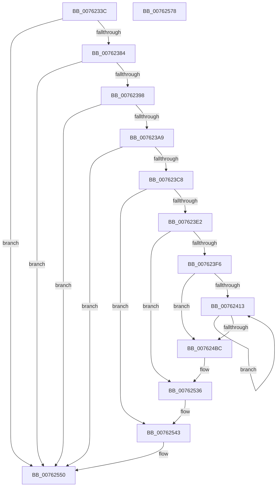

# PopDiagTracePowerLimitExtension

- RVA: `0x0076233C`–`0x00762579` (길이 `573` bytes)
- VA: `0x000000014076233C`
- 실행 섹션: `PAGE`
- PDB 이름 있음: `예`; PDB Function 태그: `아니요`
- unwind 정보 RVA: `0x000C9EA4`
- 디코드: `137`개 명령, `573/573` bytes 표시
- 미해석 바이트: `0` (있으면 어셈블리에 `.byte`로 보존)

> 이 문서는 커널 이미지의 기계어와 PDB 기호를 분석해 생성했습니다. 4번과 5번은 함수 원형과 자료형을 바이너리 사용 방식에서 추정한 C 해석이며 원본 소스 복구 결과는 아닙니다.

## 1. Dependencies

- 직접 호출 지점: **7**; 고유 호출 대상: **7**
- 직접 호출자로 확인된 함수: **4**
- RIP 상대 이미지 참조: **3**

### Outgoing calls
- `0x0076238B` → [EtwEventEnabled](../../text/39/EtwEventEnabled_function_00392450.md) (function, `0x00392450`)
- `0x007623B7` → [ExAllocatePool2](../../poolcode/B8/ExAllocatePool2_function_00B820F0.md) (function, `0x00B820F0`)
- `0x007623D1` → [IoGetDeviceAttachmentBaseRefWithTag](../../text/27/IoGetDeviceAttachmentBaseRefWithTag_function_00272788.md) (function, `0x00272788`)
- `0x00762531` → [EtwWrite](../../text/41/EtwWrite_function_0041C720.md) (function, `0x0041C720`)
- `0x0076253E` → [ObfDereferenceObjectWithTag](../../text/2F/ObfDereferenceObjectWithTag_function_002F78E0.md) (function, `0x002F78E0`)
- `0x0076254B` → [ExFreePoolWithTag](../../poolcode/B8/ExFreePoolWithTag_function_00B82870.md) (function, `0x00B82870`)
- `0x00762557` → [_security_check_cookie](../../text/6A/_security_check_cookie_function_006AC640.md) (function, `0x006AC640`)

### Direct callers
- [PopAssociatePowerLimitRequest](../75/PopAssociatePowerLimitRequest_function_00755EC8.md) at `0x00755FDB`
- [PopDisablePowerLimitExtension](../75/PopDisablePowerLimitExtension_function_00756148.md) at `0x00756196`
- [PopPowerLimitPnpNotification](../75/PopPowerLimitPnpNotification_function_007567C0.md) at `0x00756883`
- [PopRundownPowerLimitRequests](../A3/PopRundownPowerLimitRequests_function_00A398C4.md) at `0x00A39912`

### Static image references
- `0x0076235A` → RVA `0x00E0A740` (`.data`; read)
- `0x00762377` → RVA `0x00E67858` (`.data`; read)
- `0x00762384` → RVA `0x00F0B408` (`.data`; read)

## 2. Other-region calls and transfers

- 다른 실행 섹션으로 향하는 call: **7**
  - `0x0076238B` → [EtwEventEnabled](../../text/39/EtwEventEnabled_function_00392450.md) (`PAGE` → `.text`)
  - `0x007623B7` → [ExAllocatePool2](../../poolcode/B8/ExAllocatePool2_function_00B820F0.md) (`PAGE` → `POOLCODE`)
  - `0x007623D1` → [IoGetDeviceAttachmentBaseRefWithTag](../../text/27/IoGetDeviceAttachmentBaseRefWithTag_function_00272788.md) (`PAGE` → `.text`)
  - `0x00762531` → [EtwWrite](../../text/41/EtwWrite_function_0041C720.md) (`PAGE` → `.text`)
  - `0x0076253E` → [ObfDereferenceObjectWithTag](../../text/2F/ObfDereferenceObjectWithTag_function_002F78E0.md) (`PAGE` → `.text`)
  - `0x0076254B` → [ExFreePoolWithTag](../../poolcode/B8/ExFreePoolWithTag_function_00B82870.md) (`PAGE` → `POOLCODE`)
  - `0x00762557` → [_security_check_cookie](../../text/6A/_security_check_cookie_function_006AC640.md) (`PAGE` → `.text`)
- 별도 외부 분기/꼬리 이동을 확인하지 못했습니다.

## 3. Assembly (complete function range)

```asm
0076233C  48 89 5C 24 18                  mov qword ptr [rsp + 0x18], rbx
00762341  48 89 74 24 20                  mov qword ptr [rsp + 0x20], rsi
00762346  55                              push rbp
00762347  57                              push rdi
00762348  41 54                           push r12
0076234A  41 56                           push r14
0076234C  41 57                           push r15
0076234E  48 8D 6C 24 C9                  lea rbp, [rsp - 0x37]
00762353  48 81 EC A0 00 00 00            sub rsp, 0xa0
0076235A  48 8B 05 DF 83 6A 00            mov rax, qword ptr [rip + 0x6a83df]
00762361  48 33 C4                        xor rax, rsp
00762364  48 89 45 27                     mov qword ptr [rbp + 0x27], rax
00762368  83 65 C7 00                     and dword ptr [rbp - 0x39], 0
0076236C  4C 8B E2                        mov r12, rdx
0076236F  48 83 65 CF 00                  and qword ptr [rbp - 0x31], 0
00762374  48 8B D9                        mov rbx, rcx
00762377  80 3D DA 54 70 00 00            cmp byte ptr [rip + 0x7054da], 0
0076237E  0F 84 CC 01 00 00               je 0x140762550
00762384  48 8B 0D 7D 90 7A 00            mov rcx, qword ptr [rip + 0x7a907d]
0076238B  E8 C0 00 C3 FF                  call 0x140392450
00762390  84 C0                           test al, al
00762392  0F 84 B8 01 00 00               je 0x140762550
00762398  48 8D 73 48                     lea rsi, [rbx + 0x48]
0076239C  44 6B 3E 2C                     imul r15d, dword ptr [rsi], 0x2c
007623A0  45 85 FF                        test r15d, r15d
007623A3  0F 84 A7 01 00 00               je 0x140762550
007623A9  41 8B D7                        mov edx, r15d
007623AC  B9 00 01 00 00                  mov ecx, 0x100
007623B1  41 B8 50 64 69 67               mov r8d, 0x67696450
007623B7  E8 34 FD 41 00                  call 0x140b820f0
007623BC  48 8B F8                        mov rdi, rax
007623BF  48 85 C0                        test rax, rax
007623C2  0F 84 88 01 00 00               je 0x140762550
007623C8  48 8B 4B 38                     mov rcx, qword ptr [rbx + 0x38]
007623CC  BA 50 6F 44 67                  mov edx, 0x67446f50
007623D1  E8 B2 03 B1 FF                  call 0x140272788
007623D6  4C 8B F0                        mov r14, rax
007623D9  48 85 C0                        test rax, rax
007623DC  0F 84 61 01 00 00               je 0x140762543
007623E2  48 8B 88 38 01 00 00            mov rcx, qword ptr [rax + 0x138]
007623E9  4C 8B 51 28                     mov r10, qword ptr [rcx + 0x28]
007623ED  4D 85 D2                        test r10, r10
007623F0  0F 84 40 01 00 00               je 0x140762536
007623F6  41 0F B7 8A 80 00 00 00         movzx ecx, word ptr [r10 + 0x80]
007623FE  45 33 DB                        xor r11d, r11d
00762401  D1 E9                           shr ecx, 1
00762403  89 4D C7                        mov dword ptr [rbp - 0x39], ecx
00762406  48 89 5D CF                     mov qword ptr [rbp - 0x31], rbx
0076240A  44 39 1E                        cmp dword ptr [rsi], r11d
0076240D  0F 86 A9 00 00 00               jbe 0x1407624bc
00762413  48 8B 43 50                     mov rax, qword ptr [rbx + 0x50]
00762417  4B 8D 14 DB                     lea rdx, [r11 + r11*8]
0076241B  45 8B CB                        mov r9d, r11d
0076241E  41 FF C3                        inc r11d
00762421  4D 6B C1 2C                     imul r8, r9, 0x2c
00762425  8B 0C 90                        mov ecx, dword ptr [rax + rdx*4]
00762428  4D 03 C9                        add r9, r9
0076242B  41 89 0C 38                     mov dword ptr [r8 + rdi], ecx
0076242F  48 8B 43 50                     mov rax, qword ptr [rbx + 0x50]
00762433  8B 4C 90 04                     mov ecx, dword ptr [rax + rdx*4 + 4]
00762437  41 89 4C 38 04                  mov dword ptr [r8 + rdi + 4], ecx
0076243C  48 8B 43 50                     mov rax, qword ptr [rbx + 0x50]
00762440  8B 4C 90 0C                     mov ecx, dword ptr [rax + rdx*4 + 0xc]
00762444  41 89 4C 38 08                  mov dword ptr [r8 + rdi + 8], ecx
00762449  48 8B 43 50                     mov rax, qword ptr [rbx + 0x50]
0076244D  8B 4C 90 08                     mov ecx, dword ptr [rax + rdx*4 + 8]
00762451  41 89 4C 38 0C                  mov dword ptr [r8 + rdi + 0xc], ecx
00762456  48 8B 43 50                     mov rax, qword ptr [rbx + 0x50]
0076245A  8B 4C 90 10                     mov ecx, dword ptr [rax + rdx*4 + 0x10]
0076245E  41 89 4C 38 10                  mov dword ptr [r8 + rdi + 0x10], ecx
00762463  48 8B 43 50                     mov rax, qword ptr [rbx + 0x50]
00762467  8B 4C 90 14                     mov ecx, dword ptr [rax + rdx*4 + 0x14]
0076246B  41 89 4C 38 14                  mov dword ptr [r8 + rdi + 0x14], ecx
00762470  48 8B 43 50                     mov rax, qword ptr [rbx + 0x50]
00762474  8B 4C 90 18                     mov ecx, dword ptr [rax + rdx*4 + 0x18]
00762478  41 89 4C 38 18                  mov dword ptr [r8 + rdi + 0x18], ecx
0076247D  48 8B 43 50                     mov rax, qword ptr [rbx + 0x50]
00762481  8B 4C 90 1C                     mov ecx, dword ptr [rax + rdx*4 + 0x1c]
00762485  41 89 4C 38 1C                  mov dword ptr [r8 + rdi + 0x1c], ecx
0076248A  48 8B 43 50                     mov rax, qword ptr [rbx + 0x50]
0076248E  8B 4C 90 20                     mov ecx, dword ptr [rax + rdx*4 + 0x20]
00762492  41 89 4C 38 20                  mov dword ptr [r8 + rdi + 0x20], ecx
00762497  48 8B 43 58                     mov rax, qword ptr [rbx + 0x58]
0076249B  42 8B 4C C8 08                  mov ecx, dword ptr [rax + r9*8 + 8]
007624A0  41 89 4C 38 24                  mov dword ptr [r8 + rdi + 0x24], ecx
007624A5  48 8B 43 58                     mov rax, qword ptr [rbx + 0x58]
007624A9  42 8B 4C C8 0C                  mov ecx, dword ptr [rax + r9*8 + 0xc]
007624AE  41 89 4C 38 28                  mov dword ptr [r8 + rdi + 0x28], ecx
007624B3  44 3B 1E                        cmp r11d, dword ptr [rsi]
007624B6  0F 82 57 FF FF FF               jb 0x140762413
007624BC  83 65 E3 00                     and dword ptr [rbp - 0x1d], 0
007624C0  48 8D 45 CF                     lea rax, [rbp - 0x31]
007624C4  83 65 F3 00                     and dword ptr [rbp - 0xd], 0
007624C8  41 B8 04 00 00 00               mov r8d, 4
007624CE  48 89 45 D7                     mov qword ptr [rbp - 0x29], rax
007624D2  49 8B D4                        mov rdx, r12
007624D5  44 89 45 EF                     mov dword ptr [rbp - 0x11], r8d
007624D9  48 8D 45 C7                     lea rax, [rbp - 0x39]
007624DD  48 89 45 E7                     mov qword ptr [rbp - 0x19], rax
007624E1  C7 45 DF 08 00 00 00            mov dword ptr [rbp - 0x21], 8
007624E8  45 8D 48 01                     lea r9d, [r8 + 1]
007624EC  49 8B 82 88 00 00 00            mov rax, qword ptr [r10 + 0x88]
007624F3  41 0F B7 8A 80 00 00 00         movzx ecx, word ptr [r10 + 0x80]
007624FB  83 65 03 00                     and dword ptr [rbp + 3], 0
007624FF  83 65 13 00                     and dword ptr [rbp + 0x13], 0
00762503  83 65 23 00                     and dword ptr [rbp + 0x23], 0
00762507  48 89 45 F7                     mov qword ptr [rbp - 9], rax
0076250B  48 8D 45 D7                     lea rax, [rbp - 0x29]
0076250F  89 4D FF                        mov dword ptr [rbp - 1], ecx
00762512  48 8B 0D EF 8E 7A 00            mov rcx, qword ptr [rip + 0x7a8eef]
00762519  44 89 45 0F                     mov dword ptr [rbp + 0xf], r8d
0076251D  45 33 C0                        xor r8d, r8d
00762520  48 89 44 24 20                  mov qword ptr [rsp + 0x20], rax
00762525  48 89 75 07                     mov qword ptr [rbp + 7], rsi
00762529  48 89 7D 17                     mov qword ptr [rbp + 0x17], rdi
0076252D  44 89 7D 1F                     mov dword ptr [rbp + 0x1f], r15d
00762531  E8 EA A1 CB FF                  call 0x14041c720
00762536  BA 50 6F 44 67                  mov edx, 0x67446f50
0076253B  49 8B CE                        mov rcx, r14
0076253E  E8 9D 53 B9 FF                  call 0x1402f78e0
00762543  BA 50 64 69 67                  mov edx, 0x67696450
00762548  48 8B CF                        mov rcx, rdi
0076254B  E8 20 03 42 00                  call 0x140b82870
00762550  48 8B 4D 27                     mov rcx, qword ptr [rbp + 0x27]
00762554  48 33 CC                        xor rcx, rsp
00762557  E8 E4 A0 F4 FF                  call 0x1406ac640
0076255C  4C 8D 9C 24 A0 00 00 00         lea r11, [rsp + 0xa0]
00762564  49 8B 5B 40                     mov rbx, qword ptr [r11 + 0x40]
00762568  49 8B 73 48                     mov rsi, qword ptr [r11 + 0x48]
0076256C  49 8B E3                        mov rsp, r11
0076256F  41 5F                           pop r15
00762571  41 5E                           pop r14
00762573  41 5C                           pop r12
00762575  5F                              pop rdi
00762576  5D                              pop rbp
00762577  C3                              ret
00762578  CC                              int3
```

## 4. C-style interpretation (structured pseudocode)

```c
__int64 __fastcall PopDiagTracePowerLimitExtension(__int64 a1, __int64 a2)
{
    __int64 result;
    __int64 v_r11;
    __int64 v_r15;
    __int64 v_rsp;
    unsigned __int64 v_stack_m28;
    unsigned __int64 v_stack_m38;
    unsigned int v_stack_m3C;
    unsigned int v_stack_m40;
    unsigned __int64 v_stack_m48;
    unsigned int v_stack_m4C;
    unsigned int v_stack_m50;
    unsigned __int64 v_stack_m58;
    unsigned int v_stack_m5C;
    unsigned __int64 v_stack_m5F;
    unsigned int v_stack_m60;
    unsigned __int64 v_stack_m68;
    unsigned int v_stack_m6C;
    unsigned int v_stack_m70;
    unsigned __int64 v_stack_m78;
    unsigned int v_stack_m7C;
    unsigned int v_stack_m80;
    unsigned __int64 v_stack_m88;
    unsigned __int64 v_stack_m90;
    unsigned int v_stack_m98;
    unsigned __int64 v_stack_mA8;
    unsigned __int64 v_stack_p18;
    unsigned __int64 v_stack_p20;

    v_stack_p18 = v_rbx;
    v_stack_p20 = v_rsi;
    v_rsp = (v_rsp) - (160);
    result = (*(unsigned __int64 *)(v_rip + 6980575)) ^ (v_rsp);
    v_stack_m38 = result;
    if ((*(unsigned __int8 *)(v_rip + 7361754)) == 0) goto loc_00762550;
    result = EtwEventEnabled(*(unsigned __int64 *)(v_rip + 8032381), a2, a3, a4);
    if ((unsigned __int8)(result) == 0) goto loc_00762550;
    v_r15 = (unsigned int)((v_r15) * (*(unsigned int *)(a1 + 72)));
    if ((unsigned int)(v_r15) == 0) goto loc_00762550;
    result = ExAllocatePool2(256, (unsigned int)((unsigned int)(v_r15)), (unsigned int)(0x67696450ULL), a4);
    if (result == 0) goto loc_00762550;
    result = IoGetDeviceAttachmentBaseRefWithTag(*(unsigned __int64 *)(a1 + 56), (unsigned int)(0x67446F50ULL), (unsigned int)(0x67696450ULL), a4);
    if (result == 0) goto loc_00762543;
    if (*(unsigned __int64 *)(*(unsigned __int64 *)(result + 312) + 40) == 0) goto loc_00762536;
    v_r11 = 0;
    a1 = (unsigned int)((*(unsigned __int16 *)(*(unsigned __int64 *)(*(unsigned __int64 *)(result + 312) + 40) + 128)) >> (1));
    v_stack_m98 = (unsigned int)(a1);
    v_stack_m90 = a1;
    if ((*(unsigned int *)(a1 + 72)) <= 0) goto loc_007624BC;
loc_00762413:
    v_r11 = (unsigned int)((v_r11) + 1);
    a3 = ((unsigned int)(0x67696450ULL)) * (0);
    a4 = (0) + (0);
    *(unsigned int *)(a3 + result * 1) = (unsigned int)((unsigned int)(*(unsigned int *)(*(unsigned __int64 *)(a1 + 80) + v_r11 + v_r11 * 8 * 4)));
    *(unsigned int *)(a3 + result * 1 + 4) = (unsigned int)((unsigned int)(*(unsigned int *)(*(unsigned __int64 *)(a1 + 80) + v_r11 + v_r11 * 8 * 4 + 4)));
    *(unsigned int *)(a3 + result * 1 + 8) = (unsigned int)((unsigned int)(*(unsigned int *)(*(unsigned __int64 *)(a1 + 80) + v_r11 + v_r11 * 8 * 4 + 12)));
    *(unsigned int *)(a3 + result * 1 + 12) = (unsigned int)((unsigned int)(*(unsigned int *)(*(unsigned __int64 *)(a1 + 80) + v_r11 + v_r11 * 8 * 4 + 8)));
    *(unsigned int *)(a3 + result * 1 + 16) = (unsigned int)((unsigned int)(*(unsigned int *)(*(unsigned __int64 *)(a1 + 80) + v_r11 + v_r11 * 8 * 4 + 16)));
    *(unsigned int *)(a3 + result * 1 + 20) = (unsigned int)((unsigned int)(*(unsigned int *)(*(unsigned __int64 *)(a1 + 80) + v_r11 + v_r11 * 8 * 4 + 20)));
    *(unsigned int *)(a3 + result * 1 + 24) = (unsigned int)((unsigned int)(*(unsigned int *)(*(unsigned __int64 *)(a1 + 80) + v_r11 + v_r11 * 8 * 4 + 24)));
    *(unsigned int *)(a3 + result * 1 + 28) = (unsigned int)((unsigned int)(*(unsigned int *)(*(unsigned __int64 *)(a1 + 80) + v_r11 + v_r11 * 8 * 4 + 28)));
    *(unsigned int *)(a3 + result * 1 + 32) = (unsigned int)((unsigned int)(*(unsigned int *)(*(unsigned __int64 *)(a1 + 80) + v_r11 + v_r11 * 8 * 4 + 32)));
    *(unsigned int *)(a3 + result * 1 + 36) = (unsigned int)((unsigned int)(*(unsigned int *)(*(unsigned __int64 *)(a1 + 88) + a4 * 8 + 8)));
    *(unsigned int *)(a3 + result * 1 + 40) = (unsigned int)((unsigned int)(*(unsigned int *)(*(unsigned __int64 *)(a1 + 88) + a4 * 8 + 12)));
    if (((unsigned int)(v_r11)) < (*(unsigned int *)(a1 + 72))) goto loc_00762413;
loc_007624BC:
    v_stack_m88 = v_stack_m90;
    v_stack_m70 = 4;
    v_stack_m78 = v_stack_m98;
    v_stack_m80 = 8;
    v_stack_m68 = *(unsigned __int64 *)(*(unsigned __int64 *)(*(unsigned __int64 *)(result + 312) + 40) + 136);
    v_stack_m60 = (unsigned int)(*(unsigned __int16 *)(*(unsigned __int64 *)(*(unsigned __int64 *)(result + 312) + 40) + 128));
    v_stack_m50 = 4;
    a3 = 0;
    v_stack_mA8 = v_stack_m88;
    v_stack_m58 = a1 + 72;
    v_stack_m48 = result;
    v_stack_m40 = (unsigned int)(v_r15);
    result = EtwWrite(*(unsigned __int64 *)(v_rip + 8031983), a2, a3, 4 + 1);
loc_00762536:
    result = ObfDereferenceObjectWithTag(result, (unsigned int)(0x67446F50ULL), a3, 4 + 1);
loc_00762543:
    result = ExFreePoolWithTag(result, (unsigned int)(0x67696450ULL), a3, 4 + 1);
loc_00762550:
    a1 = (v_stack_m38) ^ (v_rsp);
    result = _security_check_cookie(a1, (unsigned int)(0x67696450ULL), a3, 4 + 1);
    return result;
}
```

## 5. (Beta) C Style

```c
int64_t PopDiagTracePowerLimitExtension(void *Arg1, int64_t Arg2)
{
    uint8_t *arg1 = (uint8_t *)Arg1;

    int64_t result;
    int64_t local_r11;
    int64_t local_r15;
    int64_t local_rsp;
    uint64_t v_stack_m28;
    uint64_t v_stack_m38;
    uint32_t v_stack_m3C;
    uint32_t v_stack_m40;
    uint64_t v_stack_m48;
    uint32_t v_stack_m4C;
    uint32_t v_stack_m50;
    uint64_t v_stack_m58;
    uint32_t v_stack_m5C;
    uint64_t v_stack_m5F;
    uint32_t v_stack_m60;
    uint64_t v_stack_m68;
    uint32_t v_stack_m6C;
    uint32_t v_stack_m70;
    uint64_t v_stack_m78;
    uint32_t v_stack_m7C;
    uint32_t v_stack_m80;
    uint64_t v_stack_m88;
    uint64_t v_stack_m90;
    uint32_t v_stack_m98;
    uint64_t v_stack_mA8;
    uint64_t v_stack_p18;
    uint64_t v_stack_p20;

    v_stack_p18 = local_rbx;
    v_stack_p20 = local_rsi;
    local_rsp = (local_rsp) - (160);
    result = (*(uint64_t *)(v_rip + 0x6A83DF)) ^ (local_rsp);
    v_stack_m38 = result;
    if ((*(uint8_t *)(v_rip + 0x7054DA)) == 0) goto loc_00762550;
    result = EtwEventEnabled(*(uint64_t *)(v_rip + 0x7A907D), Arg2, a3, a4);
    if ((uint8_t)(result) == 0) goto loc_00762550;
    local_r15 = (uint32_t)((local_r15) * (*(uint32_t *)(arg1 + 0x48)));
    if ((uint32_t)(local_r15) == 0) goto loc_00762550;
    result = ExAllocatePool2(256, (uint32_t)((uint32_t)(local_r15)), (uint32_t)(0x67696450ULL), a4);
    if (result == 0) goto loc_00762550;
    result = IoGetDeviceAttachmentBaseRefWithTag(*(uint64_t *)(arg1 + 0x38), (uint32_t)(0x67446F50ULL), (uint32_t)(0x67696450ULL), a4);
    if (result == 0) goto loc_00762543;
    if (*(uint64_t *)(*(uint64_t *)(result + 0x138) + 0x28) == 0) goto loc_00762536;
    local_r11 = 0;
    Arg1 = (uint32_t)((*(uint16_t *)(*(uint64_t *)(*(uint64_t *)(result + 0x138) + 0x28) + 0x80)) >> (1));
    v_stack_m98 = (uint32_t)(Arg1);
    v_stack_m90 = Arg1;
    if ((*(uint32_t *)(arg1 + 0x48)) <= 0) goto loc_007624BC;
loc_00762413:
    local_r11 = (uint32_t)((local_r11) + 1);
    a3 = ((uint32_t)(0x67696450ULL)) * (0);
    a4 = (0) + (0);
    *(uint32_t *)(a3 + result * 1) = (uint32_t)((uint32_t)(*(uint32_t *)(*(uint64_t *)(arg1 + 0x50) + local_r11 + local_r11 * 8 * 4)));
    *(uint32_t *)(a3 + result * 1 + 0x4) = (uint32_t)((uint32_t)(*(uint32_t *)(*(uint64_t *)(arg1 + 0x50) + local_r11 + local_r11 * 8 * 4 + 0x4)));
    *(uint32_t *)(a3 + result * 1 + 0x8) = (uint32_t)((uint32_t)(*(uint32_t *)(*(uint64_t *)(arg1 + 0x50) + local_r11 + local_r11 * 8 * 4 + 0xC)));
    *(uint32_t *)(a3 + result * 1 + 0xC) = (uint32_t)((uint32_t)(*(uint32_t *)(*(uint64_t *)(arg1 + 0x50) + local_r11 + local_r11 * 8 * 4 + 0x8)));
    *(uint32_t *)(a3 + result * 1 + 0x10) = (uint32_t)((uint32_t)(*(uint32_t *)(*(uint64_t *)(arg1 + 0x50) + local_r11 + local_r11 * 8 * 4 + 0x10)));
    *(uint32_t *)(a3 + result * 1 + 0x14) = (uint32_t)((uint32_t)(*(uint32_t *)(*(uint64_t *)(arg1 + 0x50) + local_r11 + local_r11 * 8 * 4 + 0x14)));
    *(uint32_t *)(a3 + result * 1 + 0x18) = (uint32_t)((uint32_t)(*(uint32_t *)(*(uint64_t *)(arg1 + 0x50) + local_r11 + local_r11 * 8 * 4 + 0x18)));
    *(uint32_t *)(a3 + result * 1 + 0x1C) = (uint32_t)((uint32_t)(*(uint32_t *)(*(uint64_t *)(arg1 + 0x50) + local_r11 + local_r11 * 8 * 4 + 0x1C)));
    *(uint32_t *)(a3 + result * 1 + 0x20) = (uint32_t)((uint32_t)(*(uint32_t *)(*(uint64_t *)(arg1 + 0x50) + local_r11 + local_r11 * 8 * 4 + 0x20)));
    *(uint32_t *)(a3 + result * 1 + 0x24) = (uint32_t)((uint32_t)(*(uint32_t *)(*(uint64_t *)(arg1 + 0x58) + a4 * 8 + 0x8)));
    *(uint32_t *)(a3 + result * 1 + 0x28) = (uint32_t)((uint32_t)(*(uint32_t *)(*(uint64_t *)(arg1 + 0x58) + a4 * 8 + 0xC)));
    if (((uint32_t)(local_r11)) < (*(uint32_t *)(arg1 + 0x48))) goto loc_00762413;
loc_007624BC:
    v_stack_m88 = v_stack_m90;
    v_stack_m70 = 4;
    v_stack_m78 = v_stack_m98;
    v_stack_m80 = 8;
    v_stack_m68 = *(uint64_t *)(*(uint64_t *)(*(uint64_t *)(result + 0x138) + 0x28) + 0x88);
    v_stack_m60 = (uint32_t)(*(uint16_t *)(*(uint64_t *)(*(uint64_t *)(result + 0x138) + 0x28) + 0x80));
    v_stack_m50 = 4;
    a3 = 0;
    v_stack_mA8 = v_stack_m88;
    v_stack_m58 = Arg1 + 72;
    v_stack_m48 = result;
    v_stack_m40 = (uint32_t)(local_r15);
    result = EtwWrite(*(uint64_t *)(v_rip + 0x7A8EEF), Arg2, a3, 4 + 1);
loc_00762536:
    result = ObfDereferenceObjectWithTag(result, (uint32_t)(0x67446F50ULL), a3, 4 + 1);
loc_00762543:
    result = ExFreePoolWithTag(result, (uint32_t)(0x67696450ULL), a3, 4 + 1);
loc_00762550:
    Arg1 = (v_stack_m38) ^ (local_rsp);
    result = _security_check_cookie(Arg1, (uint32_t)(0x67696450ULL), a3, 4 + 1);
    return result;
}
```

### 관측된 메모리 오프셋

구조체 형식이 확인되지 않은 접근은 인자 기준의 오프셋으로만 기록했습니다.

| 기준 인자 | 오프셋 표현 | 폭 (bit) | 접근 |
|---|---:|---:|---|
| `Arg1` | `+ 0x0` | `32` | `R` |
| `Arg1` | `+ 0x38` | `64` | `R` |
| `Arg1` | `+ 0x48` | `64` | `R` |
| `Arg1` | `+ 0x50` | `64` | `R` |
| `Arg1` | `+ 0x58` | `64` | `R` |

## 6. Execution-region graph

[열기: 2D/3D 그래프와 함수 탐색 컨트롤 패널](../../../control-panel.html?section=page&rva=0x0076233C&view=graph)

- 2D 그래프는 위에서 아래로 흐르고, 3D 그래프는 빈 공간을 드래그해 회전합니다. Shift+드래그는 이동, 휠은 확대·축소, 함수 노드 선택은 대상 보고서 이동입니다.

### Static fallback


