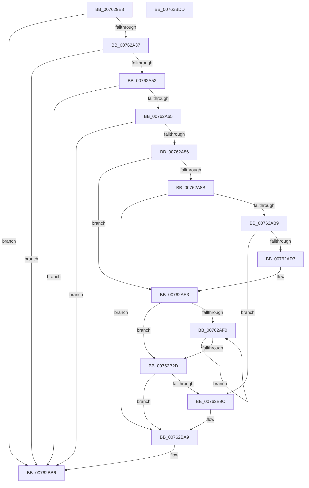

# PopDiagTracePowerLimitRequestValueUpdate

- RVA: `0x007629E8`–`0x00762BDE` (길이 `502` bytes)
- VA: `0x00000001407629E8`
- 실행 섹션: `PAGE`
- PDB 이름 있음: `예`; PDB Function 태그: `아니요`
- unwind 정보 RVA: `0x000BD58C`
- 디코드: `131`개 명령, `502/502` bytes 표시
- 미해석 바이트: `0` (있으면 어셈블리에 `.byte`로 보존)

> 이 문서는 커널 이미지의 기계어와 PDB 기호를 분석해 생성했습니다. 4번과 5번은 함수 원형과 자료형을 바이너리 사용 방식에서 추정한 C 해석이며 원본 소스 복구 결과는 아닙니다.

## 1. Dependencies

- 직접 호출 지점: **9**; 고유 호출 대상: **6**
- 직접 호출자로 확인된 함수: **1**
- RIP 상대 이미지 참조: **4**

### Outgoing calls
- `0x00762A45` → [EtwEventEnabled](../../text/39/EtwEventEnabled_function_00392450.md) (function, `0x00392450`)
- `0x00762A72` → [ExAllocatePool2](../../poolcode/B8/ExAllocatePool2_function_00B820F0.md) (function, `0x00B820F0`)
- `0x00762A94` → [PoStoreDiagnosticContext](../../text/23/PoStoreDiagnosticContext_function_0023009C.md) (function, `0x0023009C`)
- `0x00762AA8` → [ExAllocatePool2](../../poolcode/B8/ExAllocatePool2_function_00B820F0.md) (function, `0x00B820F0`)
- `0x00762AC3` → [PoStoreDiagnosticContext](../../text/23/PoStoreDiagnosticContext_function_0023009C.md) (function, `0x0023009C`)
- `0x00762B92` → [EtwWrite](../../text/41/EtwWrite_function_0041C720.md) (function, `0x0041C720`)
- `0x00762BA4` → [ExFreePoolWithTag](../../poolcode/B8/ExFreePoolWithTag_function_00B82870.md) (function, `0x00B82870`)
- `0x00762BB1` → [ExFreePoolWithTag](../../poolcode/B8/ExFreePoolWithTag_function_00B82870.md) (function, `0x00B82870`)
- `0x00762BBD` → [_security_check_cookie](../../text/6A/_security_check_cookie_function_006AC640.md) (function, `0x006AC640`)

### Direct callers
- [PoSetPowerLimitValue](../75/PoSetPowerLimitValue_function_00755C30.md) at `0x00755DC5`

### Static image references
- `0x00762A04` → RVA `0x00E0A740` (`.data`; read)
- `0x00762A17` → RVA `0x00E67858` (`.data`; read)
- `0x00762A37` → RVA `0x00F0B408` (`.data`; read)
- `0x00762A3E` → RVA `0x00021A88` (`.rdata`; read)

## 2. Other-region calls and transfers

- 다른 실행 섹션으로 향하는 call: **9**
  - `0x00762A45` → [EtwEventEnabled](../../text/39/EtwEventEnabled_function_00392450.md) (`PAGE` → `.text`)
  - `0x00762A72` → [ExAllocatePool2](../../poolcode/B8/ExAllocatePool2_function_00B820F0.md) (`PAGE` → `POOLCODE`)
  - `0x00762A94` → [PoStoreDiagnosticContext](../../text/23/PoStoreDiagnosticContext_function_0023009C.md) (`PAGE` → `.text`)
  - `0x00762AA8` → [ExAllocatePool2](../../poolcode/B8/ExAllocatePool2_function_00B820F0.md) (`PAGE` → `POOLCODE`)
  - `0x00762AC3` → [PoStoreDiagnosticContext](../../text/23/PoStoreDiagnosticContext_function_0023009C.md) (`PAGE` → `.text`)
  - `0x00762B92` → [EtwWrite](../../text/41/EtwWrite_function_0041C720.md) (`PAGE` → `.text`)
  - `0x00762BA4` → [ExFreePoolWithTag](../../poolcode/B8/ExFreePoolWithTag_function_00B82870.md) (`PAGE` → `POOLCODE`)
  - `0x00762BB1` → [ExFreePoolWithTag](../../poolcode/B8/ExFreePoolWithTag_function_00B82870.md) (`PAGE` → `POOLCODE`)
  - `0x00762BBD` → [_security_check_cookie](../../text/6A/_security_check_cookie_function_006AC640.md) (`PAGE` → `.text`)
- 별도 외부 분기/꼬리 이동을 확인하지 못했습니다.

## 3. Assembly (complete function range)

```asm
007629E8  48 89 5C 24 18                  mov qword ptr [rsp + 0x18], rbx
007629ED  55                              push rbp
007629EE  56                              push rsi
007629EF  57                              push rdi
007629F0  41 54                           push r12
007629F2  41 55                           push r13
007629F4  41 56                           push r14
007629F6  41 57                           push r15
007629F8  48 8D 6C 24 D9                  lea rbp, [rsp - 0x27]
007629FD  48 81 EC B0 00 00 00            sub rsp, 0xb0
00762A04  48 8B 05 35 7D 6A 00            mov rax, qword ptr [rip + 0x6a7d35]
00762A0B  48 33 C4                        xor rax, rsp
00762A0E  48 89 45 17                     mov qword ptr [rbp + 0x17], rax
00762A12  33 F6                           xor esi, esi
00762A14  4C 8B FA                        mov r15, rdx
00762A17  40 38 35 3A 4E 70 00            cmp byte ptr [rip + 0x704e3a], sil
00762A1E  4C 8B F1                        mov r14, rcx
00762A21  48 89 75 AF                     mov qword ptr [rbp - 0x51], rsi
00762A25  8B DE                           mov ebx, esi
00762A27  48 89 75 B7                     mov qword ptr [rbp - 0x49], rsi
00762A2B  44 8B EE                        mov r13d, esi
00762A2E  89 75 A7                        mov dword ptr [rbp - 0x59], esi
00762A31  0F 84 7F 01 00 00               je 0x140762bb6
00762A37  48 8B 0D CA 89 7A 00            mov rcx, qword ptr [rip + 0x7a89ca]
00762A3E  48 8D 15 43 F0 8B FF            lea rdx, [rip - 0x740fbd]
00762A45  E8 06 FA C2 FF                  call 0x140392450
00762A4A  84 C0                           test al, al
00762A4C  0F 84 64 01 00 00               je 0x140762bb6
00762A52  4D 8D 66 20                     lea r12, [r14 + 0x20]
00762A56  41 8B 3C 24                     mov edi, dword ptr [r12]
00762A5A  C1 E7 04                        shl edi, 4
00762A5D  85 FF                           test edi, edi
00762A5F  0F 84 51 01 00 00               je 0x140762bb6
00762A65  8B D7                           mov edx, edi
00762A67  B9 00 01 00 00                  mov ecx, 0x100
00762A6C  41 B8 50 64 69 67               mov r8d, 0x67696450
00762A72  E8 79 F6 41 00                  call 0x140b820f0
00762A77  45 33 C9                        xor r9d, r9d
00762A7A  48 8B F0                        mov rsi, rax
00762A7D  48 85 C0                        test rax, rax
00762A80  0F 84 30 01 00 00               je 0x140762bb6
00762A86  4D 85 FF                        test r15, r15
00762A89  74 58                           je 0x140762ae3
00762A8B  4C 8D 45 AF                     lea r8, [rbp - 0x51]
00762A8F  33 D2                           xor edx, edx
00762A91  49 8B CF                        mov rcx, r15
00762A94  E8 03 D6 AC FF                  call 0x14023009c
00762A99  48 8B 55 AF                     mov rdx, qword ptr [rbp - 0x51]
00762A9D  41 B8 54 56 45 50               mov r8d, 0x50455654
00762AA3  B9 00 01 00 00                  mov ecx, 0x100
00762AA8  E8 43 F6 41 00                  call 0x140b820f0
00762AAD  48 8B D8                        mov rbx, rax
00762AB0  48 85 C0                        test rax, rax
00762AB3  0F 84 F0 00 00 00               je 0x140762ba9
00762AB9  4C 8D 45 AF                     lea r8, [rbp - 0x51]
00762ABD  48 8B D0                        mov rdx, rax
00762AC0  49 8B CF                        mov rcx, r15
00762AC3  E8 D4 D5 AC FF                  call 0x14023009c
00762AC8  45 33 C9                        xor r9d, r9d
00762ACB  85 C0                           test eax, eax
00762ACD  0F 88 C9 00 00 00               js 0x140762b9c
00762AD3  4C 8B 6B 20                     mov r13, qword ptr [rbx + 0x20]
00762AD7  8B 45 AF                        mov eax, dword ptr [rbp - 0x51]
00762ADA  4C 03 EB                        add r13, rbx
00762ADD  2B 43 20                        sub eax, dword ptr [rbx + 0x20]
00762AE0  89 45 A7                        mov dword ptr [rbp - 0x59], eax
00762AE3  45 8B C1                        mov r8d, r9d
00762AE6  4C 89 75 B7                     mov qword ptr [rbp - 0x49], r14
00762AEA  45 39 0C 24                     cmp dword ptr [r12], r9d
00762AEE  76 3D                           jbe 0x140762b2d
00762AF0  49 8B 46 28                     mov rax, qword ptr [r14 + 0x28]
00762AF4  41 8B D0                        mov edx, r8d
00762AF7  41 FF C0                        inc r8d
00762AFA  48 03 D2                        add rdx, rdx
00762AFD  8B 0C D0                        mov ecx, dword ptr [rax + rdx*8]
00762B00  89 0C D6                        mov dword ptr [rsi + rdx*8], ecx
00762B03  49 8B 46 28                     mov rax, qword ptr [r14 + 0x28]
00762B07  8B 4C D0 04                     mov ecx, dword ptr [rax + rdx*8 + 4]
00762B0B  89 4C D6 04                     mov dword ptr [rsi + rdx*8 + 4], ecx
00762B0F  49 8B 46 28                     mov rax, qword ptr [r14 + 0x28]
00762B13  8B 4C D0 08                     mov ecx, dword ptr [rax + rdx*8 + 8]
00762B17  89 4C D6 08                     mov dword ptr [rsi + rdx*8 + 8], ecx
00762B1B  49 8B 46 28                     mov rax, qword ptr [r14 + 0x28]
00762B1F  8B 4C D0 0C                     mov ecx, dword ptr [rax + rdx*8 + 0xc]
00762B23  89 4C D6 0C                     mov dword ptr [rsi + rdx*8 + 0xc], ecx
00762B27  45 3B 04 24                     cmp r8d, dword ptr [r12]
00762B2B  72 C3                           jb 0x140762af0
00762B2D  48 8B 0D D4 88 7A 00            mov rcx, qword ptr [rip + 0x7a88d4]
00762B34  48 8D 45 B7                     lea rax, [rbp - 0x49]
00762B38  48 89 45 C7                     mov qword ptr [rbp - 0x39], rax
00762B3C  48 8D 15 45 EF 8B FF            lea rdx, [rip - 0x7410bb]
00762B43  48 8D 45 A7                     lea rax, [rbp - 0x59]
00762B47  44 89 4D F3                     mov dword ptr [rbp - 0xd], r9d
00762B4B  48 89 45 D7                     mov qword ptr [rbp - 0x29], rax
00762B4F  45 33 C0                        xor r8d, r8d
00762B52  8B 45 A7                        mov eax, dword ptr [rbp - 0x59]
00762B55  89 45 EF                        mov dword ptr [rbp - 0x11], eax
00762B58  48 8D 45 C7                     lea rax, [rbp - 0x39]
00762B5C  44 89 4D 13                     mov dword ptr [rbp + 0x13], r9d
00762B60  41 B9 05 00 00 00               mov r9d, 5
00762B66  48 89 44 24 20                  mov qword ptr [rsp + 0x20], rax
00762B6B  48 C7 45 CF 08 00 00 00         mov qword ptr [rbp - 0x31], 8
00762B73  48 C7 45 DF 04 00 00 00         mov qword ptr [rbp - 0x21], 4
00762B7B  4C 89 6D E7                     mov qword ptr [rbp - 0x19], r13
00762B7F  4C 89 65 F7                     mov qword ptr [rbp - 9], r12
00762B83  48 C7 45 FF 04 00 00 00         mov qword ptr [rbp - 1], 4
00762B8B  48 89 75 07                     mov qword ptr [rbp + 7], rsi
00762B8F  89 7D 0F                        mov dword ptr [rbp + 0xf], edi
00762B92  E8 89 9B CB FF                  call 0x14041c720
00762B97  48 85 DB                        test rbx, rbx
00762B9A  74 0D                           je 0x140762ba9
00762B9C  BA 54 56 45 50                  mov edx, 0x50455654
00762BA1  48 8B CB                        mov rcx, rbx
00762BA4  E8 C7 FC 41 00                  call 0x140b82870
00762BA9  BA 50 64 69 67                  mov edx, 0x67696450
00762BAE  48 8B CE                        mov rcx, rsi
00762BB1  E8 BA FC 41 00                  call 0x140b82870
00762BB6  48 8B 4D 17                     mov rcx, qword ptr [rbp + 0x17]
00762BBA  48 33 CC                        xor rcx, rsp
00762BBD  E8 7E 9A F4 FF                  call 0x1406ac640
00762BC2  48 8B 9C 24 00 01 00 00         mov rbx, qword ptr [rsp + 0x100]
00762BCA  48 81 C4 B0 00 00 00            add rsp, 0xb0
00762BD1  41 5F                           pop r15
00762BD3  41 5E                           pop r14
00762BD5  41 5D                           pop r13
00762BD7  41 5C                           pop r12
00762BD9  5F                              pop rdi
00762BDA  5E                              pop rsi
00762BDB  5D                              pop rbp
00762BDC  C3                              ret
00762BDD  CC                              int3
```

## 4. C-style interpretation (structured pseudocode)

```c
__int64 __fastcall PopDiagTracePowerLimitRequestValueUpdate(__int64 a1, __int64 a2, __int64 a3, int a4)
{
    __int64 result;
    __int64 v_r13;
    __int64 v_rdi;
    __int64 v_rsi;
    __int64 v_rsp;
    unsigned __int64 v_stack_m48;
    unsigned int v_stack_m4C;
    unsigned int v_stack_m50;
    unsigned __int64 v_stack_m58;
    unsigned __int64 v_stack_m5F;
    unsigned __int64 v_stack_m60;
    unsigned __int64 v_stack_m68;
    unsigned int v_stack_m6C;
    unsigned int v_stack_m70;
    unsigned __int64 v_stack_m78;
    unsigned __int64 v_stack_m80;
    unsigned __int64 v_stack_m88;
    unsigned __int64 v_stack_m90;
    unsigned __int64 v_stack_m98;
    unsigned __int64 v_stack_mA8;
    unsigned __int64 v_stack_mB0;
    unsigned int v_stack_mB8;
    unsigned __int64 v_stack_mC8;
    unsigned __int64 v_stack_p18;

    v_stack_p18 = v_rbx;
    v_rsp = (v_rsp) - (176);
    result = (*(unsigned __int64 *)(v_rip + 6978869)) ^ (v_rsp);
    v_stack_m48 = result;
    v_rsi = 0;
    v_stack_mB0 = 0;
    v_stack_mA8 = 0;
    v_stack_mB8 = 0;
    if ((*(unsigned __int8 *)(v_rip + 7360058)) == 0) goto loc_00762BB6;
    result = EtwEventEnabled(*(unsigned __int64 *)(v_rip + 8030666), v_rip - 7606205, a3, a4);
    if ((unsigned __int8)(result) == 0) goto loc_00762BB6;
    v_rdi = (unsigned int)(((unsigned int)(*(unsigned int *)(a1 + 32))) << (4));
    if ((unsigned int)(v_rdi) == 0) goto loc_00762BB6;
    result = ExAllocatePool2(256, (unsigned int)((unsigned int)(v_rdi)), (unsigned int)(0x67696450ULL), a4);
    a4 = 0;
    if (result == 0) goto loc_00762BB6;
    if (a2 == 0) goto loc_00762AE3;
    a2 = 0;
    result = PoStoreDiagnosticContext(0, a2, v_stack_mB0, a4);
    result = ExAllocatePool2(256, v_stack_mB0, (unsigned int)(0x50455654ULL), a4);
    if (result == 0) goto loc_00762BA9;
    result = PoStoreDiagnosticContext(0, result, v_stack_mB0, a4);
    a4 = 0;
    if (sign_flag) goto loc_00762B9C;
    v_r13 = (*(unsigned __int64 *)(result + 32)) + (result);
    result = (unsigned int)(((unsigned int)(v_stack_mB0)) - (*(unsigned int *)(result + 32)));
    v_stack_mB8 = (unsigned int)(result);
loc_00762AE3:
    v_stack_mA8 = a1;
    if ((*(unsigned int *)(a1 + 32)) <= 0) goto loc_00762B2D;
loc_00762AF0:
    a3 = (unsigned int)((0) + 1);
    a2 = (0) + (0);
    *(unsigned int *)(result + a2 * 8) = (unsigned int)((unsigned int)(*(unsigned int *)(*(unsigned __int64 *)(a1 + 40) + a2 * 8)));
    *(unsigned int *)(result + a2 * 8 + 4) = (unsigned int)((unsigned int)(*(unsigned int *)(*(unsigned __int64 *)(a1 + 40) + a2 * 8 + 4)));
    *(unsigned int *)(result + a2 * 8 + 8) = (unsigned int)((unsigned int)(*(unsigned int *)(*(unsigned __int64 *)(a1 + 40) + a2 * 8 + 8)));
    *(unsigned int *)(result + a2 * 8 + 12) = (unsigned int)((unsigned int)(*(unsigned int *)(*(unsigned __int64 *)(a1 + 40) + a2 * 8 + 12)));
    if (((unsigned int)(a3)) < (*(unsigned int *)(a1 + 32))) goto loc_00762AF0;
loc_00762B2D:
    v_stack_m98 = v_stack_mA8;
    v_stack_m6C = 0;
    v_stack_m88 = v_stack_mB8;
    a3 = 0;
    v_stack_m70 = (unsigned int)((unsigned int)(v_stack_mB8));
    v_stack_m4C = 0;
    v_stack_mC8 = v_stack_m98;
    v_stack_m90 = 8;
    v_stack_m80 = 4;
    v_stack_m78 = v_r13;
    v_stack_m68 = a1 + 32;
    v_stack_m60 = 4;
    v_stack_m58 = result;
    v_stack_m50 = (unsigned int)(v_rdi);
    result = EtwWrite(*(unsigned __int64 *)(v_rip + 8030420), v_rip - 7606459, a3, 5);
    if (result != 0) {
        a2 = 0x50455654ULL;
        a1 = result;
        result = ExFreePoolWithTag(a1, a2, a3, 5);
    }
    result = ExFreePoolWithTag(result, (unsigned int)(0x67696450ULL), a3, 5);
loc_00762BB6:
    a1 = (v_stack_m48) ^ (v_rsp);
    result = _security_check_cookie(a1, (unsigned int)(0x67696450ULL), a3, 5);
    v_rsp = (v_rsp) + (176);
    return result;
}
```

## 5. (Beta) C Style

```c
int64_t PopDiagTracePowerLimitRequestValueUpdate(void *Arg1, int64_t Arg2, int64_t Arg3, int32_t Arg4)
{
    uint8_t *arg1 = (uint8_t *)Arg1;

    int64_t result;
    int64_t local_r13;
    int64_t local_rdi;
    int64_t local_rsi;
    int64_t local_rsp;
    uint64_t v_stack_m48;
    uint32_t v_stack_m4C;
    uint32_t v_stack_m50;
    uint64_t v_stack_m58;
    uint64_t v_stack_m5F;
    uint64_t v_stack_m60;
    uint64_t v_stack_m68;
    uint32_t v_stack_m6C;
    uint32_t v_stack_m70;
    uint64_t v_stack_m78;
    uint64_t v_stack_m80;
    uint64_t v_stack_m88;
    uint64_t v_stack_m90;
    uint64_t v_stack_m98;
    uint64_t v_stack_mA8;
    uint64_t v_stack_mB0;
    uint32_t v_stack_mB8;
    uint64_t v_stack_mC8;
    uint64_t v_stack_p18;

    v_stack_p18 = local_rbx;
    local_rsp = (local_rsp) - (176);
    result = (*(uint64_t *)(v_rip + 0x6A7D35)) ^ (local_rsp);
    v_stack_m48 = result;
    local_rsi = 0;
    v_stack_mB0 = 0;
    v_stack_mA8 = 0;
    v_stack_mB8 = 0;
    if ((*(uint8_t *)(v_rip + 0x704E3A)) == 0) goto loc_00762BB6;
    result = EtwEventEnabled(*(uint64_t *)(v_rip + 0x7A89CA), v_rip - 7606205, Arg3, Arg4);
    if ((uint8_t)(result) == 0) goto loc_00762BB6;
    local_rdi = (uint32_t)(((uint32_t)(*(uint32_t *)(arg1 + 0x20))) << (4));
    if ((uint32_t)(local_rdi) == 0) goto loc_00762BB6;
    result = ExAllocatePool2(256, (uint32_t)((uint32_t)(local_rdi)), (uint32_t)(0x67696450ULL), Arg4);
    Arg4 = 0;
    if (result == 0) goto loc_00762BB6;
    if (Arg2 == 0) goto loc_00762AE3;
    Arg2 = 0;
    result = PoStoreDiagnosticContext(0, Arg2, v_stack_mB0, Arg4);
    result = ExAllocatePool2(256, v_stack_mB0, (uint32_t)(0x50455654ULL), Arg4);
    if (result == 0) goto loc_00762BA9;
    result = PoStoreDiagnosticContext(0, result, v_stack_mB0, Arg4);
    Arg4 = 0;
    if (sign_flag) goto loc_00762B9C;
    local_r13 = (*(uint64_t *)(result + 0x20)) + (result);
    result = (uint32_t)(((uint32_t)(v_stack_mB0)) - (*(uint32_t *)(result + 0x20)));
    v_stack_mB8 = (uint32_t)(result);
loc_00762AE3:
    v_stack_mA8 = Arg1;
    if ((*(uint32_t *)(arg1 + 0x20)) <= 0) goto loc_00762B2D;
loc_00762AF0:
    Arg3 = (uint32_t)((0) + 1);
    Arg2 = (0) + (0);
    *(uint32_t *)(result + Arg2 * 8) = (uint32_t)((uint32_t)(*(uint32_t *)(*(uint64_t *)(arg1 + 0x28) + Arg2 * 8)));
    *(uint32_t *)(result + Arg2 * 8 + 0x4) = (uint32_t)((uint32_t)(*(uint32_t *)(*(uint64_t *)(arg1 + 0x28) + Arg2 * 8 + 0x4)));
    *(uint32_t *)(result + Arg2 * 8 + 0x8) = (uint32_t)((uint32_t)(*(uint32_t *)(*(uint64_t *)(arg1 + 0x28) + Arg2 * 8 + 0x8)));
    *(uint32_t *)(result + Arg2 * 8 + 0xC) = (uint32_t)((uint32_t)(*(uint32_t *)(*(uint64_t *)(arg1 + 0x28) + Arg2 * 8 + 0xC)));
    if (((uint32_t)(Arg3)) < (*(uint32_t *)(arg1 + 0x20))) goto loc_00762AF0;
loc_00762B2D:
    v_stack_m98 = v_stack_mA8;
    v_stack_m6C = 0;
    v_stack_m88 = v_stack_mB8;
    Arg3 = 0;
    v_stack_m70 = (uint32_t)((uint32_t)(v_stack_mB8));
    v_stack_m4C = 0;
    v_stack_mC8 = v_stack_m98;
    v_stack_m90 = 8;
    v_stack_m80 = 4;
    v_stack_m78 = local_r13;
    v_stack_m68 = Arg1 + 32;
    v_stack_m60 = 4;
    v_stack_m58 = result;
    v_stack_m50 = (uint32_t)(local_rdi);
    result = EtwWrite(*(uint64_t *)(v_rip + 0x7A88D4), v_rip - 7606459, Arg3, 5);
    if (result != 0) {
        Arg2 = 0x50455654ULL;
        Arg1 = result;
        result = ExFreePoolWithTag(Arg1, Arg2, Arg3, 5);
    }
    result = ExFreePoolWithTag(result, (uint32_t)(0x67696450ULL), Arg3, 5);
loc_00762BB6:
    Arg1 = (v_stack_m48) ^ (local_rsp);
    result = _security_check_cookie(Arg1, (uint32_t)(0x67696450ULL), Arg3, 5);
    local_rsp = (local_rsp) + (176);
    return result;
}
```

### 관측된 메모리 오프셋

구조체 형식이 확인되지 않은 접근은 인자 기준의 오프셋으로만 기록했습니다.

| 기준 인자 | 오프셋 표현 | 폭 (bit) | 접근 |
|---|---:|---:|---|
| `Arg1` | `+ 0x0` | `32` | `R` |
| `Arg1` | `+ 0x20` | `64` | `R` |
| `Arg1` | `+ 0x28` | `64` | `R` |

## 6. Execution-region graph

[열기: 2D/3D 그래프와 함수 탐색 컨트롤 패널](../../../control-panel.html?section=page&rva=0x007629E8&view=graph)

- 2D 그래프는 위에서 아래로 흐르고, 3D 그래프는 빈 공간을 드래그해 회전합니다. Shift+드래그는 이동, 휠은 확대·축소, 함수 노드 선택은 대상 보고서 이동입니다.

### Static fallback


