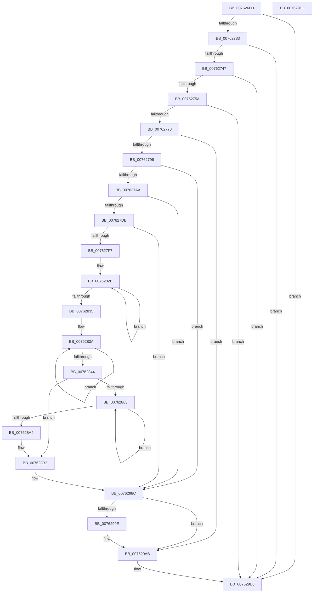

# PopDiagTracePowerLimitRequest

- RVA: `0x007626D0`–`0x007629E0` (길이 `784` bytes)
- VA: `0x00000001407626D0`
- 실행 섹션: `PAGE`
- PDB 이름 있음: `예`; PDB Function 태그: `아니요`
- unwind 정보 RVA: `0x000CCBA4`
- 디코드: `189`개 명령, `784/784` bytes 표시
- 미해석 바이트: `0` (있으면 어셈블리에 `.byte`로 보존)

> 이 문서는 커널 이미지의 기계어와 PDB 기호를 분석해 생성했습니다. 4번과 5번은 함수 원형과 자료형을 바이너리 사용 방식에서 추정한 C 해석이며 원본 소스 복구 결과는 아닙니다.

## 1. Dependencies

- 직접 호출 지점: **11**; 고유 호출 대상: **8**
- 직접 호출자로 확인된 함수: **5**
- RIP 상대 이미지 참조: **3**

### Outgoing calls
- `0x0076273A` → [EtwEventEnabled](../../text/39/EtwEventEnabled_function_00392450.md) (function, `0x00392450`)
- `0x00762767` → [ExAllocatePool2](../../poolcode/B8/ExAllocatePool2_function_00B820F0.md) (function, `0x00B820F0`)
- `0x00762785` → [IoGetDeviceAttachmentBaseRefWithTag](../../text/27/IoGetDeviceAttachmentBaseRefWithTag_function_00272788.md) (function, `0x00272788`)
- `0x007627B5` → [PoStoreDiagnosticContext](../../text/23/PoStoreDiagnosticContext_function_0023009C.md) (function, `0x0023009C`)
- `0x007627CA` → [ExAllocatePool2](../../poolcode/B8/ExAllocatePool2_function_00B820F0.md) (function, `0x00B820F0`)
- `0x007627E7` → [PoStoreDiagnosticContext](../../text/23/PoStoreDiagnosticContext_function_0023009C.md) (function, `0x0023009C`)
- `0x00762987` → [EtwWrite](../../text/41/EtwWrite_function_0041C720.md) (function, `0x0041C720`)
- `0x00762994` → [ObfDereferenceObjectWithTag](../../text/2F/ObfDereferenceObjectWithTag_function_002F78E0.md) (function, `0x002F78E0`)
- `0x007629A6` → [ExFreePoolWithTag](../../poolcode/B8/ExFreePoolWithTag_function_00B82870.md) (function, `0x00B82870`)
- `0x007629B3` → [ExFreePoolWithTag](../../poolcode/B8/ExFreePoolWithTag_function_00B82870.md) (function, `0x00B82870`)
- `0x007629BF` → [_security_check_cookie](../../text/6A/_security_check_cookie_function_006AC640.md) (function, `0x006AC640`)

### Direct callers
- [PopAssociatePowerLimitRequest](../75/PopAssociatePowerLimitRequest_function_00755EC8.md) at `0x007560FB`
- [PopFreePowerLimitRequest](../75/PopFreePowerLimitRequest_function_00756494.md) at `0x00756504`
- [PopOrphanPowerLimitExtension](../75/PopOrphanPowerLimitExtension_function_007566D8.md) at `0x00756742`
- [PopPowerLimitPnpNotification](../75/PopPowerLimitPnpNotification_function_007567C0.md) at `0x007568A5`
- [PopRundownPowerLimitRequests](../A3/PopRundownPowerLimitRequests_function_00A398C4.md) at `0x00A39930`

### Static image references
- `0x007626EC` → RVA `0x00E0A740` (`.data`; read)
- `0x00762702` → RVA `0x00E67858` (`.data`; read)
- `0x00762733` → RVA `0x00F0B408` (`.data`; read)

## 2. Other-region calls and transfers

- 다른 실행 섹션으로 향하는 call: **11**
  - `0x0076273A` → [EtwEventEnabled](../../text/39/EtwEventEnabled_function_00392450.md) (`PAGE` → `.text`)
  - `0x00762767` → [ExAllocatePool2](../../poolcode/B8/ExAllocatePool2_function_00B820F0.md) (`PAGE` → `POOLCODE`)
  - `0x00762785` → [IoGetDeviceAttachmentBaseRefWithTag](../../text/27/IoGetDeviceAttachmentBaseRefWithTag_function_00272788.md) (`PAGE` → `.text`)
  - `0x007627B5` → [PoStoreDiagnosticContext](../../text/23/PoStoreDiagnosticContext_function_0023009C.md) (`PAGE` → `.text`)
  - `0x007627CA` → [ExAllocatePool2](../../poolcode/B8/ExAllocatePool2_function_00B820F0.md) (`PAGE` → `POOLCODE`)
  - `0x007627E7` → [PoStoreDiagnosticContext](../../text/23/PoStoreDiagnosticContext_function_0023009C.md) (`PAGE` → `.text`)
  - `0x00762987` → [EtwWrite](../../text/41/EtwWrite_function_0041C720.md) (`PAGE` → `.text`)
  - `0x00762994` → [ObfDereferenceObjectWithTag](../../text/2F/ObfDereferenceObjectWithTag_function_002F78E0.md) (`PAGE` → `.text`)
  - `0x007629A6` → [ExFreePoolWithTag](../../poolcode/B8/ExFreePoolWithTag_function_00B82870.md) (`PAGE` → `POOLCODE`)
  - `0x007629B3` → [ExFreePoolWithTag](../../poolcode/B8/ExFreePoolWithTag_function_00B82870.md) (`PAGE` → `POOLCODE`)
  - `0x007629BF` → [_security_check_cookie](../../text/6A/_security_check_cookie_function_006AC640.md) (`PAGE` → `.text`)
- 별도 외부 분기/꼬리 이동을 확인하지 못했습니다.

## 3. Assembly (complete function range)

```asm
007626D0  48 89 5C 24 18                  mov qword ptr [rsp + 0x18], rbx
007626D5  55                              push rbp
007626D6  56                              push rsi
007626D7  57                              push rdi
007626D8  41 54                           push r12
007626DA  41 55                           push r13
007626DC  41 56                           push r14
007626DE  41 57                           push r15
007626E0  48 8D 6C 24 D0                  lea rbp, [rsp - 0x30]
007626E5  48 81 EC 30 01 00 00            sub rsp, 0x130
007626EC  48 8B 05 4D 80 6A 00            mov rax, qword ptr [rip + 0x6a804d]
007626F3  48 33 C4                        xor rax, rsp
007626F6  48 89 45 20                     mov qword ptr [rbp + 0x20], rax
007626FA  45 33 ED                        xor r13d, r13d
007626FD  48 89 54 24 60                  mov qword ptr [rsp + 0x60], rdx
00762702  44 38 2D 4F 51 70 00            cmp byte ptr [rip + 0x70514f], r13b
00762709  48 8B F9                        mov rdi, rcx
0076270C  44 89 6C 24 3C                  mov dword ptr [rsp + 0x3c], r13d
00762711  41 8B DD                        mov ebx, r13d
00762714  44 89 6C 24 30                  mov dword ptr [rsp + 0x30], r13d
00762719  44 89 6C 24 34                  mov dword ptr [rsp + 0x34], r13d
0076271E  44 89 6C 24 38                  mov dword ptr [rsp + 0x38], r13d
00762723  4C 89 6C 24 40                  mov qword ptr [rsp + 0x40], r13
00762728  4C 89 6C 24 48                  mov qword ptr [rsp + 0x48], r13
0076272D  0F 84 85 02 00 00               je 0x1407629b8
00762733  48 8B 0D CE 8C 7A 00            mov rcx, qword ptr [rip + 0x7a8cce]
0076273A  E8 11 FD C2 FF                  call 0x140392450
0076273F  84 C0                           test al, al
00762741  0F 84 71 02 00 00               je 0x1407629b8
00762747  4C 8D 67 20                     lea r12, [rdi + 0x20]
0076274B  41 8B 34 24                     mov esi, dword ptr [r12]
0076274F  C1 E6 04                        shl esi, 4
00762752  85 F6                           test esi, esi
00762754  0F 84 5E 02 00 00               je 0x1407629b8
0076275A  8B D6                           mov edx, esi
0076275C  B9 00 01 00 00                  mov ecx, 0x100
00762761  41 B8 50 64 69 67               mov r8d, 0x67696450
00762767  E8 84 F9 41 00                  call 0x140b820f0
0076276C  4C 8B F0                        mov r14, rax
0076276F  48 85 C0                        test rax, rax
00762772  0F 84 40 02 00 00               je 0x1407629b8
00762778  48 8B 4F 40                     mov rcx, qword ptr [rdi + 0x40]
0076277C  BA 50 6F 44 67                  mov edx, 0x67446f50
00762781  48 8B 49 38                     mov rcx, qword ptr [rcx + 0x38]
00762785  E8 FE FF B0 FF                  call 0x140272788
0076278A  4C 8B F8                        mov r15, rax
0076278D  48 85 C0                        test rax, rax
00762790  0F 84 15 02 00 00               je 0x1407629ab
00762796  48 8B 90 38 01 00 00            mov rdx, qword ptr [rax + 0x138]
0076279D  4C 8B 6A 28                     mov r13, qword ptr [rdx + 0x28]
007627A1  4D 85 ED                        test r13, r13
007627A4  0F 84 E2 01 00 00               je 0x14076298c
007627AA  48 8B 4F 18                     mov rcx, qword ptr [rdi + 0x18]
007627AE  4C 8D 44 24 40                  lea r8, [rsp + 0x40]
007627B3  33 D2                           xor edx, edx
007627B5  E8 E2 D8 AC FF                  call 0x14023009c
007627BA  48 8B 54 24 40                  mov rdx, qword ptr [rsp + 0x40]
007627BF  41 B8 54 56 45 50               mov r8d, 0x50455654
007627C5  B9 00 01 00 00                  mov ecx, 0x100
007627CA  E8 21 F9 41 00                  call 0x140b820f0
007627CF  48 8B D8                        mov rbx, rax
007627D2  48 85 C0                        test rax, rax
007627D5  0F 84 B1 01 00 00               je 0x14076298c
007627DB  48 8B 4F 18                     mov rcx, qword ptr [rdi + 0x18]
007627DF  4C 8D 44 24 40                  lea r8, [rsp + 0x40]
007627E4  48 8B D0                        mov rdx, rax
007627E7  E8 B0 D8 AC FF                  call 0x14023009c
007627EC  45 33 D2                        xor r10d, r10d
007627EF  85 C0                           test eax, eax
007627F1  0F 88 95 01 00 00               js 0x14076298c
007627F7  4C 8B 5B 10                     mov r11, qword ptr [rbx + 0x10]
007627FB  48 8B 4B 18                     mov rcx, qword ptr [rbx + 0x18]
007627FF  4C 03 DB                        add r11, rbx
00762802  48 8B 43 20                     mov rax, qword ptr [rbx + 0x20]
00762806  48 03 CB                        add rcx, rbx
00762809  44 8B 4C 24 40                  mov r9d, dword ptr [rsp + 0x40]
0076280E  48 03 C3                        add rax, rbx
00762811  44 2B 4B 20                     sub r9d, dword ptr [rbx + 0x20]
00762815  48 83 CA FF                     or rdx, 0xffffffffffffffff
00762819  48 89 4C 24 50                  mov qword ptr [rsp + 0x50], rcx
0076281E  4C 8B C2                        mov r8, rdx
00762821  48 89 44 24 58                  mov qword ptr [rsp + 0x58], rax
00762826  44 89 4C 24 38                  mov dword ptr [rsp + 0x38], r9d
0076282B  49 FF C0                        inc r8
0076282E  66 47 39 14 43                  cmp word ptr [r11 + r8*2], r10w
00762833  75 F6                           jne 0x14076282b
00762835  44 89 44 24 30                  mov dword ptr [rsp + 0x30], r8d
0076283A  48 FF C2                        inc rdx
0076283D  66 44 39 14 51                  cmp word ptr [rcx + rdx*2], r10w
00762842  75 F6                           jne 0x14076283a
00762844  89 54 24 34                     mov dword ptr [rsp + 0x34], edx
00762848  33 C9                           xor ecx, ecx
0076284A  41 0F B7 85 80 00 00 00         movzx eax, word ptr [r13 + 0x80]
00762852  D1 E8                           shr eax, 1
00762854  89 44 24 3C                     mov dword ptr [rsp + 0x3c], eax
00762858  48 89 7C 24 48                  mov qword ptr [rsp + 0x48], rdi
0076285D  41 39 0C 24                     cmp dword ptr [r12], ecx
00762861  76 4F                           jbe 0x1407628b2
00762863  48 8B 47 28                     mov rax, qword ptr [rdi + 0x28]
00762867  41 8B D2                        mov edx, r10d
0076286A  41 FF C2                        inc r10d
0076286D  48 03 D2                        add rdx, rdx
00762870  8B 0C D0                        mov ecx, dword ptr [rax + rdx*8]
00762873  41 89 0C D6                     mov dword ptr [r14 + rdx*8], ecx
00762877  48 8B 47 28                     mov rax, qword ptr [rdi + 0x28]
0076287B  8B 4C D0 04                     mov ecx, dword ptr [rax + rdx*8 + 4]
0076287F  41 89 4C D6 04                  mov dword ptr [r14 + rdx*8 + 4], ecx
00762884  48 8B 47 28                     mov rax, qword ptr [rdi + 0x28]
00762888  8B 4C D0 08                     mov ecx, dword ptr [rax + rdx*8 + 8]
0076288C  41 89 4C D6 08                  mov dword ptr [r14 + rdx*8 + 8], ecx
00762891  48 8B 47 28                     mov rax, qword ptr [rdi + 0x28]
00762895  8B 4C D0 0C                     mov ecx, dword ptr [rax + rdx*8 + 0xc]
00762899  41 89 4C D6 0C                  mov dword ptr [r14 + rdx*8 + 0xc], ecx
0076289E  45 3B 14 24                     cmp r10d, dword ptr [r12]
007628A2  72 BF                           jb 0x140762863
007628A4  44 8B 44 24 30                  mov r8d, dword ptr [rsp + 0x30]
007628A9  8B 54 24 34                     mov edx, dword ptr [rsp + 0x34]
007628AD  44 8B 4C 24 38                  mov r9d, dword ptr [rsp + 0x38]
007628B2  48 C7 44 24 78 08 00 00 00      mov qword ptr [rsp + 0x78], 8
007628BB  48 8D 44 24 48                  lea rax, [rsp + 0x48]
007628C0  48 89 44 24 70                  mov qword ptr [rsp + 0x70], rax
007628C5  48 8D 44 24 3C                  lea rax, [rsp + 0x3c]
007628CA  48 89 45 80                     mov qword ptr [rbp - 0x80], rax
007628CE  48 C7 45 88 04 00 00 00         mov qword ptr [rbp - 0x78], 4
007628D6  49 8B 85 88 00 00 00            mov rax, qword ptr [r13 + 0x88]
007628DD  41 0F B7 8D 80 00 00 00         movzx ecx, word ptr [r13 + 0x80]
007628E5  48 89 45 90                     mov qword ptr [rbp - 0x70], rax
007628E9  48 8D 44 24 30                  lea rax, [rsp + 0x30]
007628EE  48 89 45 A0                     mov qword ptr [rbp - 0x60], rax
007628F2  43 8D 04 00                     lea eax, [r8 + r8]
007628F6  89 45 B8                        mov dword ptr [rbp - 0x48], eax
007628F9  45 33 C0                        xor r8d, r8d
007628FC  89 4D 98                        mov dword ptr [rbp - 0x68], ecx
007628FF  48 8D 44 24 34                  lea rax, [rsp + 0x34]
00762904  33 C9                           xor ecx, ecx
00762906  48 89 45 C0                     mov qword ptr [rbp - 0x40], rax
0076290A  48 8B 44 24 50                  mov rax, qword ptr [rsp + 0x50]
0076290F  48 89 45 D0                     mov qword ptr [rbp - 0x30], rax
00762913  8D 04 12                        lea eax, [rdx + rdx]
00762916  48 8B 54 24 60                  mov rdx, qword ptr [rsp + 0x60]
0076291B  89 45 D8                        mov dword ptr [rbp - 0x28], eax
0076291E  48 8D 44 24 38                  lea rax, [rsp + 0x38]
00762923  48 89 45 E0                     mov qword ptr [rbp - 0x20], rax
00762927  48 8B 44 24 58                  mov rax, qword ptr [rsp + 0x58]
0076292C  48 89 45 F0                     mov qword ptr [rbp - 0x10], rax
00762930  48 8D 44 24 70                  lea rax, [rsp + 0x70]
00762935  44 89 4D F8                     mov dword ptr [rbp - 8], r9d
00762939  44 8D 49 0B                     lea r9d, [rcx + 0xb]
0076293D  89 4D 9C                        mov dword ptr [rbp - 0x64], ecx
00762940  89 4D BC                        mov dword ptr [rbp - 0x44], ecx
00762943  89 4D DC                        mov dword ptr [rbp - 0x24], ecx
00762946  89 4D FC                        mov dword ptr [rbp - 4], ecx
00762949  89 4D 1C                        mov dword ptr [rbp + 0x1c], ecx
0076294C  48 8B 0D B5 8A 7A 00            mov rcx, qword ptr [rip + 0x7a8ab5]
00762953  48 89 44 24 20                  mov qword ptr [rsp + 0x20], rax
00762958  48 C7 45 A8 04 00 00 00         mov qword ptr [rbp - 0x58], 4
00762960  4C 89 5D B0                     mov qword ptr [rbp - 0x50], r11
00762964  48 C7 45 C8 04 00 00 00         mov qword ptr [rbp - 0x38], 4
0076296C  48 C7 45 E8 04 00 00 00         mov qword ptr [rbp - 0x18], 4
00762974  4C 89 65 00                     mov qword ptr [rbp], r12
00762978  48 C7 45 08 04 00 00 00         mov qword ptr [rbp + 8], 4
00762980  4C 89 75 10                     mov qword ptr [rbp + 0x10], r14
00762984  89 75 18                        mov dword ptr [rbp + 0x18], esi
00762987  E8 94 9D CB FF                  call 0x14041c720
0076298C  BA 50 6F 44 67                  mov edx, 0x67446f50
00762991  49 8B CF                        mov rcx, r15
00762994  E8 47 4F B9 FF                  call 0x1402f78e0
00762999  48 85 DB                        test rbx, rbx
0076299C  74 0D                           je 0x1407629ab
0076299E  BA 54 56 45 50                  mov edx, 0x50455654
007629A3  48 8B CB                        mov rcx, rbx
007629A6  E8 C5 FE 41 00                  call 0x140b82870
007629AB  BA 54 56 45 50                  mov edx, 0x50455654
007629B0  49 8B CE                        mov rcx, r14
007629B3  E8 B8 FE 41 00                  call 0x140b82870
007629B8  48 8B 4D 20                     mov rcx, qword ptr [rbp + 0x20]
007629BC  48 33 CC                        xor rcx, rsp
007629BF  E8 7C 9C F4 FF                  call 0x1406ac640
007629C4  48 8B 9C 24 80 01 00 00         mov rbx, qword ptr [rsp + 0x180]
007629CC  48 81 C4 30 01 00 00            add rsp, 0x130
007629D3  41 5F                           pop r15
007629D5  41 5E                           pop r14
007629D7  41 5D                           pop r13
007629D9  41 5C                           pop r12
007629DB  5F                              pop rdi
007629DC  5E                              pop rsi
007629DD  5D                              pop rbp
007629DE  C3                              ret
007629DF  CC                              int3
```

## 4. C-style interpretation (structured pseudocode)

```c
__int64 __fastcall PopDiagTracePowerLimitRequest(__int64 a1, __int64 a2)
{
    __int64 result;
    __int64 v_r10;
    __int64 v_r11;
    __int64 v_r13;
    __int64 v_rsi;
    __int64 v_rsp;
    unsigned __int64 v_stack_m108;
    unsigned __int64 v_stack_m110;
    unsigned __int64 v_stack_m118;
    unsigned __int64 v_stack_m120;
    unsigned __int64 v_stack_m128;
    unsigned int v_stack_m12C;
    unsigned int v_stack_m130;
    unsigned int v_stack_m134;
    unsigned int v_stack_m138;
    unsigned __int64 v_stack_m148;
    unsigned __int64 v_stack_m48;
    unsigned int v_stack_m4C;
    unsigned int v_stack_m50;
    unsigned __int64 v_stack_m58;
    unsigned __int64 v_stack_m60;
    unsigned __int64 v_stack_m68;
    unsigned int v_stack_m6C;
    unsigned int v_stack_m70;
    unsigned __int64 v_stack_m78;
    unsigned __int64 v_stack_m80;
    unsigned __int64 v_stack_m88;
    unsigned int v_stack_m8C;
    unsigned int v_stack_m90;
    unsigned __int64 v_stack_m98;
    unsigned __int64 v_stack_mA0;
    unsigned __int64 v_stack_mA8;
    unsigned int v_stack_mAC;
    unsigned int v_stack_mB0;
    unsigned __int64 v_stack_mB8;
    unsigned __int64 v_stack_mC0;
    unsigned __int64 v_stack_mC8;
    unsigned int v_stack_mCC;
    unsigned int v_stack_mD0;
    unsigned __int64 v_stack_mD8;
    unsigned __int64 v_stack_mE0;
    unsigned __int64 v_stack_mE8;
    unsigned __int64 v_stack_mF0;
    unsigned __int64 v_stack_mF8;
    unsigned __int64 v_stack_p18;

    v_stack_p18 = v_rbx;
    v_rsp = (v_rsp) - (304);
    result = (*(unsigned __int64 *)(v_rip + 6979661)) ^ (v_rsp);
    v_stack_m48 = result;
    v_r13 = 0;
    v_stack_m108 = a2;
    v_stack_m12C = 0;
    v_stack_m138 = 0;
    v_stack_m134 = 0;
    v_stack_m130 = 0;
    v_stack_m128 = 0;
    v_stack_m120 = 0;
    if ((*(unsigned __int8 *)(v_rip + 7360847)) == 0) goto loc_007629B8;
    result = EtwEventEnabled(*(unsigned __int64 *)(v_rip + 8031438), a2, a3, a4);
    if ((unsigned __int8)(result) == 0) goto loc_007629B8;
    v_rsi = (unsigned int)(((unsigned int)(*(unsigned int *)(a1 + 32))) << (4));
    if ((unsigned int)(v_rsi) == 0) goto loc_007629B8;
    result = ExAllocatePool2(256, (unsigned int)((unsigned int)(v_rsi)), (unsigned int)(0x67696450ULL), a4);
    if (result == 0) goto loc_007629B8;
    result = IoGetDeviceAttachmentBaseRefWithTag(*(unsigned __int64 *)(*(unsigned __int64 *)(a1 + 64) + 56), (unsigned int)(0x67446F50ULL), (unsigned int)(0x67696450ULL), a4);
    if (result == 0) goto loc_007629AB;
    if (*(unsigned __int64 *)(*(unsigned __int64 *)(result + 312) + 40) == 0) goto loc_0076298C;
    a2 = 0;
    result = PoStoreDiagnosticContext(*(unsigned __int64 *)(a1 + 24), a2, v_stack_m128, a4);
    result = ExAllocatePool2(256, v_stack_m128, (unsigned int)(0x50455654ULL), a4);
    if (result == 0) goto loc_0076298C;
    result = PoStoreDiagnosticContext(*(unsigned __int64 *)(a1 + 24), result, v_stack_m128, a4);
    v_r10 = 0;
    if (sign_flag) goto loc_0076298C;
    v_r11 = (*(unsigned __int64 *)(result + 16)) + (result);
    a1 = (*(unsigned __int64 *)(result + 24)) + (result);
    result = (*(unsigned __int64 *)(result + 32)) + (result);
    a4 = (unsigned int)(((unsigned int)(v_stack_m128)) - (*(unsigned int *)(result + 32)));
    a2 = (result) | (-1);
    v_stack_m118 = a1;
    v_stack_m110 = result;
    v_stack_m130 = (unsigned int)(a4);
loc_0076282B:
    a3 = (a2) + 1;
    if ((*(unsigned __int16 *)(v_r11 + a3 * 2)) != 0) goto loc_0076282B;
    v_stack_m138 = (unsigned int)(a3);
loc_0076283A:
    a2 = (a2) + 1;
    if ((*(unsigned __int16 *)(a1 + a2 * 2)) != 0) goto loc_0076283A;
    v_stack_m134 = (unsigned int)(a2);
    a1 = 0;
    result = (unsigned int)((*(unsigned __int16 *)(*(unsigned __int64 *)(*(unsigned __int64 *)(result + 312) + 40) + 128)) >> (1));
    v_stack_m12C = (unsigned int)(result);
    v_stack_m120 = 0;
    if ((*(unsigned int *)(a1 + 32)) <= 0) goto loc_007628B2;
loc_00762863:
    v_r10 = (unsigned int)((v_r10) + 1);
    a2 = (0) + (0);
    *(unsigned int *)(result + a2 * 8) = (unsigned int)((unsigned int)(*(unsigned int *)(*(unsigned __int64 *)(a1 + 40) + a2 * 8)));
    *(unsigned int *)(result + a2 * 8 + 4) = (unsigned int)((unsigned int)(*(unsigned int *)(*(unsigned __int64 *)(a1 + 40) + a2 * 8 + 4)));
    *(unsigned int *)(result + a2 * 8 + 8) = (unsigned int)((unsigned int)(*(unsigned int *)(*(unsigned __int64 *)(a1 + 40) + a2 * 8 + 8)));
    *(unsigned int *)(result + a2 * 8 + 12) = (unsigned int)((unsigned int)(*(unsigned int *)(*(unsigned __int64 *)(a1 + 40) + a2 * 8 + 12)));
    if (((unsigned int)(v_r10)) < (*(unsigned int *)(a1 + 32))) goto loc_00762863;
loc_007628B2:
    v_stack_mF0 = 8;
    v_stack_mF8 = v_stack_m120;
    v_stack_mE8 = v_stack_m12C;
    v_stack_mE0 = 4;
    v_stack_mD8 = *(unsigned __int64 *)(*(unsigned __int64 *)(*(unsigned __int64 *)(result + 312) + 40) + 136);
    v_stack_mC8 = v_stack_m138;
    v_stack_mB0 = (unsigned int)((unsigned int)(v_stack_m138) + (unsigned int)(v_stack_m138) * 1);
    a3 = 0;
    v_stack_mD0 = (unsigned int)(*(unsigned __int16 *)(*(unsigned __int64 *)(*(unsigned __int64 *)(result + 312) + 40) + 128));
    a1 = 0;
    v_stack_mA8 = v_stack_m134;
    v_stack_m98 = v_stack_m118;
    v_stack_m90 = (unsigned int)((unsigned int)(v_stack_m134) + (unsigned int)(v_stack_m134) * 1);
    v_stack_m88 = v_stack_m130;
    v_stack_m78 = v_stack_m110;
    v_stack_m70 = (unsigned int)((unsigned int)(v_stack_m130));
    v_stack_mCC = 0;
    v_stack_mAC = 0;
    v_stack_m8C = 0;
    v_stack_m6C = 0;
    v_stack_m4C = 0;
    v_stack_m148 = v_stack_mF8;
    v_stack_mC0 = 4;
    v_stack_mB8 = v_r11;
    v_stack_mA0 = 4;
    v_stack_m80 = 4;
    v_stack_m68 = a1 + 32;
    v_stack_m60 = 4;
    v_stack_m58 = result;
    v_stack_m50 = (unsigned int)(v_rsi);
    result = EtwWrite(*(unsigned __int64 *)(v_rip + 8030901), v_stack_m108, a3, a1 + 11);
loc_0076298C:
    result = ObfDereferenceObjectWithTag(result, (unsigned int)(0x67446F50ULL), a3, a1 + 11);
    if (result != 0) {
        a2 = 0x50455654ULL;
        a1 = result;
        result = ExFreePoolWithTag(a1, a2, a3, a1 + 11);
    }
    result = ExFreePoolWithTag(result, (unsigned int)(0x50455654ULL), a3, a1 + 11);
loc_007629B8:
    a1 = (v_stack_m48) ^ (v_rsp);
    result = _security_check_cookie(a1, (unsigned int)(0x50455654ULL), a3, a1 + 11);
    v_rsp = (v_rsp) + (304);
    return result;
}
```

## 5. (Beta) C Style

```c
int64_t PopDiagTracePowerLimitRequest(void *Arg1, int64_t Arg2)
{
    uint8_t *arg1 = (uint8_t *)Arg1;

    int64_t result;
    int64_t local_r10;
    int64_t local_r11;
    int64_t local_r13;
    int64_t local_rsi;
    int64_t local_rsp;
    uint64_t v_stack_m108;
    uint64_t v_stack_m110;
    uint64_t v_stack_m118;
    uint64_t v_stack_m120;
    uint64_t v_stack_m128;
    uint32_t v_stack_m12C;
    uint32_t v_stack_m130;
    uint32_t v_stack_m134;
    uint32_t v_stack_m138;
    uint64_t v_stack_m148;
    uint64_t v_stack_m48;
    uint32_t v_stack_m4C;
    uint32_t v_stack_m50;
    uint64_t v_stack_m58;
    uint64_t v_stack_m60;
    uint64_t v_stack_m68;
    uint32_t v_stack_m6C;
    uint32_t v_stack_m70;
    uint64_t v_stack_m78;
    uint64_t v_stack_m80;
    uint64_t v_stack_m88;
    uint32_t v_stack_m8C;
    uint32_t v_stack_m90;
    uint64_t v_stack_m98;
    uint64_t v_stack_mA0;
    uint64_t v_stack_mA8;
    uint32_t v_stack_mAC;
    uint32_t v_stack_mB0;
    uint64_t v_stack_mB8;
    uint64_t v_stack_mC0;
    uint64_t v_stack_mC8;
    uint32_t v_stack_mCC;
    uint32_t v_stack_mD0;
    uint64_t v_stack_mD8;
    uint64_t v_stack_mE0;
    uint64_t v_stack_mE8;
    uint64_t v_stack_mF0;
    uint64_t v_stack_mF8;
    uint64_t v_stack_p18;

    v_stack_p18 = local_rbx;
    local_rsp = (local_rsp) - (304);
    result = (*(uint64_t *)(v_rip + 0x6A804D)) ^ (local_rsp);
    v_stack_m48 = result;
    local_r13 = 0;
    v_stack_m108 = Arg2;
    v_stack_m12C = 0;
    v_stack_m138 = 0;
    v_stack_m134 = 0;
    v_stack_m130 = 0;
    v_stack_m128 = 0;
    v_stack_m120 = 0;
    if ((*(uint8_t *)(v_rip + 0x70514F)) == 0) goto loc_007629B8;
    result = EtwEventEnabled(*(uint64_t *)(v_rip + 0x7A8CCE), Arg2, a3, a4);
    if ((uint8_t)(result) == 0) goto loc_007629B8;
    local_rsi = (uint32_t)(((uint32_t)(*(uint32_t *)(arg1 + 0x20))) << (4));
    if ((uint32_t)(local_rsi) == 0) goto loc_007629B8;
    result = ExAllocatePool2(256, (uint32_t)((uint32_t)(local_rsi)), (uint32_t)(0x67696450ULL), a4);
    if (result == 0) goto loc_007629B8;
    result = IoGetDeviceAttachmentBaseRefWithTag(*(uint64_t *)(*(uint64_t *)(arg1 + 0x40) + 0x38), (uint32_t)(0x67446F50ULL), (uint32_t)(0x67696450ULL), a4);
    if (result == 0) goto loc_007629AB;
    if (*(uint64_t *)(*(uint64_t *)(result + 0x138) + 0x28) == 0) goto loc_0076298C;
    Arg2 = 0;
    result = PoStoreDiagnosticContext(*(uint64_t *)(arg1 + 0x18), Arg2, v_stack_m128, a4);
    result = ExAllocatePool2(256, v_stack_m128, (uint32_t)(0x50455654ULL), a4);
    if (result == 0) goto loc_0076298C;
    result = PoStoreDiagnosticContext(*(uint64_t *)(arg1 + 0x18), result, v_stack_m128, a4);
    local_r10 = 0;
    if (sign_flag) goto loc_0076298C;
    local_r11 = (*(uint64_t *)(result + 0x10)) + (result);
    Arg1 = (*(uint64_t *)(result + 0x18)) + (result);
    result = (*(uint64_t *)(result + 0x20)) + (result);
    a4 = (uint32_t)(((uint32_t)(v_stack_m128)) - (*(uint32_t *)(result + 0x20)));
    Arg2 = (result) | (-1);
    v_stack_m118 = Arg1;
    v_stack_m110 = result;
    v_stack_m130 = (uint32_t)(a4);
loc_0076282B:
    a3 = (Arg2) + 1;
    if ((*(uint16_t *)(local_r11 + a3 * 2)) != 0) goto loc_0076282B;
    v_stack_m138 = (uint32_t)(a3);
loc_0076283A:
    Arg2 = (Arg2) + 1;
    if ((*(uint16_t *)(arg1 + Arg2 * 2)) != 0) goto loc_0076283A;
    v_stack_m134 = (uint32_t)(Arg2);
    Arg1 = 0;
    result = (uint32_t)((*(uint16_t *)(*(uint64_t *)(*(uint64_t *)(result + 0x138) + 0x28) + 0x80)) >> (1));
    v_stack_m12C = (uint32_t)(result);
    v_stack_m120 = 0;
    if ((*(uint32_t *)(arg1 + 0x20)) <= 0) goto loc_007628B2;
loc_00762863:
    local_r10 = (uint32_t)((local_r10) + 1);
    Arg2 = (0) + (0);
    *(uint32_t *)(result + Arg2 * 8) = (uint32_t)((uint32_t)(*(uint32_t *)(*(uint64_t *)(arg1 + 0x28) + Arg2 * 8)));
    *(uint32_t *)(result + Arg2 * 8 + 0x4) = (uint32_t)((uint32_t)(*(uint32_t *)(*(uint64_t *)(arg1 + 0x28) + Arg2 * 8 + 0x4)));
    *(uint32_t *)(result + Arg2 * 8 + 0x8) = (uint32_t)((uint32_t)(*(uint32_t *)(*(uint64_t *)(arg1 + 0x28) + Arg2 * 8 + 0x8)));
    *(uint32_t *)(result + Arg2 * 8 + 0xC) = (uint32_t)((uint32_t)(*(uint32_t *)(*(uint64_t *)(arg1 + 0x28) + Arg2 * 8 + 0xC)));
    if (((uint32_t)(local_r10)) < (*(uint32_t *)(arg1 + 0x20))) goto loc_00762863;
loc_007628B2:
    v_stack_mF0 = 8;
    v_stack_mF8 = v_stack_m120;
    v_stack_mE8 = v_stack_m12C;
    v_stack_mE0 = 4;
    v_stack_mD8 = *(uint64_t *)(*(uint64_t *)(*(uint64_t *)(result + 0x138) + 0x28) + 0x88);
    v_stack_mC8 = v_stack_m138;
    v_stack_mB0 = (uint32_t)((uint32_t)(v_stack_m138) + (uint32_t)(v_stack_m138) * 1);
    a3 = 0;
    v_stack_mD0 = (uint32_t)(*(uint16_t *)(*(uint64_t *)(*(uint64_t *)(result + 0x138) + 0x28) + 0x80));
    Arg1 = 0;
    v_stack_mA8 = v_stack_m134;
    v_stack_m98 = v_stack_m118;
    v_stack_m90 = (uint32_t)((uint32_t)(v_stack_m134) + (uint32_t)(v_stack_m134) * 1);
    v_stack_m88 = v_stack_m130;
    v_stack_m78 = v_stack_m110;
    v_stack_m70 = (uint32_t)((uint32_t)(v_stack_m130));
    v_stack_mCC = 0;
    v_stack_mAC = 0;
    v_stack_m8C = 0;
    v_stack_m6C = 0;
    v_stack_m4C = 0;
    v_stack_m148 = v_stack_mF8;
    v_stack_mC0 = 4;
    v_stack_mB8 = local_r11;
    v_stack_mA0 = 4;
    v_stack_m80 = 4;
    v_stack_m68 = Arg1 + 32;
    v_stack_m60 = 4;
    v_stack_m58 = result;
    v_stack_m50 = (uint32_t)(local_rsi);
    result = EtwWrite(*(uint64_t *)(v_rip + 0x7A8AB5), v_stack_m108, a3, Arg1 + 11);
loc_0076298C:
    result = ObfDereferenceObjectWithTag(result, (uint32_t)(0x67446F50ULL), a3, Arg1 + 11);
    if (result != 0) {
        Arg2 = 0x50455654ULL;
        Arg1 = result;
        result = ExFreePoolWithTag(Arg1, Arg2, a3, Arg1 + 11);
    }
    result = ExFreePoolWithTag(result, (uint32_t)(0x50455654ULL), a3, Arg1 + 11);
loc_007629B8:
    Arg1 = (v_stack_m48) ^ (local_rsp);
    result = _security_check_cookie(Arg1, (uint32_t)(0x50455654ULL), a3, Arg1 + 11);
    local_rsp = (local_rsp) + (304);
    return result;
}
```

### 관측된 메모리 오프셋

구조체 형식이 확인되지 않은 접근은 인자 기준의 오프셋으로만 기록했습니다.

| 기준 인자 | 오프셋 표현 | 폭 (bit) | 접근 |
|---|---:|---:|---|
| `Arg1` | `+ 0x0` | `32` | `R` |
| `Arg1` | `+ 0x18` | `64` | `R` |
| `Arg1` | `+ 0x20` | `64` | `R` |
| `Arg1` | `+ 0x28` | `64` | `R` |
| `Arg1` | `+ 0x40` | `64` | `R` |

## 6. Execution-region graph

[열기: 2D/3D 그래프와 함수 탐색 컨트롤 패널](../../../control-panel.html?section=page&rva=0x007626D0&view=graph)

- 2D 그래프는 위에서 아래로 흐르고, 3D 그래프는 빈 공간을 드래그해 회전합니다. Shift+드래그는 이동, 휠은 확대·축소, 함수 노드 선택은 대상 보고서 이동입니다.

### Static fallback


