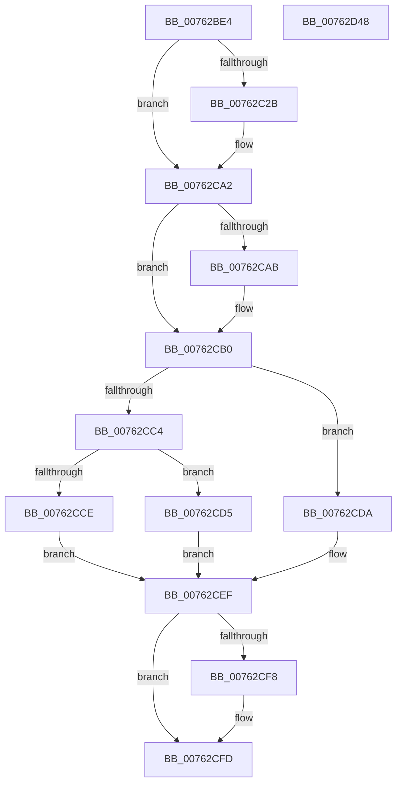

# PopDiagTracePreSleepNotification

- RVA: `0x00762BE4`–`0x00762D49` (길이 `357` bytes)
- VA: `0x0000000140762BE4`
- 실행 섹션: `PAGE`
- PDB 이름 있음: `예`; PDB Function 태그: `아니요`
- unwind 정보 RVA: `0x000CC8FC`
- 디코드: `101`개 명령, `357/357` bytes 표시
- 미해석 바이트: `0` (있으면 어셈블리에 `.byte`로 보존)

> 이 문서는 커널 이미지의 기계어와 PDB 기호를 분석해 생성했습니다. 4번과 5번은 함수 원형과 자료형을 바이너리 사용 방식에서 추정한 C 해석이며 원본 소스 복구 결과는 아닙니다.

## 1. Dependencies

- 직접 호출 지점: **7**; 고유 호출 대상: **6**
- 직접 호출자로 확인된 함수: **1**
- RIP 상대 이미지 참조: **7**

### Outgoing calls
- `0x00762C9D` → [EtwWrite](../../text/41/EtwWrite_function_0041C720.md) (function, `0x0041C720`)
- `0x00762CA2` → [Feature_2845206840__private_IsEnabledDeviceUsageNoInline](../../text/5D/Feature_2845206840__private_IsEnabledDeviceUsageNoInline_function_005D5B64.md) (function, `0x005D5B64`)
- `0x00762CAB` → [PopAcquirePolicyLock](../../pagelk/B7/PopAcquirePolicyLock_function_00B783C0.md) (function, `0x00B783C0`)
- `0x00762CEF` → [Feature_2845206840__private_IsEnabledDeviceUsageNoInline](../../text/5D/Feature_2845206840__private_IsEnabledDeviceUsageNoInline_function_005D5B64.md) (function, `0x005D5B64`)
- `0x00762CF8` → [PopReleasePolicyLock](../../pagelk/B7/PopReleasePolicyLock_function_00B78410.md) (function, `0x00B78410`)
- `0x00762D25` → [SshSessionManagerTracePreSleepNotification](../77/SshSessionManagerTracePreSleepNotification_function_00774098.md) (function, `0x00774098`)
- `0x00762D31` → [_security_check_cookie](../../text/6A/_security_check_cookie_function_006AC640.md) (function, `0x006AC640`)

### Direct callers
- [PopTransitionSystemPowerStateEx](../../pagelk/B7/PopTransitionSystemPowerStateEx_function_00B7E8C0.md) at `0x00B7F072`
- [PopTransitionSystemPowerStateEx](../../pagelk/B7/PopTransitionSystemPowerStateEx_function_00B7E8C0.md) at `0x00B7F0AD`

### Static image references
- `0x00762BFF` → RVA `0x00E0A740` (`.data`; read)
- `0x00762C14` → RVA `0x00E67858` (`.data`; read)
- `0x00762C37` → RVA `0x00021760` (`.rdata`; read)
- `0x00762C91` → RVA `0x00F0B408` (`.data`; read)
- `0x00762CB0` → RVA `0x00E0B579` (`.data`; read)
- `0x00762CBB` → RVA `0x00E67A54` (`.data`; read)
- `0x00762CC6` → RVA `0x00E67884` (`.data`; read)

## 2. Other-region calls and transfers

- 다른 실행 섹션으로 향하는 call: **6**
  - `0x00762C9D` → [EtwWrite](../../text/41/EtwWrite_function_0041C720.md) (`PAGE` → `.text`)
  - `0x00762CA2` → [Feature_2845206840__private_IsEnabledDeviceUsageNoInline](../../text/5D/Feature_2845206840__private_IsEnabledDeviceUsageNoInline_function_005D5B64.md) (`PAGE` → `.text`)
  - `0x00762CAB` → [PopAcquirePolicyLock](../../pagelk/B7/PopAcquirePolicyLock_function_00B783C0.md) (`PAGE` → `PAGELK`)
  - `0x00762CEF` → [Feature_2845206840__private_IsEnabledDeviceUsageNoInline](../../text/5D/Feature_2845206840__private_IsEnabledDeviceUsageNoInline_function_005D5B64.md) (`PAGE` → `.text`)
  - `0x00762CF8` → [PopReleasePolicyLock](../../pagelk/B7/PopReleasePolicyLock_function_00B78410.md) (`PAGE` → `PAGELK`)
  - `0x00762D31` → [_security_check_cookie](../../text/6A/_security_check_cookie_function_006AC640.md) (`PAGE` → `.text`)
- 별도 외부 분기/꼬리 이동을 확인하지 못했습니다.

## 3. Assembly (complete function range)

```asm
00762BE4  44 89 4C 24 20                  mov dword ptr [rsp + 0x20], r9d
00762BE9  55                              push rbp
00762BEA  53                              push rbx
00762BEB  56                              push rsi
00762BEC  57                              push rdi
00762BED  41 54                           push r12
00762BEF  41 56                           push r14
00762BF1  41 57                           push r15
00762BF3  48 8D 6C 24 F1                  lea rbp, [rsp - 0xf]
00762BF8  48 81 EC D0 00 00 00            sub rsp, 0xd0
00762BFF  48 8B 05 3A 7B 6A 00            mov rax, qword ptr [rip + 0x6a7b3a]
00762C06  48 33 C4                        xor rax, rsp
00762C09  48 89 45 FF                     mov qword ptr [rbp - 1], rax
00762C0D  83 65 8F 00                     and dword ptr [rbp - 0x71], 0
00762C11  45 8B F8                        mov r15d, r8d
00762C14  80 3D 3D 4C 70 00 00            cmp byte ptr [rip + 0x704c3d], 0
00762C1B  4C 8B 75 77                     mov r14, qword ptr [rbp + 0x77]
00762C1F  4C 8B 65 7F                     mov r12, qword ptr [rbp + 0x7f]
00762C23  89 4D 9F                        mov dword ptr [rbp - 0x61], ecx
00762C26  89 55 97                        mov dword ptr [rbp - 0x69], edx
00762C29  74 77                           je 0x140762ca2
00762C2B  83 65 BB 00                     and dword ptr [rbp - 0x45], 0
00762C2F  48 8D 45 9F                     lea rax, [rbp - 0x61]
00762C33  83 65 CB 00                     and dword ptr [rbp - 0x35], 0
00762C37  48 8D 15 22 EB 8B FF            lea rdx, [rip - 0x7414de]
00762C3E  83 65 DB 00                     and dword ptr [rbp - 0x25], 0
00762C42  B9 04 00 00 00                  mov ecx, 4
00762C47  83 65 EB 00                     and dword ptr [rbp - 0x15], 0
00762C4B  83 65 FB 00                     and dword ptr [rbp - 5], 0
00762C4F  48 89 45 AF                     mov qword ptr [rbp - 0x51], rax
00762C53  48 8D 45 97                     lea rax, [rbp - 0x69]
00762C57  48 89 45 BF                     mov qword ptr [rbp - 0x41], rax
00762C5B  44 8D 49 01                     lea r9d, [rcx + 1]
00762C5F  48 8D 45 8F                     lea rax, [rbp - 0x71]
00762C63  44 89 45 8F                     mov dword ptr [rbp - 0x71], r8d
00762C67  48 89 45 CF                     mov qword ptr [rbp - 0x31], rax
00762C6B  45 33 C0                        xor r8d, r8d
00762C6E  48 8D 45 67                     lea rax, [rbp + 0x67]
00762C72  89 4D B7                        mov dword ptr [rbp - 0x49], ecx
00762C75  48 89 45 DF                     mov qword ptr [rbp - 0x21], rax
00762C79  48 8D 45 6F                     lea rax, [rbp + 0x6f]
00762C7D  48 89 45 EF                     mov qword ptr [rbp - 0x11], rax
00762C81  48 8D 45 AF                     lea rax, [rbp - 0x51]
00762C85  89 4D C7                        mov dword ptr [rbp - 0x39], ecx
00762C88  89 4D D7                        mov dword ptr [rbp - 0x29], ecx
00762C8B  89 4D E7                        mov dword ptr [rbp - 0x19], ecx
00762C8E  89 4D F7                        mov dword ptr [rbp - 9], ecx
00762C91  48 8B 0D 70 87 7A 00            mov rcx, qword ptr [rip + 0x7a8770]
00762C98  48 89 44 24 20                  mov qword ptr [rsp + 0x20], rax
00762C9D  E8 7E 9A CB FF                  call 0x14041c720
00762CA2  E8 BD 2E E7 FF                  call 0x1405d5b64
00762CA7  85 C0                           test eax, eax
00762CA9  75 05                           jne 0x140762cb0
00762CAB  E8 10 57 41 00                  call 0x140b783c0
00762CB0  80 3D C2 88 6A 00 00            cmp byte ptr [rip + 0x6a88c2], 0
00762CB7  40 0F 95 C6                     setne sil
00762CBB  80 3D 92 4D 70 00 00            cmp byte ptr [rip + 0x704d92], 0
00762CC2  75 16                           jne 0x140762cda
00762CC4  32 DB                           xor bl, bl
00762CC6  38 1D B8 4B 70 00               cmp byte ptr [rip + 0x704bb8], bl
00762CCC  74 07                           je 0x140762cd5
00762CCE  B3 01                           mov bl, 1
00762CD0  40 B7 02                        mov dil, 2
00762CD3  EB 1A                           jmp 0x140762cef
00762CD5  40 32 FF                        xor dil, dil
00762CD8  EB 15                           jmp 0x140762cef
00762CDA  8A 05 A4 4B 70 00               mov al, byte ptr [rip + 0x704ba4]
00762CE0  40 B7 02                        mov dil, 2
00762CE3  F6 D8                           neg al
00762CE5  B3 01                           mov bl, 1
00762CE7  1A C9                           sbb cl, cl
00762CE9  40 22 F9                        and dil, cl
00762CEC  40 02 FB                        add dil, bl
00762CEF  E8 70 2E E7 FF                  call 0x1405d5b64
00762CF4  85 C0                           test eax, eax
00762CF6  75 05                           jne 0x140762cfd
00762CF8  E8 13 57 41 00                  call 0x140b78410
00762CFD  41 8B 46 08                     mov eax, dword ptr [r14 + 8]
00762D01  45 8B C7                        mov r8d, r15d
00762D04  45 8B 4E 0C                     mov r9d, dword ptr [r14 + 0xc]
00762D08  8B 55 97                        mov edx, dword ptr [rbp - 0x69]
00762D0B  8B 4D 9F                        mov ecx, dword ptr [rbp - 0x61]
00762D0E  40 88 7C 24 40                  mov byte ptr [rsp + 0x40], dil
00762D13  88 5C 24 38                     mov byte ptr [rsp + 0x38], bl
00762D17  4C 89 64 24 30                  mov qword ptr [rsp + 0x30], r12
00762D1C  40 88 74 24 28                  mov byte ptr [rsp + 0x28], sil
00762D21  89 44 24 20                     mov dword ptr [rsp + 0x20], eax
00762D25  E8 6E 13 01 00                  call 0x140774098
00762D2A  48 8B 4D FF                     mov rcx, qword ptr [rbp - 1]
00762D2E  48 33 CC                        xor rcx, rsp
00762D31  E8 0A 99 F4 FF                  call 0x1406ac640
00762D36  48 81 C4 D0 00 00 00            add rsp, 0xd0
00762D3D  41 5F                           pop r15
00762D3F  41 5E                           pop r14
00762D41  41 5C                           pop r12
00762D43  5F                              pop rdi
00762D44  5E                              pop rsi
00762D45  5B                              pop rbx
00762D46  5D                              pop rbp
00762D47  C3                              ret
00762D48  CC                              int3
```

## 4. C-style interpretation (structured pseudocode)

```c
__int64 __fastcall PopDiagTracePreSleepNotification(int a1, int a2, int a3, int a4, __int64 a5, __int64 a6, __int64 a7)
{
    __int64 result;
    __int64 v_rbx;
    __int64 v_rdi;
    __int64 v_rsi;
    __int64 v_rsp;
    unsigned __int64 v_stack_m47;
    unsigned __int64 v_stack_m48;
    unsigned int v_stack_m4C;
    unsigned int v_stack_m50;
    unsigned __int64 v_stack_m58;
    unsigned int v_stack_m5C;
    unsigned int v_stack_m60;
    unsigned __int64 v_stack_m68;
    unsigned int v_stack_m6C;
    unsigned int v_stack_m70;
    unsigned __int64 v_stack_m78;
    unsigned int v_stack_m7C;
    unsigned int v_stack_m80;
    unsigned __int64 v_stack_m88;
    unsigned int v_stack_m8C;
    unsigned int v_stack_m90;
    unsigned __int64 v_stack_m98;
    unsigned int v_stack_mA8;
    unsigned int v_stack_mB0;
    unsigned int v_stack_mB8;
    unsigned __int8 v_stack_mC8;
    unsigned __int8 v_stack_mD0;
    unsigned __int64 v_stack_mD8;
    unsigned __int8 v_stack_mE0;
    unsigned __int64 v_stack_mE8;
    unsigned int v_stack_p20;

    v_stack_p20 = a4;
    v_rsp = (v_rsp) - (208);
    result = (*(unsigned __int64 *)(v_rip + 6978362)) ^ (v_rsp);
    v_stack_m48 = result;
    v_stack_mA8 = a1;
    v_stack_mB0 = a2;
    if ((*(unsigned __int8 *)(v_rip + 7359549)) != 0) {
        result = v_stack_mA8;
        a2 = v_rip - 7607518;
        a1 = 4;
        v_stack_m98 = result;
        result = v_stack_mB0;
        v_stack_m88 = result;
        a4 = a1 + 1;
        result = v_stack_mB8;
        v_stack_mB8 = a3;
        v_stack_m78 = result;
        a3 = 0;
        result = v_stack_p20;
        v_stack_m90 = a1;
        v_stack_m68 = result;
        result = a5;
        v_stack_m58 = result;
        result = v_stack_m98;
        v_stack_m80 = a1;
        v_stack_m70 = a1;
        v_stack_m60 = a1;
        v_stack_m50 = a1;
        a1 = *(unsigned __int64 *)(v_rip + 8030064);
        v_stack_mE8 = result;
        result = EtwWrite(a1, a2, a3, a4);
    }
    result = Feature_2845206840__private_IsEnabledDeviceUsageNoInline(a1, a2, a3, a4);
    if ((unsigned int)(result) == 0) {
        result = PopAcquirePolicyLock(a1, a2, a3, a4);
    }
    v_rsi = ((*(unsigned __int8 *)(v_rip + 6981826)) != 0) ? 1 : 0;
    if ((*(unsigned __int8 *)(v_rip + 7359890)) != 0) goto loc_00762CDA;
    v_rbx = 0;
    if ((*(unsigned __int8 *)(v_rip + 7359416)) == 0) goto loc_00762CD5;
    goto loc_00762CEF;
loc_00762CD5:
    v_rdi = 0;
    goto loc_00762CEF;
loc_00762CDA:
    result = (unsigned __int8)(-(*(unsigned __int8 *)(v_rip + 7359396)));
    v_rdi = (unsigned __int8)((2) & ((unsigned __int8)(a1)));
    v_rdi = (unsigned __int8)((v_rdi) + (1));
loc_00762CEF:
    result = Feature_2845206840__private_IsEnabledDeviceUsageNoInline(a1, a2, a3, a4);
    if ((unsigned int)(result) == 0) {
        result = PopReleasePolicyLock(a1, a2, a3, a4);
    }
    v_stack_mC8 = (unsigned __int8)(v_rdi);
    v_stack_mD0 = 1;
    v_stack_mD8 = a7;
    v_stack_mE0 = (unsigned __int8)(v_rsi);
    v_stack_mE8 = (unsigned int)((unsigned int)(*(unsigned int *)(a6 + 8)));
    result = SshSessionManagerTracePreSleepNotification((unsigned int)(v_stack_mA8), (unsigned int)(v_stack_mB0), (unsigned int)((unsigned int)((unsigned int)(a3))), (unsigned int)(*(unsigned int *)(a6 + 12)));
    a1 = (v_stack_m48) ^ (v_rsp);
    result = _security_check_cookie(a1, (unsigned int)(v_stack_mB0), (unsigned int)((unsigned int)((unsigned int)(a3))), (unsigned int)(*(unsigned int *)(a6 + 12)));
    v_rsp = (v_rsp) + (208);
    return result;
}
```

## 5. (Beta) C Style

```c
int64_t PopDiagTracePreSleepNotification(int32_t Arg1, int32_t Arg2, int32_t Arg3, int32_t Arg4, int64_t Arg5, void *Arg6, int64_t Arg7)
{
    uint8_t *arg6 = (uint8_t *)Arg6;

    int64_t result;
    int64_t local_rbx;
    int64_t local_rdi;
    int64_t local_rsi;
    int64_t local_rsp;
    uint64_t v_stack_m47;
    uint64_t v_stack_m48;
    uint32_t v_stack_m4C;
    uint32_t v_stack_m50;
    uint64_t v_stack_m58;
    uint32_t v_stack_m5C;
    uint32_t v_stack_m60;
    uint64_t v_stack_m68;
    uint32_t v_stack_m6C;
    uint32_t v_stack_m70;
    uint64_t v_stack_m78;
    uint32_t v_stack_m7C;
    uint32_t v_stack_m80;
    uint64_t v_stack_m88;
    uint32_t v_stack_m8C;
    uint32_t v_stack_m90;
    uint64_t v_stack_m98;
    uint32_t v_stack_mA8;
    uint32_t v_stack_mB0;
    uint32_t v_stack_mB8;
    uint8_t v_stack_mC8;
    uint8_t v_stack_mD0;
    uint64_t v_stack_mD8;
    uint8_t v_stack_mE0;
    uint64_t v_stack_mE8;
    uint32_t v_stack_p20;

    v_stack_p20 = Arg4;
    local_rsp = (local_rsp) - (208);
    result = (*(uint64_t *)(v_rip + 0x6A7B3A)) ^ (local_rsp);
    v_stack_m48 = result;
    v_stack_mA8 = Arg1;
    v_stack_mB0 = Arg2;
    if ((*(uint8_t *)(v_rip + 0x704C3D)) != 0) {
        result = v_stack_mA8;
        Arg2 = v_rip - 7607518;
        Arg1 = 4;
        v_stack_m98 = result;
        result = v_stack_mB0;
        v_stack_m88 = result;
        Arg4 = Arg1 + 1;
        result = v_stack_mB8;
        v_stack_mB8 = Arg3;
        v_stack_m78 = result;
        Arg3 = 0;
        result = v_stack_p20;
        v_stack_m90 = Arg1;
        v_stack_m68 = result;
        result = Arg5;
        v_stack_m58 = result;
        result = v_stack_m98;
        v_stack_m80 = Arg1;
        v_stack_m70 = Arg1;
        v_stack_m60 = Arg1;
        v_stack_m50 = Arg1;
        Arg1 = *(uint64_t *)(v_rip + 0x7A8770);
        v_stack_mE8 = result;
        result = EtwWrite(Arg1, Arg2, Arg3, Arg4);
    }
    result = Feature_2845206840__private_IsEnabledDeviceUsageNoInline(Arg1, Arg2, Arg3, Arg4);
    if ((uint32_t)(result) == 0) {
        result = PopAcquirePolicyLock(Arg1, Arg2, Arg3, Arg4);
    }
    local_rsi = ((*(uint8_t *)(v_rip + 0x6A88C2)) != 0) ? 1 : 0;
    if ((*(uint8_t *)(v_rip + 0x704D92)) != 0) goto loc_00762CDA;
    local_rbx = 0;
    if ((*(uint8_t *)(v_rip + 0x704BB8)) == 0) goto loc_00762CD5;
    goto loc_00762CEF;
loc_00762CD5:
    local_rdi = 0;
    goto loc_00762CEF;
loc_00762CDA:
    result = (uint8_t)(-(*(uint8_t *)(v_rip + 0x704BA4)));
    local_rdi = (uint8_t)((2) & ((uint8_t)(Arg1)));
    local_rdi = (uint8_t)((local_rdi) + (1));
loc_00762CEF:
    result = Feature_2845206840__private_IsEnabledDeviceUsageNoInline(Arg1, Arg2, Arg3, Arg4);
    if ((uint32_t)(result) == 0) {
        result = PopReleasePolicyLock(Arg1, Arg2, Arg3, Arg4);
    }
    v_stack_mC8 = (uint8_t)(local_rdi);
    v_stack_mD0 = 1;
    v_stack_mD8 = Arg7;
    v_stack_mE0 = (uint8_t)(local_rsi);
    v_stack_mE8 = (uint32_t)((uint32_t)(*(uint32_t *)(arg6 + 0x8)));
    result = SshSessionManagerTracePreSleepNotification((uint32_t)(v_stack_mA8), (uint32_t)(v_stack_mB0), (uint32_t)((uint32_t)((uint32_t)(Arg3))), (uint32_t)(*(uint32_t *)(arg6 + 0xC)));
    Arg1 = (v_stack_m48) ^ (local_rsp);
    result = _security_check_cookie(Arg1, (uint32_t)(v_stack_mB0), (uint32_t)((uint32_t)((uint32_t)(Arg3))), (uint32_t)(*(uint32_t *)(arg6 + 0xC)));
    local_rsp = (local_rsp) + (208);
    return result;
}
```

### 관측된 메모리 오프셋

구조체 형식이 확인되지 않은 접근은 인자 기준의 오프셋으로만 기록했습니다.

| 기준 인자 | 오프셋 표현 | 폭 (bit) | 접근 |
|---|---:|---:|---|
| `Arg6` | `+ 0x8` | `32` | `R` |
| `Arg6` | `+ 0xC` | `32` | `R` |

## 6. Execution-region graph

[열기: 2D/3D 그래프와 함수 탐색 컨트롤 패널](../../../control-panel.html?section=page&rva=0x00762BE4&view=graph)

- 2D 그래프는 위에서 아래로 흐르고, 3D 그래프는 빈 공간을 드래그해 회전합니다. Shift+드래그는 이동, 휠은 확대·축소, 함수 노드 선택은 대상 보고서 이동입니다.

### Static fallback


