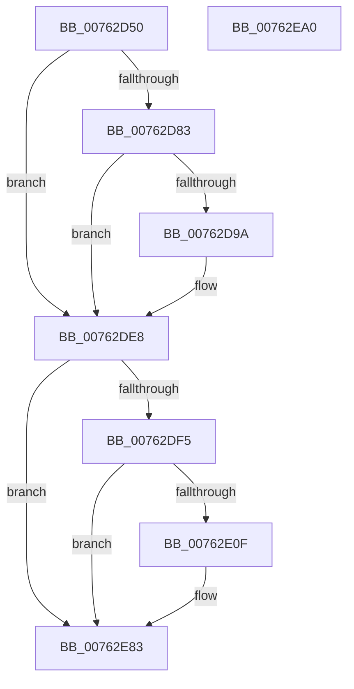

# PopDiagTraceSetHiberFileFailurePoint

- RVA: `0x00762D50`–`0x00762EA1` (길이 `337` bytes)
- VA: `0x0000000140762D50`
- 실행 섹션: `PAGE`
- PDB 이름 있음: `예`; PDB Function 태그: `아니요`
- unwind 정보 RVA: `0x000CCA90`
- 디코드: `72`개 명령, `337/337` bytes 표시
- 미해석 바이트: `0` (있으면 어셈블리에 `.byte`로 보존)

> 이 문서는 커널 이미지의 기계어와 PDB 기호를 분석해 생성했습니다. 4번과 5번은 함수 원형과 자료형을 바이너리 사용 방식에서 추정한 C 해석이며 원본 소스 복구 결과는 아닙니다.

## 1. Dependencies

- 직접 호출 지점: **5**; 고유 호출 대상: **5**
- 직접 호출자로 확인된 함수: **2**
- RIP 상대 이미지 참조: **6**

### Outgoing calls
- `0x00762D91` → [EtwEventEnabled](../../text/39/EtwEventEnabled_function_00392450.md) (function, `0x00392450`)
- `0x00762DE3` → [EtwWrite](../../text/41/EtwWrite_function_0041C720.md) (function, `0x0041C720`)
- `0x00762E06` → [tlgKeywordOn](../../text/42/tlgKeywordOn_function_0042EAA0.md) (function, `0x0042EAA0`)
- `0x00762E7E` → [tlgWriteTransfer_EtwWriteTransfer](../../text/42/tlgWriteTransfer_EtwWriteTransfer_function_004260E0.md) (function, `0x004260E0`)
- `0x00762E8A` → [_security_check_cookie](../../text/6A/_security_check_cookie_function_006AC640.md) (function, `0x006AC640`)

### Direct callers
- [PopSetHiberFileType](../70/PopSetHiberFileType_function_00703268.md) at `0x00703324`
- [PopSetHiberFileSize](../70/PopSetHiberFileSize_function_00703974.md) at `0x00703A38`

### Static image references
- `0x00762D66` → RVA `0x00E0A740` (`.data`; read)
- `0x00762D7A` → RVA `0x00E67858` (`.data`; read)
- `0x00762D83` → RVA `0x00F0B408` (`.data`; read)
- `0x00762D8A` → RVA `0x00021C70` (`.rdata`; read)
- `0x00762DE8` → RVA `0x00E07748` (`.data`; read)
- `0x00762E12` → RVA `0x00049741` (`.rdata`; read)

## 2. Other-region calls and transfers

- 다른 실행 섹션으로 향하는 call: **5**
  - `0x00762D91` → [EtwEventEnabled](../../text/39/EtwEventEnabled_function_00392450.md) (`PAGE` → `.text`)
  - `0x00762DE3` → [EtwWrite](../../text/41/EtwWrite_function_0041C720.md) (`PAGE` → `.text`)
  - `0x00762E06` → [tlgKeywordOn](../../text/42/tlgKeywordOn_function_0042EAA0.md) (`PAGE` → `.text`)
  - `0x00762E7E` → [tlgWriteTransfer_EtwWriteTransfer](../../text/42/tlgWriteTransfer_EtwWriteTransfer_function_004260E0.md) (`PAGE` → `.text`)
  - `0x00762E8A` → [_security_check_cookie](../../text/6A/_security_check_cookie_function_006AC640.md) (`PAGE` → `.text`)
- 별도 외부 분기/꼬리 이동을 확인하지 못했습니다.

## 3. Assembly (complete function range)

```asm
00762D50  48 89 5C 24 10                  mov qword ptr [rsp + 0x10], rbx
00762D55  89 4C 24 08                     mov dword ptr [rsp + 8], ecx
00762D59  55                              push rbp
00762D5A  48 8D 6C 24 A9                  lea rbp, [rsp - 0x57]
00762D5F  48 81 EC D0 00 00 00            sub rsp, 0xd0
00762D66  48 8B 05 D3 79 6A 00            mov rax, qword ptr [rip + 0x6a79d3]
00762D6D  48 33 C4                        xor rax, rsp
00762D70  48 89 45 47                     mov qword ptr [rbp + 0x47], rax
00762D74  83 65 B7 00                     and dword ptr [rbp - 0x49], 0
00762D78  8B DA                           mov ebx, edx
00762D7A  80 3D D7 4A 70 00 00            cmp byte ptr [rip + 0x704ad7], 0
00762D81  74 65                           je 0x140762de8
00762D83  48 8B 0D 7E 86 7A 00            mov rcx, qword ptr [rip + 0x7a867e]
00762D8A  48 8D 15 DF EE 8B FF            lea rdx, [rip - 0x741121]
00762D91  E8 BA F6 C2 FF                  call 0x140392450
00762D96  84 C0                           test al, al
00762D98  74 4E                           je 0x140762de8
00762D9A  83 65 DB 00                     and dword ptr [rbp - 0x25], 0
00762D9E  48 8D 45 67                     lea rax, [rbp + 0x67]
00762DA2  83 65 EB 00                     and dword ptr [rbp - 0x15], 0
00762DA6  48 8D 15 C3 EE 8B FF            lea rdx, [rip - 0x74113d]
00762DAD  48 8B 0D 54 86 7A 00            mov rcx, qword ptr [rip + 0x7a8654]
00762DB4  41 B9 02 00 00 00               mov r9d, 2
00762DBA  48 89 45 CF                     mov qword ptr [rbp - 0x31], rax
00762DBE  45 33 C0                        xor r8d, r8d
00762DC1  48 8D 45 B7                     lea rax, [rbp - 0x49]
00762DC5  89 5D B7                        mov dword ptr [rbp - 0x49], ebx
00762DC8  48 89 45 DF                     mov qword ptr [rbp - 0x21], rax
00762DCC  48 8D 45 CF                     lea rax, [rbp - 0x31]
00762DD0  48 89 44 24 20                  mov qword ptr [rsp + 0x20], rax
00762DD5  C7 45 D7 04 00 00 00            mov dword ptr [rbp - 0x29], 4
00762DDC  C7 45 E7 04 00 00 00            mov dword ptr [rbp - 0x19], 4
00762DE3  E8 38 99 CB FF                  call 0x14041c720
00762DE8  83 3D 59 49 6A 00 05            cmp dword ptr [rip + 0x6a4959], 5
00762DEF  0F 86 8E 00 00 00               jbe 0x140762e83
00762DF5  48 BA 00 00 00 00 00 40 00 00   movabs rdx, 0x400000000000
00762DFF  48 8D 0D 42 49 6A 00            lea rcx, [rip + 0x6a4942]
00762E06  E8 95 BC CC FF                  call 0x14042eaa0
00762E0B  84 C0                           test al, al
00762E0D  74 74                           je 0x140762e83
00762E0F  8B 45 67                        mov eax, dword ptr [rbp + 0x67]
00762E12  48 8D 15 28 69 8E FF            lea rdx, [rip - 0x7196d8]
00762E19  83 65 23 00                     and dword ptr [rbp + 0x23], 0
00762E1D  48 8D 0D 24 49 6A 00            lea rcx, [rip + 0x6a4924]
00762E24  83 65 33 00                     and dword ptr [rbp + 0x33], 0
00762E28  45 33 C9                        xor r9d, r9d
00762E2B  83 65 43 00                     and dword ptr [rbp + 0x43], 0
00762E2F  45 33 C0                        xor r8d, r8d
00762E32  89 45 BB                        mov dword ptr [rbp - 0x45], eax
00762E35  48 8D 45 BB                     lea rax, [rbp - 0x45]
00762E39  48 89 45 17                     mov qword ptr [rbp + 0x17], rax
00762E3D  48 8D 45 BF                     lea rax, [rbp - 0x41]
00762E41  48 89 45 27                     mov qword ptr [rbp + 0x27], rax
00762E45  48 8D 45 C7                     lea rax, [rbp - 0x39]
00762E49  48 89 45 37                     mov qword ptr [rbp + 0x37], rax
00762E4D  48 8D 45 F7                     lea rax, [rbp - 9]
00762E51  48 89 44 24 28                  mov qword ptr [rsp + 0x28], rax
00762E56  C7 44 24 20 05 00 00 00         mov dword ptr [rsp + 0x20], 5
00762E5E  C7 45 1F 04 00 00 00            mov dword ptr [rbp + 0x1f], 4
00762E65  89 5D BF                        mov dword ptr [rbp - 0x41], ebx
00762E68  C7 45 2F 04 00 00 00            mov dword ptr [rbp + 0x2f], 4
00762E6F  48 C7 45 C7 00 00 00 01         mov qword ptr [rbp - 0x39], 0x1000000
00762E77  C7 45 3F 08 00 00 00            mov dword ptr [rbp + 0x3f], 8
00762E7E  E8 5D 32 CC FF                  call 0x1404260e0
00762E83  48 8B 4D 47                     mov rcx, qword ptr [rbp + 0x47]
00762E87  48 33 CC                        xor rcx, rsp
00762E8A  E8 B1 97 F4 FF                  call 0x1406ac640
00762E8F  48 8B 9C 24 E8 00 00 00         mov rbx, qword ptr [rsp + 0xe8]
00762E97  48 81 C4 D0 00 00 00            add rsp, 0xd0
00762E9E  5D                              pop rbp
00762E9F  C3                              ret
00762EA0  CC                              int3
```

## 4. C-style interpretation (structured pseudocode)

```c
__int64 __fastcall PopDiagTraceSetHiberFileFailurePoint(int a1, int a2, int a3)
{
    __int64 result;
    __int64 v_rsp;
    unsigned __int64 v_stack_m18;
    unsigned int v_stack_m1C;
    unsigned int v_stack_m20;
    unsigned __int64 v_stack_m28;
    unsigned int v_stack_m2C;
    unsigned int v_stack_m30;
    unsigned __int64 v_stack_m38;
    unsigned int v_stack_m3C;
    unsigned int v_stack_m40;
    unsigned __int64 v_stack_m48;
    unsigned __int64 v_stack_m5F;
    unsigned __int64 v_stack_m68;
    unsigned int v_stack_m74;
    unsigned int v_stack_m78;
    unsigned __int64 v_stack_m80;
    unsigned int v_stack_m84;
    unsigned int v_stack_m88;
    unsigned __int64 v_stack_m90;
    unsigned __int64 v_stack_m98;
    unsigned __int64 v_stack_mA0;
    unsigned int v_stack_mA4;
    unsigned int v_stack_mA8;
    unsigned __int64 v_stack_mB0;
    unsigned __int64 v_stack_mB8;
    unsigned __int64 v_stack_p10;
    unsigned int v_stack_p8;

    v_stack_p10 = v_rbx;
    v_stack_p8 = a1;
    v_rsp = (v_rsp) - (208);
    result = (*(unsigned __int64 *)(v_rip + 6978003)) ^ (v_rsp);
    v_stack_m18 = result;
    if ((*(unsigned __int8 *)(v_rip + 7359191)) == 0) goto loc_00762DE8;
    result = EtwEventEnabled(*(unsigned __int64 *)(v_rip + 8029822), v_rip - 7606561, a3, a4);
    if ((unsigned __int8)(result) != 0) {
        result = v_stack_p8;
        a2 = v_rip - 7606589;
        a1 = *(unsigned __int64 *)(v_rip + 8029780);
        a4 = 2;
        v_stack_m90 = result;
        a3 = 0;
        result = v_stack_mA8;
        v_stack_mA8 = (unsigned int)((unsigned int)(a2));
        v_stack_m80 = result;
        result = v_stack_m90;
        v_stack_mB8 = result;
        v_stack_m88 = 4;
        v_stack_m78 = 4;
        result = EtwWrite(a1, a2, a3, a4);
    }
    if ((*(unsigned int *)(v_rip + 6965593)) <= 5) goto loc_00762E83;
    result = tlgKeywordOn(v_rip + 6965570, a2, a3, a4);
    if ((unsigned __int8)(result) != 0) {
        result = v_stack_p8;
        a2 = v_rip - 7444184;
        a1 = v_rip + 6965540;
        a4 = 0;
        a3 = 0;
        v_stack_mA4 = (unsigned int)(result);
        result = v_stack_mA4;
        v_stack_m48 = result;
        result = v_stack_mA0;
        v_stack_m38 = result;
        result = v_stack_m98;
        v_stack_m28 = result;
        result = v_stack_m68;
        v_stack_mB0 = result;
        v_stack_mB8 = 5;
        v_stack_m40 = 4;
        v_stack_mA0 = (unsigned int)((unsigned int)(a2));
        v_stack_m30 = 4;
        v_stack_m98 = 0x1000000ULL;
        v_stack_m20 = 8;
        result = tlgWriteTransfer_EtwWriteTransfer(a1, a2, a3, a4);
    }
    a1 = (v_stack_m18) ^ (v_rsp);
    result = _security_check_cookie(a1, a2, a3, a4);
    v_rsp = (v_rsp) + (208);
    return result;
}
```

## 5. (Beta) C Style

```c
int64_t PopDiagTraceSetHiberFileFailurePoint(int32_t Arg1, int32_t Arg2, int32_t Arg3)
{
    int64_t result;
    int64_t local_rsp;
    uint64_t v_stack_m18;
    uint32_t v_stack_m1C;
    uint32_t v_stack_m20;
    uint64_t v_stack_m28;
    uint32_t v_stack_m2C;
    uint32_t v_stack_m30;
    uint64_t v_stack_m38;
    uint32_t v_stack_m3C;
    uint32_t v_stack_m40;
    uint64_t v_stack_m48;
    uint64_t v_stack_m5F;
    uint64_t v_stack_m68;
    uint32_t v_stack_m74;
    uint32_t v_stack_m78;
    uint64_t v_stack_m80;
    uint32_t v_stack_m84;
    uint32_t v_stack_m88;
    uint64_t v_stack_m90;
    uint64_t v_stack_m98;
    uint64_t v_stack_mA0;
    uint32_t v_stack_mA4;
    uint32_t v_stack_mA8;
    uint64_t v_stack_mB0;
    uint64_t v_stack_mB8;
    uint64_t v_stack_p10;
    uint32_t v_stack_p8;

    v_stack_p10 = local_rbx;
    v_stack_p8 = Arg1;
    local_rsp = (local_rsp) - (208);
    result = (*(uint64_t *)(v_rip + 0x6A79D3)) ^ (local_rsp);
    v_stack_m18 = result;
    if ((*(uint8_t *)(v_rip + 0x704AD7)) == 0) goto loc_00762DE8;
    result = EtwEventEnabled(*(uint64_t *)(v_rip + 0x7A867E), v_rip - 7606561, Arg3, a4);
    if ((uint8_t)(result) != 0) {
        result = v_stack_p8;
        Arg2 = v_rip - 7606589;
        Arg1 = *(uint64_t *)(v_rip + 0x7A8654);
        a4 = 2;
        v_stack_m90 = result;
        Arg3 = 0;
        result = v_stack_mA8;
        v_stack_mA8 = (uint32_t)((uint32_t)(Arg2));
        v_stack_m80 = result;
        result = v_stack_m90;
        v_stack_mB8 = result;
        v_stack_m88 = 4;
        v_stack_m78 = 4;
        result = EtwWrite(Arg1, Arg2, Arg3, a4);
    }
    if ((*(uint32_t *)(v_rip + 0x6A4959)) <= 5) goto loc_00762E83;
    result = tlgKeywordOn(v_rip + 6965570, Arg2, Arg3, a4);
    if ((uint8_t)(result) != 0) {
        result = v_stack_p8;
        Arg2 = v_rip - 7444184;
        Arg1 = v_rip + 6965540;
        a4 = 0;
        Arg3 = 0;
        v_stack_mA4 = (uint32_t)(result);
        result = v_stack_mA4;
        v_stack_m48 = result;
        result = v_stack_mA0;
        v_stack_m38 = result;
        result = v_stack_m98;
        v_stack_m28 = result;
        result = v_stack_m68;
        v_stack_mB0 = result;
        v_stack_mB8 = 5;
        v_stack_m40 = 4;
        v_stack_mA0 = (uint32_t)((uint32_t)(Arg2));
        v_stack_m30 = 4;
        v_stack_m98 = 0x1000000ULL;
        v_stack_m20 = 8;
        result = tlgWriteTransfer_EtwWriteTransfer(Arg1, Arg2, Arg3, a4);
    }
    Arg1 = (v_stack_m18) ^ (local_rsp);
    result = _security_check_cookie(Arg1, Arg2, Arg3, a4);
    local_rsp = (local_rsp) + (208);
    return result;
}
```

## 6. Execution-region graph

[열기: 2D/3D 그래프와 함수 탐색 컨트롤 패널](../../../control-panel.html?section=page&rva=0x00762D50&view=graph)

- 2D 그래프는 위에서 아래로 흐르고, 3D 그래프는 빈 공간을 드래그해 회전합니다. Shift+드래그는 이동, 휠은 확대·축소, 함수 노드 선택은 대상 보고서 이동입니다.

### Static fallback


