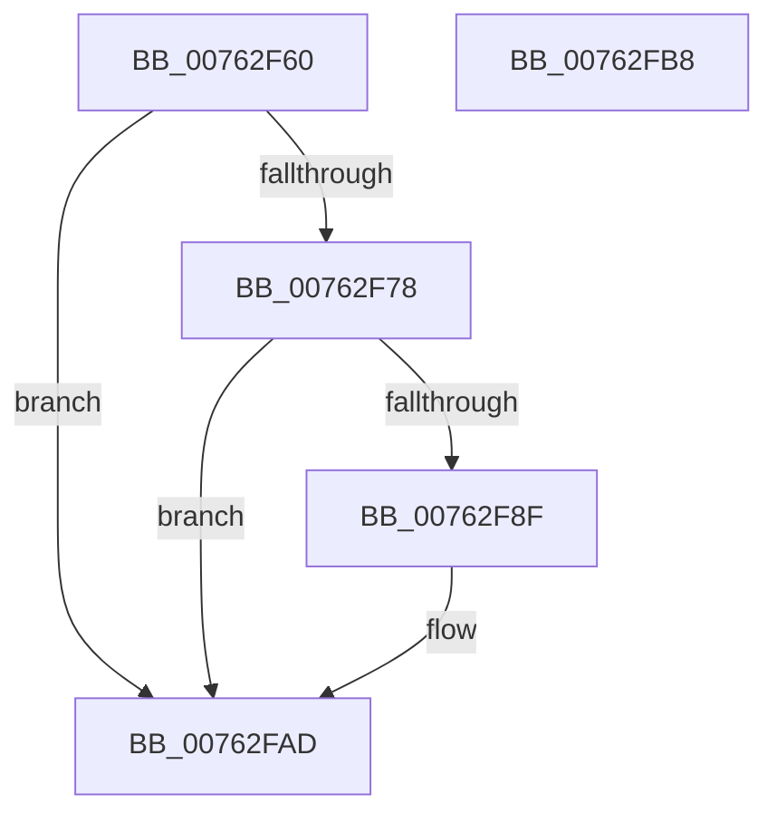

# PopDiagTraceSleepStudyBlockerData

- RVA: `0x00762F60`–`0x00762FB9` (길이 `89` bytes)
- VA: `0x0000000140762F60`
- 실행 섹션: `PAGE`
- PDB 이름 있음: `예`; PDB Function 태그: `아니요`
- unwind 정보 RVA: `0x0006E5F8`
- 디코드: `23`개 명령, `89/89` bytes 표시
- 미해석 바이트: `0` (있으면 어셈블리에 `.byte`로 보존)

> 이 문서는 커널 이미지의 기계어와 PDB 기호를 분석해 생성했습니다. 4번과 5번은 함수 원형과 자료형을 바이너리 사용 방식에서 추정한 C 해석이며 원본 소스 복구 결과는 아닙니다.

## 1. Dependencies

- 직접 호출 지점: **2**; 고유 호출 대상: **2**
- 직접 호출자로 확인된 함수: **1**
- RIP 상대 이미지 참조: **3**

### Outgoing calls
- `0x00762F86` → [EtwEventEnabled](../../text/39/EtwEventEnabled_function_00392450.md) (function, `0x00392450`)
- `0x00762FA8` → [EtwWrite](../../text/41/EtwWrite_function_0041C720.md) (function, `0x0041C720`)

### Direct callers
- [PopFxLogSocSubsystemMetadata](../97/PopFxLogSocSubsystemMetadata_function_0097AC1C.md) at `0x0097AF37`

### Static image references
- `0x00762F6A` → RVA `0x00E67859` (`.data`; read)
- `0x00762F78` → RVA `0x00F0B6B8` (`.data`; read)
- `0x00762F7F` → RVA `0x0001A7F0` (`.rdata`; read)

## 2. Other-region calls and transfers

- 다른 실행 섹션으로 향하는 call: **2**
  - `0x00762F86` → [EtwEventEnabled](../../text/39/EtwEventEnabled_function_00392450.md) (`PAGE` → `.text`)
  - `0x00762FA8` → [EtwWrite](../../text/41/EtwWrite_function_0041C720.md) (`PAGE` → `.text`)
- 별도 외부 분기/꼬리 이동을 확인하지 못했습니다.

## 3. Assembly (complete function range)

```asm
00762F60  48 89 5C 24 08                  mov qword ptr [rsp + 8], rbx
00762F65  57                              push rdi
00762F66  48 83 EC 30                     sub rsp, 0x30
00762F6A  80 3D E8 48 70 00 00            cmp byte ptr [rip + 0x7048e8], 0
00762F71  48 8B DA                        mov rbx, rdx
00762F74  8B F9                           mov edi, ecx
00762F76  74 35                           je 0x140762fad
00762F78  48 8B 0D 39 87 7A 00            mov rcx, qword ptr [rip + 0x7a8739]
00762F7F  48 8D 15 6A 78 8B FF            lea rdx, [rip - 0x748796]
00762F86  E8 C5 F4 C2 FF                  call 0x140392450
00762F8B  84 C0                           test al, al
00762F8D  74 1E                           je 0x140762fad
00762F8F  48 8B 0D 22 87 7A 00            mov rcx, qword ptr [rip + 0x7a8722]
00762F96  48 8D 15 53 78 8B FF            lea rdx, [rip - 0x7487ad]
00762F9D  44 8B CF                        mov r9d, edi
00762FA0  48 89 5C 24 20                  mov qword ptr [rsp + 0x20], rbx
00762FA5  45 33 C0                        xor r8d, r8d
00762FA8  E8 73 97 CB FF                  call 0x14041c720
00762FAD  48 8B 5C 24 40                  mov rbx, qword ptr [rsp + 0x40]
00762FB2  48 83 C4 30                     add rsp, 0x30
00762FB6  5F                              pop rdi
00762FB7  C3                              ret
00762FB8  CC                              int3
```

## 4. C-style interpretation (structured pseudocode)

```c
__int64 __fastcall PopDiagTraceSleepStudyBlockerData(int a1, __int64 a2, int a3)
{
    __int64 result;
    __int64 v_rsp;
    unsigned __int64 v_stack_m18;
    unsigned __int64 v_stack_p8;

    v_stack_p8 = v_rbx;
    v_rsp = (v_rsp) - (48);
    if ((*(unsigned __int8 *)(v_rip + 7358696)) == 0) goto loc_00762FAD;
    result = EtwEventEnabled(*(unsigned __int64 *)(v_rip + 8030009), v_rip - 7636886, a3, a4);
    if ((unsigned __int8)(result) != 0) {
        a1 = *(unsigned __int64 *)(v_rip + 8029986);
        a2 = v_rip - 7636909;
        a4 = (unsigned int)((unsigned int)(a1));
        v_stack_m18 = a2;
        a3 = 0;
        result = EtwWrite(a1, a2, a3, a4);
    }
    v_rsp = (v_rsp) + (48);
    return result;
}
```

## 5. (Beta) C Style

```c
int64_t PopDiagTraceSleepStudyBlockerData(int32_t Arg1, int64_t Arg2, int32_t Arg3)
{
    int64_t result;
    int64_t local_rsp;
    uint64_t v_stack_m18;
    uint64_t v_stack_p8;

    v_stack_p8 = local_rbx;
    local_rsp = (local_rsp) - (48);
    if ((*(uint8_t *)(v_rip + 0x7048E8)) == 0) goto loc_00762FAD;
    result = EtwEventEnabled(*(uint64_t *)(v_rip + 0x7A8739), v_rip - 7636886, Arg3, a4);
    if ((uint8_t)(result) != 0) {
        Arg1 = *(uint64_t *)(v_rip + 0x7A8722);
        Arg2 = v_rip - 7636909;
        a4 = (uint32_t)((uint32_t)(Arg1));
        v_stack_m18 = Arg2;
        Arg3 = 0;
        result = EtwWrite(Arg1, Arg2, Arg3, a4);
    }
    local_rsp = (local_rsp) + (48);
    return result;
}
```

## 6. Execution-region graph

[열기: 2D/3D 그래프와 함수 탐색 컨트롤 패널](../../../control-panel.html?section=page&rva=0x00762F60&view=graph)

- 2D 그래프는 위에서 아래로 흐르고, 3D 그래프는 빈 공간을 드래그해 회전합니다. Shift+드래그는 이동, 휠은 확대·축소, 함수 노드 선택은 대상 보고서 이동입니다.

### Static fallback


