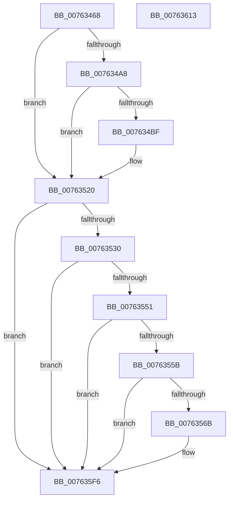

# PopDiagTraceStateTransitionFailurePoint

- RVA: `0x00763468`–`0x00763614` (길이 `428` bytes)
- VA: `0x0000000140763468`
- 실행 섹션: `PAGE`
- PDB 이름 있음: `예`; PDB Function 태그: `아니요`
- unwind 정보 RVA: `0x000CC6DC`
- 디코드: `92`개 명령, `428/428` bytes 표시
- 미해석 바이트: `0` (있으면 어셈블리에 `.byte`로 보존)

> 이 문서는 커널 이미지의 기계어와 PDB 기호를 분석해 생성했습니다. 4번과 5번은 함수 원형과 자료형을 바이너리 사용 방식에서 추정한 C 해석이며 원본 소스 복구 결과는 아닙니다.

## 1. Dependencies

- 직접 호출 지점: **6**; 고유 호출 대상: **5**
- 직접 호출자로 확인된 함수: **1**
- RIP 상대 이미지 참조: **6**

### Outgoing calls
- `0x007634B6` → [EtwEventEnabled](../../text/39/EtwEventEnabled_function_00392450.md) (function, `0x00392450`)
- `0x0076351B` → [EtwWrite](../../text/41/EtwWrite_function_0041C720.md) (function, `0x0041C720`)
- `0x00763544` → [tlgKeywordOn](../../text/42/tlgKeywordOn_function_0042EAA0.md) (function, `0x0042EAA0`)
- `0x0076355E` → [tlgKeywordOn](../../text/42/tlgKeywordOn_function_0042EAA0.md) (function, `0x0042EAA0`)
- `0x007635F1` → [tlgWriteTransfer_EtwWriteTransfer](../../text/42/tlgWriteTransfer_EtwWriteTransfer_function_004260E0.md) (function, `0x004260E0`)
- `0x007635FD` → [_security_check_cookie](../../text/6A/_security_check_cookie_function_006AC640.md) (function, `0x006AC640`)

### Direct callers
- [PopTransitionSystemPowerStateEx](../../pagelk/B7/PopTransitionSystemPowerStateEx_function_00B7E8C0.md) at `0x00B7FBCB`

### Static image references
- `0x0076347E` → RVA `0x00E0A740` (`.data`; read)
- `0x0076349B` → RVA `0x00E67858` (`.data`; read)
- `0x007634A8` → RVA `0x00F0B408` (`.data`; read)
- `0x007634AF` → RVA `0x00022A08` (`.rdata`; read)
- `0x00763520` → RVA `0x00E07748` (`.data`; read)
- `0x0076356F` → RVA `0x000496E6` (`.rdata`; read)

## 2. Other-region calls and transfers

- 다른 실행 섹션으로 향하는 call: **6**
  - `0x007634B6` → [EtwEventEnabled](../../text/39/EtwEventEnabled_function_00392450.md) (`PAGE` → `.text`)
  - `0x0076351B` → [EtwWrite](../../text/41/EtwWrite_function_0041C720.md) (`PAGE` → `.text`)
  - `0x00763544` → [tlgKeywordOn](../../text/42/tlgKeywordOn_function_0042EAA0.md) (`PAGE` → `.text`)
  - `0x0076355E` → [tlgKeywordOn](../../text/42/tlgKeywordOn_function_0042EAA0.md) (`PAGE` → `.text`)
  - `0x007635F1` → [tlgWriteTransfer_EtwWriteTransfer](../../text/42/tlgWriteTransfer_EtwWriteTransfer_function_004260E0.md) (`PAGE` → `.text`)
  - `0x007635FD` → [_security_check_cookie](../../text/6A/_security_check_cookie_function_006AC640.md) (`PAGE` → `.text`)
- 별도 외부 분기/꼬리 이동을 확인하지 못했습니다.

## 3. Assembly (complete function range)

```asm
00763468  48 89 5C 24 10                  mov qword ptr [rsp + 0x10], rbx
0076346D  89 4C 24 08                     mov dword ptr [rsp + 8], ecx
00763471  55                              push rbp
00763472  48 8D 6C 24 A9                  lea rbp, [rsp - 0x57]
00763477  48 81 EC 00 01 00 00            sub rsp, 0x100
0076347E  48 8B 05 BB 72 6A 00            mov rax, qword ptr [rip + 0x6a72bb]
00763485  48 33 C4                        xor rax, rsp
00763488  48 89 45 47                     mov qword ptr [rbp + 0x47], rax
0076348C  83 65 87 00                     and dword ptr [rbp - 0x79], 0
00763490  8B DA                           mov ebx, edx
00763492  65 48 8B 04 25 88 01 00 00      mov rax, qword ptr gs:[0x188]
0076349B  80 3D B6 43 70 00 00            cmp byte ptr [rip + 0x7043b6], 0
007634A2  48 89 45 97                     mov qword ptr [rbp - 0x69], rax
007634A6  74 78                           je 0x140763520
007634A8  48 8B 0D 59 7F 7A 00            mov rcx, qword ptr [rip + 0x7a7f59]
007634AF  48 8D 15 52 F5 8B FF            lea rdx, [rip - 0x740aae]
007634B6  E8 95 EF C2 FF                  call 0x140392450
007634BB  84 C0                           test al, al
007634BD  74 61                           je 0x140763520
007634BF  83 65 BB 00                     and dword ptr [rbp - 0x45], 0
007634C3  48 8D 45 97                     lea rax, [rbp - 0x69]
007634C7  83 65 CB 00                     and dword ptr [rbp - 0x35], 0
007634CB  48 8D 15 36 F5 8B FF            lea rdx, [rip - 0x740aca]
007634D2  83 65 DB 00                     and dword ptr [rbp - 0x25], 0
007634D6  41 B9 03 00 00 00               mov r9d, 3
007634DC  48 8B 0D 25 7F 7A 00            mov rcx, qword ptr [rip + 0x7a7f25]
007634E3  45 33 C0                        xor r8d, r8d
007634E6  48 89 45 AF                     mov qword ptr [rbp - 0x51], rax
007634EA  48 8D 45 67                     lea rax, [rbp + 0x67]
007634EE  48 89 45 BF                     mov qword ptr [rbp - 0x41], rax
007634F2  48 8D 45 87                     lea rax, [rbp - 0x79]
007634F6  48 89 45 CF                     mov qword ptr [rbp - 0x31], rax
007634FA  48 8D 45 AF                     lea rax, [rbp - 0x51]
007634FE  48 89 44 24 20                  mov qword ptr [rsp + 0x20], rax
00763503  89 5D 87                        mov dword ptr [rbp - 0x79], ebx
00763506  C7 45 B7 08 00 00 00            mov dword ptr [rbp - 0x49], 8
0076350D  C7 45 C7 04 00 00 00            mov dword ptr [rbp - 0x39], 4
00763514  C7 45 D7 04 00 00 00            mov dword ptr [rbp - 0x29], 4
0076351B  E8 00 92 CB FF                  call 0x14041c720
00763520  44 8B 05 21 42 6A 00            mov r8d, dword ptr [rip + 0x6a4221]
00763527  45 85 C0                        test r8d, r8d
0076352A  0F 84 C6 00 00 00               je 0x1407635f6
00763530  4C 8D 15 11 42 6A 00            lea r10, [rip + 0x6a4211]
00763537  48 BA 00 00 00 00 00 80 00 00   movabs rdx, 0x800000000000
00763541  49 8B CA                        mov rcx, r10
00763544  E8 57 B5 CC FF                  call 0x14042eaa0
00763549  84 C0                           test al, al
0076354B  0F 84 A5 00 00 00               je 0x1407635f6
00763551  41 83 F8 05                     cmp r8d, 5
00763555  0F 86 9B 00 00 00               jbe 0x1407635f6
0076355B  49 8B CA                        mov rcx, r10
0076355E  E8 3D B5 CC FF                  call 0x14042eaa0
00763563  84 C0                           test al, al
00763565  0F 84 8B 00 00 00               je 0x1407635f6
0076356B  48 8B 45 97                     mov rax, qword ptr [rbp - 0x69]
0076356F  48 8D 15 70 61 8E FF            lea rdx, [rip - 0x719e90]
00763576  83 65 13 00                     and dword ptr [rbp + 0x13], 0
0076357A  45 33 C9                        xor r9d, r9d
0076357D  83 65 23 00                     and dword ptr [rbp + 0x23], 0
00763581  45 33 C0                        xor r8d, r8d
00763584  83 65 33 00                     and dword ptr [rbp + 0x33], 0
00763588  49 8B CA                        mov rcx, r10
0076358B  83 65 43 00                     and dword ptr [rbp + 0x43], 0
0076358F  48 89 45 9F                     mov qword ptr [rbp - 0x61], rax
00763593  48 8D 45 9F                     lea rax, [rbp - 0x61]
00763597  48 89 45 07                     mov qword ptr [rbp + 7], rax
0076359B  8B 45 67                        mov eax, dword ptr [rbp + 0x67]
0076359E  89 45 8B                        mov dword ptr [rbp - 0x75], eax
007635A1  48 8D 45 8B                     lea rax, [rbp - 0x75]
007635A5  48 89 45 17                     mov qword ptr [rbp + 0x17], rax
007635A9  48 8D 45 8F                     lea rax, [rbp - 0x71]
007635AD  48 89 45 27                     mov qword ptr [rbp + 0x27], rax
007635B1  48 8D 45 A7                     lea rax, [rbp - 0x59]
007635B5  48 89 45 37                     mov qword ptr [rbp + 0x37], rax
007635B9  48 8D 45 E7                     lea rax, [rbp - 0x19]
007635BD  48 89 44 24 28                  mov qword ptr [rsp + 0x28], rax
007635C2  C7 44 24 20 06 00 00 00         mov dword ptr [rsp + 0x20], 6
007635CA  C7 45 0F 08 00 00 00            mov dword ptr [rbp + 0xf], 8
007635D1  C7 45 1F 04 00 00 00            mov dword ptr [rbp + 0x1f], 4
007635D8  89 5D 8F                        mov dword ptr [rbp - 0x71], ebx
007635DB  C7 45 2F 04 00 00 00            mov dword ptr [rbp + 0x2f], 4
007635E2  48 C7 45 A7 00 00 00 01         mov qword ptr [rbp - 0x59], 0x1000000
007635EA  C7 45 3F 08 00 00 00            mov dword ptr [rbp + 0x3f], 8
007635F1  E8 EA 2A CC FF                  call 0x1404260e0
007635F6  48 8B 4D 47                     mov rcx, qword ptr [rbp + 0x47]
007635FA  48 33 CC                        xor rcx, rsp
007635FD  E8 3E 90 F4 FF                  call 0x1406ac640
00763602  48 8B 9C 24 18 01 00 00         mov rbx, qword ptr [rsp + 0x118]
0076360A  48 81 C4 00 01 00 00            add rsp, 0x100
00763611  5D                              pop rbp
00763612  C3                              ret
00763613  CC                              int3
```

## 4. C-style interpretation (structured pseudocode)

```c
__int64 __fastcall PopDiagTraceStateTransitionFailurePoint(int a1, int a2, int a3)
{
    __int64 result;
    __int64 v_rsp;
    unsigned __int64 v_stack_m18;
    unsigned int v_stack_m1C;
    unsigned int v_stack_m20;
    unsigned __int64 v_stack_m28;
    unsigned int v_stack_m2C;
    unsigned int v_stack_m30;
    unsigned __int64 v_stack_m38;
    unsigned int v_stack_m3C;
    unsigned int v_stack_m40;
    unsigned __int64 v_stack_m48;
    unsigned int v_stack_m4C;
    unsigned int v_stack_m50;
    unsigned __int64 v_stack_m58;
    unsigned __int64 v_stack_m5F;
    unsigned __int64 v_stack_m78;
    unsigned int v_stack_m84;
    unsigned int v_stack_m88;
    unsigned __int64 v_stack_m90;
    unsigned int v_stack_m94;
    unsigned int v_stack_m98;
    unsigned __int64 v_stack_mA0;
    unsigned int v_stack_mA4;
    unsigned int v_stack_mA8;
    unsigned __int64 v_stack_mB0;
    unsigned __int64 v_stack_mB8;
    unsigned __int64 v_stack_mC0;
    unsigned __int64 v_stack_mC8;
    unsigned __int64 v_stack_mD0;
    unsigned int v_stack_mD4;
    unsigned int v_stack_mD8;
    unsigned __int64 v_stack_mE0;
    unsigned __int64 v_stack_mE8;
    unsigned __int64 v_stack_p10;
    unsigned int v_stack_p8;

    v_stack_p10 = v_rbx;
    v_stack_p8 = a1;
    v_rsp = (v_rsp) - (256);
    result = (*(unsigned __int64 *)(v_rip + 6976187)) ^ (v_rsp);
    v_stack_m18 = result;
    v_stack_mC8 = *(unsigned __int64 *)(gs_base + (0 + 392));
    if ((*(unsigned __int8 *)(v_rip + 7357366)) == 0) goto loc_00763520;
    result = EtwEventEnabled(*(unsigned __int64 *)(v_rip + 8027993), v_rip - 7604910, a3, a4);
    if ((unsigned __int8)(result) != 0) {
        result = v_stack_mC8;
        a2 = v_rip - 7604938;
        a4 = 3;
        a1 = *(unsigned __int64 *)(v_rip + 8027941);
        a3 = 0;
        v_stack_mB0 = result;
        result = v_stack_p8;
        v_stack_mA0 = result;
        result = v_stack_mD8;
        v_stack_m90 = result;
        result = v_stack_mB0;
        v_stack_mE8 = result;
        v_stack_mD8 = (unsigned int)((unsigned int)(a2));
        v_stack_mA8 = 8;
        v_stack_m98 = 4;
        v_stack_m88 = 4;
        result = EtwWrite(a1, a2, a3, a4);
    }
    if ((unsigned int)((unsigned int)(*(unsigned int *)(v_rip + 6963745))) == 0) goto loc_007635F6;
    result = tlgKeywordOn(v_rip + 6963729, a2, (unsigned int)(*(unsigned int *)(v_rip + 6963745)), a4);
    if ((unsigned __int8)(result) == 0) goto loc_007635F6;
    if (((unsigned int)((unsigned int)(*(unsigned int *)(v_rip + 6963745)))) <= 5) goto loc_007635F6;
    result = tlgKeywordOn(v_rip + 6963729, a2, (unsigned int)(*(unsigned int *)(v_rip + 6963745)), a4);
    if ((unsigned __int8)(result) != 0) {
        result = v_stack_mC8;
        a2 = v_rip - 7446160;
        a4 = 0;
        a3 = 0;
        a1 = v_rip + 6963729;
        v_stack_mC0 = result;
        result = v_stack_mC0;
        v_stack_m58 = result;
        result = v_stack_p8;
        v_stack_mD4 = (unsigned int)(result);
        result = v_stack_mD4;
        v_stack_m48 = result;
        result = v_stack_mD0;
        v_stack_m38 = result;
        result = v_stack_mB8;
        v_stack_m28 = result;
        result = v_stack_m78;
        v_stack_mE0 = result;
        v_stack_mE8 = 6;
        v_stack_m50 = 8;
        v_stack_m40 = 4;
        v_stack_mD0 = (unsigned int)((unsigned int)(a2));
        v_stack_m30 = 4;
        v_stack_mB8 = 0x1000000ULL;
        v_stack_m20 = 8;
        result = tlgWriteTransfer_EtwWriteTransfer(a1, a2, a3, a4);
    }
    a1 = (v_stack_m18) ^ (v_rsp);
    result = _security_check_cookie(a1, a2, a3, a4);
    v_rsp = (v_rsp) + (256);
    return result;
}
```

## 5. (Beta) C Style

```c
int64_t PopDiagTraceStateTransitionFailurePoint(int32_t Arg1, int32_t Arg2, int32_t Arg3)
{
    int64_t result;
    int64_t local_rsp;
    uint64_t v_stack_m18;
    uint32_t v_stack_m1C;
    uint32_t v_stack_m20;
    uint64_t v_stack_m28;
    uint32_t v_stack_m2C;
    uint32_t v_stack_m30;
    uint64_t v_stack_m38;
    uint32_t v_stack_m3C;
    uint32_t v_stack_m40;
    uint64_t v_stack_m48;
    uint32_t v_stack_m4C;
    uint32_t v_stack_m50;
    uint64_t v_stack_m58;
    uint64_t v_stack_m5F;
    uint64_t v_stack_m78;
    uint32_t v_stack_m84;
    uint32_t v_stack_m88;
    uint64_t v_stack_m90;
    uint32_t v_stack_m94;
    uint32_t v_stack_m98;
    uint64_t v_stack_mA0;
    uint32_t v_stack_mA4;
    uint32_t v_stack_mA8;
    uint64_t v_stack_mB0;
    uint64_t v_stack_mB8;
    uint64_t v_stack_mC0;
    uint64_t v_stack_mC8;
    uint64_t v_stack_mD0;
    uint32_t v_stack_mD4;
    uint32_t v_stack_mD8;
    uint64_t v_stack_mE0;
    uint64_t v_stack_mE8;
    uint64_t v_stack_p10;
    uint32_t v_stack_p8;

    v_stack_p10 = local_rbx;
    v_stack_p8 = Arg1;
    local_rsp = (local_rsp) - (256);
    result = (*(uint64_t *)(v_rip + 0x6A72BB)) ^ (local_rsp);
    v_stack_m18 = result;
    v_stack_mC8 = *(uint64_t *)(gs_base + (0 + 0x188));
    if ((*(uint8_t *)(v_rip + 0x7043B6)) == 0) goto loc_00763520;
    result = EtwEventEnabled(*(uint64_t *)(v_rip + 0x7A7F59), v_rip - 7604910, Arg3, a4);
    if ((uint8_t)(result) != 0) {
        result = v_stack_mC8;
        Arg2 = v_rip - 7604938;
        a4 = 3;
        Arg1 = *(uint64_t *)(v_rip + 0x7A7F25);
        Arg3 = 0;
        v_stack_mB0 = result;
        result = v_stack_p8;
        v_stack_mA0 = result;
        result = v_stack_mD8;
        v_stack_m90 = result;
        result = v_stack_mB0;
        v_stack_mE8 = result;
        v_stack_mD8 = (uint32_t)((uint32_t)(Arg2));
        v_stack_mA8 = 8;
        v_stack_m98 = 4;
        v_stack_m88 = 4;
        result = EtwWrite(Arg1, Arg2, Arg3, a4);
    }
    if ((uint32_t)((uint32_t)(*(uint32_t *)(v_rip + 0x6A4221))) == 0) goto loc_007635F6;
    result = tlgKeywordOn(v_rip + 6963729, Arg2, (uint32_t)(*(uint32_t *)(v_rip + 0x6A4221)), a4);
    if ((uint8_t)(result) == 0) goto loc_007635F6;
    if (((uint32_t)((uint32_t)(*(uint32_t *)(v_rip + 0x6A4221)))) <= 5) goto loc_007635F6;
    result = tlgKeywordOn(v_rip + 6963729, Arg2, (uint32_t)(*(uint32_t *)(v_rip + 0x6A4221)), a4);
    if ((uint8_t)(result) != 0) {
        result = v_stack_mC8;
        Arg2 = v_rip - 7446160;
        a4 = 0;
        Arg3 = 0;
        Arg1 = v_rip + 6963729;
        v_stack_mC0 = result;
        result = v_stack_mC0;
        v_stack_m58 = result;
        result = v_stack_p8;
        v_stack_mD4 = (uint32_t)(result);
        result = v_stack_mD4;
        v_stack_m48 = result;
        result = v_stack_mD0;
        v_stack_m38 = result;
        result = v_stack_mB8;
        v_stack_m28 = result;
        result = v_stack_m78;
        v_stack_mE0 = result;
        v_stack_mE8 = 6;
        v_stack_m50 = 8;
        v_stack_m40 = 4;
        v_stack_mD0 = (uint32_t)((uint32_t)(Arg2));
        v_stack_m30 = 4;
        v_stack_mB8 = 0x1000000ULL;
        v_stack_m20 = 8;
        result = tlgWriteTransfer_EtwWriteTransfer(Arg1, Arg2, Arg3, a4);
    }
    Arg1 = (v_stack_m18) ^ (local_rsp);
    result = _security_check_cookie(Arg1, Arg2, Arg3, a4);
    local_rsp = (local_rsp) + (256);
    return result;
}
```

## 6. Execution-region graph

[열기: 2D/3D 그래프와 함수 탐색 컨트롤 패널](../../../control-panel.html?section=page&rva=0x00763468&view=graph)

- 2D 그래프는 위에서 아래로 흐르고, 3D 그래프는 빈 공간을 드래그해 회전합니다. Shift+드래그는 이동, 휠은 확대·축소, 함수 노드 선택은 대상 보고서 이동입니다.

### Static fallback


