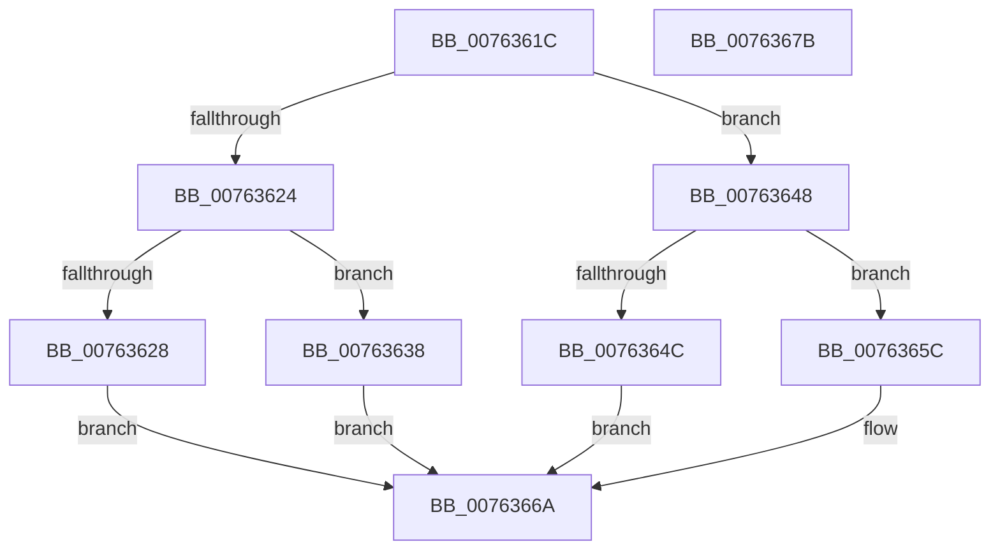

# PopDiagTraceSuspendResumeNotification

- RVA: `0x0076361C`–`0x0076367C` (길이 `96` bytes)
- VA: `0x000000014076361C`
- 실행 섹션: `PAGE`
- PDB 이름 있음: `예`; PDB Function 태그: `아니요`
- unwind 정보 RVA: `0x0005C788`
- 디코드: `24`개 명령, `96/96` bytes 표시
- 미해석 바이트: `0` (있으면 어셈블리에 `.byte`로 보존)

> 이 문서는 커널 이미지의 기계어와 PDB 기호를 분석해 생성했습니다. 4번과 5번은 함수 원형과 자료형을 바이너리 사용 방식에서 추정한 C 해석이며 원본 소스 복구 결과는 아닙니다.

## 1. Dependencies

- 직접 호출 지점: **1**; 고유 호출 대상: **1**
- 직접 호출자로 확인된 함수: **2**
- RIP 상대 이미지 참조: **8**

### Outgoing calls
- `0x00763671` → [PopDiagTraceEventNoPayload](../../text/49/PopDiagTraceEventNoPayload_function_004982F8.md) (function, `0x004982F8`)

### Direct callers
- [PopSendSuspendResumeApplicationNotification](../75/PopSendSuspendResumeApplicationNotification_function_0075EC74.md) at `0x0075ECC3`
- [PopSendSuspendResumeApplicationNotification](../75/PopSendSuspendResumeApplicationNotification_function_0075EC74.md) at `0x0075ED6B`
- [PopSendSuspendResumeServiceNotification](../75/PopSendSuspendResumeServiceNotification_function_0075ED9C.md) at `0x0075EDD0`
- [PopSendSuspendResumeServiceNotification](../75/PopSendSuspendResumeServiceNotification_function_0075ED9C.md) at `0x0075EE57`

### Static image references
- `0x00763628` → RVA `0x00022C68` (`.rdata`; read)
- `0x0076362F` → RVA `0x00022D30` (`.rdata`; read)
- `0x00763638` → RVA `0x00021320` (`.rdata`; read)
- `0x0076363F` → RVA `0x00020BF0` (`.rdata`; read)
- `0x0076364C` → RVA `0x00022C10` (`.rdata`; read)
- `0x00763653` → RVA `0x000225B0` (`.rdata`; read)
- `0x0076365C` → RVA `0x00022988` (`.rdata`; read)
- `0x00763663` → RVA `0x00022DE8` (`.rdata`; read)

## 2. Other-region calls and transfers

- 다른 실행 섹션으로 향하는 call: **1**
  - `0x00763671` → [PopDiagTraceEventNoPayload](../../text/49/PopDiagTraceEventNoPayload_function_004982F8.md) (`PAGE` → `.text`)
- 별도 외부 분기/꼬리 이동을 확인하지 못했습니다.

## 3. Assembly (complete function range)

```asm
0076361C  48 83 EC 28                     sub rsp, 0x28
00763620  84 C9                           test cl, cl
00763622  74 24                           je 0x140763648
00763624  84 D2                           test dl, dl
00763626  74 10                           je 0x140763638
00763628  48 8D 05 39 F6 8B FF            lea rax, [rip - 0x7409c7]
0076362F  48 8D 0D FA F6 8B FF            lea rcx, [rip - 0x740906]
00763636  EB 32                           jmp 0x14076366a
00763638  48 8D 0D E1 DC 8B FF            lea rcx, [rip - 0x74231f]
0076363F  48 8D 05 AA D5 8B FF            lea rax, [rip - 0x742a56]
00763646  EB 22                           jmp 0x14076366a
00763648  84 D2                           test dl, dl
0076364A  74 10                           je 0x14076365c
0076364C  48 8D 05 BD F5 8B FF            lea rax, [rip - 0x740a43]
00763653  48 8D 0D 56 EF 8B FF            lea rcx, [rip - 0x7410aa]
0076365A  EB 0E                           jmp 0x14076366a
0076365C  48 8D 0D 25 F3 8B FF            lea rcx, [rip - 0x740cdb]
00763663  48 8D 05 7E F7 8B FF            lea rax, [rip - 0x740882]
0076366A  45 84 C0                        test r8b, r8b
0076366D  48 0F 44 C8                     cmove rcx, rax
00763671  E8 82 4C D3 FF                  call 0x1404982f8
00763676  48 83 C4 28                     add rsp, 0x28
0076367A  C3                              ret
0076367B  CC                              int3
```

## 4. C-style interpretation (structured pseudocode)

```c
__int64 __fastcall PopDiagTraceSuspendResumeNotification(unsigned __int8 a1, unsigned __int8 a2, unsigned __int8 a3)
{
    __int64 result;
    __int64 v_rsp;

    v_rsp = (v_rsp) - (40);
    if (a1 == 0) goto loc_00763648;
    if (a2 == 0) goto loc_00763638;
    goto loc_0076366A;
loc_00763638:
    goto loc_0076366A;
loc_00763648:
    if (a2 == 0) goto loc_0076365C;
    goto loc_0076366A;
loc_0076365C:
loc_0076366A:
    a1 = v_rip - 7605467;
    if (a3 == 0) { a1 = v_rip - 7604354; }
    result = PopDiagTraceEventNoPayload(a1, a2, a3, a4);
    v_rsp = (v_rsp) + (40);
    return result;
}
```

## 5. (Beta) C Style

```c
int64_t PopDiagTraceSuspendResumeNotification(uint8_t Arg1, uint8_t Arg2, uint8_t Arg3)
{
    int64_t result;
    int64_t local_rsp;

    local_rsp = (local_rsp) - (40);
    if (Arg1 == 0) goto loc_00763648;
    if (Arg2 == 0) goto loc_00763638;
    goto loc_0076366A;
loc_00763638:
    goto loc_0076366A;
loc_00763648:
    if (Arg2 == 0) goto loc_0076365C;
    goto loc_0076366A;
loc_0076365C:
loc_0076366A:
    Arg1 = v_rip - 7605467;
    if (Arg3 == 0) { Arg1 = v_rip - 7604354; }
    result = PopDiagTraceEventNoPayload(Arg1, Arg2, Arg3, a4);
    local_rsp = (local_rsp) + (40);
    return result;
}
```

## 6. Execution-region graph

[열기: 2D/3D 그래프와 함수 탐색 컨트롤 패널](../../../control-panel.html?section=page&rva=0x0076361C&view=graph)

- 2D 그래프는 위에서 아래로 흐르고, 3D 그래프는 빈 공간을 드래그해 회전합니다. Shift+드래그는 이동, 휠은 확대·축소, 함수 노드 선택은 대상 보고서 이동입니다.

### Static fallback


