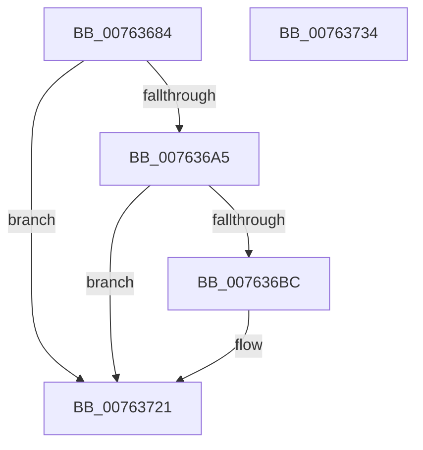

# PopDiagTraceThermalRequestActiveUpdate

- RVA: `0x00763684`–`0x00763735` (길이 `177` bytes)
- VA: `0x0000000140763684`
- 실행 섹션: `PAGE`
- PDB 이름 있음: `예`; PDB Function 태그: `아니요`
- unwind 정보 RVA: `0x00087EC4`
- 디코드: `40`개 명령, `177/177` bytes 표시
- 미해석 바이트: `0` (있으면 어셈블리에 `.byte`로 보존)

> 이 문서는 커널 이미지의 기계어와 PDB 기호를 분석해 생성했습니다. 4번과 5번은 함수 원형과 자료형을 바이너리 사용 방식에서 추정한 C 해석이며 원본 소스 복구 결과는 아닙니다.

## 1. Dependencies

- 직접 호출 지점: **3**; 고유 호출 대상: **3**
- 직접 호출자로 확인된 함수: **1**
- RIP 상대 이미지 참조: **4**

### Outgoing calls
- `0x007636B3` → [EtwEventEnabled](../../text/39/EtwEventEnabled_function_00392450.md) (function, `0x00392450`)
- `0x0076371C` → [EtwWrite](../../text/41/EtwWrite_function_0041C720.md) (function, `0x0041C720`)
- `0x00763729` → [_security_check_cookie](../../text/6A/_security_check_cookie_function_006AC640.md) (function, `0x006AC640`)

### Direct callers
- [PoSetThermalActiveCooling](../75/PoSetThermalActiveCooling_function_00756D40.md) at `0x00756DAC`

### Static image references
- `0x0076368A` → RVA `0x00E0A740` (`.data`; read)
- `0x00763699` → RVA `0x00E67858` (`.data`; read)
- `0x007636A5` → RVA `0x00F0B408` (`.data`; read)
- `0x007636AC` → RVA `0x00021AB8` (`.rdata`; read)

## 2. Other-region calls and transfers

- 다른 실행 섹션으로 향하는 call: **3**
  - `0x007636B3` → [EtwEventEnabled](../../text/39/EtwEventEnabled_function_00392450.md) (`PAGE` → `.text`)
  - `0x0076371C` → [EtwWrite](../../text/41/EtwWrite_function_0041C720.md) (`PAGE` → `.text`)
  - `0x00763729` → [_security_check_cookie](../../text/6A/_security_check_cookie_function_006AC640.md) (`PAGE` → `.text`)
- 별도 외부 분기/꼬리 이동을 확인하지 못했습니다.

## 3. Assembly (complete function range)

```asm
00763684  40 53                           push rbx
00763686  48 83 EC 70                     sub rsp, 0x70
0076368A  48 8B 05 AF 70 6A 00            mov rax, qword ptr [rip + 0x6a70af]
00763691  48 33 C4                        xor rax, rsp
00763694  48 89 44 24 60                  mov qword ptr [rsp + 0x60], rax
00763699  80 3D B8 41 70 00 00            cmp byte ptr [rip + 0x7041b8], 0
007636A0  48 8B D9                        mov rbx, rcx
007636A3  74 7C                           je 0x140763721
007636A5  48 8B 0D 5C 7D 7A 00            mov rcx, qword ptr [rip + 0x7a7d5c]
007636AC  48 8D 15 05 E4 8B FF            lea rdx, [rip - 0x741bfb]
007636B3  E8 98 ED C2 FF                  call 0x140392450
007636B8  84 C0                           test al, al
007636BA  74 65                           je 0x140763721
007636BC  48 8B 0D 45 7D 7A 00            mov rcx, qword ptr [rip + 0x7a7d45]
007636C3  48 8D 15 EE E3 8B FF            lea rdx, [rip - 0x741c12]
007636CA  33 C0                           xor eax, eax
007636CC  48 89 5C 24 38                  mov qword ptr [rsp + 0x38], rbx
007636D1  38 43 11                        cmp byte ptr [rbx + 0x11], al
007636D4  41 B9 02 00 00 00               mov r9d, 2
007636DA  C7 44 24 48 04 00 00 00         mov dword ptr [rsp + 0x48], 4
007636E2  0F 95 C0                        setne al
007636E5  C7 44 24 58 08 00 00 00         mov dword ptr [rsp + 0x58], 8
007636ED  83 64 24 4C 00                  and dword ptr [rsp + 0x4c], 0
007636F2  45 33 C0                        xor r8d, r8d
007636F5  83 64 24 5C 00                  and dword ptr [rsp + 0x5c], 0
007636FA  89 44 24 30                     mov dword ptr [rsp + 0x30], eax
007636FE  48 8D 44 24 30                  lea rax, [rsp + 0x30]
00763703  48 89 44 24 40                  mov qword ptr [rsp + 0x40], rax
00763708  48 8D 44 24 38                  lea rax, [rsp + 0x38]
0076370D  48 89 44 24 50                  mov qword ptr [rsp + 0x50], rax
00763712  48 8D 44 24 40                  lea rax, [rsp + 0x40]
00763717  48 89 44 24 20                  mov qword ptr [rsp + 0x20], rax
0076371C  E8 FF 8F CB FF                  call 0x14041c720
00763721  48 8B 4C 24 60                  mov rcx, qword ptr [rsp + 0x60]
00763726  48 33 CC                        xor rcx, rsp
00763729  E8 12 8F F4 FF                  call 0x1406ac640
0076372E  48 83 C4 70                     add rsp, 0x70
00763732  5B                              pop rbx
00763733  C3                              ret
00763734  CC                              int3
```

## 4. C-style interpretation (structured pseudocode)

```c
__int64 __fastcall PopDiagTraceThermalRequestActiveUpdate(__int64 a1, __int64 a2, int a3)
{
    __int64 result;
    __int64 v_rsp;
    unsigned __int64 v_stack_m18;
    unsigned int v_stack_m1C;
    unsigned int v_stack_m20;
    unsigned __int64 v_stack_m28;
    unsigned int v_stack_m2C;
    unsigned int v_stack_m30;
    unsigned __int64 v_stack_m38;
    unsigned __int64 v_stack_m40;
    unsigned int v_stack_m48;
    unsigned __int64 v_stack_m58;

    v_rsp = (v_rsp) - (112);
    result = (*(unsigned __int64 *)(v_rip + 6975663)) ^ (v_rsp);
    v_stack_m18 = result;
    if ((*(unsigned __int8 *)(v_rip + 7356856)) == 0) goto loc_00763721;
    result = EtwEventEnabled(*(unsigned __int64 *)(v_rip + 8027484), v_rip - 7609339, a3, a4);
    if ((unsigned __int8)(result) != 0) {
        a1 = *(unsigned __int64 *)(v_rip + 8027461);
        a2 = v_rip - 7609362;
        result = 0;
        v_stack_m40 = a1;
        a4 = 2;
        v_stack_m30 = 4;
        result = ((*(unsigned __int8 *)(a1 + 17)) != 0) ? 1 : 0;
        v_stack_m20 = 8;
        a3 = 0;
        v_stack_m48 = (unsigned int)(result);
        result = v_stack_m48;
        v_stack_m38 = result;
        result = v_stack_m40;
        v_stack_m28 = result;
        result = v_stack_m38;
        v_stack_m58 = result;
        result = EtwWrite(a1, a2, a3, a4);
    }
    a1 = (v_stack_m18) ^ (v_rsp);
    result = _security_check_cookie(a1, a2, a3, a4);
    v_rsp = (v_rsp) + (112);
    return result;
}
```

## 5. (Beta) C Style

```c
int64_t PopDiagTraceThermalRequestActiveUpdate(void *Arg1, int64_t Arg2, int32_t Arg3)
{
    uint8_t *arg1 = (uint8_t *)Arg1;

    int64_t result;
    int64_t local_rsp;
    uint64_t v_stack_m18;
    uint32_t v_stack_m1C;
    uint32_t v_stack_m20;
    uint64_t v_stack_m28;
    uint32_t v_stack_m2C;
    uint32_t v_stack_m30;
    uint64_t v_stack_m38;
    uint64_t v_stack_m40;
    uint32_t v_stack_m48;
    uint64_t v_stack_m58;

    local_rsp = (local_rsp) - (112);
    result = (*(uint64_t *)(v_rip + 0x6A70AF)) ^ (local_rsp);
    v_stack_m18 = result;
    if ((*(uint8_t *)(v_rip + 0x7041B8)) == 0) goto loc_00763721;
    result = EtwEventEnabled(*(uint64_t *)(v_rip + 0x7A7D5C), v_rip - 7609339, Arg3, a4);
    if ((uint8_t)(result) != 0) {
        Arg1 = *(uint64_t *)(v_rip + 0x7A7D45);
        Arg2 = v_rip - 7609362;
        result = 0;
        v_stack_m40 = Arg1;
        a4 = 2;
        v_stack_m30 = 4;
        result = ((*(uint8_t *)(arg1 + 0x11)) != 0) ? 1 : 0;
        v_stack_m20 = 8;
        Arg3 = 0;
        v_stack_m48 = (uint32_t)(result);
        result = v_stack_m48;
        v_stack_m38 = result;
        result = v_stack_m40;
        v_stack_m28 = result;
        result = v_stack_m38;
        v_stack_m58 = result;
        result = EtwWrite(Arg1, Arg2, Arg3, a4);
    }
    Arg1 = (v_stack_m18) ^ (local_rsp);
    result = _security_check_cookie(Arg1, Arg2, Arg3, a4);
    local_rsp = (local_rsp) + (112);
    return result;
}
```

### 관측된 메모리 오프셋

구조체 형식이 확인되지 않은 접근은 인자 기준의 오프셋으로만 기록했습니다.

| 기준 인자 | 오프셋 표현 | 폭 (bit) | 접근 |
|---|---:|---:|---|
| `Arg1` | `+ 0x11` | `8` | `R` |

## 6. Execution-region graph

[열기: 2D/3D 그래프와 함수 탐색 컨트롤 패널](../../../control-panel.html?section=page&rva=0x00763684&view=graph)

- 2D 그래프는 위에서 아래로 흐르고, 3D 그래프는 빈 공간을 드래그해 회전합니다. Shift+드래그는 이동, 휠은 확대·축소, 함수 노드 선택은 대상 보고서 이동입니다.

### Static fallback


