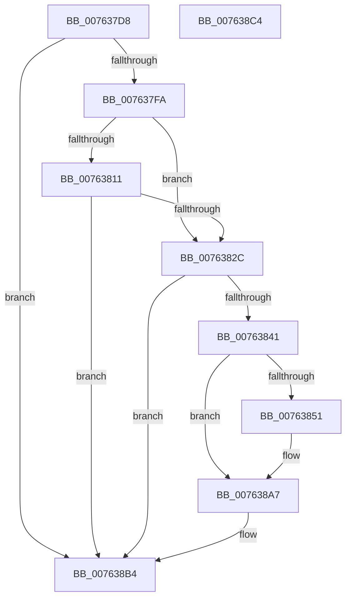

# PopDiagTraceZoneCriticalTripPointExceeded

- RVA: `0x007637D8`–`0x007638C5` (길이 `237` bytes)
- VA: `0x00000001407637D8`
- 실행 섹션: `PAGE`
- PDB 이름 있음: `예`; PDB Function 태그: `아니요`
- unwind 정보 RVA: `0x00060BC4`
- 디코드: `55`개 명령, `237/237` bytes 표시
- 미해석 바이트: `0` (있으면 어셈블리에 `.byte`로 보존)

> 이 문서는 커널 이미지의 기계어와 PDB 기호를 분석해 생성했습니다. 4번과 5번은 함수 원형과 자료형을 바이너리 사용 방식에서 추정한 C 해석이며 원본 소스 복구 결과는 아닙니다.

## 1. Dependencies

- 직접 호출 지점: **6**; 고유 호출 대상: **4**
- 직접 호출자로 확인된 함수: **1**
- RIP 상대 이미지 참조: **4**

### Outgoing calls
- `0x00763808` → [EtwEventEnabled](../../text/39/EtwEventEnabled_function_00392450.md) (function, `0x00392450`)
- `0x0076381F` → [EtwEventEnabled](../../text/39/EtwEventEnabled_function_00392450.md) (function, `0x00392450`)
- `0x00763834` → [IoGetDeviceAttachmentBaseRefWithTag](../../text/27/IoGetDeviceAttachmentBaseRefWithTag_function_00272788.md) (function, `0x00272788`)
- `0x00763877` → [PopDiagTraceTripPointExceeded](../AB/PopDiagTraceTripPointExceeded_function_00AB7EEC.md) (function, `0x00AB7EEC`)
- `0x007638A2` → [PopDiagTraceTripPointExceeded](../AB/PopDiagTraceTripPointExceeded_function_00AB7EEC.md) (function, `0x00AB7EEC`)
- `0x007638AF` → [ObfDereferenceObjectWithTag](../../text/2F/ObfDereferenceObjectWithTag_function_002F78E0.md) (function, `0x002F78E0`)

### Direct callers
- [PopCheckAndHandleThermalConditions](../../text/4A/PopCheckAndHandleThermalConditions_function_004A8C00.md) at `0x004A8C99`

### Static image references
- `0x007637E7` → RVA `0x00E67858` (`.data`; read)
- `0x007637FA` → RVA `0x00F0B408` (`.data`; read)
- `0x00763801` → RVA `0x0001E2B8` (`.rdata`; read)
- `0x00763818` → RVA `0x0001E2A8` (`.rdata`; read)

## 2. Other-region calls and transfers

- 다른 실행 섹션으로 향하는 call: **4**
  - `0x00763808` → [EtwEventEnabled](../../text/39/EtwEventEnabled_function_00392450.md) (`PAGE` → `.text`)
  - `0x0076381F` → [EtwEventEnabled](../../text/39/EtwEventEnabled_function_00392450.md) (`PAGE` → `.text`)
  - `0x00763834` → [IoGetDeviceAttachmentBaseRefWithTag](../../text/27/IoGetDeviceAttachmentBaseRefWithTag_function_00272788.md) (`PAGE` → `.text`)
  - `0x007638AF` → [ObfDereferenceObjectWithTag](../../text/2F/ObfDereferenceObjectWithTag_function_002F78E0.md) (`PAGE` → `.text`)
- 별도 외부 분기/꼬리 이동을 확인하지 못했습니다.

## 3. Assembly (complete function range)

```asm
007637D8  48 89 5C 24 08                  mov qword ptr [rsp + 8], rbx
007637DD  48 89 74 24 10                  mov qword ptr [rsp + 0x10], rsi
007637E2  57                              push rdi
007637E3  48 83 EC 20                     sub rsp, 0x20
007637E7  80 3D 6A 40 70 00 00            cmp byte ptr [rip + 0x70406a], 0
007637EE  48 8B DA                        mov rbx, rdx
007637F1  48 8B F1                        mov rsi, rcx
007637F4  0F 84 BA 00 00 00               je 0x1407638b4
007637FA  48 8B 0D 07 7C 7A 00            mov rcx, qword ptr [rip + 0x7a7c07]
00763801  48 8D 15 B0 AA 8B FF            lea rdx, [rip - 0x745550]
00763808  E8 43 EC C2 FF                  call 0x140392450
0076380D  84 C0                           test al, al
0076380F  75 1B                           jne 0x14076382c
00763811  48 8B 0D F0 7B 7A 00            mov rcx, qword ptr [rip + 0x7a7bf0]
00763818  48 8D 15 89 AA 8B FF            lea rdx, [rip - 0x745577]
0076381F  E8 2C EC C2 FF                  call 0x140392450
00763824  84 C0                           test al, al
00763826  0F 84 88 00 00 00               je 0x1407638b4
0076382C  BA 50 6F 44 67                  mov edx, 0x67446f50
00763831  48 8B CB                        mov rcx, rbx
00763834  E8 4F EF B0 FF                  call 0x140272788
00763839  48 8B D8                        mov rbx, rax
0076383C  48 85 C0                        test rax, rax
0076383F  74 73                           je 0x1407638b4
00763841  48 8B 88 38 01 00 00            mov rcx, qword ptr [rax + 0x138]
00763848  48 8B 79 28                     mov rdi, qword ptr [rcx + 0x28]
0076384C  48 85 FF                        test rdi, rdi
0076384F  74 56                           je 0x1407638a7
00763851  0F B7 8F 80 00 00 00            movzx ecx, word ptr [rdi + 0x80]
00763858  4C 8D 0D 59 AA 8B FF            lea r9, [rip - 0x7455a7]
0076385F  B8 CD CC CC CC                  mov eax, 0xcccccccd
00763864  66 D1 E9                        shr cx, 1
00763867  F7 66 1C                        mul dword ptr [rsi + 0x1c]
0076386A  C1 EA 03                        shr edx, 3
0076386D  44 8B C2                        mov r8d, edx
00763870  48 8B 97 88 00 00 00            mov rdx, qword ptr [rdi + 0x88]
00763877  E8 70 46 35 00                  call 0x140ab7eec
0076387C  0F B7 8F 80 00 00 00            movzx ecx, word ptr [rdi + 0x80]
00763883  4C 8D 0D 1E AA 8B FF            lea r9, [rip - 0x7455e2]
0076388A  B8 CD CC CC CC                  mov eax, 0xcccccccd
0076388F  66 D1 E9                        shr cx, 1
00763892  F7 66 1C                        mul dword ptr [rsi + 0x1c]
00763895  C1 EA 03                        shr edx, 3
00763898  44 8B C2                        mov r8d, edx
0076389B  48 8B 97 88 00 00 00            mov rdx, qword ptr [rdi + 0x88]
007638A2  E8 45 46 35 00                  call 0x140ab7eec
007638A7  BA 50 6F 44 67                  mov edx, 0x67446f50
007638AC  48 8B CB                        mov rcx, rbx
007638AF  E8 2C 40 B9 FF                  call 0x1402f78e0
007638B4  48 8B 5C 24 30                  mov rbx, qword ptr [rsp + 0x30]
007638B9  48 8B 74 24 38                  mov rsi, qword ptr [rsp + 0x38]
007638BE  48 83 C4 20                     add rsp, 0x20
007638C2  5F                              pop rdi
007638C3  C3                              ret
007638C4  CC                              int3
```

## 4. C-style interpretation (structured pseudocode)

```c
__int64 __fastcall PopDiagTraceZoneCriticalTripPointExceeded(__int64 a1, __int64 a2)
{
    __int64 result;
    __int64 v_rsp;
    unsigned __int64 v_stack_p10;
    unsigned __int64 v_stack_p8;

    v_stack_p8 = v_rbx;
    v_stack_p10 = v_rsi;
    v_rsp = (v_rsp) - (32);
    if ((*(unsigned __int8 *)(v_rip + 7356522)) == 0) goto loc_007638B4;
    result = EtwEventEnabled(*(unsigned __int64 *)(v_rip + 8027143), v_rip - 7624016, a3, a4);
    if ((unsigned __int8)(result) != 0) goto loc_0076382C;
    result = EtwEventEnabled(*(unsigned __int64 *)(v_rip + 8027120), v_rip - 7624055, a3, a4);
    if ((unsigned __int8)(result) == 0) goto loc_007638B4;
loc_0076382C:
    result = IoGetDeviceAttachmentBaseRefWithTag(a2, (unsigned int)(0x67446F50ULL), a3, a4);
    if (result == 0) goto loc_007638B4;
    if (*(unsigned __int64 *)(*(unsigned __int64 *)(result + 312) + 40) != 0) {
        a1 = *(unsigned __int16 *)(*(unsigned __int64 *)(*(unsigned __int64 *)(result + 312) + 40) + 128);
        a4 = v_rip - 7624103;
        result = 0xCCCCCCCDULL;
        a1 = (unsigned __int16)((a1) >> (1));
        a2 = (unsigned int)(((unsigned int)(0x67446F50ULL)) >> (3));
        a3 = (unsigned int)(a2);
        a2 = *(unsigned __int64 *)(*(unsigned __int64 *)(*(unsigned __int64 *)(result + 312) + 40) + 136);
        result = PopDiagTraceTripPointExceeded(a1, a2, a3, a4);
        a1 = *(unsigned __int16 *)(*(unsigned __int64 *)(*(unsigned __int64 *)(result + 312) + 40) + 128);
        a4 = v_rip - 7624162;
        result = 0xCCCCCCCDULL;
        a1 = (unsigned __int16)((a1) >> (1));
        a2 = (unsigned int)((a2) >> (3));
        a3 = (unsigned int)(a2);
        a2 = *(unsigned __int64 *)(*(unsigned __int64 *)(*(unsigned __int64 *)(result + 312) + 40) + 136);
        result = PopDiagTraceTripPointExceeded(a1, a2, a3, a4);
    }
    result = ObfDereferenceObjectWithTag(result, (unsigned int)(0x67446F50ULL), a3, a4);
loc_007638B4:
    v_rsp = (v_rsp) + (32);
    return result;
}
```

## 5. (Beta) C Style

```c
int64_t PopDiagTraceZoneCriticalTripPointExceeded(void *Arg1, int64_t Arg2)
{
    uint8_t *arg1 = (uint8_t *)Arg1;

    int64_t result;
    int64_t local_rsp;
    uint64_t v_stack_p10;
    uint64_t v_stack_p8;

    v_stack_p8 = local_rbx;
    v_stack_p10 = local_rsi;
    local_rsp = (local_rsp) - (32);
    if ((*(uint8_t *)(v_rip + 0x70406A)) == 0) goto loc_007638B4;
    result = EtwEventEnabled(*(uint64_t *)(v_rip + 0x7A7C07), v_rip - 7624016, a3, a4);
    if ((uint8_t)(result) != 0) goto loc_0076382C;
    result = EtwEventEnabled(*(uint64_t *)(v_rip + 0x7A7BF0), v_rip - 7624055, a3, a4);
    if ((uint8_t)(result) == 0) goto loc_007638B4;
loc_0076382C:
    result = IoGetDeviceAttachmentBaseRefWithTag(Arg2, (uint32_t)(0x67446F50ULL), a3, a4);
    if (result == 0) goto loc_007638B4;
    if (*(uint64_t *)(*(uint64_t *)(result + 0x138) + 0x28) != 0) {
        Arg1 = *(uint16_t *)(*(uint64_t *)(*(uint64_t *)(result + 0x138) + 0x28) + 0x80);
        a4 = v_rip - 7624103;
        result = 0xCCCCCCCDULL;
        Arg1 = (uint16_t)((Arg1) >> (1));
        Arg2 = (uint32_t)(((uint32_t)(0x67446F50ULL)) >> (3));
        a3 = (uint32_t)(Arg2);
        Arg2 = *(uint64_t *)(*(uint64_t *)(*(uint64_t *)(result + 0x138) + 0x28) + 0x88);
        result = PopDiagTraceTripPointExceeded(Arg1, Arg2, a3, a4);
        Arg1 = *(uint16_t *)(*(uint64_t *)(*(uint64_t *)(result + 0x138) + 0x28) + 0x80);
        a4 = v_rip - 7624162;
        result = 0xCCCCCCCDULL;
        Arg1 = (uint16_t)((Arg1) >> (1));
        Arg2 = (uint32_t)((Arg2) >> (3));
        a3 = (uint32_t)(Arg2);
        Arg2 = *(uint64_t *)(*(uint64_t *)(*(uint64_t *)(result + 0x138) + 0x28) + 0x88);
        result = PopDiagTraceTripPointExceeded(Arg1, Arg2, a3, a4);
    }
    result = ObfDereferenceObjectWithTag(result, (uint32_t)(0x67446F50ULL), a3, a4);
loc_007638B4:
    local_rsp = (local_rsp) + (32);
    return result;
}
```

### 관측된 메모리 오프셋

구조체 형식이 확인되지 않은 접근은 인자 기준의 오프셋으로만 기록했습니다.

| 기준 인자 | 오프셋 표현 | 폭 (bit) | 접근 |
|---|---:|---:|---|
| `Arg1` | `+ 0x1C` | `32` | `R` |

## 6. Execution-region graph

[열기: 2D/3D 그래프와 함수 탐색 컨트롤 패널](../../../control-panel.html?section=page&rva=0x007637D8&view=graph)

- 2D 그래프는 위에서 아래로 흐르고, 3D 그래프는 빈 공간을 드래그해 회전합니다. Shift+드래그는 이동, 휠은 확대·축소, 함수 노드 선택은 대상 보고서 이동입니다.

### Static fallback


