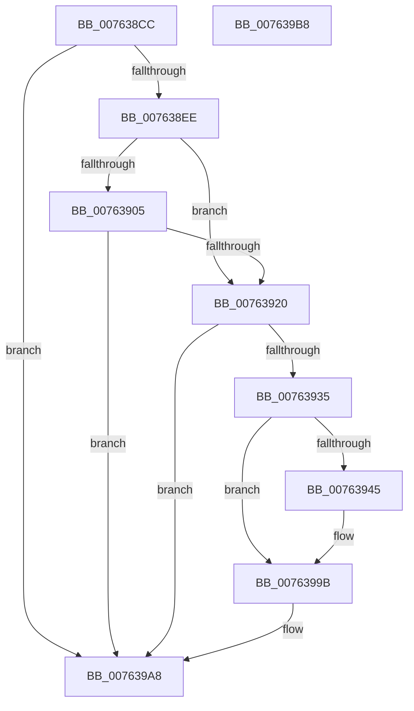

# PopDiagTraceZoneS4TripPointExceeded

- RVA: `0x007638CC`–`0x007639B9` (길이 `237` bytes)
- VA: `0x00000001407638CC`
- 실행 섹션: `PAGE`
- PDB 이름 있음: `예`; PDB Function 태그: `아니요`
- unwind 정보 RVA: `0x00060BC4`
- 디코드: `55`개 명령, `237/237` bytes 표시
- 미해석 바이트: `0` (있으면 어셈블리에 `.byte`로 보존)

> 이 문서는 커널 이미지의 기계어와 PDB 기호를 분석해 생성했습니다. 4번과 5번은 함수 원형과 자료형을 바이너리 사용 방식에서 추정한 C 해석이며 원본 소스 복구 결과는 아닙니다.

## 1. Dependencies

- 직접 호출 지점: **6**; 고유 호출 대상: **4**
- 직접 호출자로 확인된 함수: **1**
- RIP 상대 이미지 참조: **6**

### Outgoing calls
- `0x007638FC` → [EtwEventEnabled](../../text/39/EtwEventEnabled_function_00392450.md) (function, `0x00392450`)
- `0x00763913` → [EtwEventEnabled](../../text/39/EtwEventEnabled_function_00392450.md) (function, `0x00392450`)
- `0x00763928` → [IoGetDeviceAttachmentBaseRefWithTag](../../text/27/IoGetDeviceAttachmentBaseRefWithTag_function_00272788.md) (function, `0x00272788`)
- `0x0076396B` → [PopDiagTraceTripPointExceeded](../AB/PopDiagTraceTripPointExceeded_function_00AB7EEC.md) (function, `0x00AB7EEC`)
- `0x00763996` → [PopDiagTraceTripPointExceeded](../AB/PopDiagTraceTripPointExceeded_function_00AB7EEC.md) (function, `0x00AB7EEC`)
- `0x007639A3` → [ObfDereferenceObjectWithTag](../../text/2F/ObfDereferenceObjectWithTag_function_002F78E0.md) (function, `0x002F78E0`)

### Direct callers
- [PopCheckAndHandleThermalConditions](../../text/4A/PopCheckAndHandleThermalConditions_function_004A8C00.md) at `0x004A8CAB`

### Static image references
- `0x007638DB` → RVA `0x00E67858` (`.data`; read)
- `0x007638EE` → RVA `0x00F0B408` (`.data`; read)
- `0x007638F5` → RVA `0x0001E2B8` (`.rdata`; read)
- `0x0076390C` → RVA `0x0001E2A8` (`.rdata`; read)
- `0x0076394C` → RVA `0x0001E2C8` (`.rdata`; read)
- `0x00763977` → RVA `0x0001E298` (`.rdata`; read)

## 2. Other-region calls and transfers

- 다른 실행 섹션으로 향하는 call: **4**
  - `0x007638FC` → [EtwEventEnabled](../../text/39/EtwEventEnabled_function_00392450.md) (`PAGE` → `.text`)
  - `0x00763913` → [EtwEventEnabled](../../text/39/EtwEventEnabled_function_00392450.md) (`PAGE` → `.text`)
  - `0x00763928` → [IoGetDeviceAttachmentBaseRefWithTag](../../text/27/IoGetDeviceAttachmentBaseRefWithTag_function_00272788.md) (`PAGE` → `.text`)
  - `0x007639A3` → [ObfDereferenceObjectWithTag](../../text/2F/ObfDereferenceObjectWithTag_function_002F78E0.md) (`PAGE` → `.text`)
- 별도 외부 분기/꼬리 이동을 확인하지 못했습니다.

## 3. Assembly (complete function range)

```asm
007638CC  48 89 5C 24 08                  mov qword ptr [rsp + 8], rbx
007638D1  48 89 74 24 10                  mov qword ptr [rsp + 0x10], rsi
007638D6  57                              push rdi
007638D7  48 83 EC 20                     sub rsp, 0x20
007638DB  80 3D 76 3F 70 00 00            cmp byte ptr [rip + 0x703f76], 0
007638E2  48 8B DA                        mov rbx, rdx
007638E5  48 8B F1                        mov rsi, rcx
007638E8  0F 84 BA 00 00 00               je 0x1407639a8
007638EE  48 8B 0D 13 7B 7A 00            mov rcx, qword ptr [rip + 0x7a7b13]
007638F5  48 8D 15 BC A9 8B FF            lea rdx, [rip - 0x745644]
007638FC  E8 4F EB C2 FF                  call 0x140392450
00763901  84 C0                           test al, al
00763903  75 1B                           jne 0x140763920
00763905  48 8B 0D FC 7A 7A 00            mov rcx, qword ptr [rip + 0x7a7afc]
0076390C  48 8D 15 95 A9 8B FF            lea rdx, [rip - 0x74566b]
00763913  E8 38 EB C2 FF                  call 0x140392450
00763918  84 C0                           test al, al
0076391A  0F 84 88 00 00 00               je 0x1407639a8
00763920  BA 50 6F 44 67                  mov edx, 0x67446f50
00763925  48 8B CB                        mov rcx, rbx
00763928  E8 5B EE B0 FF                  call 0x140272788
0076392D  48 8B D8                        mov rbx, rax
00763930  48 85 C0                        test rax, rax
00763933  74 73                           je 0x1407639a8
00763935  48 8B 88 38 01 00 00            mov rcx, qword ptr [rax + 0x138]
0076393C  48 8B 79 28                     mov rdi, qword ptr [rcx + 0x28]
00763940  48 85 FF                        test rdi, rdi
00763943  74 56                           je 0x14076399b
00763945  0F B7 8F 80 00 00 00            movzx ecx, word ptr [rdi + 0x80]
0076394C  4C 8D 0D 75 A9 8B FF            lea r9, [rip - 0x74568b]
00763953  B8 CD CC CC CC                  mov eax, 0xcccccccd
00763958  66 D1 E9                        shr cx, 1
0076395B  F7 66 4C                        mul dword ptr [rsi + 0x4c]
0076395E  C1 EA 03                        shr edx, 3
00763961  44 8B C2                        mov r8d, edx
00763964  48 8B 97 88 00 00 00            mov rdx, qword ptr [rdi + 0x88]
0076396B  E8 7C 45 35 00                  call 0x140ab7eec
00763970  0F B7 8F 80 00 00 00            movzx ecx, word ptr [rdi + 0x80]
00763977  4C 8D 0D 1A A9 8B FF            lea r9, [rip - 0x7456e6]
0076397E  B8 CD CC CC CC                  mov eax, 0xcccccccd
00763983  66 D1 E9                        shr cx, 1
00763986  F7 66 4C                        mul dword ptr [rsi + 0x4c]
00763989  C1 EA 03                        shr edx, 3
0076398C  44 8B C2                        mov r8d, edx
0076398F  48 8B 97 88 00 00 00            mov rdx, qword ptr [rdi + 0x88]
00763996  E8 51 45 35 00                  call 0x140ab7eec
0076399B  BA 50 6F 44 67                  mov edx, 0x67446f50
007639A0  48 8B CB                        mov rcx, rbx
007639A3  E8 38 3F B9 FF                  call 0x1402f78e0
007639A8  48 8B 5C 24 30                  mov rbx, qword ptr [rsp + 0x30]
007639AD  48 8B 74 24 38                  mov rsi, qword ptr [rsp + 0x38]
007639B2  48 83 C4 20                     add rsp, 0x20
007639B6  5F                              pop rdi
007639B7  C3                              ret
007639B8  CC                              int3
```

## 4. C-style interpretation (structured pseudocode)

```c
__int64 __fastcall PopDiagTraceZoneS4TripPointExceeded(__int64 a1, __int64 a2)
{
    __int64 result;
    __int64 v_rsp;
    unsigned __int64 v_stack_p10;
    unsigned __int64 v_stack_p8;

    v_stack_p8 = v_rbx;
    v_stack_p10 = v_rsi;
    v_rsp = (v_rsp) - (32);
    if ((*(unsigned __int8 *)(v_rip + 7356278)) == 0) goto loc_007639A8;
    result = EtwEventEnabled(*(unsigned __int64 *)(v_rip + 8026899), v_rip - 7624260, a3, a4);
    if ((unsigned __int8)(result) != 0) goto loc_00763920;
    result = EtwEventEnabled(*(unsigned __int64 *)(v_rip + 8026876), v_rip - 7624299, a3, a4);
    if ((unsigned __int8)(result) == 0) goto loc_007639A8;
loc_00763920:
    result = IoGetDeviceAttachmentBaseRefWithTag(a2, (unsigned int)(0x67446F50ULL), a3, a4);
    if (result == 0) goto loc_007639A8;
    if (*(unsigned __int64 *)(*(unsigned __int64 *)(result + 312) + 40) != 0) {
        a1 = *(unsigned __int16 *)(*(unsigned __int64 *)(*(unsigned __int64 *)(result + 312) + 40) + 128);
        a4 = v_rip - 7624331;
        result = 0xCCCCCCCDULL;
        a1 = (unsigned __int16)((a1) >> (1));
        a2 = (unsigned int)(((unsigned int)(0x67446F50ULL)) >> (3));
        a3 = (unsigned int)(a2);
        a2 = *(unsigned __int64 *)(*(unsigned __int64 *)(*(unsigned __int64 *)(result + 312) + 40) + 136);
        result = PopDiagTraceTripPointExceeded(a1, a2, a3, a4);
        a1 = *(unsigned __int16 *)(*(unsigned __int64 *)(*(unsigned __int64 *)(result + 312) + 40) + 128);
        a4 = v_rip - 7624422;
        result = 0xCCCCCCCDULL;
        a1 = (unsigned __int16)((a1) >> (1));
        a2 = (unsigned int)((a2) >> (3));
        a3 = (unsigned int)(a2);
        a2 = *(unsigned __int64 *)(*(unsigned __int64 *)(*(unsigned __int64 *)(result + 312) + 40) + 136);
        result = PopDiagTraceTripPointExceeded(a1, a2, a3, a4);
    }
    result = ObfDereferenceObjectWithTag(result, (unsigned int)(0x67446F50ULL), a3, a4);
loc_007639A8:
    v_rsp = (v_rsp) + (32);
    return result;
}
```

## 5. (Beta) C Style

```c
int64_t PopDiagTraceZoneS4TripPointExceeded(void *Arg1, int64_t Arg2)
{
    uint8_t *arg1 = (uint8_t *)Arg1;

    int64_t result;
    int64_t local_rsp;
    uint64_t v_stack_p10;
    uint64_t v_stack_p8;

    v_stack_p8 = local_rbx;
    v_stack_p10 = local_rsi;
    local_rsp = (local_rsp) - (32);
    if ((*(uint8_t *)(v_rip + 0x703F76)) == 0) goto loc_007639A8;
    result = EtwEventEnabled(*(uint64_t *)(v_rip + 0x7A7B13), v_rip - 7624260, a3, a4);
    if ((uint8_t)(result) != 0) goto loc_00763920;
    result = EtwEventEnabled(*(uint64_t *)(v_rip + 0x7A7AFC), v_rip - 7624299, a3, a4);
    if ((uint8_t)(result) == 0) goto loc_007639A8;
loc_00763920:
    result = IoGetDeviceAttachmentBaseRefWithTag(Arg2, (uint32_t)(0x67446F50ULL), a3, a4);
    if (result == 0) goto loc_007639A8;
    if (*(uint64_t *)(*(uint64_t *)(result + 0x138) + 0x28) != 0) {
        Arg1 = *(uint16_t *)(*(uint64_t *)(*(uint64_t *)(result + 0x138) + 0x28) + 0x80);
        a4 = v_rip - 7624331;
        result = 0xCCCCCCCDULL;
        Arg1 = (uint16_t)((Arg1) >> (1));
        Arg2 = (uint32_t)(((uint32_t)(0x67446F50ULL)) >> (3));
        a3 = (uint32_t)(Arg2);
        Arg2 = *(uint64_t *)(*(uint64_t *)(*(uint64_t *)(result + 0x138) + 0x28) + 0x88);
        result = PopDiagTraceTripPointExceeded(Arg1, Arg2, a3, a4);
        Arg1 = *(uint16_t *)(*(uint64_t *)(*(uint64_t *)(result + 0x138) + 0x28) + 0x80);
        a4 = v_rip - 7624422;
        result = 0xCCCCCCCDULL;
        Arg1 = (uint16_t)((Arg1) >> (1));
        Arg2 = (uint32_t)((Arg2) >> (3));
        a3 = (uint32_t)(Arg2);
        Arg2 = *(uint64_t *)(*(uint64_t *)(*(uint64_t *)(result + 0x138) + 0x28) + 0x88);
        result = PopDiagTraceTripPointExceeded(Arg1, Arg2, a3, a4);
    }
    result = ObfDereferenceObjectWithTag(result, (uint32_t)(0x67446F50ULL), a3, a4);
loc_007639A8:
    local_rsp = (local_rsp) + (32);
    return result;
}
```

### 관측된 메모리 오프셋

구조체 형식이 확인되지 않은 접근은 인자 기준의 오프셋으로만 기록했습니다.

| 기준 인자 | 오프셋 표현 | 폭 (bit) | 접근 |
|---|---:|---:|---|
| `Arg1` | `+ 0x4C` | `32` | `R` |

## 6. Execution-region graph

[열기: 2D/3D 그래프와 함수 탐색 컨트롤 패널](../../../control-panel.html?section=page&rva=0x007638CC&view=graph)

- 2D 그래프는 위에서 아래로 흐르고, 3D 그래프는 빈 공간을 드래그해 회전합니다. Shift+드래그는 이동, 휠은 확대·축소, 함수 노드 선택은 대상 보고서 이동입니다.

### Static fallback


