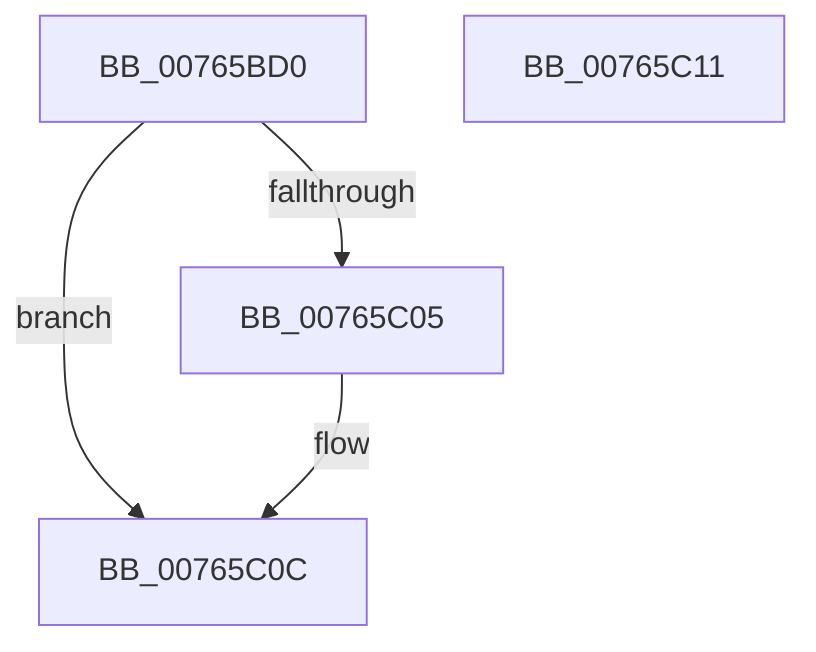

# PopDispatchAcDcCallback

- RVA: `0x00765BD0`–`0x00765C12` (길이 `66` bytes)
- VA: `0x0000000140765BD0`
- 실행 섹션: `PAGE`
- PDB 이름 있음: `예`; PDB Function 태그: `아니요`
- unwind 정보 RVA: `0x0005C788`
- 디코드: `15`개 명령, `66/66` bytes 표시
- 미해석 바이트: `0` (있으면 어셈블리에 `.byte`로 보존)

> 이 문서는 커널 이미지의 기계어와 PDB 기호를 분석해 생성했습니다. 4번과 5번은 함수 원형과 자료형을 바이너리 사용 방식에서 추정한 C 해석이며 원본 소스 복구 결과는 아닙니다.

## 1. Dependencies

- 직접 호출 지점: **1**; 고유 호출 대상: **1**
- 직접 호출자로 확인된 함수: **0**
- RIP 상대 이미지 참조: **2**

### Outgoing calls
- `0x00765BEE` → [ExNotifyCallback](../../text/39/ExNotifyCallback_function_003926B0.md) (function, `0x003926B0`)

### Direct callers
- 이 함수 시작 RVA로 연결되는 직접 call은 확인되지 않았습니다. 간접 호출은 완전히 역산할 수 없습니다.

### Static image references
- `0x00765BD4` → RVA `0x00EFEDA8` (`.data`; read)
- `0x00765BDE` → RVA `0x00F0CE0C` (`.data`; read)

## 2. Other-region calls and transfers

- 다른 실행 섹션으로 향하는 call: **1**
  - `0x00765BEE` → [ExNotifyCallback](../../text/39/ExNotifyCallback_function_003926B0.md) (`PAGE` → `.text`)
- 별도 외부 분기/꼬리 이동을 확인하지 못했습니다.

## 3. Assembly (complete function range)

```asm
00765BD0  48 83 EC 28                     sub rsp, 0x28
00765BD4  48 8B 0D CD 91 79 00            mov rcx, qword ptr [rip + 0x7991cd]
00765BDB  45 33 C0                        xor r8d, r8d
00765BDE  44 39 05 27 72 7A 00            cmp dword ptr [rip + 0x7a7227], r8d
00765BE5  BA 01 00 00 00                  mov edx, 1
00765BEA  41 0F 94 C0                     sete r8b
00765BEE  E8 BD CA C2 FF                  call 0x1403926b0
00765BF3  65 48 8B 04 25 88 01 00 00      mov rax, qword ptr gs:[0x188]
00765BFC  83 B8 E4 01 00 00 00            cmp dword ptr [rax + 0x1e4], 0
00765C03  74 07                           je 0x140765c0c
00765C05  B9 20 00 00 00                  mov ecx, 0x20
00765C0A  CD 29                           int 0x29
00765C0C  48 83 C4 28                     add rsp, 0x28
00765C10  C3                              ret
00765C11  CC                              int3
```

## 4. C-style interpretation (structured pseudocode)

```c
__int64 __fastcall PopDispatchAcDcCallback(__int64 a1, __int64 a2, int a3)
{
    __int64 result;
    __int64 v_rsp;

    v_rsp = (v_rsp) - (40);
    a3 = 0;
    a3 = ((*(unsigned int *)(v_rip + 8024615)) == 0) ? 1 : 0;
    result = ExNotifyCallback(*(unsigned __int64 *)(v_rip + 7967181), 1, a3, a4);
    if ((*(unsigned int *)(*(unsigned __int64 *)(gs_base + (0 + 392)) + 484)) != 0) {
        a1 = 32;
    }
    v_rsp = (v_rsp) + (40);
    return *(unsigned __int64 *)(gs_base + (0 + 392));
}
```

## 5. (Beta) C Style

```c
int64_t PopDispatchAcDcCallback(int64_t Arg1, int64_t Arg2, int32_t Arg3)
{
    int64_t result;
    int64_t local_rsp;

    local_rsp = (local_rsp) - (40);
    Arg3 = 0;
    Arg3 = ((*(uint32_t *)(v_rip + 0x7A7227)) == 0) ? 1 : 0;
    result = ExNotifyCallback(*(uint64_t *)(v_rip + 0x7991CD), 1, Arg3, a4);
    if ((*(uint32_t *)(*(uint64_t *)(gs_base + (0 + 0x188)) + 0x1E4)) != 0) {
        Arg1 = 32;
    }
    local_rsp = (local_rsp) + (40);
    return *(uint64_t *)(gs_base + (0 + 0x188));
}
```

## 6. Execution-region graph

[열기: 2D/3D 그래프와 함수 탐색 컨트롤 패널](../../../control-panel.html?section=page&rva=0x00765BD0&view=graph)

- 2D 그래프는 위에서 아래로 흐르고, 3D 그래프는 빈 공간을 드래그해 회전합니다. Shift+드래그는 이동, 휠은 확대·축소, 함수 노드 선택은 대상 보고서 이동입니다.

### Static fallback


