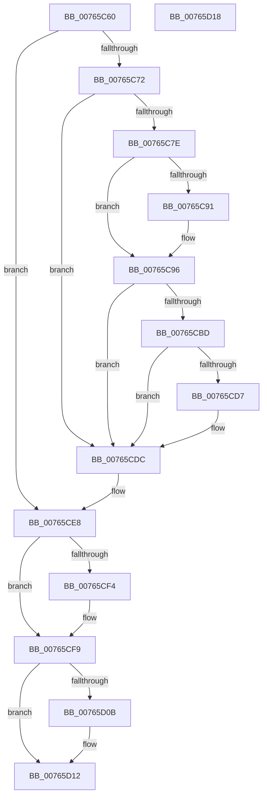

# PopDispatchShutdownEvent

- RVA: `0x00765C60`–`0x00765D19` (길이 `185` bytes)
- VA: `0x0000000140765C60`
- 실행 섹션: `PAGE`
- PDB 이름 있음: `예`; PDB Function 태그: `아니요`
- unwind 정보 RVA: `0x00064C80`
- 디코드: `47`개 명령, `185/185` bytes 표시
- 미해석 바이트: `0` (있으면 어셈블리에 `.byte`로 보존)

> 이 문서는 커널 이미지의 기계어와 PDB 기호를 분석해 생성했습니다. 4번과 5번은 함수 원형과 자료형을 바이너리 사용 방식에서 추정한 C 해석이며 원본 소스 복구 결과는 아닙니다.

## 1. Dependencies

- 직접 호출 지점: **7**; 고유 호출 대상: **6**
- 직접 호출자로 확인된 함수: **0**
- RIP 상대 이미지 참조: **5**

### Outgoing calls
- `0x00765C80` → [PdcTaskClientRequest](../AA/PdcTaskClientRequest_function_00AA37E4.md) (function, `0x00AA37E4`)
- `0x00765C91` → [SleepstudyHelperBlockerActiveReference](../../text/45/SleepstudyHelperBlockerActiveReference_function_004538D0.md) (function, `0x004538D0`)
- `0x00765CB4` → [KeSetTimer2](../../text/3A/KeSetTimer2_function_003A08E0.md) (function, `0x003A08E0`)
- `0x00765CC6` → [PdcTaskClientRequest](../AA/PdcTaskClientRequest_function_00AA37E4.md) (function, `0x00AA37E4`)
- `0x00765CD7` → [SleepstudyHelperBlockerActiveDereference](../../text/45/SleepstudyHelperBlockerActiveDereference_function_00453830.md) (function, `0x00453830`)
- `0x00765CE3` → [PopEventCalloutDispatch](../../text/4B/PopEventCalloutDispatch_function_004B4870.md) (function, `0x004B4870`)
- `0x00765CF4` → [guard_dispatch_icall](../../text/6B/guard_dispatch_icall_function_006BAAD0.md) (function, `0x006BAAD0`)

### Direct callers
- 이 함수 시작 RVA로 연결되는 직접 call은 확인되지 않았습니다. 간접 호출은 완전히 역산할 수 없습니다.

### Static image references
- `0x00765C68` → RVA `0x00F0C9E0` (`.data`; read/write)
- `0x00765C72` → RVA `0x00F0D0B0` (`.data`; read)
- `0x00765C85` → RVA `0x00F0CFE0` (`.data`; read)
- `0x00765CA1` → RVA `0x00F0D000` (`.data`; read)
- `0x00765CE8` → RVA `0x00E67770` (`.data`; read)

## 2. Other-region calls and transfers

- 다른 실행 섹션으로 향하는 call: **5**
  - `0x00765C91` → [SleepstudyHelperBlockerActiveReference](../../text/45/SleepstudyHelperBlockerActiveReference_function_004538D0.md) (`PAGE` → `.text`)
  - `0x00765CB4` → [KeSetTimer2](../../text/3A/KeSetTimer2_function_003A08E0.md) (`PAGE` → `.text`)
  - `0x00765CD7` → [SleepstudyHelperBlockerActiveDereference](../../text/45/SleepstudyHelperBlockerActiveDereference_function_00453830.md) (`PAGE` → `.text`)
  - `0x00765CE3` → [PopEventCalloutDispatch](../../text/4B/PopEventCalloutDispatch_function_004B4870.md) (`PAGE` → `.text`)
  - `0x00765CF4` → [guard_dispatch_icall](../../text/6B/guard_dispatch_icall_function_006BAAD0.md) (`PAGE` → `.text`)
- 별도 외부 분기/꼬리 이동을 확인하지 못했습니다.

## 3. Assembly (complete function range)

```asm
00765C60  40 53                           push rbx
00765C62  48 83 EC 30                     sub rsp, 0x30
00765C66  33 DB                           xor ebx, ebx
00765C68  87 1D 72 6D 7A 00               xchg dword ptr [rip + 0x7a6d72], ebx
00765C6E  85 DB                           test ebx, ebx
00765C70  74 76                           je 0x140765ce8
00765C72  48 8B 0D 37 74 7A 00            mov rcx, qword ptr [rip + 0x7a7437]
00765C79  48 85 C9                        test rcx, rcx
00765C7C  74 5E                           je 0x140765cdc
00765C7E  B2 01                           mov dl, 1
00765C80  E8 5F DB 33 00                  call 0x140aa37e4
00765C85  48 8B 0D 54 73 7A 00            mov rcx, qword ptr [rip + 0x7a7354]
00765C8C  48 85 C9                        test rcx, rcx
00765C8F  74 05                           je 0x140765c96
00765C91  E8 3A DC CE FF                  call 0x1404538d0
00765C96  0F 57 C0                        xorps xmm0, xmm0
00765C99  4C 8D 4C 24 20                  lea r9, [rsp + 0x20]
00765C9E  45 33 C0                        xor r8d, r8d
00765CA1  48 8D 0D 58 73 7A 00            lea rcx, [rip + 0x7a7358]
00765CA8  48 C7 C2 00 17 5B CA            mov rdx, 0xffffffffca5b1700
00765CAF  0F 11 44 24 20                  movups xmmword ptr [rsp + 0x20], xmm0
00765CB4  E8 27 AC C3 FF                  call 0x1403a08e0
00765CB9  84 C0                           test al, al
00765CBB  74 1F                           je 0x140765cdc
00765CBD  48 8B 0D EC 73 7A 00            mov rcx, qword ptr [rip + 0x7a73ec]
00765CC4  33 D2                           xor edx, edx
00765CC6  E8 19 DB 33 00                  call 0x140aa37e4
00765CCB  48 8B 0D 0E 73 7A 00            mov rcx, qword ptr [rip + 0x7a730e]
00765CD2  48 85 C9                        test rcx, rcx
00765CD5  74 05                           je 0x140765cdc
00765CD7  E8 54 DB CE FF                  call 0x140453830
00765CDC  8B D3                           mov edx, ebx
00765CDE  B9 01 00 00 00                  mov ecx, 1
00765CE3  E8 88 EB D4 FF                  call 0x1404b4870
00765CE8  48 8B 05 81 1A 70 00            mov rax, qword ptr [rip + 0x701a81]
00765CEF  48 85 C0                        test rax, rax
00765CF2  74 05                           je 0x140765cf9
00765CF4  E8 D7 4D F5 FF                  call 0x1406baad0
00765CF9  65 48 8B 04 25 88 01 00 00      mov rax, qword ptr gs:[0x188]
00765D02  83 B8 E4 01 00 00 00            cmp dword ptr [rax + 0x1e4], 0
00765D09  74 07                           je 0x140765d12
00765D0B  B9 20 00 00 00                  mov ecx, 0x20
00765D10  CD 29                           int 0x29
00765D12  48 83 C4 30                     add rsp, 0x30
00765D16  5B                              pop rbx
00765D17  C3                              ret
00765D18  CC                              int3
```

## 4. C-style interpretation (structured pseudocode)

```c
__int64 __fastcall PopDispatchShutdownEvent(__int64 a1, __int64 a2, int a3)
{
    __int64 result;
    __int64 v_rbx;
    __int64 v_rsp;
    unsigned __int64 v_stack_m18;

    v_rsp = (v_rsp) - (48);
    v_rbx = 0;
    if (0 == 0) goto loc_00765CE8;
    if (*(unsigned __int64 *)(v_rip + 8025143) == 0) goto loc_00765CDC;
    result = PdcTaskClientRequest(*(unsigned __int64 *)(v_rip + 8025143), 1, a3, a4);
    if (*(unsigned __int64 *)(v_rip + 8024916) != 0) {
        result = SleepstudyHelperBlockerActiveReference(*(unsigned __int64 *)(v_rip + 8024916), 1, a3, a4);
    }
    a3 = 0;
    v_stack_m18 = v_xmm0;
    result = KeSetTimer2(v_rip + 8024920, 0xFFFFFFFFCA5B1700ULL, a3, v_stack_m18);
    if ((unsigned __int8)(result) == 0) goto loc_00765CDC;
    a2 = 0;
    result = PdcTaskClientRequest(*(unsigned __int64 *)(v_rip + 8025068), a2, a3, v_stack_m18);
    if (*(unsigned __int64 *)(v_rip + 8024846) != 0) {
        result = SleepstudyHelperBlockerActiveDereference(*(unsigned __int64 *)(v_rip + 8024846), a2, a3, v_stack_m18);
    }
    result = PopEventCalloutDispatch(1, 0, a3, v_stack_m18);
loc_00765CE8:
    result = *(unsigned __int64 *)(v_rip + 7346817);
    if (*(unsigned __int64 *)(v_rip + 7346817) != 0) {
        result = guard_dispatch_icall(1, 0, a3, v_stack_m18);
    }
    if ((*(unsigned int *)(*(unsigned __int64 *)(gs_base + (0 + 392)) + 484)) != 0) {
        a1 = 32;
    }
    v_rsp = (v_rsp) + (48);
    return *(unsigned __int64 *)(gs_base + (0 + 392));
}
```

## 5. (Beta) C Style

```c
int64_t PopDispatchShutdownEvent(int64_t Arg1, int64_t Arg2, int32_t Arg3)
{
    int64_t result;
    int64_t local_rbx;
    int64_t local_rsp;
    uint64_t v_stack_m18;

    local_rsp = (local_rsp) - (48);
    local_rbx = 0;
    if (0 == 0) goto loc_00765CE8;
    if (*(uint64_t *)(v_rip + 0x7A7437) == 0) goto loc_00765CDC;
    result = PdcTaskClientRequest(*(uint64_t *)(v_rip + 0x7A7437), 1, Arg3, a4);
    if (*(uint64_t *)(v_rip + 0x7A7354) != 0) {
        result = SleepstudyHelperBlockerActiveReference(*(uint64_t *)(v_rip + 0x7A7354), 1, Arg3, a4);
    }
    Arg3 = 0;
    v_stack_m18 = v_xmm0;
    result = KeSetTimer2(v_rip + 8024920, 0xFFFFFFFFCA5B1700ULL, Arg3, v_stack_m18);
    if ((uint8_t)(result) == 0) goto loc_00765CDC;
    Arg2 = 0;
    result = PdcTaskClientRequest(*(uint64_t *)(v_rip + 0x7A73EC), Arg2, Arg3, v_stack_m18);
    if (*(uint64_t *)(v_rip + 0x7A730E) != 0) {
        result = SleepstudyHelperBlockerActiveDereference(*(uint64_t *)(v_rip + 0x7A730E), Arg2, Arg3, v_stack_m18);
    }
    result = PopEventCalloutDispatch(1, 0, Arg3, v_stack_m18);
loc_00765CE8:
    result = *(uint64_t *)(v_rip + 0x701A81);
    if (*(uint64_t *)(v_rip + 0x701A81) != 0) {
        result = guard_dispatch_icall(1, 0, Arg3, v_stack_m18);
    }
    if ((*(uint32_t *)(*(uint64_t *)(gs_base + (0 + 0x188)) + 0x1E4)) != 0) {
        Arg1 = 32;
    }
    local_rsp = (local_rsp) + (48);
    return *(uint64_t *)(gs_base + (0 + 0x188));
}
```

## 6. Execution-region graph

[열기: 2D/3D 그래프와 함수 탐색 컨트롤 패널](../../../control-panel.html?section=page&rva=0x00765C60&view=graph)

- 2D 그래프는 위에서 아래로 흐르고, 3D 그래프는 빈 공간을 드래그해 회전합니다. Shift+드래그는 이동, 휠은 확대·축소, 함수 노드 선택은 대상 보고서 이동입니다.

### Static fallback


