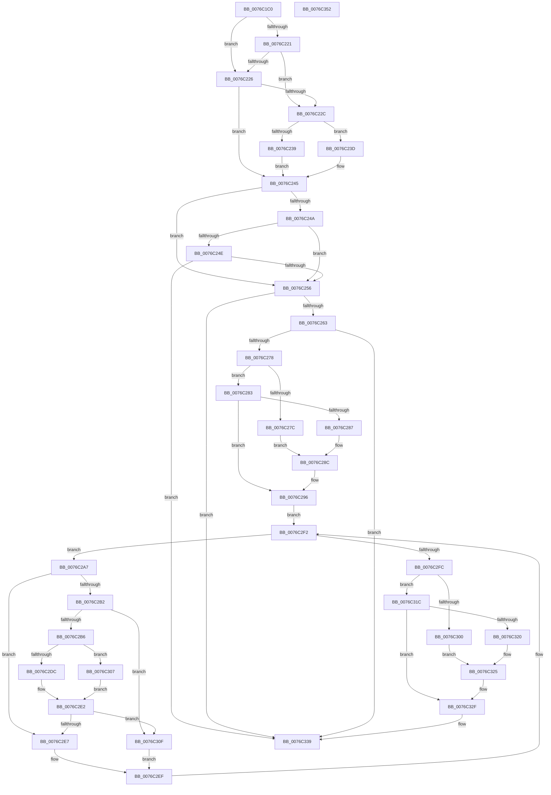

# PopDripsWatchdogCallbackHandler

- RVA: `0x0076C1C0`–`0x0076C353` (길이 `403` bytes)
- VA: `0x000000014076C1C0`
- 실행 섹션: `PAGE`
- PDB 이름 있음: `예`; PDB Function 태그: `아니요`
- unwind 정보 RVA: `0x00084C9C`
- 디코드: `116`개 명령, `403/403` bytes 표시
- 미해석 바이트: `0` (있으면 어셈블리에 `.byte`로 보존)

> 이 문서는 커널 이미지의 기계어와 PDB 기호를 분석해 생성했습니다. 4번과 5번은 함수 원형과 자료형을 바이너리 사용 방식에서 추정한 C 해석이며 원본 소스 복구 결과는 아닙니다.

## 1. Dependencies

- 직접 호출 지점: **9**; 고유 호출 대상: **8**
- 직접 호출자로 확인된 함수: **1**
- RIP 상대 이미지 참조: **3**

### Outgoing calls
- `0x0076C256` → [PopDeviceConstraintsEnforced](../../text/4C/PopDeviceConstraintsEnforced_function_004CF710.md) (function, `0x004CF710`)
- `0x0076C26B` → [PopFxBuildDripsBlockingDeviceList](../../text/49/PopFxBuildDripsBlockingDeviceList_function_0049B5B0.md) (function, `0x0049B5B0`)
- `0x0076C291` → [PopDirectedDripsNotify](../A8/PopDirectedDripsNotify_function_00A80850.md) (function, `0x00A80850`)
- `0x0076C2B9` → [PopDripsWatchdogGetDeviceActiveTime](../../text/4D/PopDripsWatchdogGetDeviceActiveTime_function_004D2D34.md) (function, `0x004D2D34`)
- `0x0076C2D3` → [PopFxIsDirectedPowerTransitionSupported](../../text/5D/PopFxIsDirectedPowerTransitionSupported_function_005D2DD8.md) (function, `0x005D2DD8`)
- `0x0076C2EA` → [PopDirectedDripsMarkCandidateDevice](../70/PopDirectedDripsMarkCandidateDevice_function_00705BB4.md) (function, `0x00705BB4`)
- `0x0076C315` → [PopDripsWatchdogInvokeDeviceCallbacks](../AA/PopDripsWatchdogInvokeDeviceCallbacks_function_00AA34A0.md) (function, `0x00AA34A0`)
- `0x0076C32A` → [PopDirectedDripsNotify](../A8/PopDirectedDripsNotify_function_00A80850.md) (function, `0x00A80850`)
- `0x0076C334` → [PopFxDestroyDripsBlockingDeviceList](../75/PopFxDestroyDripsBlockingDeviceList_function_00758DEC.md) (function, `0x00758DEC`)

### Direct callers
- [PopDripsWatchdogCallbackWorker](PopDripsWatchdogCallbackWorker_function_0076C360.md) at `0x0076C4E5`

### Static image references
- `0x0076C204` → RVA `0x00FC50A4` (`ALMOSTRO`; read)
- `0x0076C231` → RVA `0x00E27DD8` (`.data`; reference)
- `0x0076C307` → RVA `0x00E0B3E0` (`.data`; read)

## 2. Other-region calls and transfers

- 다른 실행 섹션으로 향하는 call: **4**
  - `0x0076C256` → [PopDeviceConstraintsEnforced](../../text/4C/PopDeviceConstraintsEnforced_function_004CF710.md) (`PAGE` → `.text`)
  - `0x0076C26B` → [PopFxBuildDripsBlockingDeviceList](../../text/49/PopFxBuildDripsBlockingDeviceList_function_0049B5B0.md) (`PAGE` → `.text`)
  - `0x0076C2B9` → [PopDripsWatchdogGetDeviceActiveTime](../../text/4D/PopDripsWatchdogGetDeviceActiveTime_function_004D2D34.md) (`PAGE` → `.text`)
  - `0x0076C2D3` → [PopFxIsDirectedPowerTransitionSupported](../../text/5D/PopFxIsDirectedPowerTransitionSupported_function_005D2DD8.md) (`PAGE` → `.text`)
- 별도 외부 분기/꼬리 이동을 확인하지 못했습니다.

## 3. Assembly (complete function range)

```asm
0076C1C0  48 8B C4                        mov rax, rsp
0076C1C3  48 89 58 08                     mov qword ptr [rax + 8], rbx
0076C1C7  48 89 68 10                     mov qword ptr [rax + 0x10], rbp
0076C1CB  48 89 70 18                     mov qword ptr [rax + 0x18], rsi
0076C1CF  57                              push rdi
0076C1D0  41 56                           push r14
0076C1D2  41 57                           push r15
0076C1D4  48 83 EC 30                     sub rsp, 0x30
0076C1D8  44 8B F2                        mov r14d, edx
0076C1DB  0F 57 C0                        xorps xmm0, xmm0
0076C1DE  0F 11 40 D8                     movups xmmword ptr [rax - 0x28], xmm0
0076C1E2  48 8B 44 24 70                  mov rax, qword ptr [rsp + 0x70]
0076C1E7  49 BF BD 42 7A E5 D5 94 BF D6   movabs r15, 0xd6bf94d5e57a42bd
0076C1F1  48 89 44 24 70                  mov qword ptr [rsp + 0x70], rax
0076C1F6  8B E9                           mov ebp, ecx
0076C1F8  49 8B C7                        mov rax, r15
0076C1FB  81 E5 00 01 00 00               and ebp, 0x100
0076C201  49 F7 E1                        mul r9
0076C204  8B 05 9A 8E 85 00               mov eax, dword ptr [rip + 0x858e9a]
0076C20A  44 8B C9                        mov r9d, ecx
0076C20D  48 C1 EA 17                     shr rdx, 0x17
0076C211  41 81 E1 80 00 00 00            and r9d, 0x80
0076C218  32 DB                           xor bl, bl
0076C21A  49 8B F8                        mov rdi, r8
0076C21D  85 C0                           test eax, eax
0076C21F  74 05                           je 0x14076c226
0076C221  48 3B D0                        cmp rdx, rax
0076C224  73 06                           jae 0x14076c22c
0076C226  38 5C 24 78                     cmp byte ptr [rsp + 0x78], bl
0076C22A  74 19                           je 0x14076c245
0076C22C  BA 01 00 00 00                  mov edx, 1
0076C231  84 15 A1 BB 6B 00               test byte ptr [rip + 0x6bbba1], dl
0076C237  75 04                           jne 0x14076c23d
0076C239  8A DA                           mov bl, dl
0076C23B  EB 08                           jmp 0x14076c245
0076C23D  84 CA                           test dl, cl
0076C23F  0F B6 DB                        movzx ebx, bl
0076C242  0F 45 DA                        cmovne ebx, edx
0076C245  45 85 C9                        test r9d, r9d
0076C248  75 0C                           jne 0x14076c256
0076C24A  85 ED                           test ebp, ebp
0076C24C  75 08                           jne 0x14076c256
0076C24E  84 DB                           test bl, bl
0076C250  0F 84 E3 00 00 00               je 0x14076c339
0076C256  E8 B5 34 D6 FF                  call 0x1404cf710
0076C25B  84 C0                           test al, al
0076C25D  0F 84 D6 00 00 00               je 0x14076c339
0076C263  48 8D 54 24 20                  lea rdx, [rsp + 0x20]
0076C268  48 8B CF                        mov rcx, rdi
0076C26B  E8 40 F3 D2 FF                  call 0x14049b5b0
0076C270  85 C0                           test eax, eax
0076C272  0F 88 C1 00 00 00               js 0x14076c339
0076C278  84 DB                           test bl, bl
0076C27A  74 07                           je 0x14076c283
0076C27C  B9 04 00 00 00                  mov ecx, 4
0076C281  EB 09                           jmp 0x14076c28c
0076C283  85 ED                           test ebp, ebp
0076C285  74 0F                           je 0x14076c296
0076C287  B9 02 00 00 00                  mov ecx, 2
0076C28C  48 8D 54 24 70                  lea rdx, [rsp + 0x70]
0076C291  E8 BA 45 31 00                  call 0x140a80850
0076C296  48 A1 08 00 00 00 80 F7 FF FF   movabs rax, qword ptr [0xfffff78000000008]
0076C2A0  48 8B 7C 24 20                  mov rdi, qword ptr [rsp + 0x20]
0076C2A5  EB 4B                           jmp 0x14076c2f2
0076C2A7  48 8D B7 70 FC FF FF            lea rsi, [rdi - 0x390]
0076C2AE  84 DB                           test bl, bl
0076C2B0  75 35                           jne 0x14076c2e7
0076C2B2  85 ED                           test ebp, ebp
0076C2B4  74 59                           je 0x14076c30f
0076C2B6  48 8B CE                        mov rcx, rsi
0076C2B9  E8 76 6A D6 FF                  call 0x1404d2d34
0076C2BE  48 8B C8                        mov rcx, rax
0076C2C1  49 8B C7                        mov rax, r15
0076C2C4  48 F7 E1                        mul rcx
0076C2C7  48 8B CE                        mov rcx, rsi
0076C2CA  4C 8B D2                        mov r10, rdx
0076C2CD  33 D2                           xor edx, edx
0076C2CF  49 C1 EA 17                     shr r10, 0x17
0076C2D3  E8 00 6B E6 FF                  call 0x1405d2dd8
0076C2D8  84 C0                           test al, al
0076C2DA  74 2B                           je 0x14076c307
0076C2DC  8B 86 BC 03 00 00               mov eax, dword ptr [rsi + 0x3bc]
0076C2E2  4C 3B D0                        cmp r10, rax
0076C2E5  72 28                           jb 0x14076c30f
0076C2E7  48 8B CE                        mov rcx, rsi
0076C2EA  E8 C5 98 F9 FF                  call 0x140705bb4
0076C2EF  48 8B 3F                        mov rdi, qword ptr [rdi]
0076C2F2  48 8D 44 24 20                  lea rax, [rsp + 0x20]
0076C2F7  48 3B F8                        cmp rdi, rax
0076C2FA  75 AB                           jne 0x14076c2a7
0076C2FC  84 DB                           test bl, bl
0076C2FE  74 1C                           je 0x14076c31c
0076C300  B9 05 00 00 00                  mov ecx, 5
0076C305  EB 1E                           jmp 0x14076c325
0076C307  8B 05 D3 F0 69 00               mov eax, dword ptr [rip + 0x69f0d3]
0076C30D  EB D3                           jmp 0x14076c2e2
0076C30F  41 8B D6                        mov edx, r14d
0076C312  48 8B CE                        mov rcx, rsi
0076C315  E8 86 71 33 00                  call 0x140aa34a0
0076C31A  EB D3                           jmp 0x14076c2ef
0076C31C  85 ED                           test ebp, ebp
0076C31E  74 0F                           je 0x14076c32f
0076C320  B9 03 00 00 00                  mov ecx, 3
0076C325  48 8D 54 24 70                  lea rdx, [rsp + 0x70]
0076C32A  E8 21 45 31 00                  call 0x140a80850
0076C32F  48 8D 4C 24 20                  lea rcx, [rsp + 0x20]
0076C334  E8 B3 CA FE FF                  call 0x140758dec
0076C339  48 8B 5C 24 50                  mov rbx, qword ptr [rsp + 0x50]
0076C33E  48 8B 6C 24 58                  mov rbp, qword ptr [rsp + 0x58]
0076C343  48 8B 74 24 60                  mov rsi, qword ptr [rsp + 0x60]
0076C348  48 83 C4 30                     add rsp, 0x30
0076C34C  41 5F                           pop r15
0076C34E  41 5E                           pop r14
0076C350  5F                              pop rdi
0076C351  C3                              ret
0076C352  CC                              int3
```

## 4. C-style interpretation (structured pseudocode)

```c
__int64 __fastcall PopDripsWatchdogCallbackHandler(int a1, __int64 a2, __int64 a3, __int64 a4, __int64 a5, unsigned __int8 a6)
{
    __int64 result;
    __int64 v_r10;
    __int64 v_rbp;
    __int64 v_rbx;
    __int64 v_rsp;
    unsigned __int64 v_stack_m28;
    unsigned __int64 v_stack_p10;
    unsigned __int64 v_stack_p18;
    unsigned __int64 v_stack_p28;
    unsigned __int64 v_stack_p8;

    *(unsigned __int64 *)(v_rsp + 8) = v_rbx;
    *(unsigned __int64 *)(v_rsp + 16) = v_rbp;
    *(unsigned __int64 *)(v_rsp + 24) = v_rsi;
    v_rsp = (v_rsp) - (48);
    *(unsigned __int64 *)(v_rsp - 40) = v_xmm0;
    v_stack_p28 = a5;
    v_rbp = (unsigned int)(((unsigned int)(a1)) & (256));
    a2 = (a2) >> (23);
    a4 = (unsigned int)(((unsigned int)(a1)) & (128));
    v_rbx = 0;
    if ((unsigned int)((unsigned int)(*(unsigned int *)(v_rip + 8752794))) == 0) goto loc_0076C226;
    if (a2 >= ((unsigned int)(*(unsigned int *)(v_rip + 8752794)))) goto loc_0076C22C;
loc_0076C226:
    if (a6 == 0) goto loc_0076C245;
loc_0076C22C:
    if (((*(unsigned __int8 *)(v_rip + 7060385)) & (1)) != 0) goto loc_0076C23D;
    goto loc_0076C245;
loc_0076C23D:
    v_rbx = 1;
    if (((1) & ((unsigned __int8)(a1))) != 0) { v_rbx = 1; }
loc_0076C245:
    if ((unsigned int)(a4) != 0) goto loc_0076C256;
    if ((unsigned int)(v_rbp) != 0) goto loc_0076C256;
    if ((unsigned __int8)(v_rbx) == 0) goto loc_0076C339;
loc_0076C256:
    result = PopDeviceConstraintsEnforced(a1, 1, a3, a4);
    if ((unsigned __int8)(result) == 0) goto loc_0076C339;
    result = PopFxBuildDripsBlockingDeviceList(a3, v_stack_m28, a3, a4);
    if (sign_flag) goto loc_0076C339;
    if ((unsigned __int8)(v_rbx) == 0) goto loc_0076C283;
    goto loc_0076C28C;
loc_0076C283:
    if ((unsigned int)(v_rbp) == 0) goto loc_0076C296;
loc_0076C28C:
    result = PopDirectedDripsNotify(2, a5, a3, a4);
loc_0076C296:
    goto loc_0076C2F2;
loc_0076C2A7:
    if ((unsigned __int8)(v_rbx) != 0) goto loc_0076C2E7;
    if ((unsigned int)(v_rbp) == 0) goto loc_0076C30F;
    result = PopDripsWatchdogGetDeviceActiveTime(v_stack_m28 - 912, a5, a3, a4);
    a2 = 0;
    v_r10 = (a5) >> (23);
    result = PopFxIsDirectedPowerTransitionSupported(v_stack_m28 - 912, a2, a3, a4);
    if ((unsigned __int8)(result) == 0) goto loc_0076C307;
loc_0076C2E2:
    if (v_r10 < ((unsigned int)(*(unsigned int *)(v_stack_m28 - 912 + 956)))) goto loc_0076C30F;
loc_0076C2E7:
    result = PopDirectedDripsMarkCandidateDevice(v_stack_m28 - 912, a2, a3, a4);
loc_0076C2EF:
loc_0076C2F2:
    if ((*(unsigned __int64 *)(v_stack_m28)) != v_stack_m28) goto loc_0076C2A7;
    if ((unsigned __int8)(v_rbx) == 0) goto loc_0076C31C;
    goto loc_0076C325;
loc_0076C307:
    goto loc_0076C2E2;
loc_0076C30F:
    result = PopDripsWatchdogInvokeDeviceCallbacks(v_stack_m28 - 912, (unsigned int)((unsigned int)((unsigned int)((unsigned int)(a2)))), a3, a4);
    goto loc_0076C2EF;
loc_0076C31C:
    if ((unsigned int)(v_rbp) == 0) goto loc_0076C32F;
loc_0076C325:
    result = PopDirectedDripsNotify(3, a5, a3, a4);
loc_0076C32F:
    result = PopFxDestroyDripsBlockingDeviceList(v_stack_m28, a5, a3, a4);
loc_0076C339:
    v_rsp = (v_rsp) + (48);
    return result;
}
```

## 5. (Beta) C Style

```c
int64_t PopDripsWatchdogCallbackHandler(int32_t Arg1, int64_t Arg2, int64_t Arg3, int64_t Arg4, int64_t Arg5, uint8_t Arg6)
{
    int64_t result;
    int64_t local_r10;
    int64_t local_rbp;
    int64_t local_rbx;
    int64_t local_rsp;
    uint64_t v_stack_m28;
    uint64_t v_stack_p10;
    uint64_t v_stack_p18;
    uint64_t v_stack_p28;
    uint64_t v_stack_p8;

    *(uint64_t *)(local_rsp + 0x8) = local_rbx;
    *(uint64_t *)(local_rsp + 0x10) = local_rbp;
    *(uint64_t *)(local_rsp + 0x18) = local_rsi;
    local_rsp = (local_rsp) - (48);
    *(uint64_t *)(local_rsp - 0x28) = v_xmm0;
    v_stack_p28 = Arg5;
    local_rbp = (uint32_t)(((uint32_t)(Arg1)) & (256));
    Arg2 = (Arg2) >> (23);
    Arg4 = (uint32_t)(((uint32_t)(Arg1)) & (128));
    local_rbx = 0;
    if ((uint32_t)((uint32_t)(*(uint32_t *)(v_rip + 0x858E9A))) == 0) goto loc_0076C226;
    if (Arg2 >= ((uint32_t)(*(uint32_t *)(v_rip + 0x858E9A)))) goto loc_0076C22C;
loc_0076C226:
    if (Arg6 == 0) goto loc_0076C245;
loc_0076C22C:
    if (((*(uint8_t *)(v_rip + 0x6BBBA1)) & (1)) != 0) goto loc_0076C23D;
    goto loc_0076C245;
loc_0076C23D:
    local_rbx = 1;
    if (((1) & ((uint8_t)(Arg1))) != 0) { local_rbx = 1; }
loc_0076C245:
    if ((uint32_t)(Arg4) != 0) goto loc_0076C256;
    if ((uint32_t)(local_rbp) != 0) goto loc_0076C256;
    if ((uint8_t)(local_rbx) == 0) goto loc_0076C339;
loc_0076C256:
    result = PopDeviceConstraintsEnforced(Arg1, 1, Arg3, Arg4);
    if ((uint8_t)(result) == 0) goto loc_0076C339;
    result = PopFxBuildDripsBlockingDeviceList(Arg3, v_stack_m28, Arg3, Arg4);
    if (sign_flag) goto loc_0076C339;
    if ((uint8_t)(local_rbx) == 0) goto loc_0076C283;
    goto loc_0076C28C;
loc_0076C283:
    if ((uint32_t)(local_rbp) == 0) goto loc_0076C296;
loc_0076C28C:
    result = PopDirectedDripsNotify(2, Arg5, Arg3, Arg4);
loc_0076C296:
    goto loc_0076C2F2;
loc_0076C2A7:
    if ((uint8_t)(local_rbx) != 0) goto loc_0076C2E7;
    if ((uint32_t)(local_rbp) == 0) goto loc_0076C30F;
    result = PopDripsWatchdogGetDeviceActiveTime(v_stack_m28 - 912, Arg5, Arg3, Arg4);
    Arg2 = 0;
    local_r10 = (Arg5) >> (23);
    result = PopFxIsDirectedPowerTransitionSupported(v_stack_m28 - 912, Arg2, Arg3, Arg4);
    if ((uint8_t)(result) == 0) goto loc_0076C307;
loc_0076C2E2:
    if (local_r10 < ((uint32_t)(*(uint32_t *)(v_stack_m28 - 0x390 + 0x3BC)))) goto loc_0076C30F;
loc_0076C2E7:
    result = PopDirectedDripsMarkCandidateDevice(v_stack_m28 - 912, Arg2, Arg3, Arg4);
loc_0076C2EF:
loc_0076C2F2:
    if ((*(uint64_t *)(v_stack_m28)) != v_stack_m28) goto loc_0076C2A7;
    if ((uint8_t)(local_rbx) == 0) goto loc_0076C31C;
    goto loc_0076C325;
loc_0076C307:
    goto loc_0076C2E2;
loc_0076C30F:
    result = PopDripsWatchdogInvokeDeviceCallbacks(v_stack_m28 - 912, (uint32_t)((uint32_t)((uint32_t)((uint32_t)(Arg2)))), Arg3, Arg4);
    goto loc_0076C2EF;
loc_0076C31C:
    if ((uint32_t)(local_rbp) == 0) goto loc_0076C32F;
loc_0076C325:
    result = PopDirectedDripsNotify(3, Arg5, Arg3, Arg4);
loc_0076C32F:
    result = PopFxDestroyDripsBlockingDeviceList(v_stack_m28, Arg5, Arg3, Arg4);
loc_0076C339:
    local_rsp = (local_rsp) + (48);
    return result;
}
```

## 6. Execution-region graph

[열기: 2D/3D 그래프와 함수 탐색 컨트롤 패널](../../../control-panel.html?section=page&rva=0x0076C1C0&view=graph)

- 2D 그래프는 위에서 아래로 흐르고, 3D 그래프는 빈 공간을 드래그해 회전합니다. Shift+드래그는 이동, 휠은 확대·축소, 함수 노드 선택은 대상 보고서 이동입니다.

### Static fallback


