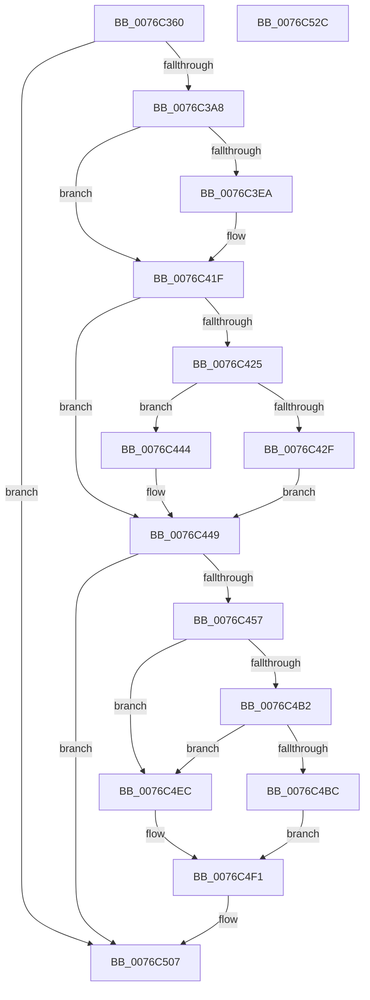

# PopDripsWatchdogCallbackWorker

- RVA: `0x0076C360`–`0x0076C52D` (길이 `461` bytes)
- VA: `0x000000014076C360`
- 실행 섹션: `PAGE`
- PDB 이름 있음: `예`; PDB Function 태그: `아니요`
- unwind 정보 RVA: `0x000A11A4`
- 디코드: `106`개 명령, `461/461` bytes 표시
- 미해석 바이트: `0` (있으면 어셈블리에 `.byte`로 보존)

> 이 문서는 커널 이미지의 기계어와 PDB 기호를 분석해 생성했습니다. 4번과 5번은 함수 원형과 자료형을 바이너리 사용 방식에서 추정한 C 해석이며 원본 소스 복구 결과는 아닙니다.

## 1. Dependencies

- 직접 호출 지점: **15**; 고유 호출 대상: **11**
- 직접 호출자로 확인된 함수: **0**
- RIP 상대 이미지 참조: **2**

### Outgoing calls
- `0x0076C384` → [PiDmObjectManagerAcquireExclusiveLock](../95/PiDmObjectManagerAcquireExclusiveLock_function_00951334.md) (function, `0x00951334`)
- `0x0076C397` → [PopOkayToQueueNextWorkItem](../../text/4A/PopOkayToQueueNextWorkItem_function_004AED54.md) (function, `0x004AED54`)
- `0x0076C3B8` → [PopDripsWatchdogScheduleNextTimer](../70/PopDripsWatchdogScheduleNextTimer_function_00705880.md) (function, `0x00705880`)
- `0x0076C3D0` → [PopCalculateIdleInformation](../../text/43/PopCalculateIdleInformation_function_0043ADEC.md) (function, `0x0043ADEC`)
- `0x0076C42F` → [PopDirectedDripsSetDisengageReason](../../text/47/PopDirectedDripsSetDisengageReason_function_00478D60.md) (function, `0x00478D60`)
- `0x0076C444` → [PopDirectedDripsClearDisengageReason](../../text/47/PopDirectedDripsClearDisengageReason_function_00477EA4.md) (function, `0x00477EA4`)
- `0x0076C49E` → [ExReleaseResourceLite](../../text/25/ExReleaseResourceLite_function_0025FA10.md) (function, `0x0025FA10`)
- `0x0076C4A3` → [KeLeaveCriticalRegion](../../text/25/KeLeaveCriticalRegion_function_0025D8B0.md) (function, `0x0025D8B0`)
- `0x0076C4A8` → [PopAcquirePolicyLock](../../pagelk/B7/PopAcquirePolicyLock_function_00B783C0.md) (function, `0x00B783C0`)
- `0x0076C4BC` → [PopReleasePolicyLock](../../pagelk/B7/PopReleasePolicyLock_function_00B78410.md) (function, `0x00B78410`)
- `0x0076C4E5` → [PopDripsWatchdogCallbackHandler](PopDripsWatchdogCallbackHandler_function_0076C1C0.md) (function, `0x0076C1C0`)
- `0x0076C4EC` → [PopReleasePolicyLock](../../pagelk/B7/PopReleasePolicyLock_function_00B78410.md) (function, `0x00B78410`)
- `0x0076C4F4` → [PiDmObjectManagerAcquireExclusiveLock](../95/PiDmObjectManagerAcquireExclusiveLock_function_00951334.md) (function, `0x00951334`)
- `0x0076C50A` → [ExReleaseResourceLite](../../text/25/ExReleaseResourceLite_function_0025FA10.md) (function, `0x0025FA10`)
- `0x0076C50F` → [KeLeaveCriticalRegion](../../text/25/KeLeaveCriticalRegion_function_0025D8B0.md) (function, `0x0025D8B0`)

### Direct callers
- 이 함수 시작 RVA로 연결되는 직접 call은 확인되지 않았습니다. 간접 호출은 완전히 역산할 수 없습니다.

### Static image references
- `0x0076C3EF` → RVA `0x00F07E90` (`.data`; read)
- `0x0076C4B2` → RVA `0x00E27D50` (`.data`; read)

## 2. Other-region calls and transfers

- 다른 실행 섹션으로 향하는 call: **11**
  - `0x0076C397` → [PopOkayToQueueNextWorkItem](../../text/4A/PopOkayToQueueNextWorkItem_function_004AED54.md) (`PAGE` → `.text`)
  - `0x0076C3D0` → [PopCalculateIdleInformation](../../text/43/PopCalculateIdleInformation_function_0043ADEC.md) (`PAGE` → `.text`)
  - `0x0076C42F` → [PopDirectedDripsSetDisengageReason](../../text/47/PopDirectedDripsSetDisengageReason_function_00478D60.md) (`PAGE` → `.text`)
  - `0x0076C444` → [PopDirectedDripsClearDisengageReason](../../text/47/PopDirectedDripsClearDisengageReason_function_00477EA4.md) (`PAGE` → `.text`)
  - `0x0076C49E` → [ExReleaseResourceLite](../../text/25/ExReleaseResourceLite_function_0025FA10.md) (`PAGE` → `.text`)
  - `0x0076C4A3` → [KeLeaveCriticalRegion](../../text/25/KeLeaveCriticalRegion_function_0025D8B0.md) (`PAGE` → `.text`)
  - `0x0076C4A8` → [PopAcquirePolicyLock](../../pagelk/B7/PopAcquirePolicyLock_function_00B783C0.md) (`PAGE` → `PAGELK`)
  - `0x0076C4BC` → [PopReleasePolicyLock](../../pagelk/B7/PopReleasePolicyLock_function_00B78410.md) (`PAGE` → `PAGELK`)
  - `0x0076C4EC` → [PopReleasePolicyLock](../../pagelk/B7/PopReleasePolicyLock_function_00B78410.md) (`PAGE` → `PAGELK`)
  - `0x0076C50A` → [ExReleaseResourceLite](../../text/25/ExReleaseResourceLite_function_0025FA10.md) (`PAGE` → `.text`)
  - `0x0076C50F` → [KeLeaveCriticalRegion](../../text/25/KeLeaveCriticalRegion_function_0025D8B0.md) (`PAGE` → `.text`)
- 별도 외부 분기/꼬리 이동을 확인하지 못했습니다.

## 3. Assembly (complete function range)

```asm
0076C360  48 89 5C 24 18                  mov qword ptr [rsp + 0x18], rbx
0076C365  55                              push rbp
0076C366  56                              push rsi
0076C367  57                              push rdi
0076C368  41 54                           push r12
0076C36A  41 55                           push r13
0076C36C  41 56                           push r14
0076C36E  41 57                           push r15
0076C370  48 83 EC 50                     sub rsp, 0x50
0076C374  0F 57 C0                        xorps xmm0, xmm0
0076C377  48 8B D9                        mov rbx, rcx
0076C37A  0F 11 44 24 30                  movups xmmword ptr [rsp + 0x30], xmm0
0076C37F  0F 11 44 24 40                  movups xmmword ptr [rsp + 0x40], xmm0
0076C384  E8 AB 4F 1E 00                  call 0x140951334
0076C389  83 A3 24 01 00 00 FD            and dword ptr [rbx + 0x124], 0xfffffffd
0076C390  48 8D 8B F8 00 00 00            lea rcx, [rbx + 0xf8]
0076C397  E8 B8 29 D4 FF                  call 0x1404aed54
0076C39C  8B 53 68                        mov edx, dword ptr [rbx + 0x68]
0076C39F  F6 C2 04                        test dl, 4
0076C3A2  0F 84 5F 01 00 00               je 0x14076c507
0076C3A8  FF 83 80 02 00 00               inc dword ptr [rbx + 0x280]
0076C3AE  48 8D 4B 70                     lea rcx, [rbx + 0x70]
0076C3B2  FF 83 34 01 00 00               inc dword ptr [rbx + 0x134]
0076C3B8  E8 C3 94 F9 FF                  call 0x140705880
0076C3BD  48 BD 08 00 00 00 80 F7 FF FF   movabs rbp, 0xfffff78000000008
0076C3C7  48 8D 4C 24 30                  lea rcx, [rsp + 0x30]
0076C3CC  48 8B 6D 00                     mov rbp, qword ptr [rbp]
0076C3D0  E8 17 EA CC FF                  call 0x14043adec
0076C3D5  44 8B 7C 24 48                  mov r15d, dword ptr [rsp + 0x48]
0076C3DA  48 8D B3 38 01 00 00            lea rsi, [rbx + 0x138]
0076C3E1  44 2B BB 70 01 00 00            sub r15d, dword ptr [rbx + 0x170]
0076C3E8  74 35                           je 0x14076c41f
0076C3EA  0F 10 44 24 30                  movups xmm0, xmmword ptr [rsp + 0x30]
0076C3EF  8B 05 9B BA 79 00               mov eax, dword ptr [rip + 0x79ba9b]
0076C3F5  0F 10 4C 24 40                  movups xmm1, xmmword ptr [rsp + 0x40]
0076C3FA  83 A3 34 01 00 00 00            and dword ptr [rbx + 0x134], 0
0076C401  0F 11 83 58 01 00 00            movups xmmword ptr [rbx + 0x158], xmm0
0076C408  48 89 AB 48 01 00 00            mov qword ptr [rbx + 0x148], rbp
0076C40F  0F 11 8B 68 01 00 00            movups xmmword ptr [rbx + 0x168], xmm1
0076C416  89 06                           mov dword ptr [rsi], eax
0076C418  48 89 AB 40 01 00 00            mov qword ptr [rbx + 0x140], rbp
0076C41F  8B 06                           mov eax, dword ptr [rsi]
0076C421  85 C0                           test eax, eax
0076C423  74 24                           je 0x14076c449
0076C425  33 C9                           xor ecx, ecx
0076C427  39 83 34 01 00 00               cmp dword ptr [rbx + 0x134], eax
0076C42D  72 15                           jb 0x14076c444
0076C42F  E8 2C C9 D0 FF                  call 0x140478d60
0076C434  8B 8B 34 01 00 00               mov ecx, dword ptr [rbx + 0x134]
0076C43A  03 0D 50 BA 79 00               add ecx, dword ptr [rip + 0x79ba50]
0076C440  89 0E                           mov dword ptr [rsi], ecx
0076C442  EB 05                           jmp 0x14076c449
0076C444  E8 5B BA D0 FF                  call 0x140477ea4
0076C449  8B 83 24 01 00 00               mov eax, dword ptr [rbx + 0x124]
0076C44F  A8 04                           test al, 4
0076C451  0F 85 B0 00 00 00               jne 0x14076c507
0076C457  48 8B 8B 88 02 00 00            mov rcx, qword ptr [rbx + 0x288]
0076C45E  83 C8 04                        or eax, 4
0076C461  44 8B 63 6C                     mov r12d, dword ptr [rbx + 0x6c]
0076C465  48 8B F5                        mov rsi, rbp
0076C468  44 8B AB 30 01 00 00            mov r13d, dword ptr [rbx + 0x130]
0076C46F  4C 8B F5                        mov r14, rbp
0076C472  48 2B B3 40 01 00 00            sub rsi, qword ptr [rbx + 0x140]
0076C479  4C 2B B3 48 01 00 00            sub r14, qword ptr [rbx + 0x148]
0076C480  48 89 8C 24 98 00 00 00         mov qword ptr [rsp + 0x98], rcx
0076C488  8A 8B 50 01 00 00               mov cl, byte ptr [rbx + 0x150]
0076C48E  88 8C 24 90 00 00 00            mov byte ptr [rsp + 0x90], cl
0076C495  48 8B CB                        mov rcx, rbx
0076C498  89 83 24 01 00 00               mov dword ptr [rbx + 0x124], eax
0076C49E  E8 6D 35 AF FF                  call 0x14025fa10
0076C4A3  E8 08 14 AF FF                  call 0x14025d8b0
0076C4A8  E8 13 BF 40 00                  call 0x140b783c0
0076C4AD  45 85 FF                        test r15d, r15d
0076C4B0  75 3A                           jne 0x14076c4ec
0076C4B2  48 83 3D 96 B8 6B 00 00         cmp qword ptr [rip + 0x6bb896], 0
0076C4BA  75 30                           jne 0x14076c4ec
0076C4BC  E8 4F BF 40 00                  call 0x140b78410
0076C4C1  8A 84 24 90 00 00 00            mov al, byte ptr [rsp + 0x90]
0076C4C8  4D 8B CE                        mov r9, r14
0076C4CB  88 44 24 28                     mov byte ptr [rsp + 0x28], al
0076C4CF  4C 8B C6                        mov r8, rsi
0076C4D2  48 8B 84 24 98 00 00 00         mov rax, qword ptr [rsp + 0x98]
0076C4DA  41 8B D5                        mov edx, r13d
0076C4DD  41 8B CC                        mov ecx, r12d
0076C4E0  48 89 44 24 20                  mov qword ptr [rsp + 0x20], rax
0076C4E5  E8 D6 FC FF FF                  call 0x14076c1c0
0076C4EA  EB 05                           jmp 0x14076c4f1
0076C4EC  E8 1F BF 40 00                  call 0x140b78410
0076C4F1  48 8B CB                        mov rcx, rbx
0076C4F4  E8 3B 4E 1E 00                  call 0x140951334
0076C4F9  48 89 AB 40 01 00 00            mov qword ptr [rbx + 0x140], rbp
0076C500  83 A3 24 01 00 00 FB            and dword ptr [rbx + 0x124], 0xfffffffb
0076C507  48 8B CB                        mov rcx, rbx
0076C50A  E8 01 35 AF FF                  call 0x14025fa10
0076C50F  E8 9C 13 AF FF                  call 0x14025d8b0
0076C514  48 8B 9C 24 A0 00 00 00         mov rbx, qword ptr [rsp + 0xa0]
0076C51C  48 83 C4 50                     add rsp, 0x50
0076C520  41 5F                           pop r15
0076C522  41 5E                           pop r14
0076C524  41 5D                           pop r13
0076C526  41 5C                           pop r12
0076C528  5F                              pop rdi
0076C529  5E                              pop rsi
0076C52A  5D                              pop rbp
0076C52B  C3                              ret
0076C52C  CC                              int3
```

## 4. C-style interpretation (structured pseudocode)

```c
__int64 __fastcall PopDripsWatchdogCallbackWorker(__int64 a1)
{
    __int64 result;
    __int64 v_r14;
    __int64 v_r15;
    __int64 v_rsi;
    __int64 v_rsp;
    unsigned int v_stack_m40;
    unsigned __int64 v_stack_m48;
    unsigned __int64 v_stack_m58;
    unsigned __int8 v_stack_m60;
    unsigned __int64 v_stack_m68;
    unsigned __int64 v_stack_p10;
    unsigned __int64 v_stack_p18;
    unsigned __int8 v_stack_p8;

    v_stack_p18 = v_rbx;
    v_rsp = (v_rsp) - (80);
    v_stack_m58 = v_xmm0;
    v_stack_m48 = v_xmm0;
    result = PiDmObjectManagerAcquireExclusiveLock(a1, a2, a3, a4);
    result = PopOkayToQueueNextWorkItem(a1 + 248, a2, a3, a4);
    if ((((unsigned __int8)((unsigned int)(*(unsigned int *)(a1 + 104)))) & (4)) == 0) goto loc_0076C507;
    result = PopDripsWatchdogScheduleNextTimer(a1 + 112, (unsigned int)(*(unsigned int *)(a1 + 104)), a3, a4);
    result = PopCalculateIdleInformation(v_stack_m58, (unsigned int)(*(unsigned int *)(a1 + 104)), a3, a4);
    v_r15 = (unsigned int)(((unsigned int)(v_stack_m40)) - (*(unsigned int *)(a1 + 368)));
    if (!(condition_is_equal)) {
        result = *(unsigned int *)(v_rip + 7977627);
        *(unsigned __int64 *)(a1 + 344) = v_xmm0;
        *(unsigned __int64 *)(a1 + 328) = *(unsigned __int64 *)(v_rbp);
        *(unsigned __int64 *)(a1 + 360) = v_xmm1;
        *(unsigned int *)(a1 + 312) = (unsigned int)(result);
        *(unsigned __int64 *)(a1 + 320) = *(unsigned __int64 *)(v_rbp);
    }
    if ((unsigned int)((unsigned int)(*(unsigned int *)(a1 + 312))) == 0) goto loc_0076C449;
    a1 = 0;
    if ((*(unsigned int *)(a1 + 308)) < ((unsigned int)((unsigned int)(*(unsigned int *)(a1 + 312))))) goto loc_0076C444;
    result = PopDirectedDripsSetDisengageReason(a1, (unsigned int)(*(unsigned int *)(a1 + 104)), a3, a4);
    a1 = (unsigned int)(((unsigned int)(*(unsigned int *)(a1 + 308))) + (*(unsigned int *)(v_rip + 7977552)));
    *(unsigned int *)(a1 + 312) = (unsigned int)(a1);
    goto loc_0076C449;
loc_0076C444:
    result = PopDirectedDripsClearDisengageReason(a1, (unsigned int)(*(unsigned int *)(a1 + 104)), a3, a4);
loc_0076C449:
    if ((((unsigned __int8)((unsigned int)(*(unsigned int *)(a1 + 292)))) & (4)) != 0) goto loc_0076C507;
    result = (unsigned int)(((unsigned int)(*(unsigned int *)(a1 + 292))) | (4));
    v_rsi = (*(unsigned __int64 *)(v_rbp)) - (*(unsigned __int64 *)(a1 + 320));
    v_r14 = (*(unsigned __int64 *)(v_rbp)) - (*(unsigned __int64 *)(a1 + 328));
    v_stack_p10 = *(unsigned __int64 *)(a1 + 648);
    v_stack_p8 = (unsigned __int8)(*(unsigned __int8 *)(a1 + 336));
    *(unsigned int *)(a1 + 292) = (unsigned int)(result);
    result = ExReleaseResourceLite(a1, (unsigned int)(*(unsigned int *)(a1 + 104)), a3, a4);
    result = KeLeaveCriticalRegion(a1, (unsigned int)(*(unsigned int *)(a1 + 104)), a3, a4);
    result = PopAcquirePolicyLock(a1, (unsigned int)(*(unsigned int *)(a1 + 104)), a3, a4);
    if ((unsigned int)(v_r15) != 0) goto loc_0076C4EC;
    if ((*(unsigned __int64 *)(v_rip + 7059606)) != 0) goto loc_0076C4EC;
    result = PopReleasePolicyLock(a1, (unsigned int)(*(unsigned int *)(a1 + 104)), a3, a4);
    v_stack_m60 = (unsigned __int8)(v_stack_p8);
    v_stack_m68 = v_stack_p10;
    result = PopDripsWatchdogCallbackHandler((unsigned int)((unsigned int)((unsigned int)(*(unsigned int *)(a1 + 108)))), (unsigned int)((unsigned int)((unsigned int)(*(unsigned int *)(a1 + 304)))), v_rsi, v_r14);
    goto loc_0076C4F1;
loc_0076C4EC:
    result = PopReleasePolicyLock((unsigned int)((unsigned int)((unsigned int)(*(unsigned int *)(a1 + 108)))), (unsigned int)((unsigned int)((unsigned int)(*(unsigned int *)(a1 + 304)))), v_rsi, v_r14);
loc_0076C4F1:
    result = PiDmObjectManagerAcquireExclusiveLock(a1, (unsigned int)((unsigned int)((unsigned int)(*(unsigned int *)(a1 + 304)))), v_rsi, v_r14);
    *(unsigned __int64 *)(a1 + 320) = *(unsigned __int64 *)(v_rbp);
loc_0076C507:
    result = ExReleaseResourceLite(a1, (unsigned int)((unsigned int)((unsigned int)(*(unsigned int *)(a1 + 304)))), v_rsi, v_r14);
    result = KeLeaveCriticalRegion(a1, (unsigned int)((unsigned int)((unsigned int)(*(unsigned int *)(a1 + 304)))), v_rsi, v_r14);
    v_rsp = (v_rsp) + (80);
    return result;
}
```

## 5. (Beta) C Style

```c
int64_t PopDripsWatchdogCallbackWorker(void *Arg1)
{
    uint8_t *arg1 = (uint8_t *)Arg1;

    int64_t result;
    int64_t local_r14;
    int64_t local_r15;
    int64_t local_rsi;
    int64_t local_rsp;
    uint32_t v_stack_m40;
    uint64_t v_stack_m48;
    uint64_t v_stack_m58;
    uint8_t v_stack_m60;
    uint64_t v_stack_m68;
    uint64_t v_stack_p10;
    uint64_t v_stack_p18;
    uint8_t v_stack_p8;

    v_stack_p18 = local_rbx;
    local_rsp = (local_rsp) - (80);
    v_stack_m58 = v_xmm0;
    v_stack_m48 = v_xmm0;
    result = PiDmObjectManagerAcquireExclusiveLock(Arg1, a2, a3, a4);
    result = PopOkayToQueueNextWorkItem(Arg1 + 248, a2, a3, a4);
    if ((((uint8_t)((uint32_t)(*(uint32_t *)(arg1 + 0x68)))) & (4)) == 0) goto loc_0076C507;
    result = PopDripsWatchdogScheduleNextTimer(Arg1 + 112, (uint32_t)(*(uint32_t *)(arg1 + 0x68)), a3, a4);
    result = PopCalculateIdleInformation(v_stack_m58, (uint32_t)(*(uint32_t *)(arg1 + 0x68)), a3, a4);
    local_r15 = (uint32_t)(((uint32_t)(v_stack_m40)) - (*(uint32_t *)(arg1 + 0x170)));
    if (!(condition_is_equal)) {
        result = *(uint32_t *)(v_rip + 0x79BA9B);
        *(uint64_t *)(arg1 + 0x158) = v_xmm0;
        *(uint64_t *)(arg1 + 0x148) = *(uint64_t *)(local_rbp);
        *(uint64_t *)(arg1 + 0x168) = v_xmm1;
        *(uint32_t *)(arg1 + 0x138) = (uint32_t)(result);
        *(uint64_t *)(arg1 + 0x140) = *(uint64_t *)(local_rbp);
    }
    if ((uint32_t)((uint32_t)(*(uint32_t *)(arg1 + 0x138))) == 0) goto loc_0076C449;
    Arg1 = 0;
    if ((*(uint32_t *)(arg1 + 0x134)) < ((uint32_t)((uint32_t)(*(uint32_t *)(arg1 + 0x138))))) goto loc_0076C444;
    result = PopDirectedDripsSetDisengageReason(Arg1, (uint32_t)(*(uint32_t *)(arg1 + 0x68)), a3, a4);
    Arg1 = (uint32_t)(((uint32_t)(*(uint32_t *)(arg1 + 0x134))) + (*(uint32_t *)(v_rip + 0x79BA50)));
    *(uint32_t *)(arg1 + 0x138) = (uint32_t)(Arg1);
    goto loc_0076C449;
loc_0076C444:
    result = PopDirectedDripsClearDisengageReason(Arg1, (uint32_t)(*(uint32_t *)(arg1 + 0x68)), a3, a4);
loc_0076C449:
    if ((((uint8_t)((uint32_t)(*(uint32_t *)(arg1 + 0x124)))) & (4)) != 0) goto loc_0076C507;
    result = (uint32_t)(((uint32_t)(*(uint32_t *)(arg1 + 0x124))) | (4));
    local_rsi = (*(uint64_t *)(local_rbp)) - (*(uint64_t *)(arg1 + 0x140));
    local_r14 = (*(uint64_t *)(local_rbp)) - (*(uint64_t *)(arg1 + 0x148));
    v_stack_p10 = *(uint64_t *)(arg1 + 0x288);
    v_stack_p8 = (uint8_t)(*(uint8_t *)(arg1 + 0x150));
    *(uint32_t *)(arg1 + 0x124) = (uint32_t)(result);
    result = ExReleaseResourceLite(Arg1, (uint32_t)(*(uint32_t *)(arg1 + 0x68)), a3, a4);
    result = KeLeaveCriticalRegion(Arg1, (uint32_t)(*(uint32_t *)(arg1 + 0x68)), a3, a4);
    result = PopAcquirePolicyLock(Arg1, (uint32_t)(*(uint32_t *)(arg1 + 0x68)), a3, a4);
    if ((uint32_t)(local_r15) != 0) goto loc_0076C4EC;
    if ((*(uint64_t *)(v_rip + 0x6BB896)) != 0) goto loc_0076C4EC;
    result = PopReleasePolicyLock(Arg1, (uint32_t)(*(uint32_t *)(arg1 + 0x68)), a3, a4);
    v_stack_m60 = (uint8_t)(v_stack_p8);
    v_stack_m68 = v_stack_p10;
    result = PopDripsWatchdogCallbackHandler((uint32_t)((uint32_t)((uint32_t)(*(uint32_t *)(arg1 + 0x6C)))), (uint32_t)((uint32_t)((uint32_t)(*(uint32_t *)(arg1 + 0x130)))), local_rsi, local_r14);
    goto loc_0076C4F1;
loc_0076C4EC:
    result = PopReleasePolicyLock((uint32_t)((uint32_t)((uint32_t)(*(uint32_t *)(arg1 + 0x6C)))), (uint32_t)((uint32_t)((uint32_t)(*(uint32_t *)(arg1 + 0x130)))), local_rsi, local_r14);
loc_0076C4F1:
    result = PiDmObjectManagerAcquireExclusiveLock(Arg1, (uint32_t)((uint32_t)((uint32_t)(*(uint32_t *)(arg1 + 0x130)))), local_rsi, local_r14);
    *(uint64_t *)(arg1 + 0x140) = *(uint64_t *)(local_rbp);
loc_0076C507:
    result = ExReleaseResourceLite(Arg1, (uint32_t)((uint32_t)((uint32_t)(*(uint32_t *)(arg1 + 0x130)))), local_rsi, local_r14);
    result = KeLeaveCriticalRegion(Arg1, (uint32_t)((uint32_t)((uint32_t)(*(uint32_t *)(arg1 + 0x130)))), local_rsi, local_r14);
    local_rsp = (local_rsp) + (80);
    return result;
}
```

### 관측된 메모리 오프셋

구조체 형식이 확인되지 않은 접근은 인자 기준의 오프셋으로만 기록했습니다.

| 기준 인자 | 오프셋 표현 | 폭 (bit) | 접근 |
|---|---:|---:|---|
| `Arg1` | `+ 0x0` | `32` | `R` |
| `Arg1` | `+ 0x0` | `32` | `W` |
| `Arg1` | `+ 0x68` | `32` | `R` |
| `Arg1` | `+ 0x6C` | `32` | `R` |
| `Arg1` | `+ 0x70` | `64` | `R` |
| `Arg1` | `+ 0xF8` | `64` | `R` |
| `Arg1` | `+ 0x124` | `32` | `R` |
| `Arg1` | `+ 0x124` | `32` | `R/W` |
| `Arg1` | `+ 0x124` | `32` | `W` |
| `Arg1` | `+ 0x130` | `32` | `R` |
| `Arg1` | `+ 0x134` | `32` | `R` |
| `Arg1` | `+ 0x134` | `32` | `R/W` |
| `Arg1` | `+ 0x138` | `64` | `R` |
| `Arg1` | `+ 0x140` | `64` | `R` |
| `Arg1` | `+ 0x140` | `64` | `W` |
| `Arg1` | `+ 0x148` | `64` | `R` |
| `Arg1` | `+ 0x148` | `64` | `W` |
| `Arg1` | `+ 0x150` | `8` | `R` |
| `Arg1` | `+ 0x158` | `128` | `R` |
| `Arg1` | `+ 0x168` | `128` | `R` |
| `Arg1` | `+ 0x170` | `32` | `R` |
| `Arg1` | `+ 0x280` | `32` | `R/W` |
| `Arg1` | `+ 0x288` | `64` | `R` |

## 6. Execution-region graph

[열기: 2D/3D 그래프와 함수 탐색 컨트롤 패널](../../../control-panel.html?section=page&rva=0x0076C360&view=graph)

- 2D 그래프는 위에서 아래로 흐르고, 3D 그래프는 빈 공간을 드래그해 회전합니다. Shift+드래그는 이동, 휠은 확대·축소, 함수 노드 선택은 대상 보고서 이동입니다.

### Static fallback


