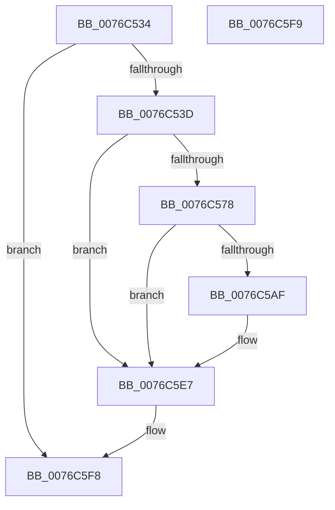

# PopDripsWatchdogCheckHwDivergence

- RVA: `0x0076C534`–`0x0076C5FA` (길이 `198` bytes)
- VA: `0x000000014076C534`
- 실행 섹션: `PAGE`
- PDB 이름 있음: `예`; PDB Function 태그: `아니요`
- unwind 정보 RVA: `0x000CD410`
- 디코드: `44`개 명령, `198/198` bytes 표시
- 미해석 바이트: `0` (있으면 어셈블리에 `.byte`로 보존)

> 이 문서는 커널 이미지의 기계어와 PDB 기호를 분석해 생성했습니다. 4번과 5번은 함수 원형과 자료형을 바이너리 사용 방식에서 추정한 C 해석이며 원본 소스 복구 결과는 아닙니다.

## 1. Dependencies

- 직접 호출 지점: **3**; 고유 호출 대상: **3**
- 직접 호출자로 확인된 함수: **1**
- RIP 상대 이미지 참조: **5**

### Outgoing calls
- `0x0076C5A1` → [ZwUpdateWnfStateData](../../text/6B/ZwUpdateWnfStateData_function_006B0D10.md) (function, `0x006B0D10`)
- `0x0076C5E2` → [DbgkWerCaptureLiveKernelDump](../AC/DbgkWerCaptureLiveKernelDump_function_00AC1E90.md) (function, `0x00AC1E90`)
- `0x0076C5EF` → [_security_check_cookie](../../text/6A/_security_check_cookie_function_006AC640.md) (function, `0x006AC640`)

### Direct callers
- [PopDripsWatchdogDiagnosticWorker](PopDripsWatchdogDiagnosticWorker_function_0076C600.md) at `0x0076C7B6`

### Static image references
- `0x0076C544` → RVA `0x00E0A740` (`.data`; read)
- `0x0076C569` → RVA `0x00FC5270` (`ALMOSTRO`; read)
- `0x0076C596` → RVA `0x00020A30` (`.rdata`; read)
- `0x0076C5A6` → RVA `0x00FC5328` (`ALMOSTRO`; read)
- `0x0076C5B4` → RVA `0x00B032E0` (` ?? ::NNGAKEGL::`string'`; read)

## 2. Other-region calls and transfers

- 다른 실행 섹션으로 향하는 call: **2**
  - `0x0076C5A1` → [ZwUpdateWnfStateData](../../text/6B/ZwUpdateWnfStateData_function_006B0D10.md) (`PAGE` → `.text`)
  - `0x0076C5EF` → [_security_check_cookie](../../text/6A/_security_check_cookie_function_006AC640.md) (`PAGE` → `.text`)
- 별도 외부 분기/꼬리 이동을 확인하지 못했습니다.

## 3. Assembly (complete function range)

```asm
0076C534  48 3B D1                        cmp rdx, rcx
0076C537  0F 86 BB 00 00 00               jbe 0x14076c5f8
0076C53D  4C 8B DC                        mov r11, rsp
0076C540  48 83 EC 78                     sub rsp, 0x78
0076C544  48 8B 05 F5 E1 69 00            mov rax, qword ptr [rip + 0x69e1f5]
0076C54B  48 33 C4                        xor rax, rsp
0076C54E  48 89 44 24 60                  mov qword ptr [rsp + 0x60], rax
0076C553  4C 8B C2                        mov r8, rdx
0076C556  4C 8B CA                        mov r9, rdx
0076C559  4C 2B C1                        sub r8, rcx
0076C55C  48 B8 DB 34 B6 D7 82 DE 1B 43   movabs rax, 0x431bde82d7b634db
0076C566  49 F7 E0                        mul r8
0076C569  8B 05 01 8D 85 00               mov eax, dword ptr [rip + 0x858d01]
0076C56F  48 C1 EA 12                     shr rdx, 0x12
0076C573  48 3B C2                        cmp rax, rdx
0076C576  73 6F                           jae 0x14076c5e7
0076C578  83 64 24 30 00                  and dword ptr [rsp + 0x30], 0
0076C57D  49 8D 53 D8                     lea rdx, [r11 - 0x28]
0076C581  83 64 24 28 00                  and dword ptr [rsp + 0x28], 0
0076C586  49 83 63 A8 00                  and qword ptr [r11 - 0x58], 0
0076C58B  4D 89 4B D8                     mov qword ptr [r11 - 0x28], r9
0076C58F  45 33 C9                        xor r9d, r9d
0076C592  49 89 4B E0                     mov qword ptr [r11 - 0x20], rcx
0076C596  48 8D 0D 93 44 8B FF            lea rcx, [rip - 0x74bb6d]
0076C59D  45 8D 41 10                     lea r8d, [r9 + 0x10]
0076C5A1  E8 6A 47 F4 FF                  call 0x1406b0d10
0076C5A6  83 3D 7B 8D 85 00 00            cmp dword ptr [rip + 0x858d7b], 0
0076C5AD  74 38                           je 0x14076c5e7
0076C5AF  83 64 24 40 00                  and dword ptr [rsp + 0x40], 0
0076C5B4  48 8D 0D 25 6D 39 00            lea rcx, [rip + 0x396d25]
0076C5BB  48 83 64 24 38 00               and qword ptr [rsp + 0x38], 0
0076C5C1  BA A4 01 00 00                  mov edx, 0x1a4
0076C5C6  48 83 64 24 30 00               and qword ptr [rsp + 0x30], 0
0076C5CC  48 83 64 24 28 00               and qword ptr [rsp + 0x28], 0
0076C5D2  48 83 64 24 20 00               and qword ptr [rsp + 0x20], 0
0076C5D8  4C 8B 4C 24 58                  mov r9, qword ptr [rsp + 0x58]
0076C5DD  4C 8B 44 24 50                  mov r8, qword ptr [rsp + 0x50]
0076C5E2  E8 A9 58 35 00                  call 0x140ac1e90
0076C5E7  48 8B 4C 24 60                  mov rcx, qword ptr [rsp + 0x60]
0076C5EC  48 33 CC                        xor rcx, rsp
0076C5EF  E8 4C 00 F4 FF                  call 0x1406ac640
0076C5F4  48 83 C4 78                     add rsp, 0x78
0076C5F8  C3                              ret
0076C5F9  CC                              int3
```

## 4. C-style interpretation (structured pseudocode)

```c
__int64 __fastcall PopDripsWatchdogCheckHwDivergence(__int64 a1, __int64 a2)
{
    __int64 result;
    __int64 v_rsp;
    unsigned __int64 v_stack_m18;
    unsigned __int64 v_stack_m20;
    unsigned __int64 v_stack_m28;
    unsigned int v_stack_m38;
    unsigned __int64 v_stack_m40;
    unsigned int v_stack_m48;
    unsigned int v_stack_m50;
    unsigned __int64 v_stack_m58;

    if (a2 <= a1) goto loc_0076C5F8;
    v_rsp = (v_rsp) - (120);
    result = (*(unsigned __int64 *)(v_rip + 6939125)) ^ (v_rsp);
    v_stack_m18 = result;
    a3 = (a2) - (a1);
    a2 = (a2) >> (18);
    if (((unsigned int)(*(unsigned int *)(v_rip + 8752385))) >= a2) goto loc_0076C5E7;
    *(unsigned __int64 *)(v_rsp - 40) = a2;
    a4 = 0;
    *(unsigned __int64 *)(v_rsp - 32) = a1;
    result = ZwUpdateWnfStateData(v_rip - 7650157, v_rsp - 40, a4 + 16, a4);
    if ((*(unsigned int *)(v_rip + 8752507)) != 0) {
        a1 = v_rip + 3763493;
        a2 = 420;
        a4 = v_stack_m20;
        a3 = v_stack_m28;
        result = DbgkWerCaptureLiveKernelDump(a1, a2, a3, a4);
    }
    a1 = (v_stack_m18) ^ (v_rsp);
    result = _security_check_cookie(a1, a2, a3, a4);
    v_rsp = (v_rsp) + (120);
loc_0076C5F8:
    return result;
}
```

## 5. (Beta) C Style

```c
int64_t PopDripsWatchdogCheckHwDivergence(int64_t Arg1, int64_t Arg2)
{
    int64_t result;
    int64_t local_rsp;
    uint64_t v_stack_m18;
    uint64_t v_stack_m20;
    uint64_t v_stack_m28;
    uint32_t v_stack_m38;
    uint64_t v_stack_m40;
    uint32_t v_stack_m48;
    uint32_t v_stack_m50;
    uint64_t v_stack_m58;

    if (Arg2 <= Arg1) goto loc_0076C5F8;
    local_rsp = (local_rsp) - (120);
    result = (*(uint64_t *)(v_rip + 0x69E1F5)) ^ (local_rsp);
    v_stack_m18 = result;
    a3 = (Arg2) - (Arg1);
    Arg2 = (Arg2) >> (18);
    if (((uint32_t)(*(uint32_t *)(v_rip + 0x858D01))) >= Arg2) goto loc_0076C5E7;
    *(uint64_t *)(local_rsp - 0x28) = Arg2;
    a4 = 0;
    *(uint64_t *)(local_rsp - 0x20) = Arg1;
    result = ZwUpdateWnfStateData(v_rip - 7650157, local_rsp - 40, a4 + 16, a4);
    if ((*(uint32_t *)(v_rip + 0x858D7B)) != 0) {
        Arg1 = v_rip + 3763493;
        Arg2 = 420;
        a4 = v_stack_m20;
        a3 = v_stack_m28;
        result = DbgkWerCaptureLiveKernelDump(Arg1, Arg2, a3, a4);
    }
    Arg1 = (v_stack_m18) ^ (local_rsp);
    result = _security_check_cookie(Arg1, Arg2, a3, a4);
    local_rsp = (local_rsp) + (120);
loc_0076C5F8:
    return result;
}
```

## 6. Execution-region graph

[열기: 2D/3D 그래프와 함수 탐색 컨트롤 패널](../../../control-panel.html?section=page&rva=0x0076C534&view=graph)

- 2D 그래프는 위에서 아래로 흐르고, 3D 그래프는 빈 공간을 드래그해 회전합니다. Shift+드래그는 이동, 휠은 확대·축소, 함수 노드 선택은 대상 보고서 이동입니다.

### Static fallback


