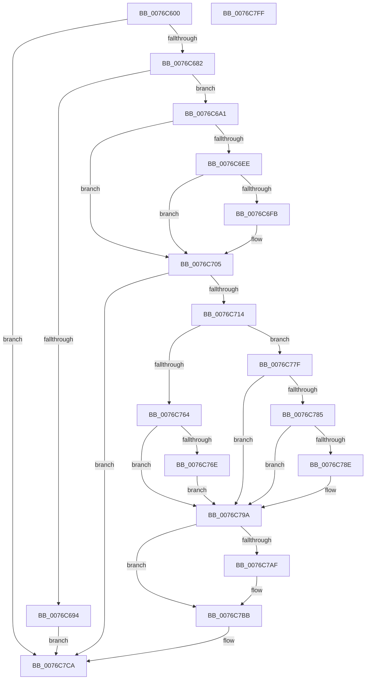

# PopDripsWatchdogDiagnosticWorker

- RVA: `0x0076C600`–`0x0076C800` (길이 `512` bytes)
- VA: `0x000000014076C600`
- 실행 섹션: `PAGE`
- PDB 이름 있음: `예`; PDB Function 태그: `아니요`
- unwind 정보 RVA: `0x000CD3E8`
- 디코드: `127`개 명령, `512/512` bytes 표시
- 미해석 바이트: `0` (있으면 어셈블리에 `.byte`로 보존)

> 이 문서는 커널 이미지의 기계어와 PDB 기호를 분석해 생성했습니다. 4번과 5번은 함수 원형과 자료형을 바이너리 사용 방식에서 추정한 C 해석이며 원본 소스 복구 결과는 아닙니다.

## 1. Dependencies

- 직접 호출 지점: **17**; 고유 호출 대상: **13**
- 직접 호출자로 확인된 함수: **0**
- RIP 상대 이미지 참조: **2**

### Outgoing calls
- `0x0076C65E` → [PiDmObjectManagerAcquireExclusiveLock](../95/PiDmObjectManagerAcquireExclusiveLock_function_00951334.md) (function, `0x00951334`)
- `0x0076C671` → [PopOkayToQueueNextWorkItem](../../text/4A/PopOkayToQueueNextWorkItem_function_004AED54.md) (function, `0x004AED54`)
- `0x0076C697` → [PopDripsWatchdogScheduleNextTimer](../70/PopDripsWatchdogScheduleNextTimer_function_00705880.md) (function, `0x00705880`)
- `0x0076C6B8` → [PopCalculateIdleInformation](../../text/43/PopCalculateIdleInformation_function_0043ADEC.md) (function, `0x0043ADEC`)
- `0x0076C6DD` → [PopDripsWatchdogUpdateMetrics](PopDripsWatchdogUpdateMetrics_function_0076C830.md) (function, `0x0076C830`)
- `0x0076C74C` → [PopDripsWatchdogScheduleNextTimer](../70/PopDripsWatchdogScheduleNextTimer_function_00705880.md) (function, `0x00705880`)
- `0x0076C754` → [ExReleaseResourceLite](../../text/25/ExReleaseResourceLite_function_0025FA10.md) (function, `0x0025FA10`)
- `0x0076C759` → [KeLeaveCriticalRegion](../../text/25/KeLeaveCriticalRegion_function_0025D8B0.md) (function, `0x0025D8B0`)
- `0x0076C778` → [PopDripsWatchdogTakeAction](../77/PopDripsWatchdogTakeAction_function_007732D0.md) (function, `0x007732D0`)
- `0x0076C785` → [PopDeepSleepEnabled](../../text/49/PopDeepSleepEnabled_function_0049E5E0.md) (function, `0x0049E5E0`)
- `0x0076C795` → [PopDeepSleepWatchdogTakeAction](../77/PopDeepSleepWatchdogTakeAction_function_007731F8.md) (function, `0x007731F8`)
- `0x0076C7A5` → [PopDiagTraceCsDripsDivergence](../../text/5D/PopDiagTraceCsDripsDivergence_function_005D5F40.md) (function, `0x005D5F40`)
- `0x0076C7B6` → [PopDripsWatchdogCheckHwDivergence](PopDripsWatchdogCheckHwDivergence_function_0076C534.md) (function, `0x0076C534`)
- `0x0076C7BE` → [PiDmObjectManagerAcquireExclusiveLock](../95/PiDmObjectManagerAcquireExclusiveLock_function_00951334.md) (function, `0x00951334`)
- `0x0076C7CD` → [ExReleaseResourceLite](../../text/25/ExReleaseResourceLite_function_0025FA10.md) (function, `0x0025FA10`)
- `0x0076C7D2` → [KeLeaveCriticalRegion](../../text/25/KeLeaveCriticalRegion_function_0025D8B0.md) (function, `0x0025D8B0`)
- `0x0076C7DE` → [_security_check_cookie](../../text/6A/_security_check_cookie_function_006AC640.md) (function, `0x006AC640`)

### Direct callers
- 이 함수 시작 RVA로 연결되는 직접 call은 확인되지 않았습니다. 간접 호출은 완전히 역산할 수 없습니다.

### Static image references
- `0x0076C61E` → RVA `0x00E0A740` (`.data`; read)
- `0x0076C764` → RVA `0x00E27D50` (`.data`; read)

## 2. Other-region calls and transfers

- 다른 실행 섹션으로 향하는 call: **9**
  - `0x0076C671` → [PopOkayToQueueNextWorkItem](../../text/4A/PopOkayToQueueNextWorkItem_function_004AED54.md) (`PAGE` → `.text`)
  - `0x0076C6B8` → [PopCalculateIdleInformation](../../text/43/PopCalculateIdleInformation_function_0043ADEC.md) (`PAGE` → `.text`)
  - `0x0076C754` → [ExReleaseResourceLite](../../text/25/ExReleaseResourceLite_function_0025FA10.md) (`PAGE` → `.text`)
  - `0x0076C759` → [KeLeaveCriticalRegion](../../text/25/KeLeaveCriticalRegion_function_0025D8B0.md) (`PAGE` → `.text`)
  - `0x0076C785` → [PopDeepSleepEnabled](../../text/49/PopDeepSleepEnabled_function_0049E5E0.md) (`PAGE` → `.text`)
  - `0x0076C7A5` → [PopDiagTraceCsDripsDivergence](../../text/5D/PopDiagTraceCsDripsDivergence_function_005D5F40.md) (`PAGE` → `.text`)
  - `0x0076C7CD` → [ExReleaseResourceLite](../../text/25/ExReleaseResourceLite_function_0025FA10.md) (`PAGE` → `.text`)
  - `0x0076C7D2` → [KeLeaveCriticalRegion](../../text/25/KeLeaveCriticalRegion_function_0025D8B0.md) (`PAGE` → `.text`)
  - `0x0076C7DE` → [_security_check_cookie](../../text/6A/_security_check_cookie_function_006AC640.md) (`PAGE` → `.text`)
- 별도 외부 분기/꼬리 이동을 확인하지 못했습니다.

## 3. Assembly (complete function range)

```asm
0076C600  48 89 5C 24 10                  mov qword ptr [rsp + 0x10], rbx
0076C605  48 89 74 24 18                  mov qword ptr [rsp + 0x18], rsi
0076C60A  55                              push rbp
0076C60B  57                              push rdi
0076C60C  41 54                           push r12
0076C60E  41 56                           push r14
0076C610  41 57                           push r15
0076C612  48 8D 6C 24 C9                  lea rbp, [rsp - 0x37]
0076C617  48 81 EC 90 00 00 00            sub rsp, 0x90
0076C61E  48 8B 05 1B E1 69 00            mov rax, qword ptr [rip + 0x69e11b]
0076C625  48 33 C4                        xor rax, rsp
0076C628  48 89 45 27                     mov qword ptr [rbp + 0x27], rax
0076C62C  33 C0                           xor eax, eax
0076C62E  48 8D 99 78 01 00 00            lea rbx, [rcx + 0x178]
0076C635  0F 57 C0                        xorps xmm0, xmm0
0076C638  48 89 45 17                     mov qword ptr [rbp + 0x17], rax
0076C63C  0F 57 C9                        xorps xmm1, xmm1
0076C63F  89 45 1F                        mov dword ptr [rbp + 0x1f], eax
0076C642  0F 11 4D 07                     movups xmmword ptr [rbp + 7], xmm1
0076C646  48 BE 08 00 00 00 80 F7 FF FF   movabs rsi, 0xfffff78000000008
0076C650  48 8B F9                        mov rdi, rcx
0076C653  0F 11 45 E7                     movups xmmword ptr [rbp - 0x19], xmm0
0076C657  0F 11 45 F7                     movups xmmword ptr [rbp - 9], xmm0
0076C65B  48 8B 36                        mov rsi, qword ptr [rsi]
0076C65E  E8 D1 4C 1E 00                  call 0x140951334
0076C663  83 A3 B4 00 00 00 FD            and dword ptr [rbx + 0xb4], 0xfffffffd
0076C66A  48 8D 8B 88 00 00 00            lea rcx, [rbx + 0x88]
0076C671  E8 DE 26 D4 FF                  call 0x1404aed54
0076C676  8B 4F 68                        mov ecx, dword ptr [rdi + 0x68]
0076C679  F6 C1 04                        test cl, 4
0076C67C  0F 84 48 01 00 00               je 0x14076c7ca
0076C682  48 8B 83 B8 00 00 00            mov rax, qword ptr [rbx + 0xb8]
0076C689  48 05 80 96 98 00               add rax, 0x989680
0076C68F  48 3B F0                        cmp rsi, rax
0076C692  77 0D                           ja 0x14076c6a1
0076C694  48 8B CB                        mov rcx, rbx
0076C697  E8 E4 91 F9 FF                  call 0x140705880
0076C69C  E9 29 01 00 00                  jmp 0x14076c7ca
0076C6A1  FF 87 80 02 00 00               inc dword ptr [rdi + 0x280]
0076C6A7  48 8D 4D E7                     lea rcx, [rbp - 0x19]
0076C6AB  83 65 DB 00                     and dword ptr [rbp - 0x25], 0
0076C6AF  48 83 65 DF 00                  and qword ptr [rbp - 0x21], 0
0076C6B4  83 65 D7 00                     and dword ptr [rbp - 0x29], 0
0076C6B8  E8 2F E7 CC FF                  call 0x14043adec
0076C6BD  48 8D 45 D7                     lea rax, [rbp - 0x29]
0076C6C1  48 8B D6                        mov rdx, rsi
0076C6C4  48 89 44 24 28                  mov qword ptr [rsp + 0x28], rax
0076C6C9  4C 8D 4D DB                     lea r9, [rbp - 0x25]
0076C6CD  48 8D 45 DF                     lea rax, [rbp - 0x21]
0076C6D1  48 8B CF                        mov rcx, rdi
0076C6D4  4C 8D 45 E7                     lea r8, [rbp - 0x19]
0076C6D8  48 89 44 24 20                  mov qword ptr [rsp + 0x20], rax
0076C6DD  E8 4E 01 00 00                  call 0x14076c830
0076C6E2  33 F6                           xor esi, esi
0076C6E4  45 32 F6                        xor r14b, r14b
0076C6E7  48 83 7D F7 FF                  cmp qword ptr [rbp - 9], -1
0076C6EC  74 17                           je 0x14076c705
0076C6EE  48 8B 87 70 02 00 00            mov rax, qword ptr [rdi + 0x270]
0076C6F5  48 83 F8 FF                     cmp rax, -1
0076C6F9  74 0A                           je 0x14076c705
0076C6FB  48 8B 75 F7                     mov rsi, qword ptr [rbp - 9]
0076C6FF  41 B6 01                        mov r14b, 1
0076C702  48 2B F0                        sub rsi, rax
0076C705  8B 8B B4 00 00 00               mov ecx, dword ptr [rbx + 0xb4]
0076C70B  F6 C1 04                        test cl, 4
0076C70E  0F 85 B6 00 00 00               jne 0x14076c7ca
0076C714  0F 10 87 38 02 00 00            movups xmm0, xmmword ptr [rdi + 0x238]
0076C71B  83 C9 04                        or ecx, 4
0076C71E  8B 87 50 02 00 00               mov eax, dword ptr [rdi + 0x250]
0076C724  F2 0F 10 8F 48 02 00 00         movsd xmm1, qword ptr [rdi + 0x248]
0076C72C  44 8B 7F 6C                     mov r15d, dword ptr [rdi + 0x6c]
0076C730  44 8B A7 80 02 00 00            mov r12d, dword ptr [rdi + 0x280]
0076C737  89 8B B4 00 00 00               mov dword ptr [rbx + 0xb4], ecx
0076C73D  48 8B CB                        mov rcx, rbx
0076C740  0F 11 45 07                     movups xmmword ptr [rbp + 7], xmm0
0076C744  89 45 1F                        mov dword ptr [rbp + 0x1f], eax
0076C747  F2 0F 11 4D 17                  movsd qword ptr [rbp + 0x17], xmm1
0076C74C  E8 2F 91 F9 FF                  call 0x140705880
0076C751  48 8B CF                        mov rcx, rdi
0076C754  E8 B7 32 AF FF                  call 0x14025fa10
0076C759  E8 52 11 AF FF                  call 0x14025d8b0
0076C75E  83 7D D7 00                     cmp dword ptr [rbp - 0x29], 0
0076C762  75 1B                           jne 0x14076c77f
0076C764  48 83 3D E4 B5 6B 00 00         cmp qword ptr [rip + 0x6bb5e4], 0
0076C76C  75 2C                           jne 0x14076c79a
0076C76E  45 8B C4                        mov r8d, r12d
0076C771  48 8D 4D 07                     lea rcx, [rbp + 7]
0076C775  41 8B D7                        mov edx, r15d
0076C778  E8 53 6B 00 00                  call 0x1407732d0
0076C77D  EB 1B                           jmp 0x14076c79a
0076C77F  83 7D DB 00                     cmp dword ptr [rbp - 0x25], 0
0076C783  75 15                           jne 0x14076c79a
0076C785  E8 56 1E D3 FF                  call 0x14049e5e0
0076C78A  84 C0                           test al, al
0076C78C  74 0C                           je 0x14076c79a
0076C78E  41 8B D7                        mov edx, r15d
0076C791  48 8D 4D 07                     lea rcx, [rbp + 7]
0076C795  E8 5E 6A 00 00                  call 0x1407731f8
0076C79A  48 8B 55 DF                     mov rdx, qword ptr [rbp - 0x21]
0076C79E  4C 8B C6                        mov r8, rsi
0076C7A1  41 0F B6 CE                     movzx ecx, r14b
0076C7A5  E8 96 97 E6 FF                  call 0x1405d5f40
0076C7AA  45 84 F6                        test r14b, r14b
0076C7AD  74 0C                           je 0x14076c7bb
0076C7AF  48 8B 55 DF                     mov rdx, qword ptr [rbp - 0x21]
0076C7B3  48 8B CE                        mov rcx, rsi
0076C7B6  E8 79 FD FF FF                  call 0x14076c534
0076C7BB  48 8B CF                        mov rcx, rdi
0076C7BE  E8 71 4B 1E 00                  call 0x140951334
0076C7C3  83 A3 B4 00 00 00 FB            and dword ptr [rbx + 0xb4], 0xfffffffb
0076C7CA  48 8B CF                        mov rcx, rdi
0076C7CD  E8 3E 32 AF FF                  call 0x14025fa10
0076C7D2  E8 D9 10 AF FF                  call 0x14025d8b0
0076C7D7  48 8B 4D 27                     mov rcx, qword ptr [rbp + 0x27]
0076C7DB  48 33 CC                        xor rcx, rsp
0076C7DE  E8 5D FE F3 FF                  call 0x1406ac640
0076C7E3  4C 8D 9C 24 90 00 00 00         lea r11, [rsp + 0x90]
0076C7EB  49 8B 5B 38                     mov rbx, qword ptr [r11 + 0x38]
0076C7EF  49 8B 73 40                     mov rsi, qword ptr [r11 + 0x40]
0076C7F3  49 8B E3                        mov rsp, r11
0076C7F6  41 5F                           pop r15
0076C7F8  41 5E                           pop r14
0076C7FA  41 5C                           pop r12
0076C7FC  5F                              pop rdi
0076C7FD  5D                              pop rbp
0076C7FE  C3                              ret
0076C7FF  CC                              int3
```

## 4. C-style interpretation (structured pseudocode)

```c
__int64 __fastcall PopDripsWatchdogDiagnosticWorker(__int64 a1)
{
    __int64 result;
    __int64 v_r14;
    __int64 v_rsi;
    __int64 v_rsp;
    unsigned __int64 v_stack_m28;
    unsigned __int64 v_stack_m38;
    unsigned int v_stack_m40;
    unsigned __int64 v_stack_m48;
    unsigned __int64 v_stack_m58;
    unsigned __int64 v_stack_m5F;
    unsigned __int64 v_stack_m68;
    unsigned __int64 v_stack_m78;
    unsigned __int64 v_stack_m80;
    unsigned int v_stack_m84;
    unsigned int v_stack_m88;
    unsigned __int64 v_stack_m90;
    unsigned __int64 v_stack_m98;
    unsigned __int64 v_stack_p10;
    unsigned __int64 v_stack_p18;

    v_stack_p10 = v_rbx;
    v_stack_p18 = v_rsi;
    v_rsp = (v_rsp) - (144);
    result = (*(unsigned __int64 *)(v_rip + 6938907)) ^ (v_rsp);
    v_stack_m38 = result;
    result = 0;
    v_stack_m48 = 0;
    v_stack_m40 = 0;
    v_stack_m58 = v_xmm1;
    v_stack_m78 = v_xmm0;
    v_stack_m68 = v_xmm0;
    result = PiDmObjectManagerAcquireExclusiveLock(a1, a2, a3, a4);
    result = PopOkayToQueueNextWorkItem(a1 + 376 + 136, a2, a3, a4);
    if ((((unsigned __int8)((unsigned int)(*(unsigned int *)(a1 + 104)))) & (4)) == 0) goto loc_0076C7CA;
    result = (*(unsigned __int64 *)(a1 + 376 + 184)) + (0x989680ULL);
    if ((*(unsigned __int64 *)(v_rsi)) > result) goto loc_0076C6A1;
    result = PopDripsWatchdogScheduleNextTimer(a1 + 376, a2, a3, a4);
    goto loc_0076C7CA;
loc_0076C6A1:
    result = PopCalculateIdleInformation(v_stack_m78, a2, a3, a4);
    v_stack_m90 = v_stack_m88;
    v_stack_m98 = v_stack_m80;
    result = PopDripsWatchdogUpdateMetrics(a1, *(unsigned __int64 *)(v_rsi), v_stack_m78, v_stack_m84);
    v_rsi = 0;
    v_r14 = 0;
    if (v_stack_m68 == -1) goto loc_0076C705;
    if ((*(unsigned __int64 *)(a1 + 624)) != -1) {
        v_rsi = v_stack_m68;
        v_r14 = 1;
        v_rsi = (v_rsi) - (*(unsigned __int64 *)(a1 + 624));
    }
    if ((((unsigned __int8)((unsigned int)(*(unsigned int *)(a1 + 376 + 180)))) & (4)) != 0) goto loc_0076C7CA;
    a1 = (unsigned int)(((unsigned int)(*(unsigned int *)(a1 + 376 + 180))) | (4));
    *(unsigned int *)(a1 + 376 + 180) = (unsigned int)(a1);
    v_stack_m58 = v_xmm0;
    v_stack_m40 = (unsigned int)((unsigned int)(*(unsigned int *)(a1 + 592)));
    v_stack_m48 = v_xmm1;
    result = PopDripsWatchdogScheduleNextTimer(a1 + 376, *(unsigned __int64 *)(v_rsi), v_stack_m78, v_stack_m84);
    result = ExReleaseResourceLite(a1, *(unsigned __int64 *)(v_rsi), v_stack_m78, v_stack_m84);
    result = KeLeaveCriticalRegion(a1, *(unsigned __int64 *)(v_rsi), v_stack_m78, v_stack_m84);
    if (v_stack_m88 != 0) goto loc_0076C77F;
    if ((*(unsigned __int64 *)(v_rip + 7058916)) != 0) goto loc_0076C79A;
    result = PopDripsWatchdogTakeAction(v_stack_m58, (unsigned int)((unsigned int)((unsigned int)(*(unsigned int *)(a1 + 108)))), (unsigned int)((unsigned int)((unsigned int)(*(unsigned int *)(a1 + 640)))), v_stack_m84);
    goto loc_0076C79A;
loc_0076C77F:
    if (v_stack_m84 != 0) goto loc_0076C79A;
    result = PopDeepSleepEnabled(v_stack_m58, (unsigned int)((unsigned int)((unsigned int)(*(unsigned int *)(a1 + 108)))), (unsigned int)((unsigned int)((unsigned int)(*(unsigned int *)(a1 + 640)))), v_stack_m84);
    if ((unsigned __int8)(result) != 0) {
        a2 = (unsigned int)((unsigned int)(*(unsigned int *)(a1 + 108)));
        a1 = v_stack_m58;
        result = PopDeepSleepWatchdogTakeAction(a1, a2, (unsigned int)((unsigned int)((unsigned int)(*(unsigned int *)(a1 + 640)))), v_stack_m84);
    }
    result = PopDiagTraceCsDripsDivergence((unsigned __int8)(v_r14), v_stack_m80, v_rsi, v_stack_m84);
    if ((unsigned __int8)(v_r14) != 0) {
        a2 = v_stack_m80;
        a1 = v_rsi;
        result = PopDripsWatchdogCheckHwDivergence(a1, a2, v_rsi, v_stack_m84);
    }
    result = PiDmObjectManagerAcquireExclusiveLock(a1, a2, v_rsi, v_stack_m84);
loc_0076C7CA:
    result = ExReleaseResourceLite(a1, a2, v_rsi, v_stack_m84);
    result = KeLeaveCriticalRegion(a1, a2, v_rsi, v_stack_m84);
    a1 = (v_stack_m38) ^ (v_rsp);
    result = _security_check_cookie(a1, a2, v_rsi, v_stack_m84);
    return result;
}
```

## 5. (Beta) C Style

```c
int64_t PopDripsWatchdogDiagnosticWorker(void *Arg1)
{
    uint8_t *arg1 = (uint8_t *)Arg1;

    int64_t result;
    int64_t local_r14;
    int64_t local_rsi;
    int64_t local_rsp;
    uint64_t v_stack_m28;
    uint64_t v_stack_m38;
    uint32_t v_stack_m40;
    uint64_t v_stack_m48;
    uint64_t v_stack_m58;
    uint64_t v_stack_m5F;
    uint64_t v_stack_m68;
    uint64_t v_stack_m78;
    uint64_t v_stack_m80;
    uint32_t v_stack_m84;
    uint32_t v_stack_m88;
    uint64_t v_stack_m90;
    uint64_t v_stack_m98;
    uint64_t v_stack_p10;
    uint64_t v_stack_p18;

    v_stack_p10 = local_rbx;
    v_stack_p18 = local_rsi;
    local_rsp = (local_rsp) - (144);
    result = (*(uint64_t *)(v_rip + 0x69E11B)) ^ (local_rsp);
    v_stack_m38 = result;
    result = 0;
    v_stack_m48 = 0;
    v_stack_m40 = 0;
    v_stack_m58 = v_xmm1;
    v_stack_m78 = v_xmm0;
    v_stack_m68 = v_xmm0;
    result = PiDmObjectManagerAcquireExclusiveLock(Arg1, a2, a3, a4);
    result = PopOkayToQueueNextWorkItem(Arg1 + 376 + 136, a2, a3, a4);
    if ((((uint8_t)((uint32_t)(*(uint32_t *)(arg1 + 0x68)))) & (4)) == 0) goto loc_0076C7CA;
    result = (*(uint64_t *)(arg1 + 0x178 + 0xB8)) + (0x989680ULL);
    if ((*(uint64_t *)(local_rsi)) > result) goto loc_0076C6A1;
    result = PopDripsWatchdogScheduleNextTimer(Arg1 + 376, a2, a3, a4);
    goto loc_0076C7CA;
loc_0076C6A1:
    result = PopCalculateIdleInformation(v_stack_m78, a2, a3, a4);
    v_stack_m90 = v_stack_m88;
    v_stack_m98 = v_stack_m80;
    result = PopDripsWatchdogUpdateMetrics(Arg1, *(uint64_t *)(local_rsi), v_stack_m78, v_stack_m84);
    local_rsi = 0;
    local_r14 = 0;
    if (v_stack_m68 == -1) goto loc_0076C705;
    if ((*(uint64_t *)(arg1 + 0x270)) != -1) {
        local_rsi = v_stack_m68;
        local_r14 = 1;
        local_rsi = (local_rsi) - (*(uint64_t *)(arg1 + 0x270));
    }
    if ((((uint8_t)((uint32_t)(*(uint32_t *)(arg1 + 0x178 + 0xB4)))) & (4)) != 0) goto loc_0076C7CA;
    Arg1 = (uint32_t)(((uint32_t)(*(uint32_t *)(arg1 + 0x178 + 0xB4))) | (4));
    *(uint32_t *)(arg1 + 0x178 + 0xB4) = (uint32_t)(Arg1);
    v_stack_m58 = v_xmm0;
    v_stack_m40 = (uint32_t)((uint32_t)(*(uint32_t *)(arg1 + 0x250)));
    v_stack_m48 = v_xmm1;
    result = PopDripsWatchdogScheduleNextTimer(Arg1 + 376, *(uint64_t *)(local_rsi), v_stack_m78, v_stack_m84);
    result = ExReleaseResourceLite(Arg1, *(uint64_t *)(local_rsi), v_stack_m78, v_stack_m84);
    result = KeLeaveCriticalRegion(Arg1, *(uint64_t *)(local_rsi), v_stack_m78, v_stack_m84);
    if (v_stack_m88 != 0) goto loc_0076C77F;
    if ((*(uint64_t *)(v_rip + 0x6BB5E4)) != 0) goto loc_0076C79A;
    result = PopDripsWatchdogTakeAction(v_stack_m58, (uint32_t)((uint32_t)((uint32_t)(*(uint32_t *)(arg1 + 0x6C)))), (uint32_t)((uint32_t)((uint32_t)(*(uint32_t *)(arg1 + 0x280)))), v_stack_m84);
    goto loc_0076C79A;
loc_0076C77F:
    if (v_stack_m84 != 0) goto loc_0076C79A;
    result = PopDeepSleepEnabled(v_stack_m58, (uint32_t)((uint32_t)((uint32_t)(*(uint32_t *)(arg1 + 0x6C)))), (uint32_t)((uint32_t)((uint32_t)(*(uint32_t *)(arg1 + 0x280)))), v_stack_m84);
    if ((uint8_t)(result) != 0) {
        a2 = (uint32_t)((uint32_t)(*(uint32_t *)(arg1 + 0x6C)));
        Arg1 = v_stack_m58;
        result = PopDeepSleepWatchdogTakeAction(Arg1, a2, (uint32_t)((uint32_t)((uint32_t)(*(uint32_t *)(arg1 + 0x280)))), v_stack_m84);
    }
    result = PopDiagTraceCsDripsDivergence((uint8_t)(local_r14), v_stack_m80, local_rsi, v_stack_m84);
    if ((uint8_t)(local_r14) != 0) {
        a2 = v_stack_m80;
        Arg1 = local_rsi;
        result = PopDripsWatchdogCheckHwDivergence(Arg1, a2, local_rsi, v_stack_m84);
    }
    result = PiDmObjectManagerAcquireExclusiveLock(Arg1, a2, local_rsi, v_stack_m84);
loc_0076C7CA:
    result = ExReleaseResourceLite(Arg1, a2, local_rsi, v_stack_m84);
    result = KeLeaveCriticalRegion(Arg1, a2, local_rsi, v_stack_m84);
    Arg1 = (v_stack_m38) ^ (local_rsp);
    result = _security_check_cookie(Arg1, a2, local_rsi, v_stack_m84);
    return result;
}
```

### 관측된 메모리 오프셋

구조체 형식이 확인되지 않은 접근은 인자 기준의 오프셋으로만 기록했습니다.

| 기준 인자 | 오프셋 표현 | 폭 (bit) | 접근 |
|---|---:|---:|---|
| `Arg1` | `+ 0x68` | `32` | `R` |
| `Arg1` | `+ 0x6C` | `32` | `R` |
| `Arg1` | `+ 0x88` | `64` | `R` |
| `Arg1` | `+ 0xB4` | `32` | `R` |
| `Arg1` | `+ 0xB4` | `32` | `R/W` |
| `Arg1` | `+ 0xB4` | `32` | `W` |
| `Arg1` | `+ 0xB8` | `64` | `R` |
| `Arg1` | `+ 0x178` | `64` | `R` |
| `Arg1` | `+ 0x238` | `128` | `R` |
| `Arg1` | `+ 0x248` | `64` | `R` |
| `Arg1` | `+ 0x250` | `32` | `R` |
| `Arg1` | `+ 0x270` | `64` | `R` |
| `Arg1` | `+ 0x280` | `32` | `R` |
| `Arg1` | `+ 0x280` | `32` | `R/W` |

## 6. Execution-region graph

[열기: 2D/3D 그래프와 함수 탐색 컨트롤 패널](../../../control-panel.html?section=page&rva=0x0076C600&view=graph)

- 2D 그래프는 위에서 아래로 흐르고, 3D 그래프는 빈 공간을 드래그해 회전합니다. Shift+드래그는 이동, 휠은 확대·축소, 함수 노드 선택은 대상 보고서 이동입니다.

### Static fallback


