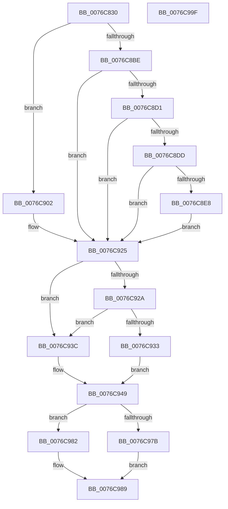

# PopDripsWatchdogUpdateMetrics

- RVA: `0x0076C830`–`0x0076C9A0` (길이 `368` bytes)
- VA: `0x000000014076C830`
- 실행 섹션: `PAGE`
- PDB 이름 있음: `예`; PDB Function 태그: `아니요`
- unwind 정보 RVA: `0x0005FD94`
- 디코드: `84`개 명령, `368/368` bytes 표시
- 미해석 바이트: `0` (있으면 어셈블리에 `.byte`로 보존)

> 이 문서는 커널 이미지의 기계어와 PDB 기호를 분석해 생성했습니다. 4번과 5번은 함수 원형과 자료형을 바이너리 사용 방식에서 추정한 C 해석이며 원본 소스 복구 결과는 아닙니다.

## 1. Dependencies

- 직접 호출 지점: **4**; 고유 호출 대상: **4**
- 직접 호출자로 확인된 함수: **1**
- RIP 상대 이미지 참조: **3**

### Outgoing calls
- `0x0076C8F5` → [PopBatteryCapacityToRate](../../text/43/PopBatteryCapacityToRate_function_0043B6A8.md) (function, `0x0043B6A8`)
- `0x0076C92A` → [PopDeepSleepEnabled](../../text/49/PopDeepSleepEnabled_function_0049E5E0.md) (function, `0x0049E5E0`)
- `0x0076C957` → [PopAccumulateNonActivatedCpuTime](../../text/4A/PopAccumulateNonActivatedCpuTime_function_004A0AA4.md) (function, `0x004A0AA4`)
- `0x0076C966` → [PpmConvertTimeTo](../../text/43/PpmConvertTimeTo_function_0043B3CC.md) (function, `0x0043B3CC`)

### Direct callers
- [PopDripsWatchdogDiagnosticWorker](PopDripsWatchdogDiagnosticWorker_function_0076C600.md) at `0x0076C6DD`

### Static image references
- `0x0076C83F` → RVA `0x00E27DD8` (`.data`; read)
- `0x0076C84E` → RVA `0x00F0C064` (`.data`; read)
- `0x0076C8D1` → RVA `0x00F0C090` (`.data`; read)

## 2. Other-region calls and transfers

- 다른 실행 섹션으로 향하는 call: **4**
  - `0x0076C8F5` → [PopBatteryCapacityToRate](../../text/43/PopBatteryCapacityToRate_function_0043B6A8.md) (`PAGE` → `.text`)
  - `0x0076C92A` → [PopDeepSleepEnabled](../../text/49/PopDeepSleepEnabled_function_0049E5E0.md) (`PAGE` → `.text`)
  - `0x0076C957` → [PopAccumulateNonActivatedCpuTime](../../text/4A/PopAccumulateNonActivatedCpuTime_function_004A0AA4.md) (`PAGE` → `.text`)
  - `0x0076C966` → [PpmConvertTimeTo](../../text/43/PpmConvertTimeTo_function_0043B3CC.md) (`PAGE` → `.text`)
- 별도 외부 분기/꼬리 이동을 확인하지 못했습니다.

## 3. Assembly (complete function range)

```asm
0076C830  48 89 5C 24 10                  mov qword ptr [rsp + 0x10], rbx
0076C835  48 89 74 24 18                  mov qword ptr [rsp + 0x18], rsi
0076C83A  57                              push rdi
0076C83B  48 83 EC 20                     sub rsp, 0x20
0076C83F  8A 05 93 B5 6B 00               mov al, byte ptr [rip + 0x6bb593]
0076C845  48 8B D9                        mov rbx, rcx
0076C848  41 8B 70 1C                     mov esi, dword ptr [r8 + 0x1c]
0076C84C  24 01                           and al, 1
0076C84E  44 8B 15 0F F8 79 00            mov r10d, dword ptr [rip + 0x79f80f]
0076C855  44 8B DE                        mov r11d, esi
0076C858  49 8B 78 08                     mov rdi, qword ptr [r8 + 8]
0076C85C  45 8B 40 18                     mov r8d, dword ptr [r8 + 0x18]
0076C860  48 83 64 24 30 00               and qword ptr [rsp + 0x30], 0
0076C866  88 81 50 02 00 00               mov byte ptr [rcx + 0x250], al
0076C86C  44 2B 99 7C 02 00 00            sub r11d, dword ptr [rcx + 0x27c]
0076C873  48 8B CF                        mov rcx, rdi
0076C876  48 2B 8B 68 02 00 00            sub rcx, qword ptr [rbx + 0x268]
0076C87D  48 2B 93 30 02 00 00            sub rdx, qword ptr [rbx + 0x230]
0076C884  48 8B 44 24 50                  mov rax, qword ptr [rsp + 0x50]
0076C889  45 89 19                        mov dword ptr [r9], r11d
0076C88C  48 89 08                        mov qword ptr [rax], rcx
0076C88F  41 8B C8                        mov ecx, r8d
0076C892  2B 8B 78 02 00 00               sub ecx, dword ptr [rbx + 0x278]
0076C898  48 8B 44 24 58                  mov rax, qword ptr [rsp + 0x58]
0076C89D  89 08                           mov dword ptr [rax], ecx
0076C89F  48 B8 4B 59 86 38 D6 C5 6D 34   movabs rax, 0x346dc5d63886594b
0076C8A9  48 F7 E2                        mul rdx
0076C8AC  4C 8B CA                        mov r9, rdx
0076C8AF  49 C1 E9 0B                     shr r9, 0xb
0076C8B3  44 89 8B 40 02 00 00            mov dword ptr [rbx + 0x240], r9d
0076C8BA  85 C9                           test ecx, ecx
0076C8BC  75 44                           jne 0x14076c902
0076C8BE  44 8B 83 38 02 00 00            mov r8d, dword ptr [rbx + 0x238]
0076C8C5  45 03 C1                        add r8d, r9d
0076C8C8  44 89 83 38 02 00 00            mov dword ptr [rbx + 0x238], r8d
0076C8CF  74 54                           je 0x14076c925
0076C8D1  F7 05 B5 F7 79 00 00 00 00 40   test dword ptr [rip + 0x79f7b5], 0x40000000
0076C8DB  75 48                           jne 0x14076c925
0076C8DD  8B 8B 54 02 00 00               mov ecx, dword ptr [rbx + 0x254]
0076C8E3  44 3B D1                        cmp r10d, ecx
0076C8E6  73 3D                           jae 0x14076c925
0076C8E8  41 8B C0                        mov eax, r8d
0076C8EB  41 2B CA                        sub ecx, r10d
0076C8EE  48 69 D0 E8 03 00 00            imul rdx, rax, 0x3e8
0076C8F5  E8 AE ED CC FF                  call 0x14043b6a8
0076C8FA  89 83 4C 02 00 00               mov dword ptr [rbx + 0x24c], eax
0076C900  EB 23                           jmp 0x14076c925
0076C902  83 A3 38 02 00 00 00            and dword ptr [rbx + 0x238], 0
0076C909  83 A3 4C 02 00 00 00            and dword ptr [rbx + 0x24c], 0
0076C910  44 89 83 78 02 00 00            mov dword ptr [rbx + 0x278], r8d
0076C917  48 89 BB 68 02 00 00            mov qword ptr [rbx + 0x268], rdi
0076C91E  44 89 93 54 02 00 00            mov dword ptr [rbx + 0x254], r10d
0076C925  45 85 DB                        test r11d, r11d
0076C928  75 12                           jne 0x14076c93c
0076C92A  E8 B1 1C D3 FF                  call 0x14049e5e0
0076C92F  84 C0                           test al, al
0076C931  74 09                           je 0x14076c93c
0076C933  44 01 8B 3C 02 00 00            add dword ptr [rbx + 0x23c], r9d
0076C93A  EB 0D                           jmp 0x14076c949
0076C93C  83 A3 3C 02 00 00 00            and dword ptr [rbx + 0x23c], 0
0076C943  89 B3 7C 02 00 00               mov dword ptr [rbx + 0x27c], esi
0076C949  48 8D 93 58 02 00 00            lea rdx, [rbx + 0x258]
0076C950  33 C9                           xor ecx, ecx
0076C952  4C 8D 44 24 30                  lea r8, [rsp + 0x30]
0076C957  E8 48 41 D3 FF                  call 0x1404a0aa4
0076C95C  48 8B 4C 24 30                  mov rcx, qword ptr [rsp + 0x30]
0076C961  BA E8 03 00 00                  mov edx, 0x3e8
0076C966  E8 61 EA CC FF                  call 0x14043b3cc
0076C96B  8B 8B 40 02 00 00               mov ecx, dword ptr [rbx + 0x240]
0076C971  89 83 44 02 00 00               mov dword ptr [rbx + 0x244], eax
0076C977  3B C1                           cmp eax, ecx
0076C979  76 07                           jbe 0x14076c982
0076C97B  B8 64 00 00 00                  mov eax, 0x64
0076C980  EB 07                           jmp 0x14076c989
0076C982  6B C0 64                        imul eax, eax, 0x64
0076C985  33 D2                           xor edx, edx
0076C987  F7 F1                           div ecx
0076C989  89 83 48 02 00 00               mov dword ptr [rbx + 0x248], eax
0076C98F  48 8B 5C 24 38                  mov rbx, qword ptr [rsp + 0x38]
0076C994  48 8B 74 24 40                  mov rsi, qword ptr [rsp + 0x40]
0076C999  48 83 C4 20                     add rsp, 0x20
0076C99D  5F                              pop rdi
0076C99E  C3                              ret
0076C99F  CC                              int3
```

## 4. C-style interpretation (structured pseudocode)

```c
__int64 __fastcall PopDripsWatchdogUpdateMetrics(__int64 a1, __int64 a2, __int64 a3, __int64 a4, __int64 a5, __int64 a6)
{
    __int64 result;
    __int64 v_r11;
    __int64 v_rsp;
    unsigned __int64 v_stack_p10;
    unsigned __int64 v_stack_p18;
    unsigned __int64 v_stack_p8;

    v_stack_p10 = v_rbx;
    v_stack_p18 = v_rsi;
    v_rsp = (v_rsp) - (32);
    result = (unsigned __int8)((*(unsigned __int8 *)(v_rip + 7058835)) & (1));
    *(unsigned __int8 *)(a1 + 592) = (unsigned __int8)(result);
    v_r11 = (unsigned int)(((unsigned int)((unsigned int)((unsigned int)(*(unsigned int *)(a3 + 28))))) - (*(unsigned int *)(a1 + 636)));
    a1 = (*(unsigned __int64 *)(a3 + 8)) - (*(unsigned __int64 *)(a1 + 616));
    a2 = (a2) - (*(unsigned __int64 *)(a1 + 560));
    *(unsigned int *)(a4) = (unsigned int)(v_r11);
    *(unsigned __int64 *)(a5) = a1;
    a1 = (unsigned int)(((unsigned int)((unsigned int)((unsigned int)(*(unsigned int *)(a3 + 24))))) - (*(unsigned int *)(a1 + 632)));
    *(unsigned int *)(a6) = (unsigned int)(a1);
    a4 = (a2) >> (11);
    *(unsigned int *)(a1 + 576) = (unsigned int)(a4);
    if ((unsigned int)(a1) != 0) goto loc_0076C902;
    a3 = (unsigned int)(((unsigned int)(*(unsigned int *)(a1 + 568))) + ((unsigned int)(a4)));
    *(unsigned int *)(a1 + 568) = (unsigned int)(a3);
    if (condition_is_equal) goto loc_0076C925;
    if (((*(unsigned int *)(v_rip + 7993269)) & (0x40000000ULL)) != 0) goto loc_0076C925;
    if (((unsigned int)((unsigned int)(*(unsigned int *)(v_rip + 7993359)))) >= ((unsigned int)((unsigned int)(*(unsigned int *)(a1 + 596))))) goto loc_0076C925;
    a1 = (unsigned int)(((unsigned int)(*(unsigned int *)(a1 + 596))) - ((unsigned int)((unsigned int)(*(unsigned int *)(v_rip + 7993359)))));
    a2 = (a2) * ((unsigned int)((unsigned int)(a3)));
    result = PopBatteryCapacityToRate(a1, a2, a3, a4);
    *(unsigned int *)(a1 + 588) = (unsigned int)(result);
    goto loc_0076C925;
loc_0076C902:
    *(unsigned int *)(a1 + 632) = (unsigned int)(a3);
    *(unsigned __int64 *)(a1 + 616) = *(unsigned __int64 *)(a3 + 8);
    *(unsigned int *)(a1 + 596) = (unsigned int)((unsigned int)(*(unsigned int *)(v_rip + 7993359)));
loc_0076C925:
    if ((unsigned int)(v_r11) != 0) goto loc_0076C93C;
    result = PopDeepSleepEnabled(a1, a2, a3, a4);
    if ((unsigned __int8)(result) == 0) goto loc_0076C93C;
    goto loc_0076C949;
loc_0076C93C:
    *(unsigned int *)(a1 + 636) = (unsigned int)((unsigned int)(*(unsigned int *)(a3 + 28)));
loc_0076C949:
    a1 = 0;
    result = PopAccumulateNonActivatedCpuTime(a1, a1 + 600, v_stack_p8, a4);
    result = PpmConvertTimeTo(v_stack_p8, 1000, v_stack_p8, a4);
    *(unsigned int *)(a1 + 580) = (unsigned int)(result);
    if (((unsigned int)(result)) <= ((unsigned int)((unsigned int)(*(unsigned int *)(a1 + 576))))) goto loc_0076C982;
    goto loc_0076C989;
loc_0076C982:
    result = (unsigned int)((100) * (100));
    a2 = 0;
loc_0076C989:
    *(unsigned int *)(a1 + 584) = (unsigned int)(result);
    v_rsp = (v_rsp) + (32);
    return result;
}
```

## 5. (Beta) C Style

```c
int64_t PopDripsWatchdogUpdateMetrics(void *Arg1, int64_t Arg2, void *Arg3, void *Arg4, void *Arg5, void *Arg6)
{
    uint8_t *arg1 = (uint8_t *)Arg1;
    uint8_t *arg3 = (uint8_t *)Arg3;
    uint8_t *arg4 = (uint8_t *)Arg4;
    uint8_t *arg5 = (uint8_t *)Arg5;
    uint8_t *arg6 = (uint8_t *)Arg6;

    int64_t result;
    int64_t local_r11;
    int64_t local_rsp;
    uint64_t v_stack_p10;
    uint64_t v_stack_p18;
    uint64_t v_stack_p8;

    v_stack_p10 = local_rbx;
    v_stack_p18 = local_rsi;
    local_rsp = (local_rsp) - (32);
    result = (uint8_t)((*(uint8_t *)(v_rip + 0x6BB593)) & (1));
    *(uint8_t *)(arg1 + 0x250) = (uint8_t)(result);
    local_r11 = (uint32_t)(((uint32_t)((uint32_t)((uint32_t)(*(uint32_t *)(arg3 + 0x1C))))) - (*(uint32_t *)(arg1 + 0x27C)));
    Arg1 = (*(uint64_t *)(arg3 + 0x8)) - (*(uint64_t *)(arg1 + 0x268));
    Arg2 = (Arg2) - (*(uint64_t *)(arg1 + 0x230));
    *(uint32_t *)(arg4) = (uint32_t)(local_r11);
    *(void **)(arg5) = Arg1;
    Arg1 = (uint32_t)(((uint32_t)((uint32_t)((uint32_t)(*(uint32_t *)(arg3 + 0x18))))) - (*(uint32_t *)(arg1 + 0x278)));
    *(uint32_t *)(arg6) = (uint32_t)(Arg1);
    Arg4 = (Arg2) >> (11);
    *(uint32_t *)(arg1 + 0x240) = (uint32_t)(Arg4);
    if ((uint32_t)(Arg1) != 0) goto loc_0076C902;
    Arg3 = (uint32_t)(((uint32_t)(*(uint32_t *)(arg1 + 0x238))) + ((uint32_t)(Arg4)));
    *(uint32_t *)(arg1 + 0x238) = (uint32_t)(Arg3);
    if (condition_is_equal) goto loc_0076C925;
    if (((*(uint32_t *)(v_rip + 0x79F7B5)) & (0x40000000ULL)) != 0) goto loc_0076C925;
    if (((uint32_t)((uint32_t)(*(uint32_t *)(v_rip + 0x79F80F)))) >= ((uint32_t)((uint32_t)(*(uint32_t *)(arg1 + 0x254))))) goto loc_0076C925;
    Arg1 = (uint32_t)(((uint32_t)(*(uint32_t *)(arg1 + 0x254))) - ((uint32_t)((uint32_t)(*(uint32_t *)(v_rip + 0x79F80F)))));
    Arg2 = (Arg2) * ((uint32_t)((uint32_t)(Arg3)));
    result = PopBatteryCapacityToRate(Arg1, Arg2, Arg3, Arg4);
    *(uint32_t *)(arg1 + 0x24C) = (uint32_t)(result);
    goto loc_0076C925;
loc_0076C902:
    *(uint32_t *)(arg1 + 0x278) = (uint32_t)(Arg3);
    *(uint64_t *)(arg1 + 0x268) = *(uint64_t *)(arg3 + 0x8);
    *(uint32_t *)(arg1 + 0x254) = (uint32_t)((uint32_t)(*(uint32_t *)(v_rip + 0x79F80F)));
loc_0076C925:
    if ((uint32_t)(local_r11) != 0) goto loc_0076C93C;
    result = PopDeepSleepEnabled(Arg1, Arg2, Arg3, Arg4);
    if ((uint8_t)(result) == 0) goto loc_0076C93C;
    goto loc_0076C949;
loc_0076C93C:
    *(uint32_t *)(arg1 + 0x27C) = (uint32_t)((uint32_t)(*(uint32_t *)(arg3 + 0x1C)));
loc_0076C949:
    Arg1 = 0;
    result = PopAccumulateNonActivatedCpuTime(Arg1, Arg1 + 600, v_stack_p8, Arg4);
    result = PpmConvertTimeTo(v_stack_p8, 1000, v_stack_p8, Arg4);
    *(uint32_t *)(arg1 + 0x244) = (uint32_t)(result);
    if (((uint32_t)(result)) <= ((uint32_t)((uint32_t)(*(uint32_t *)(arg1 + 0x240))))) goto loc_0076C982;
    goto loc_0076C989;
loc_0076C982:
    result = (uint32_t)((100) * (100));
    Arg2 = 0;
loc_0076C989:
    *(uint32_t *)(arg1 + 0x248) = (uint32_t)(result);
    local_rsp = (local_rsp) + (32);
    return result;
}
```

### 관측된 메모리 오프셋

구조체 형식이 확인되지 않은 접근은 인자 기준의 오프셋으로만 기록했습니다.

| 기준 인자 | 오프셋 표현 | 폭 (bit) | 접근 |
|---|---:|---:|---|
| `Arg1` | `+ 0x230` | `64` | `R` |
| `Arg1` | `+ 0x238` | `32` | `R` |
| `Arg1` | `+ 0x238` | `32` | `R/W` |
| `Arg1` | `+ 0x238` | `32` | `W` |
| `Arg1` | `+ 0x23C` | `32` | `R/W` |
| `Arg1` | `+ 0x240` | `32` | `R` |
| `Arg1` | `+ 0x240` | `32` | `W` |
| `Arg1` | `+ 0x244` | `32` | `W` |
| `Arg1` | `+ 0x248` | `32` | `W` |
| `Arg1` | `+ 0x24C` | `32` | `R/W` |
| `Arg1` | `+ 0x24C` | `32` | `W` |
| `Arg1` | `+ 0x250` | `8` | `W` |
| `Arg1` | `+ 0x254` | `32` | `R` |
| `Arg1` | `+ 0x254` | `32` | `W` |
| `Arg1` | `+ 0x258` | `64` | `R` |
| `Arg1` | `+ 0x268` | `64` | `R` |
| `Arg1` | `+ 0x268` | `64` | `W` |
| `Arg1` | `+ 0x278` | `32` | `R` |
| `Arg1` | `+ 0x278` | `32` | `W` |
| `Arg1` | `+ 0x27C` | `32` | `R` |
| `Arg1` | `+ 0x27C` | `32` | `W` |
| `Arg3` | `+ 0x8` | `64` | `R` |
| `Arg3` | `+ 0x18` | `32` | `R` |
| `Arg3` | `+ 0x1C` | `32` | `R` |
| `Arg4` | `+ 0x0` | `32` | `W` |
| `Arg5` | `+ 0x0` | `64` | `W` |
| `Arg6` | `+ 0x0` | `32` | `W` |

## 6. Execution-region graph

[열기: 2D/3D 그래프와 함수 탐색 컨트롤 패널](../../../control-panel.html?section=page&rva=0x0076C830&view=graph)

- 2D 그래프는 위에서 아래로 흐르고, 3D 그래프는 빈 공간을 드래그해 회전합니다. Shift+드래그는 이동, 휠은 확대·축소, 함수 노드 선택은 대상 보고서 이동입니다.

### Static fallback


