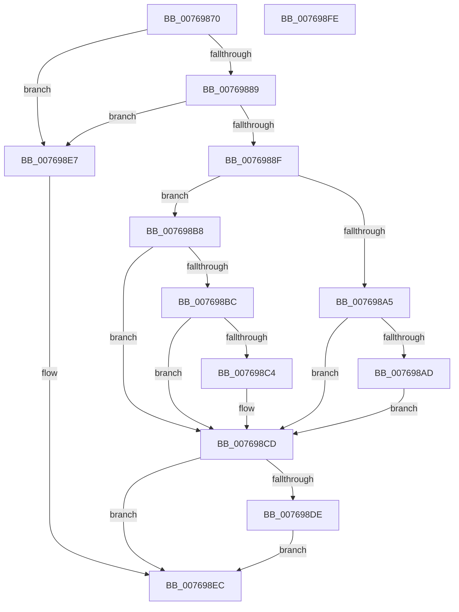

# PopEsPowerSettingPolicyCallback

- RVA: `0x00769870`–`0x007698FF` (길이 `143` bytes)
- VA: `0x0000000140769870`
- 실행 섹션: `PAGE`
- PDB 이름 있음: `예`; PDB Function 태그: `아니요`
- unwind 정보 RVA: `0x00060BC4`
- 디코드: `42`개 명령, `143/143` bytes 표시
- 미해석 바이트: `0` (있으면 어셈블리에 `.byte`로 보존)

> 이 문서는 커널 이미지의 기계어와 PDB 기호를 분석해 생성했습니다. 4번과 5번은 함수 원형과 자료형을 바이너리 사용 방식에서 추정한 C 해석이며 원본 소스 복구 결과는 아닙니다.

## 1. Dependencies

- 직접 호출 지점: **3**; 고유 호출 대상: **3**
- 직접 호출자로 확인된 함수: **0**
- RIP 상대 이미지 참조: **3**

### Outgoing calls
- `0x00769899` → [PopAcquireRwLockExclusive](../../text/43/PopAcquireRwLockExclusive_function_00430B44.md) (function, `0x00430B44`)
- `0x007698D4` → [PopReleaseRwLock](../../text/2D/PopReleaseRwLock_function_002DFBBC.md) (function, `0x002DFBBC`)
- `0x007698E0` → [PopEsQueueStateEvaluation](../A4/PopEsQueueStateEvaluation_function_00A4A398.md) (function, `0x00A4A398`)

### Direct callers
- 이 함수 시작 RVA로 연결되는 직접 call은 확인되지 않았습니다. 간접 호출은 완전히 역산할 수 없습니다.

### Static image references
- `0x0076988F` → RVA `0x00F08440` (`.data`; read)
- `0x007698A5` → RVA `0x00F0CE54` (`.data`; read)
- `0x007698B0` → RVA `0x00F0CE54` (`.data`; write)

## 2. Other-region calls and transfers

- 다른 실행 섹션으로 향하는 call: **2**
  - `0x00769899` → [PopAcquireRwLockExclusive](../../text/43/PopAcquireRwLockExclusive_function_00430B44.md) (`PAGE` → `.text`)
  - `0x007698D4` → [PopReleaseRwLock](../../text/2D/PopReleaseRwLock_function_002DFBBC.md) (`PAGE` → `.text`)
- 별도 외부 분기/꼬리 이동을 확인하지 못했습니다.

## 3. Assembly (complete function range)

```asm
00769870  48 89 5C 24 08                  mov qword ptr [rsp + 8], rbx
00769875  48 89 74 24 10                  mov qword ptr [rsp + 0x10], rsi
0076987A  57                              push rdi
0076987B  48 83 EC 20                     sub rsp, 0x20
0076987F  33 DB                           xor ebx, ebx
00769881  48 8B F2                        mov rsi, rdx
00769884  48 85 D2                        test rdx, rdx
00769887  74 5E                           je 0x1407698e7
00769889  41 83 F8 04                     cmp r8d, 4
0076988D  75 58                           jne 0x1407698e7
0076988F  48 8D 0D AA EB 79 00            lea rcx, [rip + 0x79ebaa]
00769896  40 8A FB                        mov dil, bl
00769899  E8 A6 72 CC FF                  call 0x140430b44
0076989E  8B 06                           mov eax, dword ptr [rsi]
007698A0  83 F8 01                        cmp eax, 1
007698A3  75 13                           jne 0x1407698b8
007698A5  38 1D A9 35 7A 00               cmp byte ptr [rip + 0x7a35a9], bl
007698AB  75 20                           jne 0x1407698cd
007698AD  40 8A F8                        mov dil, al
007698B0  88 05 9E 35 7A 00               mov byte ptr [rip + 0x7a359e], al
007698B6  EB 15                           jmp 0x1407698cd
007698B8  85 C0                           test eax, eax
007698BA  75 11                           jne 0x1407698cd
007698BC  38 1D 92 35 7A 00               cmp byte ptr [rip + 0x7a3592], bl
007698C2  74 09                           je 0x1407698cd
007698C4  40 B7 01                        mov dil, 1
007698C7  88 1D 87 35 7A 00               mov byte ptr [rip + 0x7a3587], bl
007698CD  48 8D 0D 6C EB 79 00            lea rcx, [rip + 0x79eb6c]
007698D4  E8 E3 62 B7 FF                  call 0x1402dfbbc
007698D9  40 84 FF                        test dil, dil
007698DC  74 0E                           je 0x1407698ec
007698DE  33 C9                           xor ecx, ecx
007698E0  E8 B3 0A 2E 00                  call 0x140a4a398
007698E5  EB 05                           jmp 0x1407698ec
007698E7  BB 0D 00 00 C0                  mov ebx, 0xc000000d
007698EC  48 8B 74 24 38                  mov rsi, qword ptr [rsp + 0x38]
007698F1  8B C3                           mov eax, ebx
007698F3  48 8B 5C 24 30                  mov rbx, qword ptr [rsp + 0x30]
007698F8  48 83 C4 20                     add rsp, 0x20
007698FC  5F                              pop rdi
007698FD  C3                              ret
007698FE  CC                              int3
```

## 4. C-style interpretation (structured pseudocode)

```c
__int64 __fastcall PopEsPowerSettingPolicyCallback(__int64 a1, __int64 a2, int a3)
{
    __int64 result;
    __int64 v_rbx;
    __int64 v_rdi;
    __int64 v_rsp;
    unsigned __int64 v_stack_p10;
    unsigned __int64 v_stack_p8;

    v_stack_p8 = v_rbx;
    v_stack_p10 = v_rsi;
    v_rsp = (v_rsp) - (32);
    v_rbx = 0;
    if (a2 == 0) goto loc_007698E7;
    if (a3 != 4) goto loc_007698E7;
    result = PopAcquireRwLockExclusive(v_rip + 7990186, a2, a3, a4);
    if (((unsigned int)((unsigned int)(*(unsigned int *)(a2)))) != 1) goto loc_007698B8;
    if ((*(unsigned __int8 *)(v_rip + 8009129)) != 0) goto loc_007698CD;
    *(unsigned __int8 *)(v_rip + 8009118) = (unsigned __int8)((unsigned int)(*(unsigned int *)(a2)));
    goto loc_007698CD;
loc_007698B8:
    if ((unsigned int)((unsigned int)(*(unsigned int *)(a2))) != 0) goto loc_007698CD;
    v_rdi = (unsigned __int8)((unsigned int)(*(unsigned int *)(a2)));
    if ((*(unsigned __int8 *)(v_rip + 8009106)) != 0) {
        v_rdi = 1;
        *(unsigned __int8 *)(v_rip + 8009095) = 0;
    }
    result = PopReleaseRwLock(v_rip + 7990124, a2, a3, a4);
    if ((unsigned __int8)(v_rdi) == 0) goto loc_007698EC;
    a1 = 0;
    result = PopEsQueueStateEvaluation(a1, a2, a3, a4);
    goto loc_007698EC;
loc_007698E7:
loc_007698EC:
    v_rsp = (v_rsp) + (32);
    return (unsigned int)((unsigned int)((unsigned int)(0xC000000DULL)));
}
```

## 5. (Beta) C Style

```c
int64_t PopEsPowerSettingPolicyCallback(int64_t Arg1, void *Arg2, int32_t Arg3)
{
    uint8_t *arg2 = (uint8_t *)Arg2;

    int64_t result;
    int64_t local_rbx;
    int64_t local_rdi;
    int64_t local_rsp;
    uint64_t v_stack_p10;
    uint64_t v_stack_p8;

    v_stack_p8 = local_rbx;
    v_stack_p10 = local_rsi;
    local_rsp = (local_rsp) - (32);
    local_rbx = 0;
    if (Arg2 == NULL) goto loc_007698E7;
    if (Arg3 != 4) goto loc_007698E7;
    result = PopAcquireRwLockExclusive(v_rip + 7990186, Arg2, Arg3, a4);
    if (((uint32_t)((uint32_t)(*(uint32_t *)(arg2)))) != 1) goto loc_007698B8;
    if ((*(uint8_t *)(v_rip + 0x7A35A9)) != 0) goto loc_007698CD;
    *(uint8_t *)(v_rip + 0x7A359E) = (uint8_t)((uint32_t)(*(uint32_t *)(arg2)));
    goto loc_007698CD;
loc_007698B8:
    if ((uint32_t)((uint32_t)(*(uint32_t *)(arg2))) != 0) goto loc_007698CD;
    local_rdi = (uint8_t)((uint32_t)(*(uint32_t *)(arg2)));
    if ((*(uint8_t *)(v_rip + 0x7A3592)) != 0) {
        local_rdi = 1;
        *(uint8_t *)(v_rip + 0x7A3587) = 0;
    }
    result = PopReleaseRwLock(v_rip + 7990124, Arg2, Arg3, a4);
    if ((uint8_t)(local_rdi) == 0) goto loc_007698EC;
    Arg1 = 0;
    result = PopEsQueueStateEvaluation(Arg1, Arg2, Arg3, a4);
    goto loc_007698EC;
loc_007698E7:
loc_007698EC:
    local_rsp = (local_rsp) + (32);
    return (uint32_t)((uint32_t)((uint32_t)(0xC000000DULL)));
}
```

### 관측된 메모리 오프셋

구조체 형식이 확인되지 않은 접근은 인자 기준의 오프셋으로만 기록했습니다.

| 기준 인자 | 오프셋 표현 | 폭 (bit) | 접근 |
|---|---:|---:|---|
| `Arg2` | `+ 0x0` | `32` | `R` |

## 6. Execution-region graph

[열기: 2D/3D 그래프와 함수 탐색 컨트롤 패널](../../../control-panel.html?section=page&rva=0x00769870&view=graph)

- 2D 그래프는 위에서 아래로 흐르고, 3D 그래프는 빈 공간을 드래그해 회전합니다. Shift+드래그는 이동, 휠은 확대·축소, 함수 노드 선택은 대상 보고서 이동입니다.

### Static fallback


