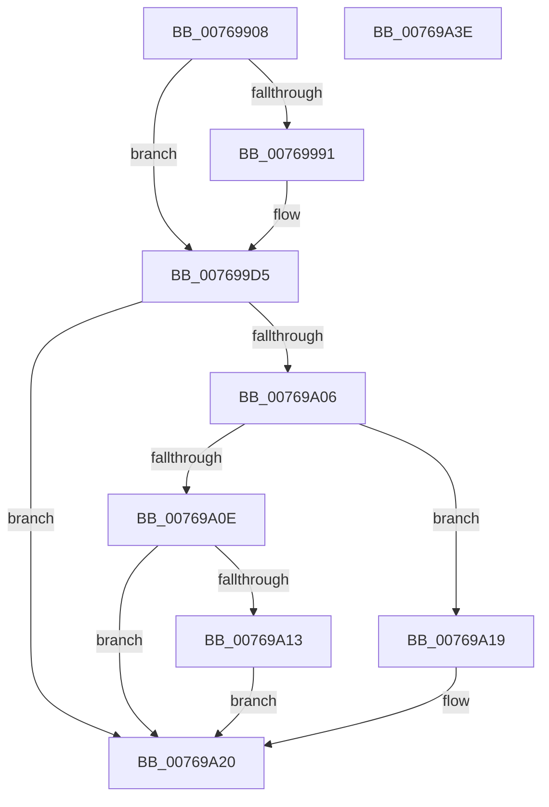

# PopEsPublishStateV2

- RVA: `0x00769908`–`0x00769A3F` (길이 `311` bytes)
- VA: `0x0000000140769908`
- 실행 섹션: `PAGE`
- PDB 이름 있음: `예`; PDB Function 태그: `아니요`
- unwind 정보 RVA: `0x000CD118`
- 디코드: `77`개 명령, `311/311` bytes 표시
- 미해석 바이트: `0` (있으면 어셈블리에 `.byte`로 보존)

> 이 문서는 커널 이미지의 기계어와 PDB 기호를 분석해 생성했습니다. 4번과 5번은 함수 원형과 자료형을 바이너리 사용 방식에서 추정한 C 해석이며 원본 소스 복구 결과는 아닙니다.

## 1. Dependencies

- 직접 호출 지점: **5**; 고유 호출 대상: **2**
- 직접 호출자로 확인된 함수: **2**
- RIP 상대 이미지 참조: **6**

### Outgoing calls
- `0x00769952` → [ZwUpdateWnfStateData](../../text/6B/ZwUpdateWnfStateData_function_006B0D10.md) (function, `0x006B0D10`)
- `0x00769982` → [ZwUpdateWnfStateData](../../text/6B/ZwUpdateWnfStateData_function_006B0D10.md) (function, `0x006B0D10`)
- `0x007699D0` → [ZwUpdateWnfStateData](../../text/6B/ZwUpdateWnfStateData_function_006B0D10.md) (function, `0x006B0D10`)
- `0x007699F7` → [PopSetPowerSettingValueAcDc](../91/PopSetPowerSettingValueAcDc_function_00914D6C.md) (function, `0x00914D6C`)
- `0x00769A30` → [PopSetPowerSettingValueAcDc](../91/PopSetPowerSettingValueAcDc_function_00914D6C.md) (function, `0x00914D6C`)

### Direct callers
- [PopEsUpdateState](../../text/5D/PopEsUpdateState_function_005DA018.md) at `0x005DA106`
- [PopEsWorker](../AC/PopEsWorker_function_00AC6EE0.md) at `0x00AC6FA8`

### Static image references
- `0x00769914` → RVA `0x00E67A2C` (`.data`; read)
- `0x00769929` → RVA `0x00020A80` (`.rdata`; read)
- `0x00769966` → RVA `0x00020938` (`.rdata`; read)
- `0x007699C3` → RVA `0x00020948` (`.rdata`; read)
- `0x007699E5` → RVA `0x00024928` (`.rdata`; read)
- `0x00769A29` → RVA `0x00024658` (`.rdata`; read)

## 2. Other-region calls and transfers

- 다른 실행 섹션으로 향하는 call: **3**
  - `0x00769952` → [ZwUpdateWnfStateData](../../text/6B/ZwUpdateWnfStateData_function_006B0D10.md) (`PAGE` → `.text`)
  - `0x00769982` → [ZwUpdateWnfStateData](../../text/6B/ZwUpdateWnfStateData_function_006B0D10.md) (`PAGE` → `.text`)
  - `0x007699D0` → [ZwUpdateWnfStateData](../../text/6B/ZwUpdateWnfStateData_function_006B0D10.md) (`PAGE` → `.text`)
- 별도 외부 분기/꼬리 이동을 확인하지 못했습니다.

## 3. Assembly (complete function range)

```asm
00769908  40 55                           push rbp
0076990A  53                              push rbx
0076990B  41 56                           push r14
0076990D  48 8B EC                        mov rbp, rsp
00769910  48 83 EC 40                     sub rsp, 0x40
00769914  8B 05 12 E1 6F 00               mov eax, dword ptr [rip + 0x6fe112]
0076991A  45 33 C9                        xor r9d, r9d
0076991D  83 64 24 30 00                  and dword ptr [rsp + 0x30], 0
00769922  8A D9                           mov bl, cl
00769924  83 64 24 28 00                  and dword ptr [rsp + 0x28], 0
00769929  48 8D 0D 50 71 8B FF            lea rcx, [rip - 0x748eb0]
00769930  83 65 20 00                     and dword ptr [rbp + 0x20], 0
00769934  83 4D 3C FF                     or dword ptr [rbp + 0x3c], 0xffffffff
00769938  45 8D 41 08                     lea r8d, [r9 + 8]
0076993C  48 83 64 24 20 00               and qword ptr [rsp + 0x20], 0
00769942  0F B6 D0                        movzx edx, al
00769945  C1 E2 0E                        shl edx, 0xe
00769948  83 CA 01                        or edx, 1
0076994B  89 55 38                        mov dword ptr [rbp + 0x38], edx
0076994E  48 8D 55 38                     lea rdx, [rbp + 0x38]
00769952  E8 B9 73 F4 FF                  call 0x1406b0d10
00769957  83 64 24 30 00                  and dword ptr [rsp + 0x30], 0
0076995C  48 8D 55 28                     lea rdx, [rbp + 0x28]
00769960  8B 05 C6 E0 6F 00               mov eax, dword ptr [rip + 0x6fe0c6]
00769966  48 8D 0D CB 6F 8B FF            lea rcx, [rip - 0x749035]
0076996D  83 64 24 28 00                  and dword ptr [rsp + 0x28], 0
00769972  45 33 C9                        xor r9d, r9d
00769975  48 83 64 24 20 00               and qword ptr [rsp + 0x20], 0
0076997B  89 45 28                        mov dword ptr [rbp + 0x28], eax
0076997E  45 8D 41 04                     lea r8d, [r9 + 4]
00769982  E8 89 73 F4 FF                  call 0x1406b0d10
00769987  41 BE 02 00 00 00               mov r14d, 2
0076998D  84 DB                           test bl, bl
0076998F  74 44                           je 0x1407699d5
00769991  8B 45 38                        mov eax, dword ptr [rbp + 0x38]
00769994  45 8D 46 06                     lea r8d, [r14 + 6]
00769998  33 C9                           xor ecx, ecx
0076999A  48 8D 55 38                     lea rdx, [rbp + 0x38]
0076999E  81 3D 84 E0 6F 00 F0 00 00 00   cmp dword ptr [rip + 0x6fe084], 0xf0
007699A8  41 0F 44 CE                     cmove ecx, r14d
007699AC  83 64 24 30 00                  and dword ptr [rsp + 0x30], 0
007699B1  83 64 24 28 00                  and dword ptr [rsp + 0x28], 0
007699B6  25 FD 3F C0 FF                  and eax, 0xffc03ffd
007699BB  48 83 64 24 20 00               and qword ptr [rsp + 0x20], 0
007699C1  0B C1                           or eax, ecx
007699C3  48 8D 0D 7E 6F 8B FF            lea rcx, [rip - 0x749082]
007699CA  89 45 38                        mov dword ptr [rbp + 0x38], eax
007699CD  45 33 C9                        xor r9d, r9d
007699D0  E8 3B 73 F4 FF                  call 0x1406b0d10
007699D5  33 C0                           xor eax, eax
007699D7  4C 8D 45 30                     lea r8, [rbp + 0x30]
007699DB  81 3D 47 E0 6F 00 F0 00 00 00   cmp dword ptr [rip + 0x6fe047], 0xf0
007699E5  48 8D 0D 3C AF 8B FF            lea rcx, [rip - 0x7450c4]
007699EC  BA 04 00 00 00                  mov edx, 4
007699F1  0F 94 C0                        sete al
007699F4  89 45 30                        mov dword ptr [rbp + 0x30], eax
007699F7  E8 70 B3 1A 00                  call 0x140914d6c
007699FC  8B 0D 2A E0 6F 00               mov ecx, dword ptr [rip + 0x6fe02a]
00769A02  85 C9                           test ecx, ecx
00769A04  74 1A                           je 0x140769a20
00769A06  81 E9 80 00 00 00               sub ecx, 0x80
00769A0C  74 0B                           je 0x140769a19
00769A0E  83 F9 70                        cmp ecx, 0x70
00769A11  75 0D                           jne 0x140769a20
00769A13  44 89 75 20                     mov dword ptr [rbp + 0x20], r14d
00769A17  EB 07                           jmp 0x140769a20
00769A19  C7 45 20 01 00 00 00            mov dword ptr [rbp + 0x20], 1
00769A20  4C 8D 45 20                     lea r8, [rbp + 0x20]
00769A24  BA 04 00 00 00                  mov edx, 4
00769A29  48 8D 0D 28 AC 8B FF            lea rcx, [rip - 0x7453d8]
00769A30  E8 37 B3 1A 00                  call 0x140914d6c
00769A35  48 83 C4 40                     add rsp, 0x40
00769A39  41 5E                           pop r14
00769A3B  5B                              pop rbx
00769A3C  5D                              pop rbp
00769A3D  C3                              ret
00769A3E  CC                              int3
```

## 4. C-style interpretation (structured pseudocode)

```c
__int64 __fastcall PopEsPublishStateV2(unsigned __int8 a1, __int64 a2, __int64 a3, int a4)
{
    __int64 result;
    __int64 v_rsp;
    unsigned int v_stack_m28;
    unsigned int v_stack_m30;
    unsigned __int64 v_stack_m38;
    unsigned __int64 v_stack_p10;
    unsigned __int64 v_stack_p18;
    unsigned int v_stack_p20;
    unsigned int v_stack_p24;
    unsigned int v_stack_p8;

    v_rsp = (v_rsp) - (64);
    a4 = 0;
    a2 = (unsigned int)(((unsigned __int8)((unsigned int)(*(unsigned int *)(v_rip + 7332114)))) << (14));
    a2 = (unsigned int)((a2) | (1));
    v_stack_p20 = (unsigned int)(a2);
    result = ZwUpdateWnfStateData(v_rip - 7638704, v_stack_p20, a4 + 8, a4);
    a4 = 0;
    v_stack_p10 = (unsigned int)((unsigned int)(*(unsigned int *)(v_rip + 7332038)));
    result = ZwUpdateWnfStateData(v_rip - 7639093, v_stack_p10, a4 + 4, a4);
    if (a1 != 0) {
        result = v_stack_p20;
        a3 = 2 + 6;
        a1 = 0;
        a2 = v_stack_p20;
        if ((*(unsigned int *)(v_rip + 7331972)) == 240) { a1 = 2; }
        result = (unsigned int)((result) & (0xFFC03FFDULL));
        result = (unsigned int)((result) | (a1));
        a1 = v_rip - 7639170;
        v_stack_p20 = (unsigned int)(result);
        a4 = 0;
        result = ZwUpdateWnfStateData(a1, a2, a3, a4);
    }
    result = 0;
    result = ((*(unsigned int *)(v_rip + 7331911)) == 240) ? 1 : 0;
    v_stack_p18 = (unsigned int)(result);
    result = PopSetPowerSettingValueAcDc(v_rip - 7622852, 4, v_stack_p18, a4);
    if ((unsigned int)((unsigned int)(*(unsigned int *)(v_rip + 7331882))) == 0) goto loc_00769A20;
    a1 = (unsigned int)(((unsigned int)(*(unsigned int *)(v_rip + 7331882))) - (128));
    if (condition_is_equal) goto loc_00769A19;
    if (a1 != 112) goto loc_00769A20;
    v_stack_p8 = 2;
    goto loc_00769A20;
loc_00769A19:
    v_stack_p8 = 1;
loc_00769A20:
    result = PopSetPowerSettingValueAcDc(v_rip - 7623640, 4, v_stack_p8, a4);
    v_rsp = (v_rsp) + (64);
    return result;
}
```

## 5. (Beta) C Style

```c
int64_t PopEsPublishStateV2(uint8_t Arg1, int64_t Arg2, int64_t Arg3, int32_t Arg4)
{
    int64_t result;
    int64_t local_rsp;
    uint32_t v_stack_m28;
    uint32_t v_stack_m30;
    uint64_t v_stack_m38;
    uint64_t v_stack_p10;
    uint64_t v_stack_p18;
    uint32_t v_stack_p20;
    uint32_t v_stack_p24;
    uint32_t v_stack_p8;

    local_rsp = (local_rsp) - (64);
    Arg4 = 0;
    Arg2 = (uint32_t)(((uint8_t)((uint32_t)(*(uint32_t *)(v_rip + 0x6FE112)))) << (14));
    Arg2 = (uint32_t)((Arg2) | (1));
    v_stack_p20 = (uint32_t)(Arg2);
    result = ZwUpdateWnfStateData(v_rip - 7638704, v_stack_p20, Arg4 + 8, Arg4);
    Arg4 = 0;
    v_stack_p10 = (uint32_t)((uint32_t)(*(uint32_t *)(v_rip + 0x6FE0C6)));
    result = ZwUpdateWnfStateData(v_rip - 7639093, v_stack_p10, Arg4 + 4, Arg4);
    if (Arg1 != 0) {
        result = v_stack_p20;
        Arg3 = 2 + 6;
        Arg1 = 0;
        Arg2 = v_stack_p20;
        if ((*(uint32_t *)(v_rip + 0x6FE084)) == 240) { Arg1 = 2; }
        result = (uint32_t)((result) & (0xFFC03FFDULL));
        result = (uint32_t)((result) | (Arg1));
        Arg1 = v_rip - 7639170;
        v_stack_p20 = (uint32_t)(result);
        Arg4 = 0;
        result = ZwUpdateWnfStateData(Arg1, Arg2, Arg3, Arg4);
    }
    result = 0;
    result = ((*(uint32_t *)(v_rip + 0x6FE047)) == 240) ? 1 : 0;
    v_stack_p18 = (uint32_t)(result);
    result = PopSetPowerSettingValueAcDc(v_rip - 7622852, 4, v_stack_p18, Arg4);
    if ((uint32_t)((uint32_t)(*(uint32_t *)(v_rip + 0x6FE02A))) == 0) goto loc_00769A20;
    Arg1 = (uint32_t)(((uint32_t)(*(uint32_t *)(v_rip + 0x6FE02A))) - (128));
    if (condition_is_equal) goto loc_00769A19;
    if (Arg1 != 112) goto loc_00769A20;
    v_stack_p8 = 2;
    goto loc_00769A20;
loc_00769A19:
    v_stack_p8 = 1;
loc_00769A20:
    result = PopSetPowerSettingValueAcDc(v_rip - 7623640, 4, v_stack_p8, Arg4);
    local_rsp = (local_rsp) + (64);
    return result;
}
```

## 6. Execution-region graph

[열기: 2D/3D 그래프와 함수 탐색 컨트롤 패널](../../../control-panel.html?section=page&rva=0x00769908&view=graph)

- 2D 그래프는 위에서 아래로 흐르고, 3D 그래프는 빈 공간을 드래그해 회전합니다. Shift+드래그는 이동, 휠은 확대·축소, 함수 노드 선택은 대상 보고서 이동입니다.

### Static fallback


