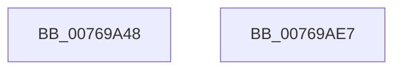

# PopEsUpdateSetting

- RVA: `0x00769A48`–`0x00769AE8` (길이 `160` bytes)
- VA: `0x0000000140769A48`
- 실행 섹션: `PAGE`
- PDB 이름 있음: `예`; PDB Function 태그: `아니요`
- unwind 정보 RVA: `0x0006F9F8`
- 디코드: `33`개 명령, `160/160` bytes 표시
- 미해석 바이트: `0` (있으면 어셈블리에 `.byte`로 보존)

> 이 문서는 커널 이미지의 기계어와 PDB 기호를 분석해 생성했습니다. 4번과 5번은 함수 원형과 자료형을 바이너리 사용 방식에서 추정한 C 해석이며 원본 소스 복구 결과는 아닙니다.

## 1. Dependencies

- 직접 호출 지점: **3**; 고유 호출 대상: **3**
- 직접 호출자로 확인된 함수: **1**
- RIP 상대 이미지 참조: **7**

### Outgoing calls
- `0x00769AAA` → [ZwUpdateWnfStateData](../../text/6B/ZwUpdateWnfStateData_function_006B0D10.md) (function, `0x006B0D10`)
- `0x00769AD0` → [PopTraceEsSetting](../../text/4E/PopTraceEsSetting_function_004E3A64.md) (function, `0x004E3A64`)
- `0x00769ADD` → [_security_check_cookie](../../text/6A/_security_check_cookie_function_006AC640.md) (function, `0x006AC640`)

### Direct callers
- [PopEsWorker](../AC/PopEsWorker_function_00AC6EE0.md) at `0x00AC6F8C`

### Static image references
- `0x00769A4C` → RVA `0x00E0A740` (`.data`; read)
- `0x00769A5B` → RVA `0x00F0CE55` (`.data`; read)
- `0x00769A67` → RVA `0x00E0B864` (`.data`; read)
- `0x00769A6D` → RVA `0x00E67A08` (`.data`; read)
- `0x00769A78` → RVA `0x00E0B860` (`.data`; read)
- `0x00769A82` → RVA `0x00F0CE50` (`.data`; read)
- `0x00769A96` → RVA `0x00020A08` (`.rdata`; read)

## 2. Other-region calls and transfers

- 다른 실행 섹션으로 향하는 call: **3**
  - `0x00769AAA` → [ZwUpdateWnfStateData](../../text/6B/ZwUpdateWnfStateData_function_006B0D10.md) (`PAGE` → `.text`)
  - `0x00769AD0` → [PopTraceEsSetting](../../text/4E/PopTraceEsSetting_function_004E3A64.md) (`PAGE` → `.text`)
  - `0x00769ADD` → [_security_check_cookie](../../text/6A/_security_check_cookie_function_006AC640.md) (`PAGE` → `.text`)
- 별도 외부 분기/꼬리 이동을 확인하지 못했습니다.

## 3. Assembly (complete function range)

```asm
00769A48  48 83 EC 68                     sub rsp, 0x68
00769A4C  48 8B 05 ED 0C 6A 00            mov rax, qword ptr [rip + 0x6a0ced]
00769A53  48 33 C4                        xor rax, rsp
00769A56  48 89 44 24 50                  mov qword ptr [rsp + 0x50], rax
00769A5B  0F B6 05 F3 33 7A 00            movzx eax, byte ptr [rip + 0x7a33f3]
00769A62  48 8D 54 24 40                  lea rdx, [rsp + 0x40]
00769A67  8B 0D F7 1D 6A 00               mov ecx, dword ptr [rip + 0x6a1df7]
00769A6D  83 3D 94 DF 6F 00 20            cmp dword ptr [rip + 0x6fdf94], 0x20
00769A74  89 44 24 48                     mov dword ptr [rsp + 0x48], eax
00769A78  0F 45 0D E1 1D 6A 00            cmovne ecx, dword ptr [rip + 0x6a1de1]
00769A7F  45 33 C9                        xor r9d, r9d
00769A82  8B 05 C8 33 7A 00               mov eax, dword ptr [rip + 0x7a33c8]
00769A88  89 44 24 44                     mov dword ptr [rsp + 0x44], eax
00769A8C  33 C0                           xor eax, eax
00769A8E  89 44 24 30                     mov dword ptr [rsp + 0x30], eax
00769A92  89 4C 24 40                     mov dword ptr [rsp + 0x40], ecx
00769A96  48 8D 0D 6B 6F 8B FF            lea rcx, [rip - 0x749095]
00769A9D  89 44 24 28                     mov dword ptr [rsp + 0x28], eax
00769AA1  44 8D 40 0C                     lea r8d, [rax + 0xc]
00769AA5  48 89 44 24 20                  mov qword ptr [rsp + 0x20], rax
00769AAA  E8 61 72 F4 FF                  call 0x1406b0d10
00769AAF  83 3D 52 DF 6F 00 20            cmp dword ptr [rip + 0x6fdf52], 0x20
00769AB6  8B 0D A8 1D 6A 00               mov ecx, dword ptr [rip + 0x6a1da8]
00769ABC  0F 45 0D 9D 1D 6A 00            cmovne ecx, dword ptr [rip + 0x6a1d9d]
00769AC3  44 8A 05 8B 33 7A 00            mov r8b, byte ptr [rip + 0x7a338b]
00769ACA  8B 15 80 33 7A 00               mov edx, dword ptr [rip + 0x7a3380]
00769AD0  E8 8F 9F D7 FF                  call 0x1404e3a64
00769AD5  48 8B 4C 24 50                  mov rcx, qword ptr [rsp + 0x50]
00769ADA  48 33 CC                        xor rcx, rsp
00769ADD  E8 5E 2B F4 FF                  call 0x1406ac640
00769AE2  48 83 C4 68                     add rsp, 0x68
00769AE6  C3                              ret
00769AE7  CC                              int3
```

## 4. C-style interpretation (structured pseudocode)

```c
__int64 __fastcall PopEsUpdateSetting(__int64 a1, __int64 a2, __int64 a3, int a4)
{
    __int64 result;
    __int64 v_rsp;
    unsigned __int64 v_stack_m18;
    unsigned int v_stack_m20;
    unsigned int v_stack_m24;
    unsigned __int64 v_stack_m28;
    unsigned int v_stack_m38;
    unsigned int v_stack_m40;
    unsigned __int64 v_stack_m48;

    v_rsp = (v_rsp) - (104);
    result = (*(unsigned __int64 *)(v_rip + 6950125)) ^ (v_rsp);
    v_stack_m18 = result;
    v_stack_m20 = (unsigned int)(*(unsigned __int8 *)(v_rip + 8008691));
    a1 = (unsigned int)(*(unsigned int *)(v_rip + 6954487));
    if ((*(unsigned int *)(v_rip + 7331732)) != 32) { a1 = *(unsigned int *)(v_rip + 6954465); }
    a4 = 0;
    v_stack_m24 = (unsigned int)((unsigned int)(*(unsigned int *)(v_rip + 8008648)));
    result = 0;
    v_stack_m38 = 0;
    v_stack_m28 = (unsigned int)(a1);
    v_stack_m40 = 0;
    v_stack_m48 = 0;
    result = ZwUpdateWnfStateData(v_rip - 7639189, v_stack_m28, result + 12, a4);
    a1 = (unsigned int)(*(unsigned int *)(v_rip + 6954408));
    if ((*(unsigned int *)(v_rip + 7331666)) != 32) { a1 = *(unsigned int *)(v_rip + 6954397); }
    result = PopTraceEsSetting(a1, (unsigned int)(*(unsigned int *)(v_rip + 8008576)), *(unsigned __int8 *)(v_rip + 8008587), a4);
    a1 = (v_stack_m18) ^ (v_rsp);
    result = _security_check_cookie(a1, (unsigned int)(*(unsigned int *)(v_rip + 8008576)), *(unsigned __int8 *)(v_rip + 8008587), a4);
    v_rsp = (v_rsp) + (104);
    return result;
}
```

## 5. (Beta) C Style

```c
int64_t PopEsUpdateSetting(int64_t Arg1, int64_t Arg2, int64_t Arg3, int32_t Arg4)
{
    int64_t result;
    int64_t local_rsp;
    uint64_t v_stack_m18;
    uint32_t v_stack_m20;
    uint32_t v_stack_m24;
    uint64_t v_stack_m28;
    uint32_t v_stack_m38;
    uint32_t v_stack_m40;
    uint64_t v_stack_m48;

    local_rsp = (local_rsp) - (104);
    result = (*(uint64_t *)(v_rip + 0x6A0CED)) ^ (local_rsp);
    v_stack_m18 = result;
    v_stack_m20 = (uint32_t)(*(uint8_t *)(v_rip + 0x7A33F3));
    Arg1 = (uint32_t)(*(uint32_t *)(v_rip + 0x6A1DF7));
    if ((*(uint32_t *)(v_rip + 0x6FDF94)) != 32) { Arg1 = *(uint32_t *)(v_rip + 0x6A1DE1); }
    Arg4 = 0;
    v_stack_m24 = (uint32_t)((uint32_t)(*(uint32_t *)(v_rip + 0x7A33C8)));
    result = 0;
    v_stack_m38 = 0;
    v_stack_m28 = (uint32_t)(Arg1);
    v_stack_m40 = 0;
    v_stack_m48 = 0;
    result = ZwUpdateWnfStateData(v_rip - 7639189, v_stack_m28, result + 12, Arg4);
    Arg1 = (uint32_t)(*(uint32_t *)(v_rip + 0x6A1DA8));
    if ((*(uint32_t *)(v_rip + 0x6FDF52)) != 32) { Arg1 = *(uint32_t *)(v_rip + 0x6A1D9D); }
    result = PopTraceEsSetting(Arg1, (uint32_t)(*(uint32_t *)(v_rip + 0x7A3380)), *(uint8_t *)(v_rip + 0x7A338B), Arg4);
    Arg1 = (v_stack_m18) ^ (local_rsp);
    result = _security_check_cookie(Arg1, (uint32_t)(*(uint32_t *)(v_rip + 0x7A3380)), *(uint8_t *)(v_rip + 0x7A338B), Arg4);
    local_rsp = (local_rsp) + (104);
    return result;
}
```

## 6. Execution-region graph

[열기: 2D/3D 그래프와 함수 탐색 컨트롤 패널](../../../control-panel.html?section=page&rva=0x00769A48&view=graph)

- 2D 그래프는 위에서 아래로 흐르고, 3D 그래프는 빈 공간을 드래그해 회전합니다. Shift+드래그는 이동, 휠은 확대·축소, 함수 노드 선택은 대상 보고서 이동입니다.

### Static fallback


