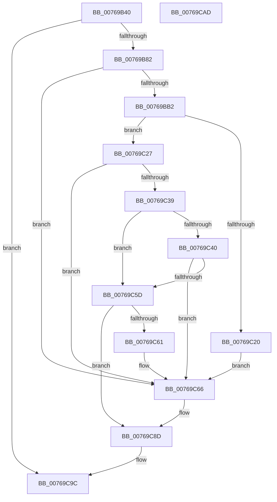

# PopEtDeferredInitDxgContext

- RVA: `0x00769B40`–`0x00769CAE` (길이 `366` bytes)
- VA: `0x0000000140769B40`
- 실행 섹션: `PAGE`
- PDB 이름 있음: `예`; PDB Function 태그: `아니요`
- unwind 정보 RVA: `0x000CD138`
- 디코드: `85`개 명령, `366/366` bytes 표시
- 미해석 바이트: `0` (있으면 어셈블리에 `.byte`로 보존)

> 이 문서는 커널 이미지의 기계어와 PDB 기호를 분석해 생성했습니다. 4번과 5번은 함수 원형과 자료형을 바이너리 사용 방식에서 추정한 C 해석이며 원본 소스 복구 결과는 아닙니다.

## 1. Dependencies

- 직접 호출 지점: **7**; 고유 호출 대상: **7**
- 직접 호출자로 확인된 함수: **1**
- RIP 상대 이미지 참조: **2**

### Outgoing calls
- `0x00769B8D` → [RtlInitUnicodeString](../../text/42/RtlInitUnicodeString_function_0042A780.md) (function, `0x0042A780`)
- `0x00769BA3` → [IoGetDeviceObjectPointer](../95/IoGetDeviceObjectPointer_function_00953220.md) (function, `0x00953220`)
- `0x00769BBB` → [KeInitializeEvent](../../text/40/KeInitializeEvent_function_0040DD10.md) (function, `0x0040DD10`)
- `0x00769C16` → [IoBuildDeviceIoControlRequest](../../text/20/IoBuildDeviceIoControlRequest_function_00204FD0.md) (function, `0x00204FD0`)
- `0x00769C2E` → [IofCallDriver](../../text/29/IofCallDriver_function_0029B4B0.md) (function, `0x0029B4B0`)
- `0x00769C52` → [KeWaitForSingleObject](../../text/20/KeWaitForSingleObject_function_0020E6B0.md) (function, `0x0020E6B0`)
- `0x00769C79` → [ExFreePoolWithTag](../../poolcode/B8/ExFreePoolWithTag_function_00B82870.md) (function, `0x00B82870`)

### Direct callers
- [PopEtEnergyTrackerCreate](PopEtEnergyTrackerCreate_function_00769EE0.md) at `0x0076A03E`

### Static image references
- `0x00769B60` → RVA `0x00E67A30` (`.data`; read)
- `0x00769B82` → RVA `0x00B02EE0` (` ?? ::NNGAKEGL::`string'`; read)

## 2. Other-region calls and transfers

- 다른 실행 섹션으로 향하는 call: **6**
  - `0x00769B8D` → [RtlInitUnicodeString](../../text/42/RtlInitUnicodeString_function_0042A780.md) (`PAGE` → `.text`)
  - `0x00769BBB` → [KeInitializeEvent](../../text/40/KeInitializeEvent_function_0040DD10.md) (`PAGE` → `.text`)
  - `0x00769C16` → [IoBuildDeviceIoControlRequest](../../text/20/IoBuildDeviceIoControlRequest_function_00204FD0.md) (`PAGE` → `.text`)
  - `0x00769C2E` → [IofCallDriver](../../text/29/IofCallDriver_function_0029B4B0.md) (`PAGE` → `.text`)
  - `0x00769C52` → [KeWaitForSingleObject](../../text/20/KeWaitForSingleObject_function_0020E6B0.md) (`PAGE` → `.text`)
  - `0x00769C79` → [ExFreePoolWithTag](../../poolcode/B8/ExFreePoolWithTag_function_00B82870.md) (`PAGE` → `POOLCODE`)
- 별도 외부 분기/꼬리 이동을 확인하지 못했습니다.

## 3. Assembly (complete function range)

```asm
00769B40  48 89 5C 24 18                  mov qword ptr [rsp + 0x18], rbx
00769B45  55                              push rbp
00769B46  48 8D 6C 24 A9                  lea rbp, [rsp - 0x57]
00769B4B  48 81 EC 90 00 00 00            sub rsp, 0x90
00769B52  48 83 65 67 00                  and qword ptr [rbp + 0x67], 0
00769B57  33 C0                           xor eax, eax
00769B59  0F 57 C0                        xorps xmm0, xmm0
00769B5C  48 89 45 47                     mov qword ptr [rbp + 0x47], rax
00769B60  48 8B 05 C9 DE 6F 00            mov rax, qword ptr [rip + 0x6fdec9]
00769B67  0F 11 45 17                     movups xmmword ptr [rbp + 0x17], xmm0
00769B6B  0F 11 45 37                     movups xmmword ptr [rbp + 0x37], xmm0
00769B6F  8B 80 48 04 00 00               mov eax, dword ptr [rax + 0x448]
00769B75  0F 11 45 27                     movups xmmword ptr [rbp + 0x27], xmm0
00769B79  83 F8 FF                        cmp eax, -1
00769B7C  0F 85 1A 01 00 00               jne 0x140769c9c
00769B82  48 8D 15 57 93 39 00            lea rdx, [rip + 0x399357]
00769B89  48 8D 4D 17                     lea rcx, [rbp + 0x17]
00769B8D  E8 EE 0B CC FF                  call 0x14042a780
00769B92  4C 8D 4D 67                     lea r9, [rbp + 0x67]
00769B96  BA 00 00 00 C0                  mov edx, 0xc0000000
00769B9B  4C 8D 45 6F                     lea r8, [rbp + 0x6f]
00769B9F  48 8D 4D 17                     lea rcx, [rbp + 0x17]
00769BA3  E8 78 96 1E 00                  call 0x140953220
00769BA8  8B D8                           mov ebx, eax
00769BAA  85 C0                           test eax, eax
00769BAC  0F 88 B4 00 00 00               js 0x140769c66
00769BB2  45 33 C0                        xor r8d, r8d
00769BB5  48 8D 4D 37                     lea rcx, [rbp + 0x37]
00769BB9  33 D2                           xor edx, edx
00769BBB  E8 50 41 CA FF                  call 0x14040dd10
00769BC0  4C 8B 05 69 DE 6F 00            mov r8, qword ptr [rip + 0x6fde69]
00769BC7  41 B9 70 02 00 00               mov r9d, 0x270
00769BCD  48 8B 55 67                     mov rdx, qword ptr [rbp + 0x67]
00769BD1  B9 67 E0 23 00                  mov ecx, 0x23e067
00769BD6  49 8B 80 40 04 00 00            mov rax, qword ptr [r8 + 0x440]
00769BDD  66 44 89 08                     mov word ptr [rax], r9w
00769BE1  49 8B 80 40 04 00 00            mov rax, qword ptr [r8 + 0x440]
00769BE8  66 C7 40 02 03 00               mov word ptr [rax + 2], 3
00769BEE  48 8D 45 27                     lea rax, [rbp + 0x27]
00769BF2  4D 8B 80 40 04 00 00            mov r8, qword ptr [r8 + 0x440]
00769BF9  48 89 44 24 40                  mov qword ptr [rsp + 0x40], rax
00769BFE  48 8D 45 37                     lea rax, [rbp + 0x37]
00769C02  48 89 44 24 38                  mov qword ptr [rsp + 0x38], rax
00769C07  C6 44 24 30 01                  mov byte ptr [rsp + 0x30], 1
00769C0C  44 89 4C 24 28                  mov dword ptr [rsp + 0x28], r9d
00769C11  4C 89 44 24 20                  mov qword ptr [rsp + 0x20], r8
00769C16  E8 B5 B3 A9 FF                  call 0x140204fd0
00769C1B  48 85 C0                        test rax, rax
00769C1E  75 07                           jne 0x140769c27
00769C20  BB 9A 00 00 C0                  mov ebx, 0xc000009a
00769C25  EB 3F                           jmp 0x140769c66
00769C27  48 8B 4D 67                     mov rcx, qword ptr [rbp + 0x67]
00769C2B  48 8B D0                        mov rdx, rax
00769C2E  E8 7D 18 B3 FF                  call 0x14029b4b0
00769C33  8B D8                           mov ebx, eax
00769C35  85 C0                           test eax, eax
00769C37  78 2D                           js 0x140769c66
00769C39  3D 03 01 00 00                  cmp eax, 0x103
00769C3E  75 1D                           jne 0x140769c5d
00769C40  48 83 64 24 20 00               and qword ptr [rsp + 0x20], 0
00769C46  48 8D 4D 37                     lea rcx, [rbp + 0x37]
00769C4A  45 33 C9                        xor r9d, r9d
00769C4D  45 33 C0                        xor r8d, r8d
00769C50  33 D2                           xor edx, edx
00769C52  E8 59 4A AA FF                  call 0x14020e6b0
00769C57  8B D8                           mov ebx, eax
00769C59  85 C0                           test eax, eax
00769C5B  78 09                           js 0x140769c66
00769C5D  85 DB                           test ebx, ebx
00769C5F  74 2C                           je 0x140769c8d
00769C61  BB 01 00 00 C0                  mov ebx, 0xc0000001
00769C66  48 8B 0D C3 DD 6F 00            mov rcx, qword ptr [rip + 0x6fddc3]
00769C6D  BA 50 6F 45 54                  mov edx, 0x54456f50
00769C72  48 8B 89 40 04 00 00            mov rcx, qword ptr [rcx + 0x440]
00769C79  E8 F2 8B 41 00                  call 0x140b82870
00769C7E  48 8B 05 AB DD 6F 00            mov rax, qword ptr [rip + 0x6fddab]
00769C85  48 83 A0 40 04 00 00 00         and qword ptr [rax + 0x440], 0
00769C8D  48 8B 05 9C DD 6F 00            mov rax, qword ptr [rip + 0x6fdd9c]
00769C94  89 98 48 04 00 00               mov dword ptr [rax + 0x448], ebx
00769C9A  8B C3                           mov eax, ebx
00769C9C  48 8B 9C 24 B0 00 00 00         mov rbx, qword ptr [rsp + 0xb0]
00769CA4  48 81 C4 90 00 00 00            add rsp, 0x90
00769CAB  5D                              pop rbp
00769CAC  C3                              ret
00769CAD  CC                              int3
```

## 4. C-style interpretation (structured pseudocode)

```c
__int64 __fastcall PopEtDeferredInitDxgContext(void)
{
    __int64 result;
    __int64 v_rsp;
    unsigned __int64 v_stack_m18;
    unsigned __int64 v_stack_m28;
    unsigned __int64 v_stack_m38;
    unsigned __int64 v_stack_m48;
    unsigned __int64 v_stack_m58;
    unsigned __int64 v_stack_m5F;
    unsigned __int64 v_stack_m60;
    unsigned __int8 v_stack_m68;
    unsigned int v_stack_m70;
    unsigned __int64 v_stack_m78;
    unsigned __int64 v_stack_p10;
    unsigned __int64 v_stack_p18;
    unsigned __int64 v_stack_p8;

    v_stack_p18 = v_rbx;
    v_rsp = (v_rsp) - (144);
    result = 0;
    v_stack_m18 = 0;
    v_stack_m48 = v_xmm0;
    v_stack_m28 = v_xmm0;
    v_stack_m38 = v_xmm0;
    if (((unsigned int)((unsigned int)(*(unsigned int *)(*(unsigned __int64 *)(v_rip + 7331529) + 1096)))) != -1) goto loc_00769C9C;
    result = RtlInitUnicodeString(v_stack_m48, v_rip + 3773271, a3, a4);
    result = IoGetDeviceObjectPointer(v_stack_m48, (unsigned int)(0xC0000000ULL), v_stack_p10, v_stack_p8);
    if (sign_flag) goto loc_00769C66;
    a3 = 0;
    a2 = 0;
    result = KeInitializeEvent(v_stack_m28, a2, a3, v_stack_p8);
    *(unsigned __int16 *)(*(unsigned __int64 *)(*(unsigned __int64 *)(v_rip + 7331433) + 1088)) = 624;
    *(unsigned __int16 *)(*(unsigned __int64 *)(*(unsigned __int64 *)(v_rip + 7331433) + 1088) + 2) = 3;
    v_stack_m58 = v_stack_m38;
    v_stack_m60 = v_stack_m28;
    v_stack_m68 = 1;
    v_stack_m70 = 624;
    v_stack_m78 = *(unsigned __int64 *)(*(unsigned __int64 *)(v_rip + 7331433) + 1088);
    result = IoBuildDeviceIoControlRequest((unsigned int)(0x23E067ULL), v_stack_p8, *(unsigned __int64 *)(*(unsigned __int64 *)(v_rip + 7331433) + 1088), 624);
    if (result != 0) goto loc_00769C27;
    goto loc_00769C66;
loc_00769C27:
    result = IofCallDriver(v_stack_p8, result, *(unsigned __int64 *)(*(unsigned __int64 *)(v_rip + 7331433) + 1088), 624);
    if (sign_flag) goto loc_00769C66;
    if (((unsigned int)(result)) != 259) goto loc_00769C5D;
    a4 = 0;
    a3 = 0;
    a2 = 0;
    result = KeWaitForSingleObject(v_stack_m28, a2, a3, a4);
    if (sign_flag) goto loc_00769C66;
loc_00769C5D:
    if ((unsigned int)((unsigned int)((unsigned int)(result))) == 0) goto loc_00769C8D;
loc_00769C66:
    result = ExFreePoolWithTag(*(unsigned __int64 *)(*(unsigned __int64 *)(v_rip + 7331267) + 1088), (unsigned int)(0x54456F50ULL), a3, a4);
loc_00769C8D:
    *(unsigned int *)(*(unsigned __int64 *)(v_rip + 7331228) + 1096) = (unsigned int)((unsigned int)(0xC0000001ULL));
loc_00769C9C:
    v_rsp = (v_rsp) + (144);
    return (unsigned int)((unsigned int)((unsigned int)(0xC0000001ULL)));
}
```

## 5. (Beta) C Style

```c
void PopEtDeferredInitDxgContext(void)
{
    int64_t result;
    int64_t local_rsp;
    uint64_t v_stack_m18;
    uint64_t v_stack_m28;
    uint64_t v_stack_m38;
    uint64_t v_stack_m48;
    uint64_t v_stack_m58;
    uint64_t v_stack_m5F;
    uint64_t v_stack_m60;
    uint8_t v_stack_m68;
    uint32_t v_stack_m70;
    uint64_t v_stack_m78;
    uint64_t v_stack_p10;
    uint64_t v_stack_p18;
    uint64_t v_stack_p8;

    v_stack_p18 = local_rbx;
    local_rsp = (local_rsp) - (144);
    result = 0;
    v_stack_m18 = 0;
    v_stack_m48 = v_xmm0;
    v_stack_m28 = v_xmm0;
    v_stack_m38 = v_xmm0;
    if (((uint32_t)((uint32_t)(*(uint32_t *)(*(uint64_t *)(v_rip + 0x6FDEC9) + 0x448)))) != -1) goto loc_00769C9C;
    result = RtlInitUnicodeString(v_stack_m48, v_rip + 3773271, a3, a4);
    result = IoGetDeviceObjectPointer(v_stack_m48, (uint32_t)(0xC0000000ULL), v_stack_p10, v_stack_p8);
    if (sign_flag) goto loc_00769C66;
    a3 = 0;
    a2 = 0;
    result = KeInitializeEvent(v_stack_m28, a2, a3, v_stack_p8);
    *(uint16_t *)(*(uint64_t *)(*(uint64_t *)(v_rip + 0x6FDE69) + 0x440)) = 624;
    *(uint16_t *)(*(uint64_t *)(*(uint64_t *)(v_rip + 0x6FDE69) + 0x440) + 0x2) = 3;
    v_stack_m58 = v_stack_m38;
    v_stack_m60 = v_stack_m28;
    v_stack_m68 = 1;
    v_stack_m70 = 624;
    v_stack_m78 = *(uint64_t *)(*(uint64_t *)(v_rip + 0x6FDE69) + 0x440);
    result = IoBuildDeviceIoControlRequest((uint32_t)(0x23E067ULL), v_stack_p8, *(uint64_t *)(*(uint64_t *)(v_rip + 0x6FDE69) + 0x440), 624);
    if (result != 0) goto loc_00769C27;
    goto loc_00769C66;
loc_00769C27:
    result = IofCallDriver(v_stack_p8, result, *(uint64_t *)(*(uint64_t *)(v_rip + 0x6FDE69) + 0x440), 624);
    if (sign_flag) goto loc_00769C66;
    if (((uint32_t)(result)) != 259) goto loc_00769C5D;
    a4 = 0;
    a3 = 0;
    a2 = 0;
    result = KeWaitForSingleObject(v_stack_m28, a2, a3, a4);
    if (sign_flag) goto loc_00769C66;
loc_00769C5D:
    if ((uint32_t)((uint32_t)((uint32_t)(result))) == 0) goto loc_00769C8D;
loc_00769C66:
    result = ExFreePoolWithTag(*(uint64_t *)(*(uint64_t *)(v_rip + 0x6FDDC3) + 0x440), (uint32_t)(0x54456F50ULL), a3, a4);
loc_00769C8D:
    *(uint32_t *)(*(uint64_t *)(v_rip + 0x6FDD9C) + 0x448) = (uint32_t)((uint32_t)(0xC0000001ULL));
loc_00769C9C:
    local_rsp = (local_rsp) + (144);
    return (uint32_t)((uint32_t)((uint32_t)(0xC0000001ULL)));
}
```

## 6. Execution-region graph

[열기: 2D/3D 그래프와 함수 탐색 컨트롤 패널](../../../control-panel.html?section=page&rva=0x00769B40&view=graph)

- 2D 그래프는 위에서 아래로 흐르고, 3D 그래프는 빈 공간을 드래그해 회전합니다. Shift+드래그는 이동, 휠은 확대·축소, 함수 노드 선택은 대상 보고서 이동입니다.

### Static fallback


