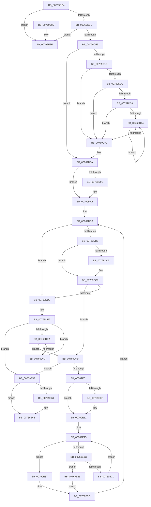

# PopEtEnergyTrackerCleanup

- RVA: `0x00769CB4`–`0x00769E95` (길이 `481` bytes)
- VA: `0x0000000140769CB4`
- 실행 섹션: `PAGE`
- PDB 이름 있음: `예`; PDB Function 태그: `아니요`
- unwind 정보 RVA: `0x000B34FC`
- 디코드: `131`개 명령, `481/481` bytes 표시
- 미해석 바이트: `0` (있으면 어셈블리에 `.byte`로 보존)

> 이 문서는 커널 이미지의 기계어와 PDB 기호를 분석해 생성했습니다. 4번과 5번은 함수 원형과 자료형을 바이너리 사용 방식에서 추정한 C 해석이며 원본 소스 복구 결과는 아닙니다.

## 1. Dependencies

- 직접 호출 지점: **10**; 고유 호출 대상: **6**
- 직접 호출자로 확인된 함수: **1**
- RIP 상대 이미지 참조: **1**

### Outgoing calls
- `0x00769CDA` → [PopAcquireRwLockExclusive](../../text/43/PopAcquireRwLockExclusive_function_00430B44.md) (function, `0x00430B44`)
- `0x00769D0B` → [PopReleaseRwLock](../../text/2D/PopReleaseRwLock_function_002DFBBC.md) (function, `0x002DFBBC`)
- `0x00769D63` → [guard_dispatch_icall](../../text/6B/guard_dispatch_icall_function_006BAAD0.md) (function, `0x006BAAD0`)
- `0x00769D7E` → [ExFreePoolWithTag](../../poolcode/B8/ExFreePoolWithTag_function_00B82870.md) (function, `0x00B82870`)
- `0x00769D8D` → [PopEtEnergyTrackerCleanupAggregates](../98/PopEtEnergyTrackerCleanupAggregates_function_0098D1D8.md) (function, `0x0098D1D8`)
- `0x00769DA0` → [ExFreePoolWithTag](../../poolcode/B8/ExFreePoolWithTag_function_00B82870.md) (function, `0x00B82870`)
- `0x00769E41` → [PopEtAggregateKeyCleanup](../98/PopEtAggregateKeyCleanup_function_0098D304.md) (function, `0x0098D304`)
- `0x00769E4E` → [ExFreePoolWithTag](../../poolcode/B8/ExFreePoolWithTag_function_00B82870.md) (function, `0x00B82870`)
- `0x00769E66` → [ExFreePoolWithTag](../../poolcode/B8/ExFreePoolWithTag_function_00B82870.md) (function, `0x00B82870`)
- `0x00769E6F` → [PopEtAggregateKeyCleanup](../98/PopEtAggregateKeyCleanup_function_0098D304.md) (function, `0x0098D304`)

### Direct callers
- [PopEtEnergyTrackerDelete](PopEtEnergyTrackerDelete_function_0076A1D0.md) at `0x0076A1D4`

### Static image references
- `0x00769CCF` → RVA `0x00E67A30` (`.data`; read)

## 2. Other-region calls and transfers

- 다른 실행 섹션으로 향하는 call: **7**
  - `0x00769CDA` → [PopAcquireRwLockExclusive](../../text/43/PopAcquireRwLockExclusive_function_00430B44.md) (`PAGE` → `.text`)
  - `0x00769D0B` → [PopReleaseRwLock](../../text/2D/PopReleaseRwLock_function_002DFBBC.md) (`PAGE` → `.text`)
  - `0x00769D63` → [guard_dispatch_icall](../../text/6B/guard_dispatch_icall_function_006BAAD0.md) (`PAGE` → `.text`)
  - `0x00769D7E` → [ExFreePoolWithTag](../../poolcode/B8/ExFreePoolWithTag_function_00B82870.md) (`PAGE` → `POOLCODE`)
  - `0x00769DA0` → [ExFreePoolWithTag](../../poolcode/B8/ExFreePoolWithTag_function_00B82870.md) (`PAGE` → `POOLCODE`)
  - `0x00769E4E` → [ExFreePoolWithTag](../../poolcode/B8/ExFreePoolWithTag_function_00B82870.md) (`PAGE` → `POOLCODE`)
  - `0x00769E66` → [ExFreePoolWithTag](../../poolcode/B8/ExFreePoolWithTag_function_00B82870.md) (`PAGE` → `POOLCODE`)
- 별도 외부 분기/꼬리 이동을 확인하지 못했습니다.

## 3. Assembly (complete function range)

```asm
00769CB4  48 89 5C 24 10                  mov qword ptr [rsp + 0x10], rbx
00769CB9  48 89 6C 24 18                  mov qword ptr [rsp + 0x18], rbp
00769CBE  48 89 74 24 20                  mov qword ptr [rsp + 0x20], rsi
00769CC3  57                              push rdi
00769CC4  41 56                           push r14
00769CC6  41 57                           push r15
00769CC8  48 83 EC 20                     sub rsp, 0x20
00769CCC  48 8B D9                        mov rbx, rcx
00769CCF  48 8B 0D 5A DD 6F 00            mov rcx, qword ptr [rip + 0x6fdd5a]
00769CD6  48 83 C1 10                     add rcx, 0x10
00769CDA  E8 65 6E CC FF                  call 0x140430b44
00769CDF  48 8B 0B                        mov rcx, qword ptr [rbx]
00769CE2  48 39 59 08                     cmp qword ptr [rcx + 8], rbx
00769CE6  0F 85 A2 01 00 00               jne 0x140769e8e
00769CEC  48 8B 43 08                     mov rax, qword ptr [rbx + 8]
00769CF0  48 39 18                        cmp qword ptr [rax], rbx
00769CF3  0F 85 95 01 00 00               jne 0x140769e8e
00769CF9  48 89 08                        mov qword ptr [rax], rcx
00769CFC  48 89 41 08                     mov qword ptr [rcx + 8], rax
00769D00  48 8B 0D 29 DD 6F 00            mov rcx, qword ptr [rip + 0x6fdd29]
00769D07  48 83 C1 10                     add rcx, 0x10
00769D0B  E8 AC 5E B7 FF                  call 0x1402dfbbc
00769D10  45 33 F6                        xor r14d, r14d
00769D13  4C 39 B3 90 02 00 00            cmp qword ptr [rbx + 0x290], r14
00769D1A  74 6E                           je 0x140769d8a
00769D1C  48 8B 05 0D DD 6F 00            mov rax, qword ptr [rip + 0x6fdd0d]
00769D23  44 39 B0 48 04 00 00            cmp dword ptr [rax + 0x448], r14d
00769D2A  7C 46                           jl 0x140769d72
00769D2C  48 8B B8 40 04 00 00            mov rdi, qword ptr [rax + 0x440]
00769D33  48 85 FF                        test rdi, rdi
00769D36  74 3A                           je 0x140769d72
00769D38  41 8B F6                        mov esi, r14d
00769D3B  44 39 B3 88 02 00 00            cmp dword ptr [rbx + 0x288], r14d
00769D42  76 2E                           jbe 0x140769d72
00769D44  8B C6                           mov eax, esi
00769D46  33 D2                           xor edx, edx
00769D48  48 8D 0C 80                     lea rcx, [rax + rax*4]
00769D4C  48 8B 83 90 02 00 00            mov rax, qword ptr [rbx + 0x290]
00769D53  8B 0C 88                        mov ecx, dword ptr [rax + rcx*4]
00769D56  48 8B 47 18                     mov rax, qword ptr [rdi + 0x18]
00769D5A  89 4C 24 40                     mov dword ptr [rsp + 0x40], ecx
00769D5E  48 8D 4C 24 40                  lea rcx, [rsp + 0x40]
00769D63  E8 68 0D F5 FF                  call 0x1406baad0
00769D68  FF C6                           inc esi
00769D6A  3B B3 88 02 00 00               cmp esi, dword ptr [rbx + 0x288]
00769D70  72 D2                           jb 0x140769d44
00769D72  48 8B 8B 90 02 00 00            mov rcx, qword ptr [rbx + 0x290]
00769D79  BA 50 6F 45 54                  mov edx, 0x54456f50
00769D7E  E8 ED 8A 41 00                  call 0x140b82870
00769D83  4C 89 B3 90 02 00 00            mov qword ptr [rbx + 0x290], r14
00769D8A  48 8B CB                        mov rcx, rbx
00769D8D  E8 46 34 22 00                  call 0x14098d1d8
00769D92  48 8B 4B 38                     mov rcx, qword ptr [rbx + 0x38]
00769D96  48 85 C9                        test rcx, rcx
00769D99  74 0A                           je 0x140769da5
00769D9B  BA 50 6F 45 54                  mov edx, 0x54456f50
00769DA0  E8 CB 8A 41 00                  call 0x140b82870
00769DA5  48 8B 73 48                     mov rsi, qword ptr [rbx + 0x48]
00769DA9  49 BF 02 00 00 00 00 00 00 80   movabs r15, 0x8000000000000002
00769DB3  48 8B FE                        mov rdi, rsi
00769DB6  48 85 FF                        test rdi, rdi
00769DB9  74 17                           je 0x140769dd2
00769DBB  48 8B 07                        mov rax, qword ptr [rdi]
00769DBE  49 23 C7                        and rax, r15
00769DC1  49 3B C7                        cmp rax, r15
00769DC4  75 03                           jne 0x140769dc9
00769DC6  49 8B 06                        mov rax, qword ptr [r14]
00769DC9  48 8B 3F                        mov rdi, qword ptr [rdi]
00769DCC  40 F6 C7 01                     test dil, 1
00769DD0  74 27                           je 0x140769df9
00769DD2  8B 4B 44                        mov ecx, dword ptr [rbx + 0x44]
00769DD5  48 83 C6 08                     add rsi, 8
00769DD9  48 8B 43 48                     mov rax, qword ptr [rbx + 0x48]
00769DDD  48 C1 E9 05                     shr rcx, 5
00769DE1  48 8D 14 C8                     lea rdx, [rax + rcx*8]
00769DE5  48 3B F2                        cmp rsi, rdx
00769DE8  73 6E                           jae 0x140769e58
00769DEA  48 8B 3E                        mov rdi, qword ptr [rsi]
00769DED  40 F6 C7 01                     test dil, 1
00769DF1  74 06                           je 0x140769df9
00769DF3  48 83 C6 08                     add rsi, 8
00769DF7  EB EC                           jmp 0x140769de5
00769DF9  48 8B C7                        mov rax, rdi
00769DFC  48 85 C0                        test rax, rax
00769DFF  74 57                           je 0x140769e58
00769E01  48 8B 07                        mov rax, qword ptr [rdi]
00769E04  48 8B EF                        mov rbp, rdi
00769E07  49 23 C7                        and rax, r15
00769E0A  49 3B C7                        cmp rax, r15
00769E0D  75 03                           jne 0x140769e12
00769E0F  49 8B 06                        mov rax, qword ptr [r14]
00769E12  48 8B CE                        mov rcx, rsi
00769E15  48 8B 01                        mov rax, qword ptr [rcx]
00769E18  A8 01                           test al, 1
00769E1A  75 1B                           jne 0x140769e37
00769E1C  48 3B C7                        cmp rax, rdi
00769E1F  74 05                           je 0x140769e26
00769E21  48 8B C8                        mov rcx, rax
00769E24  EB EF                           jmp 0x140769e15
00769E26  48 8B 07                        mov rax, qword ptr [rdi]
00769E29  48 89 01                        mov qword ptr [rcx], rax
00769E2C  FF 4B 40                        dec dword ptr [rbx + 0x40]
00769E2F  4C 09 3F                        or qword ptr [rdi], r15
00769E32  48 8B F9                        mov rdi, rcx
00769E35  EB 06                           jmp 0x140769e3d
00769E37  49 8B 06                        mov rax, qword ptr [r14]
00769E3A  49 8B EE                        mov rbp, r14
00769E3D  48 8D 4D 10                     lea rcx, [rbp + 0x10]
00769E41  E8 BE 34 22 00                  call 0x14098d304
00769E46  BA 50 6F 45 54                  mov edx, 0x54456f50
00769E4B  48 8B CD                        mov rcx, rbp
00769E4E  E8 1D 8A 41 00                  call 0x140b82870
00769E53  E9 5E FF FF FF                  jmp 0x140769db6
00769E58  48 8B 4B 48                     mov rcx, qword ptr [rbx + 0x48]
00769E5C  48 85 C9                        test rcx, rcx
00769E5F  74 0A                           je 0x140769e6b
00769E61  BA 50 6F 45 54                  mov edx, 0x54456f50
00769E66  E8 05 8A 41 00                  call 0x140b82870
00769E6B  48 8D 4B 60                     lea rcx, [rbx + 0x60]
00769E6F  E8 90 34 22 00                  call 0x14098d304
00769E74  48 8B 5C 24 48                  mov rbx, qword ptr [rsp + 0x48]
00769E79  48 8B 6C 24 50                  mov rbp, qword ptr [rsp + 0x50]
00769E7E  48 8B 74 24 58                  mov rsi, qword ptr [rsp + 0x58]
00769E83  48 83 C4 20                     add rsp, 0x20
00769E87  41 5F                           pop r15
00769E89  41 5E                           pop r14
00769E8B  5F                              pop rdi
00769E8C  C3                              ret
00769E8D  CC                              int3
00769E8E  B9 03 00 00 00                  mov ecx, 3
00769E93  CD 29                           int 0x29
```

## 4. C-style interpretation (structured pseudocode)

```c
__int64 __fastcall PopEtEnergyTrackerCleanup(__int64 a1, int a2)
{
    __int64 result;
    __int64 v_r14;
    __int64 v_rsi;
    __int64 v_rsp;
    unsigned __int64 v_stack_p10;
    unsigned __int64 v_stack_p18;
    unsigned __int64 v_stack_p20;
    unsigned int v_stack_p8;

    v_stack_p10 = v_rbx;
    v_stack_p18 = v_rbp;
    v_stack_p20 = v_rsi;
    v_rsp = (v_rsp) - (32);
    a1 = (*(unsigned __int64 *)(v_rip + 7331162)) + (16);
    result = PopAcquireRwLockExclusive(a1, a2, a3, a4);
    if ((*(unsigned __int64 *)(*(unsigned __int64 *)(a1) + 8)) != a1) goto loc_00769E8E;
    if ((*(unsigned __int64 *)(*(unsigned __int64 *)(a1 + 8))) != a1) goto loc_00769E8E;
    *(unsigned __int64 *)(*(unsigned __int64 *)(a1 + 8)) = *(unsigned __int64 *)(a1);
    *(unsigned __int64 *)(*(unsigned __int64 *)(a1) + 8) = *(unsigned __int64 *)(a1 + 8);
    a1 = (*(unsigned __int64 *)(v_rip + 7331113)) + (16);
    result = PopReleaseRwLock(a1, a2, a3, a4);
    v_r14 = 0;
    if ((*(unsigned __int64 *)(a1 + 656)) == 0) goto loc_00769D8A;
    if ((*(unsigned int *)(*(unsigned __int64 *)(v_rip + 7331085) + 1096)) < 0) goto loc_00769D72;
    if (*(unsigned __int64 *)(*(unsigned __int64 *)(v_rip + 7331085) + 1088) == 0) goto loc_00769D72;
    if ((*(unsigned int *)(a1 + 648)) <= 0) goto loc_00769D72;
loc_00769D44:
    a2 = 0;
    v_stack_p8 = (unsigned int)((unsigned int)(*(unsigned int *)(*(unsigned __int64 *)(a1 + 656) + 0 + 0 * 4 * 4)));
    result = guard_dispatch_icall(v_stack_p8, a2, a3, a4);
    v_rsi = (unsigned int)((0) + 1);
    if (((unsigned int)(v_rsi)) < (*(unsigned int *)(a1 + 648))) goto loc_00769D44;
loc_00769D72:
    result = ExFreePoolWithTag(*(unsigned __int64 *)(a1 + 656), (unsigned int)(0x54456F50ULL), a3, a4);
    *(unsigned __int64 *)(a1 + 656) = 0;
loc_00769D8A:
    result = PopEtEnergyTrackerCleanupAggregates(a1, (unsigned int)(0x54456F50ULL), a3, a4);
    if (*(unsigned __int64 *)(a1 + 56) != 0) {
        a2 = 0x54456F50ULL;
        result = ExFreePoolWithTag(*(unsigned __int64 *)(a1 + 56), a2, a3, a4);
    }
loc_00769DB6:
    if (*(unsigned __int64 *)(a1 + 72) == 0) goto loc_00769DD2;
    result = (*(unsigned __int64 *)(*(unsigned __int64 *)(a1 + 72))) & (v_r15);
    if (result == v_r15) {
        result = *(unsigned __int64 *)(v_r14);
    }
    if ((((unsigned __int8)(*(unsigned __int64 *)(*(unsigned __int64 *)(a1 + 72)))) & (1)) == 0) goto loc_00769DF9;
loc_00769DD2:
    v_rsi = (*(unsigned __int64 *)(a1 + 72)) + (8);
    a1 = ((unsigned int)(*(unsigned int *)(a1 + 68))) >> (5);
loc_00769DE5:
    if (v_rsi >= (*(unsigned __int64 *)(a1 + 72) + a1 * 8)) goto loc_00769E58;
    if ((((unsigned __int8)(*(unsigned __int64 *)(v_rsi))) & (1)) == 0) goto loc_00769DF9;
    v_rsi = (v_rsi) + (8);
    goto loc_00769DE5;
loc_00769DF9:
    if (*(unsigned __int64 *)(v_rsi) == 0) goto loc_00769E58;
    result = (*(unsigned __int64 *)(*(unsigned __int64 *)(v_rsi))) & (v_r15);
    if (result == v_r15) {
        result = *(unsigned __int64 *)(v_r14);
    }
loc_00769E15:
    if ((((unsigned __int8)(*(unsigned __int64 *)(v_rsi))) & (1)) != 0) goto loc_00769E37;
    if ((*(unsigned __int64 *)(v_rsi)) == (*(unsigned __int64 *)(v_rsi))) goto loc_00769E26;
    goto loc_00769E15;
loc_00769E26:
    *(unsigned __int64 *)(*(unsigned __int64 *)(v_rsi)) = *(unsigned __int64 *)(*(unsigned __int64 *)(v_rsi));
    goto loc_00769E3D;
loc_00769E37:
loc_00769E3D:
    result = PopEtAggregateKeyCleanup(0 + 16, *(unsigned __int64 *)(a1 + 72) + a1 * 8, a3, a4);
    result = ExFreePoolWithTag(0, (unsigned int)(0x54456F50ULL), a3, a4);
    goto loc_00769DB6;
loc_00769E58:
    if (*(unsigned __int64 *)(a1 + 72) != 0) {
        a2 = 0x54456F50ULL;
        result = ExFreePoolWithTag(*(unsigned __int64 *)(a1 + 72), a2, a3, a4);
    }
    result = PopEtAggregateKeyCleanup(a1 + 96, a2, a3, a4);
    v_rsp = (v_rsp) + (32);
    return result;
loc_00769E8E:
    return result;
}
```

## 5. (Beta) C Style

```c
int64_t PopEtEnergyTrackerCleanup(void *Arg1, int32_t Arg2)
{
    uint8_t *arg1 = (uint8_t *)Arg1;

    int64_t result;
    int64_t local_r14;
    int64_t local_rsi;
    int64_t local_rsp;
    uint64_t v_stack_p10;
    uint64_t v_stack_p18;
    uint64_t v_stack_p20;
    uint32_t v_stack_p8;

    v_stack_p10 = local_rbx;
    v_stack_p18 = local_rbp;
    v_stack_p20 = local_rsi;
    local_rsp = (local_rsp) - (32);
    Arg1 = (*(uint64_t *)(v_rip + 0x6FDD5A)) + (16);
    result = PopAcquireRwLockExclusive(Arg1, Arg2, a3, a4);
    if ((*(uint64_t *)(*(uint64_t *)(arg1) + 0x8)) != Arg1) goto loc_00769E8E;
    if ((*(uint64_t *)(*(uint64_t *)(arg1 + 0x8))) != Arg1) goto loc_00769E8E;
    *(uint64_t *)(*(uint64_t *)(arg1 + 0x8)) = *(uint64_t *)(arg1);
    *(uint64_t *)(*(uint64_t *)(arg1) + 0x8) = *(uint64_t *)(arg1 + 0x8);
    Arg1 = (*(uint64_t *)(v_rip + 0x6FDD29)) + (16);
    result = PopReleaseRwLock(Arg1, Arg2, a3, a4);
    local_r14 = 0;
    if ((*(uint64_t *)(arg1 + 0x290)) == 0) goto loc_00769D8A;
    if ((*(uint32_t *)(*(uint64_t *)(v_rip + 0x6FDD0D) + 0x448)) < 0) goto loc_00769D72;
    if (*(uint64_t *)(*(uint64_t *)(v_rip + 0x6FDD0D) + 0x440) == 0) goto loc_00769D72;
    if ((*(uint32_t *)(arg1 + 0x288)) <= 0) goto loc_00769D72;
loc_00769D44:
    Arg2 = 0;
    v_stack_p8 = (uint32_t)((uint32_t)(*(uint32_t *)(*(uint64_t *)(arg1 + 0x290) + 0x0 + 0x0 * 4 * 4)));
    result = guard_dispatch_icall(v_stack_p8, Arg2, a3, a4);
    local_rsi = (uint32_t)((0) + 1);
    if (((uint32_t)(local_rsi)) < (*(uint32_t *)(arg1 + 0x288))) goto loc_00769D44;
loc_00769D72:
    result = ExFreePoolWithTag(*(uint64_t *)(arg1 + 0x290), (uint32_t)(0x54456F50ULL), a3, a4);
    *(uint64_t *)(arg1 + 0x290) = 0;
loc_00769D8A:
    result = PopEtEnergyTrackerCleanupAggregates(Arg1, (uint32_t)(0x54456F50ULL), a3, a4);
    if (*(uint64_t *)(arg1 + 0x38) != 0) {
        Arg2 = 0x54456F50ULL;
        result = ExFreePoolWithTag(*(uint64_t *)(arg1 + 0x38), Arg2, a3, a4);
    }
loc_00769DB6:
    if (*(uint64_t *)(arg1 + 0x48) == 0) goto loc_00769DD2;
    result = (*(uint64_t *)(*(uint64_t *)(arg1 + 0x48))) & (local_r15);
    if (result == local_r15) {
        result = *(uint64_t *)(local_r14);
    }
    if ((((uint8_t)(*(uint64_t *)(*(uint64_t *)(arg1 + 0x48)))) & (1)) == 0) goto loc_00769DF9;
loc_00769DD2:
    local_rsi = (*(uint64_t *)(arg1 + 0x48)) + (8);
    Arg1 = ((uint32_t)(*(uint32_t *)(arg1 + 0x44))) >> (5);
loc_00769DE5:
    if (local_rsi >= (*(uint64_t *)(arg1 + 0x48) + Arg1 * 8)) goto loc_00769E58;
    if ((((uint8_t)(*(uint64_t *)(local_rsi))) & (1)) == 0) goto loc_00769DF9;
    local_rsi = (local_rsi) + (8);
    goto loc_00769DE5;
loc_00769DF9:
    if (*(uint64_t *)(local_rsi) == 0) goto loc_00769E58;
    result = (*(uint64_t *)(*(uint64_t *)(local_rsi))) & (local_r15);
    if (result == local_r15) {
        result = *(uint64_t *)(local_r14);
    }
loc_00769E15:
    if ((((uint8_t)(*(uint64_t *)(local_rsi))) & (1)) != 0) goto loc_00769E37;
    if ((*(uint64_t *)(local_rsi)) == (*(uint64_t *)(local_rsi))) goto loc_00769E26;
    goto loc_00769E15;
loc_00769E26:
    *(uint64_t *)(*(uint64_t *)(local_rsi)) = *(uint64_t *)(*(uint64_t *)(local_rsi));
    goto loc_00769E3D;
loc_00769E37:
loc_00769E3D:
    result = PopEtAggregateKeyCleanup(0 + 16, *(uint64_t *)(arg1 + 0x48) + Arg1 * 8, a3, a4);
    result = ExFreePoolWithTag(0, (uint32_t)(0x54456F50ULL), a3, a4);
    goto loc_00769DB6;
loc_00769E58:
    if (*(uint64_t *)(arg1 + 0x48) != 0) {
        Arg2 = 0x54456F50ULL;
        result = ExFreePoolWithTag(*(uint64_t *)(arg1 + 0x48), Arg2, a3, a4);
    }
    result = PopEtAggregateKeyCleanup(Arg1 + 96, Arg2, a3, a4);
    local_rsp = (local_rsp) + (32);
    return result;
loc_00769E8E:
    return result;
}
```

### 관측된 메모리 오프셋

구조체 형식이 확인되지 않은 접근은 인자 기준의 오프셋으로만 기록했습니다.

| 기준 인자 | 오프셋 표현 | 폭 (bit) | 접근 |
|---|---:|---:|---|
| `Arg1` | `+ 0x0` | `64` | `R` |
| `Arg1` | `+ 0x8` | `64` | `R` |
| `Arg1` | `+ 0x38` | `64` | `R` |
| `Arg1` | `+ 0x40` | `32` | `R/W` |
| `Arg1` | `+ 0x44` | `32` | `R` |
| `Arg1` | `+ 0x48` | `64` | `R` |
| `Arg1` | `+ 0x60` | `64` | `R` |
| `Arg1` | `+ 0x288` | `32` | `R` |
| `Arg1` | `+ 0x290` | `64` | `R` |
| `Arg1` | `+ 0x290` | `64` | `W` |

## 6. Execution-region graph

[열기: 2D/3D 그래프와 함수 탐색 컨트롤 패널](../../../control-panel.html?section=page&rva=0x00769CB4&view=graph)

- 2D 그래프는 위에서 아래로 흐르고, 3D 그래프는 빈 공간을 드래그해 회전합니다. Shift+드래그는 이동, 휠은 확대·축소, 함수 노드 선택은 대상 보고서 이동입니다.

### Static fallback


