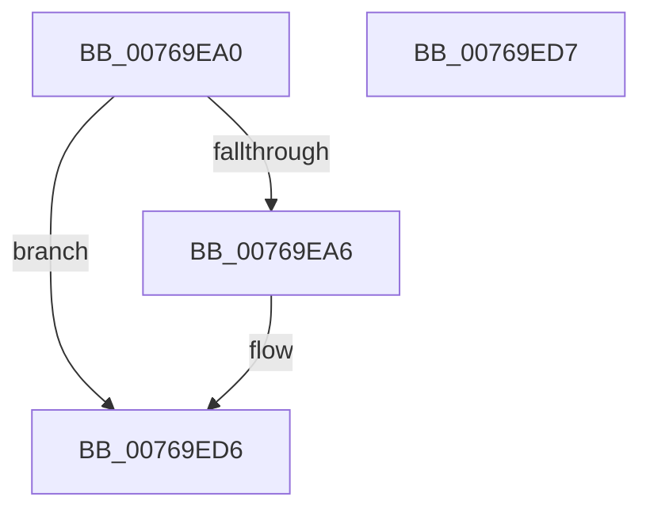

# PopEtEnergyTrackerClose

- RVA: `0x00769EA0`–`0x00769ED8` (길이 `56` bytes)
- VA: `0x0000000140769EA0`
- 실행 섹션: `PAGE`
- PDB 이름 있음: `예`; PDB Function 태그: `아니요`
- unwind 정보 RVA: `0x000CD128`
- 디코드: `16`개 명령, `56/56` bytes 표시
- 미해석 바이트: `0` (있으면 어셈블리에 `.byte`로 보존)

> 이 문서는 커널 이미지의 기계어와 PDB 기호를 분석해 생성했습니다. 4번과 5번은 함수 원형과 자료형을 바이너리 사용 방식에서 추정한 C 해석이며 원본 소스 복구 결과는 아닙니다.

## 1. Dependencies

- 직접 호출 지점: **2**; 고유 호출 대상: **2**
- 직접 호출자로 확인된 함수: **0**
- RIP 상대 이미지 참조: **0**

### Outgoing calls
- `0x00769EB7` → [PopAcquireRwLockExclusive](../../text/43/PopAcquireRwLockExclusive_function_00430B44.md) (function, `0x00430B44`)
- `0x00769EC7` → [PopReleaseRwLock](../../text/2D/PopReleaseRwLock_function_002DFBBC.md) (function, `0x002DFBBC`)

### Direct callers
- 이 함수 시작 RVA로 연결되는 직접 call은 확인되지 않았습니다. 간접 호출은 완전히 역산할 수 없습니다.

### Static image references
- 디코드된 RIP-relative 메모리 참조가 없습니다.

## 2. Other-region calls and transfers

- 다른 실행 섹션으로 향하는 call: **2**
  - `0x00769EB7` → [PopAcquireRwLockExclusive](../../text/43/PopAcquireRwLockExclusive_function_00430B44.md) (`PAGE` → `.text`)
  - `0x00769EC7` → [PopReleaseRwLock](../../text/2D/PopReleaseRwLock_function_002DFBBC.md) (`PAGE` → `.text`)
- 별도 외부 분기/꼬리 이동을 확인하지 못했습니다.

## 3. Assembly (complete function range)

```asm
00769EA0  49 83 F9 01                     cmp r9, 1
00769EA4  75 30                           jne 0x140769ed6
00769EA6  48 89 5C 24 08                  mov qword ptr [rsp + 8], rbx
00769EAB  57                              push rdi
00769EAC  48 83 EC 20                     sub rsp, 0x20
00769EB0  48 8D 4A 10                     lea rcx, [rdx + 0x10]
00769EB4  48 8B FA                        mov rdi, rdx
00769EB7  E8 88 6C CC FF                  call 0x140430b44
00769EBC  83 8F 84 02 00 00 02            or dword ptr [rdi + 0x284], 2
00769EC3  48 8D 4F 10                     lea rcx, [rdi + 0x10]
00769EC7  E8 F0 5C B7 FF                  call 0x1402dfbbc
00769ECC  48 8B 5C 24 30                  mov rbx, qword ptr [rsp + 0x30]
00769ED1  48 83 C4 20                     add rsp, 0x20
00769ED5  5F                              pop rdi
00769ED6  C3                              ret
00769ED7  CC                              int3
```

## 4. C-style interpretation (structured pseudocode)

```c
__int64 __fastcall PopEtEnergyTrackerClose(__int64 a1, __int64 a2, __int64 a3, __int64 a4)
{
    __int64 result;
    __int64 v_rbx;
    __int64 v_rdi;
    __int64 v_rsp;
    unsigned __int64 v_stack_p8;

    if (a4 == 1) {
        v_stack_p8 = v_rbx;
        v_rsp = (v_rsp) - (32);
        a1 = a2 + 16;
        v_rdi = a2;
        result = PopAcquireRwLockExclusive(a1, a2, a3, a4);
        a1 = v_rdi + 16;
        result = PopReleaseRwLock(a1, a2, a3, a4);
        v_rbx = v_stack_p8;
        v_rsp = (v_rsp) + (32);
    }
    return result;
}
```

## 5. (Beta) C Style

```c
int64_t PopEtEnergyTrackerClose(int64_t Arg1, void *Arg2, int64_t Arg3, int64_t Arg4)
{
    uint8_t *arg2 = (uint8_t *)Arg2;

    int64_t result;
    int64_t local_rbx;
    int64_t local_rdi;
    int64_t local_rsp;
    uint64_t v_stack_p8;

    if (Arg4 == 1) {
        v_stack_p8 = local_rbx;
        local_rsp = (local_rsp) - (32);
        Arg1 = Arg2 + 16;
        local_rdi = Arg2;
        result = PopAcquireRwLockExclusive(Arg1, Arg2, Arg3, Arg4);
        Arg1 = local_rdi + 16;
        result = PopReleaseRwLock(Arg1, Arg2, Arg3, Arg4);
        local_rbx = v_stack_p8;
        local_rsp = (local_rsp) + (32);
    }
    return result;
}
```

### 관측된 메모리 오프셋

구조체 형식이 확인되지 않은 접근은 인자 기준의 오프셋으로만 기록했습니다.

| 기준 인자 | 오프셋 표현 | 폭 (bit) | 접근 |
|---|---:|---:|---|
| `Arg2` | `+ 0x10` | `64` | `R` |
| `Arg2` | `+ 0x284` | `32` | `R/W` |

## 6. Execution-region graph

[열기: 2D/3D 그래프와 함수 탐색 컨트롤 패널](../../../control-panel.html?section=page&rva=0x00769EA0&view=graph)

- 2D 그래프는 위에서 아래로 흐르고, 3D 그래프는 빈 공간을 드래그해 회전합니다. Shift+드래그는 이동, 휠은 확대·축소, 함수 노드 선택은 대상 보고서 이동입니다.

### Static fallback


