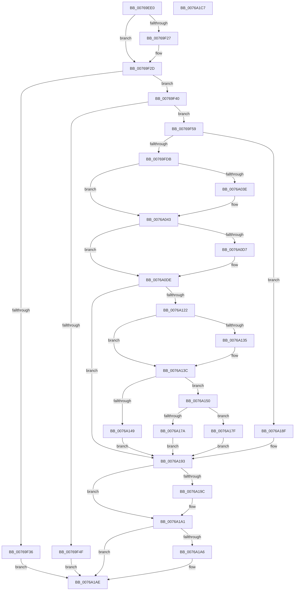

# PopEtEnergyTrackerCreate

- RVA: `0x00769EE0`–`0x0076A1C8` (길이 `744` bytes)
- VA: `0x0000000140769EE0`
- 실행 섹션: `PAGE`
- PDB 이름 있음: `예`; PDB Function 태그: `아니요`
- unwind 정보 RVA: `0x000CD14C`
- 디코드: `185`개 명령, `744/744` bytes 표시
- 미해석 바이트: `0` (있으면 어셈블리에 `.byte`로 보존)

> 이 문서는 커널 이미지의 기계어와 PDB 기호를 분석해 생성했습니다. 4번과 5번은 함수 원형과 자료형을 바이너리 사용 방식에서 추정한 C 해석이며 원본 소스 복구 결과는 아닙니다.

## 1. Dependencies

- 직접 호출 지점: **14**; 고유 호출 대상: **11**
- 직접 호출자로 확인된 함수: **1**
- RIP 상대 이미지 참조: **2**

### Outgoing calls
- `0x00769FCC` → [ObCreateObjectEx](../89/ObCreateObjectEx_function_0089B1E0.md) (function, `0x0089B1E0`)
- `0x00769FE7` → [memset](../../text/6C/memset_function_006C6C40.md) (function, `0x006C6C40`)
- `0x0076A013` → [memset](../../text/6C/memset_function_006C6C40.md) (function, `0x006C6C40`)
- `0x0076A03E` → [PopEtDeferredInitDxgContext](PopEtDeferredInitDxgContext_function_00769B40.md) (function, `0x00769B40`)
- `0x0076A046` → [PopEtEnergyTrackerFindDxgAdapters](PopEtEnergyTrackerFindDxgAdapters_function_0076A1E8.md) (function, `0x0076A1E8`)
- `0x0076A08E` → [KiQueryUnbiasedInterruptTime](../../text/42/KiQueryUnbiasedInterruptTime_function_0042D180.md) (function, `0x0042D180`)
- `0x0076A0C2` → [PopAcquireRwLockExclusive](../../text/43/PopAcquireRwLockExclusive_function_00430B44.md) (function, `0x00430B44`)
- `0x0076A0F0` → [PopReleaseRwLock](../../text/2D/PopReleaseRwLock_function_002DFBBC.md) (function, `0x002DFBBC`)
- `0x0076A117` → [PsEnumProcesses](../91/PsEnumProcesses_function_0091BE84.md) (function, `0x0091BE84`)
- `0x0076A126` → [PopAcquireRwLockExclusive](../../text/43/PopAcquireRwLockExclusive_function_00430B44.md) (function, `0x00430B44`)
- `0x0076A140` → [PopReleaseRwLock](../../text/2D/PopReleaseRwLock_function_002DFBBC.md) (function, `0x002DFBBC`)
- `0x0076A16F` → [ObInsertObjectEx](../8B/ObInsertObjectEx_function_008B97A0.md) (function, `0x008B97A0`)
- `0x0076A19C` → [NtClose](../86/NtClose_function_00868870.md) (function, `0x00868870`)
- `0x0076A1A9` → [ObfDereferenceObject](../../text/2F/ObfDereferenceObject_function_002F9350.md) (function, `0x002F9350`)

### Direct callers
- [NtPowerInformation](../95/NtPowerInformation_function_00955D80.md) at `0x00957BFE`

### Static image references
- `0x00769F2D` → RVA `0x00E67A30` (`.data`; read)
- `0x0076A0FD` → RVA `0x0091CCA0` (`PopEtProcessEnumSnapshotCallback`; read)

## 2. Other-region calls and transfers

- 다른 실행 섹션으로 향하는 call: **8**
  - `0x00769FE7` → [memset](../../text/6C/memset_function_006C6C40.md) (`PAGE` → `.text`)
  - `0x0076A013` → [memset](../../text/6C/memset_function_006C6C40.md) (`PAGE` → `.text`)
  - `0x0076A08E` → [KiQueryUnbiasedInterruptTime](../../text/42/KiQueryUnbiasedInterruptTime_function_0042D180.md) (`PAGE` → `.text`)
  - `0x0076A0C2` → [PopAcquireRwLockExclusive](../../text/43/PopAcquireRwLockExclusive_function_00430B44.md) (`PAGE` → `.text`)
  - `0x0076A0F0` → [PopReleaseRwLock](../../text/2D/PopReleaseRwLock_function_002DFBBC.md) (`PAGE` → `.text`)
  - `0x0076A126` → [PopAcquireRwLockExclusive](../../text/43/PopAcquireRwLockExclusive_function_00430B44.md) (`PAGE` → `.text`)
  - `0x0076A140` → [PopReleaseRwLock](../../text/2D/PopReleaseRwLock_function_002DFBBC.md) (`PAGE` → `.text`)
  - `0x0076A1A9` → [ObfDereferenceObject](../../text/2F/ObfDereferenceObject_function_002F9350.md) (`PAGE` → `.text`)
- 별도 외부 분기/꼬리 이동을 확인하지 못했습니다.

## 3. Assembly (complete function range)

```asm
00769EE0  48 89 5C 24 10                  mov qword ptr [rsp + 0x10], rbx
00769EE5  55                              push rbp
00769EE6  56                              push rsi
00769EE7  57                              push rdi
00769EE8  41 56                           push r14
00769EEA  41 57                           push r15
00769EEC  48 8D 6C 24 C9                  lea rbp, [rsp - 0x37]
00769EF1  48 81 EC A0 00 00 00            sub rsp, 0xa0
00769EF8  8B 01                           mov eax, dword ptr [rcx]
00769EFA  45 33 FF                        xor r15d, r15d
00769EFD  0F 57 C0                        xorps xmm0, xmm0
00769F00  4C 89 7D 67                     mov qword ptr [rbp + 0x67], r15
00769F04  FF C8                           dec eax
00769F06  4C 89 7D 77                     mov qword ptr [rbp + 0x77], r15
00769F0A  44 89 7D 0B                     mov dword ptr [rbp + 0xb], r15d
00769F0E  4C 8B F2                        mov r14, rdx
00769F11  44 89 7D 23                     mov dword ptr [rbp + 0x23], r15d
00769F15  48 8B F1                        mov rsi, rcx
00769F18  0F 11 45 E7                     movups xmmword ptr [rbp - 0x19], xmm0
00769F1C  0F 11 45 F7                     movups xmmword ptr [rbp - 9], xmm0
00769F20  3D FF FF 03 00                  cmp eax, 0x3ffff
00769F25  76 06                           jbe 0x140769f2d
00769F27  C7 01 00 00 04 00               mov dword ptr [rcx], 0x40000
00769F2D  4C 39 3D FC DA 6F 00            cmp qword ptr [rip + 0x6fdafc], r15
00769F34  75 0A                           jne 0x140769f40
00769F36  BF BB 00 00 C0                  mov edi, 0xc00000bb
00769F3B  E9 6E 02 00 00                  jmp 0x14076a1ae
00769F40  8B 41 08                        mov eax, dword ptr [rcx + 8]
00769F43  25 00 00 00 F0                  and eax, 0xf0000000
00769F48  3D 00 00 00 10                  cmp eax, 0x10000000
00769F4D  76 0A                           jbe 0x140769f59
00769F4F  BF 0D 00 00 C0                  mov edi, 0xc000000d
00769F54  E9 55 02 00 00                  jmp 0x14076a1ae
00769F59  65 48 8B 04 25 88 01 00 00      mov rax, qword ptr gs:[0x188]
00769F62  4C 8D 45 07                     lea r8, [rbp + 7]
00769F66  4C 89 7C 24 48                  mov qword ptr [rsp + 0x48], r15
00769F6B  BB 98 02 00 00                  mov ebx, 0x298
00769F70  C7 45 07 30 00 00 00            mov dword ptr [rbp + 7], 0x30
00769F77  4C 89 7D 0F                     mov qword ptr [rbp + 0xf], r15
00769F7B  8A 88 32 02 00 00               mov cl, byte ptr [rax + 0x232]
00769F81  F6 D9                           neg cl
00769F83  4C 89 7D 17                     mov qword ptr [rbp + 0x17], r15
00769F87  F3 0F 7F 45 27                  movdqu xmmword ptr [rbp + 0x27], xmm0
00769F8C  1B C0                           sbb eax, eax
00769F8E  33 C9                           xor ecx, ecx
00769F90  F7 D0                           not eax
00769F92  25 00 02 00 00                  and eax, 0x200
00769F97  89 45 1F                        mov dword ptr [rbp + 0x1f], eax
00769F9A  65 48 8B 04 25 88 01 00 00      mov rax, qword ptr gs:[0x188]
00769FA3  44 8A 88 32 02 00 00            mov r9b, byte ptr [rax + 0x232]
00769FAA  48 8B 05 7F DA 6F 00            mov rax, qword ptr [rip + 0x6fda7f]
00769FB1  48 8B 50 20                     mov rdx, qword ptr [rax + 0x20]
00769FB5  48 8D 45 67                     lea rax, [rbp + 0x67]
00769FB9  48 89 44 24 40                  mov qword ptr [rsp + 0x40], rax
00769FBE  44 89 7C 24 38                  mov dword ptr [rsp + 0x38], r15d
00769FC3  44 89 7C 24 30                  mov dword ptr [rsp + 0x30], r15d
00769FC8  89 5C 24 28                     mov dword ptr [rsp + 0x28], ebx
00769FCC  E8 0F 12 13 00                  call 0x14089b1e0
00769FD1  8B F8                           mov edi, eax
00769FD3  85 C0                           test eax, eax
00769FD5  0F 88 B4 01 00 00               js 0x14076a18f
00769FDB  48 8B 7D 67                     mov rdi, qword ptr [rbp + 0x67]
00769FDF  44 8B C3                        mov r8d, ebx
00769FE2  48 8B CF                        mov rcx, rdi
00769FE5  33 D2                           xor edx, edx
00769FE7  E8 54 CC F5 FF                  call 0x1406c6c40
00769FEC  0F 57 C0                        xorps xmm0, xmm0
00769FEF  48 8D 4F 50                     lea rcx, [rdi + 0x50]
00769FF3  0F 11 47 10                     movups xmmword ptr [rdi + 0x10], xmm0
00769FF7  4C 89 7F 10                     mov qword ptr [rdi + 0x10], r15
00769FFB  33 D2                           xor edx, edx
00769FFD  4C 89 7F 40                     mov qword ptr [rdi + 0x40], r15
0076A001  41 B8 08 02 00 00               mov r8d, 0x208
0076A007  4C 89 7F 48                     mov qword ptr [rdi + 0x48], r15
0076A00B  4C 89 7F 30                     mov qword ptr [rdi + 0x30], r15
0076A00F  4C 89 7F 38                     mov qword ptr [rdi + 0x38], r15
0076A013  E8 28 CC F5 FF                  call 0x1406c6c40
0076A018  48 8B 0D 11 DA 6F 00            mov rcx, qword ptr [rip + 0x6fda11]
0076A01F  0F 57 C0                        xorps xmm0, xmm0
0076A022  0F 11 47 60                     movups xmmword ptr [rdi + 0x60], xmm0
0076A026  0F 11 47 70                     movups xmmword ptr [rdi + 0x70], xmm0
0076A02A  48 8D 81 C8 03 00 00            lea rax, [rcx + 0x3c8]
0076A031  48 89 47 60                     mov qword ptr [rdi + 0x60], rax
0076A035  83 B9 48 04 00 00 FF            cmp dword ptr [rcx + 0x448], -1
0076A03C  75 05                           jne 0x14076a043
0076A03E  E8 FD FA FF FF                  call 0x140769b40
0076A043  48 8B CF                        mov rcx, rdi
0076A046  E8 9D 01 00 00                  call 0x14076a1e8
0076A04B  F2 0F 10 06                     movsd xmm0, qword ptr [rsi]
0076A04F  48 B9 04 00 00 00 80 F7 FF FF   movabs rcx, 0xfffff78000000004
0076A059  F2 0F 11 47 20                  movsd qword ptr [rdi + 0x20], xmm0
0076A05E  8B 46 08                        mov eax, dword ptr [rsi + 8]
0076A061  89 47 28                        mov dword ptr [rdi + 0x28], eax
0076A064  48 B8 20 03 00 00 80 F7 FF FF   movabs rax, 0xfffff78000000320
0076A06E  83 8F 84 02 00 00 01            or dword ptr [rdi + 0x284], 1
0076A075  48 8B 00                        mov rax, qword ptr [rax]
0076A078  8B 09                           mov ecx, dword ptr [rcx]
0076A07A  48 8B 5D 67                     mov rbx, qword ptr [rbp + 0x67]
0076A07E  48 0F AF C8                     imul rcx, rax
0076A082  48 C1 E9 18                     shr rcx, 0x18
0076A086  89 8B 58 02 00 00               mov dword ptr [rbx + 0x258], ecx
0076A08C  B1 01                           mov cl, 1
0076A08E  E8 ED 30 CC FF                  call 0x14042d180
0076A093  48 8B C8                        mov rcx, rax
0076A096  48 B8 4B 59 86 38 D6 C5 6D 34   movabs rax, 0x346dc5d63886594b
0076A0A0  48 F7 E1                        mul rcx
0076A0A3  48 8B 0D 86 D9 6F 00            mov rcx, qword ptr [rip + 0x6fd986]
0076A0AA  48 C1 EA 0B                     shr rdx, 0xb
0076A0AE  48 83 C1 10                     add rcx, 0x10
0076A0B2  89 93 5C 02 00 00               mov dword ptr [rbx + 0x25c], edx
0076A0B8  C7 83 60 02 00 00 01 00 00 00   mov dword ptr [rbx + 0x260], 1
0076A0C2  E8 7D 6A CC FF                  call 0x140430b44
0076A0C7  48 8B 0D 62 D9 6F 00            mov rcx, qword ptr [rip + 0x6fd962]
0076A0CE  48 8B 41 08                     mov rax, qword ptr [rcx + 8]
0076A0D2  48 39 08                        cmp qword ptr [rax], rcx
0076A0D5  74 07                           je 0x14076a0de
0076A0D7  B9 03 00 00 00                  mov ecx, 3
0076A0DC  CD 29                           int 0x29
0076A0DE  48 89 0B                        mov qword ptr [rbx], rcx
0076A0E1  48 89 43 08                     mov qword ptr [rbx + 8], rax
0076A0E5  48 89 18                        mov qword ptr [rax], rbx
0076A0E8  48 89 59 08                     mov qword ptr [rcx + 8], rbx
0076A0EC  48 83 C1 10                     add rcx, 0x10
0076A0F0  E8 C7 5A B7 FF                  call 0x1402dfbbc
0076A0F5  48 8D 55 E7                     lea rdx, [rbp - 0x19]
0076A0F9  4C 89 7D EB                     mov qword ptr [rbp - 0x15], r15
0076A0FD  48 8D 0D 9C 2B 1B 00            lea rcx, [rip + 0x1b2b9c]
0076A104  44 89 7D F3                     mov dword ptr [rbp - 0xd], r15d
0076A108  4C 89 7D FF                     mov qword ptr [rbp - 1], r15
0076A10C  C7 45 E7 01 00 00 00            mov dword ptr [rbp - 0x19], 1
0076A113  48 89 5D F7                     mov qword ptr [rbp - 9], rbx
0076A117  E8 68 1D 1B 00                  call 0x14091be84
0076A11C  8B F8                           mov edi, eax
0076A11E  85 C0                           test eax, eax
0076A120  78 71                           js 0x14076a193
0076A122  48 8D 4B 10                     lea rcx, [rbx + 0x10]
0076A126  E8 19 6A CC FF                  call 0x140430b44
0076A12B  8B B3 6C 02 00 00               mov esi, dword ptr [rbx + 0x26c]
0076A131  85 F6                           test esi, esi
0076A133  75 07                           jne 0x14076a13c
0076A135  83 A3 84 02 00 00 FE            and dword ptr [rbx + 0x284], 0xfffffffe
0076A13C  48 8D 4B 10                     lea rcx, [rbx + 0x10]
0076A140  E8 77 5A B7 FF                  call 0x1402dfbbc
0076A145  85 F6                           test esi, esi
0076A147  74 07                           je 0x14076a150
0076A149  BF 9A 00 00 C0                  mov edi, 0xc000009a
0076A14E  EB 43                           jmp 0x14076a193
0076A150  33 D2                           xor edx, edx
0076A152  48 8D 45 77                     lea rax, [rbp + 0x77]
0076A156  48 89 44 24 30                  mov qword ptr [rsp + 0x30], rax
0076A15B  48 8B CB                        mov rcx, rbx
0076A15E  4C 89 7C 24 28                  mov qword ptr [rsp + 0x28], r15
0076A163  44 89 7C 24 20                  mov dword ptr [rsp + 0x20], r15d
0076A168  44 8D 4A 01                     lea r9d, [rdx + 1]
0076A16C  45 8B C1                        mov r8d, r9d
0076A16F  E8 2C F6 14 00                  call 0x1408b97a0
0076A174  8B F8                           mov edi, eax
0076A176  85 C0                           test eax, eax
0076A178  79 05                           jns 0x14076a17f
0076A17A  49 8B DF                        mov rbx, r15
0076A17D  EB 14                           jmp 0x14076a193
0076A17F  48 8B 45 77                     mov rax, qword ptr [rbp + 0x77]
0076A183  41 8B FF                        mov edi, r15d
0076A186  49 89 06                        mov qword ptr [r14], rax
0076A189  4C 89 7D 77                     mov qword ptr [rbp + 0x77], r15
0076A18D  EB 04                           jmp 0x14076a193
0076A18F  48 8B 5D 67                     mov rbx, qword ptr [rbp + 0x67]
0076A193  48 8B 4D 77                     mov rcx, qword ptr [rbp + 0x77]
0076A197  48 85 C9                        test rcx, rcx
0076A19A  74 05                           je 0x14076a1a1
0076A19C  E8 CF E6 0F 00                  call 0x140868870
0076A1A1  48 85 DB                        test rbx, rbx
0076A1A4  74 08                           je 0x14076a1ae
0076A1A6  48 8B CB                        mov rcx, rbx
0076A1A9  E8 A2 F1 B8 FF                  call 0x1402f9350
0076A1AE  48 8B 9C 24 D8 00 00 00         mov rbx, qword ptr [rsp + 0xd8]
0076A1B6  8B C7                           mov eax, edi
0076A1B8  48 81 C4 A0 00 00 00            add rsp, 0xa0
0076A1BF  41 5F                           pop r15
0076A1C1  41 5E                           pop r14
0076A1C3  5F                              pop rdi
0076A1C4  5E                              pop rsi
0076A1C5  5D                              pop rbp
0076A1C6  C3                              ret
0076A1C7  CC                              int3
```

## 4. C-style interpretation (structured pseudocode)

```c
__int64 __fastcall PopEtEnergyTrackerCreate(__int64 a1, __int64 a2)
{
    __int64 result;
    __int64 v_r15;
    __int64 v_rsp;
    unsigned __int64 v_stack_m38;
    unsigned int v_stack_m3C;
    unsigned int v_stack_m40;
    unsigned __int64 v_stack_m48;
    unsigned __int64 v_stack_m50;
    unsigned int v_stack_m54;
    unsigned __int64 v_stack_m58;
    unsigned __int64 v_stack_m5F;
    unsigned __int64 v_stack_m60;
    unsigned __int64 v_stack_m68;
    unsigned int v_stack_m6C;
    unsigned __int64 v_stack_m74;
    unsigned __int64 v_stack_m78;
    unsigned __int64 v_stack_m80;
    unsigned __int64 v_stack_m88;
    unsigned int v_stack_m90;
    unsigned int v_stack_m98;
    unsigned int v_stack_mA0;
    unsigned int v_stack_mA8;
    unsigned __int64 v_stack_p10;
    unsigned __int64 v_stack_p18;
    unsigned __int64 v_stack_p8;

    v_stack_p10 = v_rbx;
    v_rsp = (v_rsp) - (160);
    v_r15 = 0;
    v_stack_p8 = 0;
    result = (unsigned int)(((unsigned int)(*(unsigned int *)(a1))) - 1);
    v_stack_p18 = 0;
    v_stack_m54 = 0;
    v_stack_m3C = 0;
    v_stack_m78 = v_xmm0;
    v_stack_m68 = v_xmm0;
    if (((unsigned int)(result)) >= = 0x3FFFFULL) {
        *(unsigned int *)(a1) = 0x40000ULL;
    }
    if ((*(unsigned __int64 *)(v_rip + 7330556)) != 0) goto loc_00769F40;
    goto loc_0076A1AE;
loc_00769F40:
    result = (unsigned int)(((unsigned int)(*(unsigned int *)(a1 + 8))) & (0xF0000000ULL));
    if (((unsigned int)(result)) <= 0x10000000ULL) goto loc_00769F59;
    goto loc_0076A1AE;
loc_00769F59:
    v_stack_m80 = 0;
    v_stack_m58 = 48;
    v_stack_m50 = 0;
    a1 = (unsigned __int8)(-(*(unsigned __int8 *)(*(unsigned __int64 *)(gs_base + (0 + 392)) + 562)));
    v_stack_m48 = 0;
    v_stack_m38 = v_xmm0;
    a1 = 0;
    result = (unsigned int)(~(*(unsigned __int64 *)(gs_base + (0 + 392))));
    result = (unsigned int)((result) & (512));
    v_stack_m40 = (unsigned int)(result);
    v_stack_m88 = v_stack_p8;
    v_stack_m90 = 0;
    v_stack_m98 = 0;
    v_stack_mA0 = 664;
    result = ObCreateObjectEx(a1, *(unsigned __int64 *)(*(unsigned __int64 *)(v_rip + 7330431) + 32), v_stack_m58, *(unsigned __int8 *)(*(unsigned __int64 *)(gs_base + (0 + 392)) + 562));
    if (sign_flag) goto loc_0076A18F;
    a2 = 0;
    result = memset(v_stack_p8, a2, 664, *(unsigned __int8 *)(*(unsigned __int64 *)(gs_base + (0 + 392)) + 562));
    *(unsigned __int64 *)(v_stack_p8 + 16) = v_xmm0;
    *(unsigned __int64 *)(v_stack_p8 + 16) = 0;
    a2 = 0;
    *(unsigned __int64 *)(v_stack_p8 + 64) = 0;
    *(unsigned __int64 *)(v_stack_p8 + 72) = 0;
    *(unsigned __int64 *)(v_stack_p8 + 48) = 0;
    *(unsigned __int64 *)(v_stack_p8 + 56) = 0;
    result = memset(v_stack_p8 + 80, a2, 520, *(unsigned __int8 *)(*(unsigned __int64 *)(gs_base + (0 + 392)) + 562));
    *(unsigned __int64 *)(v_stack_p8 + 96) = v_xmm0;
    *(unsigned __int64 *)(v_stack_p8 + 112) = v_xmm0;
    *(unsigned __int64 *)(v_stack_p8 + 96) = *(unsigned __int64 *)(v_rip + 7330321) + 968;
    result = *(unsigned __int64 *)(v_rip + 7330321) + 968;
    if ((*(unsigned int *)(*(unsigned __int64 *)(v_rip + 7330321) + 1096)) == -1) {
        result = PopEtDeferredInitDxgContext(*(unsigned __int64 *)(v_rip + 7330321), a2, 520, *(unsigned __int8 *)(*(unsigned __int64 *)(gs_base + (0 + 392)) + 562));
    }
    result = PopEtEnergyTrackerFindDxgAdapters(v_stack_p8, a2, 520, *(unsigned __int8 *)(*(unsigned __int64 *)(gs_base + (0 + 392)) + 562));
    *(unsigned __int64 *)(v_stack_p8 + 32) = v_xmm0;
    *(unsigned int *)(v_stack_p8 + 40) = (unsigned int)((unsigned int)(*(unsigned int *)(a1 + 8)));
    a1 = ((unsigned int)(*(unsigned int *)(v_stack_p8))) * (*(unsigned __int64 *)((unsigned int)(*(unsigned int *)(a1 + 8))));
    a1 = (a1) >> (24);
    *(unsigned int *)(v_stack_p8 + 600) = (unsigned int)(a1);
    result = KiQueryUnbiasedInterruptTime(1, a2, 520, *(unsigned __int8 *)(*(unsigned __int64 *)(gs_base + (0 + 392)) + 562));
    a2 = (a2) >> (11);
    a1 = (*(unsigned __int64 *)(v_rip + 7330182)) + (16);
    *(unsigned int *)(v_stack_p8 + 604) = (unsigned int)(a2);
    *(unsigned int *)(v_stack_p8 + 608) = 1;
    result = PopAcquireRwLockExclusive(a1, a2, 520, *(unsigned __int8 *)(*(unsigned __int64 *)(gs_base + (0 + 392)) + 562));
    if ((*(unsigned __int64 *)(*(unsigned __int64 *)(*(unsigned __int64 *)(v_rip + 7330146) + 8))) != (*(unsigned __int64 *)(v_rip + 7330146))) {
        a1 = 3;
    }
    *(unsigned __int64 *)(v_stack_p8) = a1;
    *(unsigned __int64 *)(v_stack_p8 + 8) = *(unsigned __int64 *)(*(unsigned __int64 *)(v_rip + 7330146) + 8);
    *(unsigned __int64 *)(*(unsigned __int64 *)(*(unsigned __int64 *)(v_rip + 7330146) + 8)) = v_stack_p8;
    *(unsigned __int64 *)(a1 + 8) = v_stack_p8;
    a1 = (a1) + (16);
    result = PopReleaseRwLock(a1, a2, 520, *(unsigned __int8 *)(*(unsigned __int64 *)(gs_base + (0 + 392)) + 562));
    v_stack_m74 = 0;
    v_stack_m6C = 0;
    v_stack_m60 = 0;
    v_stack_m78 = 1;
    v_stack_m68 = v_stack_p8;
    result = PsEnumProcesses(v_rip + 1780636, v_stack_m78, 520, *(unsigned __int8 *)(*(unsigned __int64 *)(gs_base + (0 + 392)) + 562));
    if (sign_flag) goto loc_0076A193;
    result = PopAcquireRwLockExclusive(v_stack_p8 + 16, v_stack_m78, 520, *(unsigned __int8 *)(*(unsigned __int64 *)(gs_base + (0 + 392)) + 562));
    if ((unsigned int)((unsigned int)(*(unsigned int *)(v_stack_p8 + 620))) == 0) {
    }
    result = PopReleaseRwLock(v_stack_p8 + 16, v_stack_m78, 520, *(unsigned __int8 *)(*(unsigned __int64 *)(gs_base + (0 + 392)) + 562));
    if ((unsigned int)((unsigned int)(*(unsigned int *)(v_stack_p8 + 620))) == 0) goto loc_0076A150;
    goto loc_0076A193;
loc_0076A150:
    a2 = 0;
    v_stack_m98 = v_stack_p18;
    v_stack_mA0 = 0;
    v_stack_mA8 = 0;
    result = ObInsertObjectEx(v_stack_p8, a2, (unsigned int)((unsigned int)(a2 + 1)), a2 + 1);
    if (!sign_flag) goto loc_0076A17F;
    goto loc_0076A193;
loc_0076A17F:
    *(unsigned __int64 *)(a2) = v_stack_p18;
    v_stack_p18 = 0;
    goto loc_0076A193;
loc_0076A18F:
loc_0076A193:
    result = v_stack_p18;
    if (v_stack_p18 != 0) {
        result = NtClose(v_stack_p18, a2, (unsigned int)((unsigned int)(a2 + 1)), a2 + 1);
    }
    if (v_stack_p8 != 0) {
        a1 = v_stack_p8;
        result = ObfDereferenceObject(a1, a2, (unsigned int)((unsigned int)(a2 + 1)), a2 + 1);
    }
    v_rsp = (v_rsp) + (160);
    return 0;
}
```

## 5. (Beta) C Style

```c
int64_t PopEtEnergyTrackerCreate(void *Arg1, void *Arg2)
{
    uint8_t *arg1 = (uint8_t *)Arg1;
    uint8_t *arg2 = (uint8_t *)Arg2;

    int64_t result;
    int64_t local_r15;
    int64_t local_rsp;
    uint64_t v_stack_m38;
    uint32_t v_stack_m3C;
    uint32_t v_stack_m40;
    uint64_t v_stack_m48;
    uint64_t v_stack_m50;
    uint32_t v_stack_m54;
    uint64_t v_stack_m58;
    uint64_t v_stack_m5F;
    uint64_t v_stack_m60;
    uint64_t v_stack_m68;
    uint32_t v_stack_m6C;
    uint64_t v_stack_m74;
    uint64_t v_stack_m78;
    uint64_t v_stack_m80;
    uint64_t v_stack_m88;
    uint32_t v_stack_m90;
    uint32_t v_stack_m98;
    uint32_t v_stack_mA0;
    uint32_t v_stack_mA8;
    uint64_t v_stack_p10;
    uint64_t v_stack_p18;
    uint64_t v_stack_p8;

    v_stack_p10 = local_rbx;
    local_rsp = (local_rsp) - (160);
    local_r15 = 0;
    v_stack_p8 = 0;
    result = (uint32_t)(((uint32_t)(*(uint32_t *)(arg1))) - 1);
    v_stack_p18 = 0;
    v_stack_m54 = 0;
    v_stack_m3C = 0;
    v_stack_m78 = v_xmm0;
    v_stack_m68 = v_xmm0;
    if (((uint32_t)(result)) >= = 0x3FFFFULL) {
        *(uint32_t *)(arg1) = 0x40000ULL;
    }
    if ((*(uint64_t *)(v_rip + 0x6FDAFC)) != 0) goto loc_00769F40;
    goto loc_0076A1AE;
loc_00769F40:
    result = (uint32_t)(((uint32_t)(*(uint32_t *)(arg1 + 0x8))) & (0xF0000000ULL));
    if (((uint32_t)(result)) <= 0x10000000ULL) goto loc_00769F59;
    goto loc_0076A1AE;
loc_00769F59:
    v_stack_m80 = 0;
    v_stack_m58 = 48;
    v_stack_m50 = 0;
    Arg1 = (uint8_t)(-(*(uint8_t *)(*(uint64_t *)(gs_base + (0 + 0x188)) + 0x232)));
    v_stack_m48 = 0;
    v_stack_m38 = v_xmm0;
    Arg1 = 0;
    result = (uint32_t)(~(*(uint64_t *)(gs_base + (0 + 0x188))));
    result = (uint32_t)((result) & (512));
    v_stack_m40 = (uint32_t)(result);
    v_stack_m88 = v_stack_p8;
    v_stack_m90 = 0;
    v_stack_m98 = 0;
    v_stack_mA0 = 664;
    result = ObCreateObjectEx(Arg1, *(uint64_t *)(*(uint64_t *)(v_rip + 0x6FDA7F) + 0x20), v_stack_m58, *(uint8_t *)(*(uint64_t *)(gs_base + (0 + 0x188)) + 0x232));
    if (sign_flag) goto loc_0076A18F;
    Arg2 = 0;
    result = memset(v_stack_p8, Arg2, 664, *(uint8_t *)(*(uint64_t *)(gs_base + (0 + 0x188)) + 0x232));
    *(uint64_t *)(v_stack_p8 + 0x10) = v_xmm0;
    *(uint64_t *)(v_stack_p8 + 0x10) = 0;
    Arg2 = 0;
    *(uint64_t *)(v_stack_p8 + 0x40) = 0;
    *(uint64_t *)(v_stack_p8 + 0x48) = 0;
    *(uint64_t *)(v_stack_p8 + 0x30) = 0;
    *(uint64_t *)(v_stack_p8 + 0x38) = 0;
    result = memset(v_stack_p8 + 80, Arg2, 520, *(uint8_t *)(*(uint64_t *)(gs_base + (0 + 0x188)) + 0x232));
    *(uint64_t *)(v_stack_p8 + 0x60) = v_xmm0;
    *(uint64_t *)(v_stack_p8 + 0x70) = v_xmm0;
    *(uint64_t *)(v_stack_p8 + 0x60) = *(uint64_t *)(v_rip + 0x6FDA11) + 968;
    result = *(uint64_t *)(v_rip + 0x6FDA11) + 968;
    if ((*(uint32_t *)(*(uint64_t *)(v_rip + 0x6FDA11) + 0x448)) == -1) {
        result = PopEtDeferredInitDxgContext(*(uint64_t *)(v_rip + 0x6FDA11), Arg2, 520, *(uint8_t *)(*(uint64_t *)(gs_base + (0 + 0x188)) + 0x232));
    }
    result = PopEtEnergyTrackerFindDxgAdapters(v_stack_p8, Arg2, 520, *(uint8_t *)(*(uint64_t *)(gs_base + (0 + 0x188)) + 0x232));
    *(uint64_t *)(v_stack_p8 + 0x20) = v_xmm0;
    *(uint32_t *)(v_stack_p8 + 0x28) = (uint32_t)((uint32_t)(*(uint32_t *)(arg1 + 0x8)));
    Arg1 = ((uint32_t)(*(uint32_t *)(v_stack_p8))) * (*(uint64_t *)((uint32_t)(*(uint32_t *)(arg1 + 0x8))));
    Arg1 = (Arg1) >> (24);
    *(uint32_t *)(v_stack_p8 + 0x258) = (uint32_t)(Arg1);
    result = KiQueryUnbiasedInterruptTime(1, Arg2, 520, *(uint8_t *)(*(uint64_t *)(gs_base + (0 + 0x188)) + 0x232));
    Arg2 = (Arg2) >> (11);
    Arg1 = (*(uint64_t *)(v_rip + 0x6FD986)) + (16);
    *(uint32_t *)(v_stack_p8 + 0x25C) = (uint32_t)(Arg2);
    *(uint32_t *)(v_stack_p8 + 0x260) = 1;
    result = PopAcquireRwLockExclusive(Arg1, Arg2, 520, *(uint8_t *)(*(uint64_t *)(gs_base + (0 + 0x188)) + 0x232));
    if ((*(uint64_t *)(*(uint64_t *)(*(uint64_t *)(v_rip + 0x6FD962) + 0x8))) != (*(uint64_t *)(v_rip + 0x6FD962))) {
        Arg1 = 3;
    }
    *(void **)(v_stack_p8) = Arg1;
    *(uint64_t *)(v_stack_p8 + 0x8) = *(uint64_t *)(*(uint64_t *)(v_rip + 0x6FD962) + 0x8);
    *(uint64_t *)(*(uint64_t *)(*(uint64_t *)(v_rip + 0x6FD962) + 0x8)) = v_stack_p8;
    *(uint64_t *)(arg1 + 0x8) = v_stack_p8;
    Arg1 = (Arg1) + (16);
    result = PopReleaseRwLock(Arg1, Arg2, 520, *(uint8_t *)(*(uint64_t *)(gs_base + (0 + 0x188)) + 0x232));
    v_stack_m74 = 0;
    v_stack_m6C = 0;
    v_stack_m60 = 0;
    v_stack_m78 = 1;
    v_stack_m68 = v_stack_p8;
    result = PsEnumProcesses(v_rip + 1780636, v_stack_m78, 520, *(uint8_t *)(*(uint64_t *)(gs_base + (0 + 0x188)) + 0x232));
    if (sign_flag) goto loc_0076A193;
    result = PopAcquireRwLockExclusive(v_stack_p8 + 16, v_stack_m78, 520, *(uint8_t *)(*(uint64_t *)(gs_base + (0 + 0x188)) + 0x232));
    if ((uint32_t)((uint32_t)(*(uint32_t *)(v_stack_p8 + 0x26C))) == 0) {
    }
    result = PopReleaseRwLock(v_stack_p8 + 16, v_stack_m78, 520, *(uint8_t *)(*(uint64_t *)(gs_base + (0 + 0x188)) + 0x232));
    if ((uint32_t)((uint32_t)(*(uint32_t *)(v_stack_p8 + 0x26C))) == 0) goto loc_0076A150;
    goto loc_0076A193;
loc_0076A150:
    Arg2 = 0;
    v_stack_m98 = v_stack_p18;
    v_stack_mA0 = 0;
    v_stack_mA8 = 0;
    result = ObInsertObjectEx(v_stack_p8, Arg2, (uint32_t)((uint32_t)(Arg2 + 1)), Arg2 + 1);
    if (!sign_flag) goto loc_0076A17F;
    goto loc_0076A193;
loc_0076A17F:
    *(uint64_t *)(arg2) = v_stack_p18;
    v_stack_p18 = 0;
    goto loc_0076A193;
loc_0076A18F:
loc_0076A193:
    result = v_stack_p18;
    if (v_stack_p18 != 0) {
        result = NtClose(v_stack_p18, Arg2, (uint32_t)((uint32_t)(Arg2 + 1)), Arg2 + 1);
    }
    if (v_stack_p8 != 0) {
        Arg1 = v_stack_p8;
        result = ObfDereferenceObject(Arg1, Arg2, (uint32_t)((uint32_t)(Arg2 + 1)), Arg2 + 1);
    }
    local_rsp = (local_rsp) + (160);
    return 0;
}
```

### 관측된 메모리 오프셋

구조체 형식이 확인되지 않은 접근은 인자 기준의 오프셋으로만 기록했습니다.

| 기준 인자 | 오프셋 표현 | 폭 (bit) | 접근 |
|---|---:|---:|---|
| `Arg1` | `+ 0x0` | `32` | `R` |
| `Arg1` | `+ 0x0` | `32` | `W` |
| `Arg1` | `+ 0x0` | `64` | `R` |
| `Arg1` | `+ 0x8` | `32` | `R` |
| `Arg2` | `+ 0x0` | `64` | `W` |

## 6. Execution-region graph

[열기: 2D/3D 그래프와 함수 탐색 컨트롤 패널](../../../control-panel.html?section=page&rva=0x00769EE0&view=graph)

- 2D 그래프는 위에서 아래로 흐르고, 3D 그래프는 빈 공간을 드래그해 회전합니다. Shift+드래그는 이동, 휠은 확대·축소, 함수 노드 선택은 대상 보고서 이동입니다.

### Static fallback


