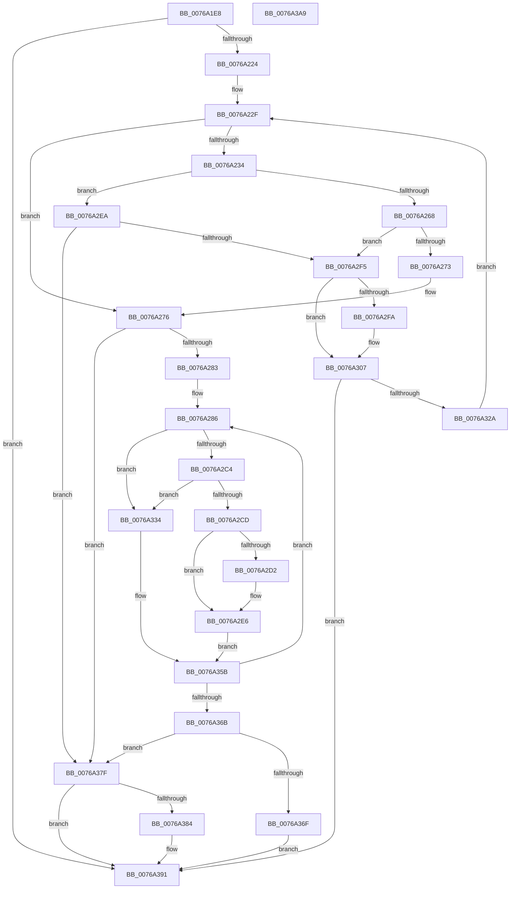

# PopEtEnergyTrackerFindDxgAdapters

- RVA: `0x0076A1E8`–`0x0076A3AA` (길이 `450` bytes)
- VA: `0x000000014076A1E8`
- 실행 섹션: `PAGE`
- PDB 이름 있음: `예`; PDB Function 태그: `아니요`
- unwind 정보 RVA: `0x000BCF10`
- 디코드: `125`개 명령, `450/450` bytes 표시
- 미해석 바이트: `0` (있으면 어셈블리에 `.byte`로 보존)

> 이 문서는 커널 이미지의 기계어와 PDB 기호를 분석해 생성했습니다. 4번과 5번은 함수 원형과 자료형을 바이너리 사용 방식에서 추정한 C 해석이며 원본 소스 복구 결과는 아닙니다.

## 1. Dependencies

- 직접 호출 지점: **6**; 고유 호출 대상: **3**
- 직접 호출자로 확인된 함수: **1**
- RIP 상대 이미지 참조: **1**

### Outgoing calls
- `0x0076A25B` → [guard_dispatch_icall](../../text/6B/guard_dispatch_icall_function_006BAAD0.md) (function, `0x006BAAD0`)
- `0x0076A2BB` → [guard_dispatch_icall](../../text/6B/guard_dispatch_icall_function_006BAAD0.md) (function, `0x006BAAD0`)
- `0x0076A302` → [ExFreePoolWithTag](../../poolcode/B8/ExFreePoolWithTag_function_00B82870.md) (function, `0x00B82870`)
- `0x0076A31D` → [ExAllocatePool2](../../poolcode/B8/ExAllocatePool2_function_00B820F0.md) (function, `0x00B820F0`)
- `0x0076A345` → [guard_dispatch_icall](../../text/6B/guard_dispatch_icall_function_006BAAD0.md) (function, `0x006BAAD0`)
- `0x0076A38C` → [ExFreePoolWithTag](../../poolcode/B8/ExFreePoolWithTag_function_00B82870.md) (function, `0x00B82870`)

### Direct callers
- [PopEtEnergyTrackerCreate](PopEtEnergyTrackerCreate_function_00769EE0.md) at `0x0076A046`

### Static image references
- `0x0076A20A` → RVA `0x00E67A30` (`.data`; read)

## 2. Other-region calls and transfers

- 다른 실행 섹션으로 향하는 call: **6**
  - `0x0076A25B` → [guard_dispatch_icall](../../text/6B/guard_dispatch_icall_function_006BAAD0.md) (`PAGE` → `.text`)
  - `0x0076A2BB` → [guard_dispatch_icall](../../text/6B/guard_dispatch_icall_function_006BAAD0.md) (`PAGE` → `.text`)
  - `0x0076A302` → [ExFreePoolWithTag](../../poolcode/B8/ExFreePoolWithTag_function_00B82870.md) (`PAGE` → `POOLCODE`)
  - `0x0076A31D` → [ExAllocatePool2](../../poolcode/B8/ExAllocatePool2_function_00B820F0.md) (`PAGE` → `POOLCODE`)
  - `0x0076A345` → [guard_dispatch_icall](../../text/6B/guard_dispatch_icall_function_006BAAD0.md) (`PAGE` → `.text`)
  - `0x0076A38C` → [ExFreePoolWithTag](../../poolcode/B8/ExFreePoolWithTag_function_00B82870.md) (`PAGE` → `POOLCODE`)
- 별도 외부 분기/꼬리 이동을 확인하지 못했습니다.

## 3. Assembly (complete function range)

```asm
0076A1E8  48 89 5C 24 08                  mov qword ptr [rsp + 8], rbx
0076A1ED  55                              push rbp
0076A1EE  56                              push rsi
0076A1EF  57                              push rdi
0076A1F0  41 54                           push r12
0076A1F2  41 55                           push r13
0076A1F4  41 56                           push r14
0076A1F6  41 57                           push r15
0076A1F8  48 8B EC                        mov rbp, rsp
0076A1FB  48 83 EC 60                     sub rsp, 0x60
0076A1FF  33 C0                           xor eax, eax
0076A201  33 F6                           xor esi, esi
0076A203  48 89 45 E0                     mov qword ptr [rbp - 0x20], rax
0076A207  0F 57 C0                        xorps xmm0, xmm0
0076A20A  48 8B 05 1F D8 6F 00            mov rax, qword ptr [rip + 0x6fd81f]
0076A211  4C 8B E9                        mov r13, rcx
0076A214  0F 11 45 D0                     movups xmmword ptr [rbp - 0x30], xmm0
0076A218  39 B0 48 04 00 00               cmp dword ptr [rax + 0x448], esi
0076A21E  0F 8C 6D 01 00 00               jl 0x14076a391
0076A224  4C 8B A0 40 04 00 00            mov r12, qword ptr [rax + 0x440]
0076A22B  33 DB                           xor ebx, ebx
0076A22D  33 FF                           xor edi, edi
0076A22F  83 FF 03                        cmp edi, 3
0076A232  7D 42                           jge 0x14076a276
0076A234  83 65 DC 00                     and dword ptr [rbp - 0x24], 0
0076A238  48 8D 4D D0                     lea rcx, [rbp - 0x30]
0076A23C  48 C7 45 D0 01 00 00 00         mov qword ptr [rbp - 0x30], 1
0076A244  45 33 C9                        xor r9d, r9d
0076A247  48 89 5D E0                     mov qword ptr [rbp - 0x20], rbx
0076A24B  45 33 C0                        xor r8d, r8d
0076A24E  89 75 D8                        mov dword ptr [rbp - 0x28], esi
0076A251  33 D2                           xor edx, edx
0076A253  49 8B 84 24 48 02 00 00         mov rax, qword ptr [r12 + 0x248]
0076A25B  E8 70 08 F5 FF                  call 0x1406baad0
0076A260  85 C0                           test eax, eax
0076A262  0F 88 82 00 00 00               js 0x14076a2ea
0076A268  48 83 7D E0 00                  cmp qword ptr [rbp - 0x20], 0
0076A26D  0F 84 82 00 00 00               je 0x14076a2f5
0076A273  8B 75 D8                        mov esi, dword ptr [rbp - 0x28]
0076A276  33 FF                           xor edi, edi
0076A278  45 33 F6                        xor r14d, r14d
0076A27B  85 F6                           test esi, esi
0076A27D  0F 84 FC 00 00 00               je 0x14076a37f
0076A283  4C 8B FB                        mov r15, rbx
0076A286  41 8B 07                        mov eax, dword ptr [r15]
0076A289  48 8D 4D E8                     lea rcx, [rbp - 0x18]
0076A28D  83 65 48 00                     and dword ptr [rbp + 0x48], 0
0076A291  45 33 C0                        xor r8d, r8d
0076A294  83 65 FC 00                     and dword ptr [rbp - 4], 0
0076A298  33 D2                           xor edx, edx
0076A29A  89 45 E8                        mov dword ptr [rbp - 0x18], eax
0076A29D  48 8D 45 48                     lea rax, [rbp + 0x48]
0076A2A1  48 89 45 F0                     mov qword ptr [rbp - 0x10], rax
0076A2A5  49 8B 84 24 58 01 00 00         mov rax, qword ptr [r12 + 0x158]
0076A2AD  C7 45 EC 0F 00 00 00            mov dword ptr [rbp - 0x14], 0xf
0076A2B4  C7 45 F8 04 00 00 00            mov dword ptr [rbp - 8], 4
0076A2BB  E8 10 08 F5 FF                  call 0x1406baad0
0076A2C0  85 C0                           test eax, eax
0076A2C2  78 70                           js 0x14076a334
0076A2C4  F7 45 48 00 08 00 00            test dword ptr [rbp + 0x48], 0x800
0076A2CB  74 67                           je 0x14076a334
0076A2CD  41 3B FE                        cmp edi, r14d
0076A2D0  74 14                           je 0x14076a2e6
0076A2D2  41 0F 10 07                     movups xmm0, xmmword ptr [r15]
0076A2D6  48 8D 0C BF                     lea rcx, [rdi + rdi*4]
0076A2DA  0F 11 04 8B                     movups xmmword ptr [rbx + rcx*4], xmm0
0076A2DE  41 8B 47 10                     mov eax, dword ptr [r15 + 0x10]
0076A2E2  89 44 8B 10                     mov dword ptr [rbx + rcx*4 + 0x10], eax
0076A2E6  FF C7                           inc edi
0076A2E8  EB 71                           jmp 0x14076a35b
0076A2EA  3D 23 00 00 C0                  cmp eax, 0xc0000023
0076A2EF  0F 85 8A 00 00 00               jne 0x14076a37f
0076A2F5  48 85 DB                        test rbx, rbx
0076A2F8  74 0D                           je 0x14076a307
0076A2FA  BA 50 6F 45 54                  mov edx, 0x54456f50
0076A2FF  48 8B CB                        mov rcx, rbx
0076A302  E8 69 85 41 00                  call 0x140b82870
0076A307  8B 45 D8                        mov eax, dword ptr [rbp - 0x28]
0076A30A  B9 00 01 00 00                  mov ecx, 0x100
0076A30F  41 B8 50 6F 45 54               mov r8d, 0x54456f50
0076A315  48 8D 14 80                     lea rdx, [rax + rax*4]
0076A319  48 C1 E2 02                     shl rdx, 2
0076A31D  E8 CE 7D 41 00                  call 0x140b820f0
0076A322  48 8B D8                        mov rbx, rax
0076A325  48 85 C0                        test rax, rax
0076A328  74 67                           je 0x14076a391
0076A32A  8B 75 D8                        mov esi, dword ptr [rbp - 0x28]
0076A32D  FF C7                           inc edi
0076A32F  E9 FB FE FF FF                  jmp 0x14076a22f
0076A334  41 8B 07                        mov eax, dword ptr [r15]
0076A337  48 8D 4D 50                     lea rcx, [rbp + 0x50]
0076A33B  89 45 50                        mov dword ptr [rbp + 0x50], eax
0076A33E  33 D2                           xor edx, edx
0076A340  49 8B 44 24 18                  mov rax, qword ptr [r12 + 0x18]
0076A345  E8 86 07 F5 FF                  call 0x1406baad0
0076A34A  4B 8D 0C B6                     lea rcx, [r14 + r14*4]
0076A34E  0F 57 C0                        xorps xmm0, xmm0
0076A351  33 C0                           xor eax, eax
0076A353  0F 11 04 8B                     movups xmmword ptr [rbx + rcx*4], xmm0
0076A357  89 44 8B 10                     mov dword ptr [rbx + rcx*4 + 0x10], eax
0076A35B  41 FF C6                        inc r14d
0076A35E  49 83 C7 14                     add r15, 0x14
0076A362  44 3B F6                        cmp r14d, esi
0076A365  0F 82 1B FF FF FF               jb 0x14076a286
0076A36B  85 FF                           test edi, edi
0076A36D  74 10                           je 0x14076a37f
0076A36F  41 89 BD 88 02 00 00            mov dword ptr [r13 + 0x288], edi
0076A376  49 89 9D 90 02 00 00            mov qword ptr [r13 + 0x290], rbx
0076A37D  EB 12                           jmp 0x14076a391
0076A37F  48 85 DB                        test rbx, rbx
0076A382  74 0D                           je 0x14076a391
0076A384  BA 50 6F 45 54                  mov edx, 0x54456f50
0076A389  48 8B CB                        mov rcx, rbx
0076A38C  E8 DF 84 41 00                  call 0x140b82870
0076A391  48 8B 9C 24 A0 00 00 00         mov rbx, qword ptr [rsp + 0xa0]
0076A399  48 83 C4 60                     add rsp, 0x60
0076A39D  41 5F                           pop r15
0076A39F  41 5E                           pop r14
0076A3A1  41 5D                           pop r13
0076A3A3  41 5C                           pop r12
0076A3A5  5F                              pop rdi
0076A3A6  5E                              pop rsi
0076A3A7  5D                              pop rbp
0076A3A8  C3                              ret
0076A3A9  CC                              int3
```

## 4. C-style interpretation (structured pseudocode)

```c
__int64 __fastcall PopEtEnergyTrackerFindDxgAdapters(__int64 a1, int a2, int a3, int a4)
{
    __int64 result;
    __int64 v_r14;
    __int64 v_r15;
    __int64 v_rbx;
    __int64 v_rdi;
    __int64 v_rsi;
    __int64 v_rsp;
    unsigned int v_stack_m3C;
    unsigned int v_stack_m40;
    unsigned __int64 v_stack_m48;
    unsigned int v_stack_m4C;
    unsigned __int64 v_stack_m50;
    unsigned __int64 v_stack_m58;
    unsigned int v_stack_m5C;
    unsigned int v_stack_m60;
    unsigned __int64 v_stack_m68;
    unsigned int v_stack_p10;
    unsigned __int64 v_stack_p18;
    unsigned __int64 v_stack_p8;

    v_stack_p8 = v_rbx;
    v_rsp = (v_rsp) - (96);
    result = 0;
    v_rsi = 0;
    v_stack_m58 = 0;
    v_stack_m68 = v_xmm0;
    if ((*(unsigned int *)(*(unsigned __int64 *)(v_rip + 7329823) + 1096)) < 0) goto loc_0076A391;
    v_rbx = 0;
    v_rdi = 0;
loc_0076A22F:
    if (0 >= 3) goto loc_0076A276;
    v_stack_m68 = 1;
    a4 = 0;
    v_stack_m58 = 0;
    a3 = 0;
    v_stack_m60 = 0;
    a2 = 0;
    result = guard_dispatch_icall(v_stack_m68, a2, a3, a4);
    if (sign_flag) goto loc_0076A2EA;
    if (v_stack_m58 == 0) goto loc_0076A2F5;
loc_0076A276:
    v_rdi = 0;
    v_r14 = 0;
    if ((unsigned int)((unsigned int)(v_stack_m60)) == 0) goto loc_0076A37F;
loc_0076A286:
    a3 = 0;
    a2 = 0;
    v_stack_m50 = (unsigned int)((unsigned int)(*(unsigned int *)(0)));
    v_stack_m48 = v_stack_p10;
    v_stack_m4C = 15;
    v_stack_m40 = 4;
    result = guard_dispatch_icall(v_stack_m50, a2, a3, a4);
    if (sign_flag) goto loc_0076A334;
    if (((v_stack_p10) & (0x800ULL)) == 0) goto loc_0076A334;
    if (0 != 0) {
        a1 = v_rdi + v_rdi * 4;
        *(unsigned __int64 *)(v_rbx + a1 * 4) = v_xmm0;
        result = *(unsigned int *)(0 + 16);
        *(unsigned int *)(v_rbx + a1 * 4 + 16) = (unsigned int)(result);
    }
    v_rdi = (unsigned int)((v_rdi) + 1);
    goto loc_0076A35B;
loc_0076A2EA:
    if (((unsigned int)(result)) != 0xC0000023ULL) goto loc_0076A37F;
loc_0076A2F5:
    if (0 != 0) {
        a2 = 0x54456F50ULL;
        a1 = 0;
        result = ExFreePoolWithTag(a1, a2, a3, a4);
    }
    a2 = ((unsigned int)(v_stack_m60) + (unsigned int)(v_stack_m60) * 4) << (2);
    result = ExAllocatePool2(256, a2, (unsigned int)(0x54456F50ULL), a4);
    if (result == 0) goto loc_0076A391;
    v_rdi = (unsigned int)((v_rdi) + 1);
    goto loc_0076A22F;
loc_0076A334:
    v_stack_p18 = (unsigned int)((unsigned int)(*(unsigned int *)(0)));
    a2 = 0;
    result = guard_dispatch_icall(v_stack_p18, a2, (unsigned int)(0x54456F50ULL), a4);
    result = 0;
    *(unsigned __int64 *)(result + v_r14 + v_r14 * 4 * 4) = v_xmm0;
    *(unsigned int *)(result + v_r14 + v_r14 * 4 * 4 + 16) = 0;
loc_0076A35B:
    v_r14 = (unsigned int)((v_r14) + 1);
    v_r15 = (0) + (20);
    if (((unsigned int)(v_r14)) < ((unsigned int)((unsigned int)(v_stack_m60)))) goto loc_0076A286;
    if ((unsigned int)(v_rdi) == 0) goto loc_0076A37F;
    *(unsigned int *)(a1 + 648) = (unsigned int)(v_rdi);
    *(unsigned __int64 *)(a1 + 656) = 0;
    goto loc_0076A391;
loc_0076A37F:
    if (0 != 0) {
        a2 = 0x54456F50ULL;
        a1 = 0;
        result = ExFreePoolWithTag(a1, a2, (unsigned int)(0x54456F50ULL), a4);
    }
    v_rsp = (v_rsp) + (96);
    return result;
}
```

## 5. (Beta) C Style

```c
int64_t PopEtEnergyTrackerFindDxgAdapters(void *Arg1, int32_t Arg2, int32_t Arg3, int32_t Arg4)
{
    uint8_t *arg1 = (uint8_t *)Arg1;

    int64_t result;
    int64_t local_r14;
    int64_t local_r15;
    int64_t local_rbx;
    int64_t local_rdi;
    int64_t local_rsi;
    int64_t local_rsp;
    uint32_t v_stack_m3C;
    uint32_t v_stack_m40;
    uint64_t v_stack_m48;
    uint32_t v_stack_m4C;
    uint64_t v_stack_m50;
    uint64_t v_stack_m58;
    uint32_t v_stack_m5C;
    uint32_t v_stack_m60;
    uint64_t v_stack_m68;
    uint32_t v_stack_p10;
    uint64_t v_stack_p18;
    uint64_t v_stack_p8;

    v_stack_p8 = local_rbx;
    local_rsp = (local_rsp) - (96);
    result = 0;
    local_rsi = 0;
    v_stack_m58 = 0;
    v_stack_m68 = v_xmm0;
    if ((*(uint32_t *)(*(uint64_t *)(v_rip + 0x6FD81F) + 0x448)) < 0) goto loc_0076A391;
    local_rbx = 0;
    local_rdi = 0;
loc_0076A22F:
    if (0 >= 3) goto loc_0076A276;
    v_stack_m68 = 1;
    Arg4 = 0;
    v_stack_m58 = 0;
    Arg3 = 0;
    v_stack_m60 = 0;
    Arg2 = 0;
    result = guard_dispatch_icall(v_stack_m68, Arg2, Arg3, Arg4);
    if (sign_flag) goto loc_0076A2EA;
    if (v_stack_m58 == 0) goto loc_0076A2F5;
loc_0076A276:
    local_rdi = 0;
    local_r14 = 0;
    if ((uint32_t)((uint32_t)(v_stack_m60)) == 0) goto loc_0076A37F;
loc_0076A286:
    Arg3 = 0;
    Arg2 = 0;
    v_stack_m50 = (uint32_t)((uint32_t)(*(uint32_t *)(0)));
    v_stack_m48 = v_stack_p10;
    v_stack_m4C = 15;
    v_stack_m40 = 4;
    result = guard_dispatch_icall(v_stack_m50, Arg2, Arg3, Arg4);
    if (sign_flag) goto loc_0076A334;
    if (((v_stack_p10) & (0x800ULL)) == 0) goto loc_0076A334;
    if (0 != 0) {
        Arg1 = local_rdi + local_rdi * 4;
        *(uint64_t *)(local_rbx + arg1 * 4) = v_xmm0;
        result = *(uint32_t *)(0 + 0x10);
        *(uint32_t *)(local_rbx + arg1 * 4 + 0x10) = (uint32_t)(result);
    }
    local_rdi = (uint32_t)((local_rdi) + 1);
    goto loc_0076A35B;
loc_0076A2EA:
    if (((uint32_t)(result)) != 0xC0000023ULL) goto loc_0076A37F;
loc_0076A2F5:
    if (0 != 0) {
        Arg2 = 0x54456F50ULL;
        Arg1 = 0;
        result = ExFreePoolWithTag(Arg1, Arg2, Arg3, Arg4);
    }
    Arg2 = ((uint32_t)(v_stack_m60) + (uint32_t)(v_stack_m60) * 4) << (2);
    result = ExAllocatePool2(256, Arg2, (uint32_t)(0x54456F50ULL), Arg4);
    if (result == 0) goto loc_0076A391;
    local_rdi = (uint32_t)((local_rdi) + 1);
    goto loc_0076A22F;
loc_0076A334:
    v_stack_p18 = (uint32_t)((uint32_t)(*(uint32_t *)(0)));
    Arg2 = 0;
    result = guard_dispatch_icall(v_stack_p18, Arg2, (uint32_t)(0x54456F50ULL), Arg4);
    result = 0;
    *(uint64_t *)(result + local_r14 + local_r14 * 4 * 4) = v_xmm0;
    *(uint32_t *)(result + local_r14 + local_r14 * 4 * 4 + 0x10) = 0;
loc_0076A35B:
    local_r14 = (uint32_t)((local_r14) + 1);
    local_r15 = (0) + (20);
    if (((uint32_t)(local_r14)) < ((uint32_t)((uint32_t)(v_stack_m60)))) goto loc_0076A286;
    if ((uint32_t)(local_rdi) == 0) goto loc_0076A37F;
    *(uint32_t *)(arg1 + 0x288) = (uint32_t)(local_rdi);
    *(uint64_t *)(arg1 + 0x290) = 0;
    goto loc_0076A391;
loc_0076A37F:
    if (0 != 0) {
        Arg2 = 0x54456F50ULL;
        Arg1 = 0;
        result = ExFreePoolWithTag(Arg1, Arg2, (uint32_t)(0x54456F50ULL), Arg4);
    }
    local_rsp = (local_rsp) + (96);
    return result;
}
```

### 관측된 메모리 오프셋

구조체 형식이 확인되지 않은 접근은 인자 기준의 오프셋으로만 기록했습니다.

| 기준 인자 | 오프셋 표현 | 폭 (bit) | 접근 |
|---|---:|---:|---|
| `Arg1` | `+ 0x288` | `32` | `W` |
| `Arg1` | `+ 0x290` | `64` | `W` |

## 6. Execution-region graph

[열기: 2D/3D 그래프와 함수 탐색 컨트롤 패널](../../../control-panel.html?section=page&rva=0x0076A1E8&view=graph)

- 2D 그래프는 위에서 아래로 흐르고, 3D 그래프는 빈 공간을 드래그해 회전합니다. Shift+드래그는 이동, 휠은 확대·축소, 함수 노드 선택은 대상 보고서 이동입니다.

### Static fallback


