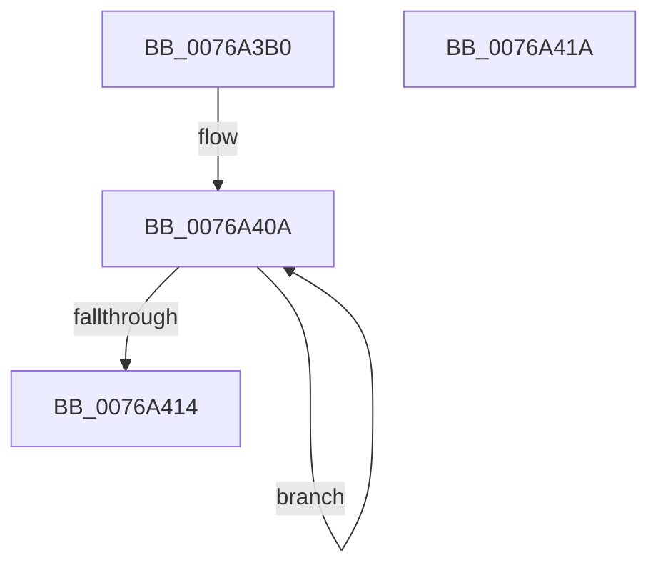

# PopEtInitializeBuiltinAppId

- RVA: `0x0076A3B0`–`0x0076A41B` (길이 `107` bytes)
- VA: `0x000000014076A3B0`
- 실행 섹션: `PAGE`
- PDB 이름 있음: `예`; PDB Function 태그: `아니요`
- unwind 정보 RVA: `0x000DB714`
- 디코드: `24`개 명령, `107/107` bytes 표시
- 미해석 바이트: `0` (있으면 어셈블리에 `.byte`로 보존)

> 이 문서는 커널 이미지의 기계어와 PDB 기호를 분석해 생성했습니다. 4번과 5번은 함수 원형과 자료형을 바이너리 사용 방식에서 추정한 C 해석이며 원본 소스 복구 결과는 아닙니다.

## 1. Dependencies

- 직접 호출 지점: **0**; 고유 호출 대상: **0**
- 직접 호출자로 확인된 함수: **1**
- RIP 상대 이미지 참조: **1**

### Outgoing calls
- 직접 디코드된 call 명령이 없습니다.

### Direct callers
- [PopEtInit](../../init/C4/PopEtInit_function_00C43018.md) at `0x00C4318E`
- [PopEtInit](../../init/C4/PopEtInit_function_00C43018.md) at `0x00C431A1`
- [PopEtInit](../../init/C4/PopEtInit_function_00C43018.md) at `0x00C431B4`
- [PopEtInit](../../init/C4/PopEtInit_function_00C43018.md) at `0x00C431CA`
- [PopEtInit](../../init/C4/PopEtInit_function_00C43018.md) at `0x00C431EE`

### Static image references
- `0x0076A3B0` → RVA `0x00E67A30` (`.data`; read)

## 2. Other-region calls and transfers

- 다른 실행 섹션으로 향하는 call: **0**
- 별도 외부 분기/꼬리 이동을 확인하지 못했습니다.

## 3. Assembly (complete function range)

```asm
0076A3B0  4C 8B 05 79 D6 6F 00            mov r8, qword ptr [rip + 0x6fd679]
0076A3B7  4C 8B C9                        mov r9, rcx
0076A3BA  45 33 D2                        xor r10d, r10d
0076A3BD  48 B8 FF FF 00 00 00 C0 FF FF   movabs rax, 0xffffc0000000ffff
0076A3C7  66 44 89 51 18                  mov word ptr [rcx + 0x18], r10w
0076A3CC  48 21 41 18                     and qword ptr [rcx + 0x18], rax
0076A3D0  49 8D 80 20 04 00 00            lea rax, [r8 + 0x420]
0076A3D7  48 89 41 20                     mov qword ptr [rcx + 0x20], rax
0076A3DB  49 8D 80 28 04 00 00            lea rax, [r8 + 0x428]
0076A3E2  48 89 41 28                     mov qword ptr [rcx + 0x28], rax
0076A3E6  49 8D 80 30 04 00 00            lea rax, [r8 + 0x430]
0076A3ED  48 89 41 48                     mov qword ptr [rcx + 0x48], rax
0076A3F1  0F B6 48 01                     movzx ecx, byte ptr [rax + 1]
0076A3F5  66 83 C1 02                     add cx, 2
0076A3F9  49 89 51 30                     mov qword ptr [r9 + 0x30], rdx
0076A3FD  66 C1 E1 02                     shl cx, 2
0076A401  66 41 89 49 56                  mov word ptr [r9 + 0x56], cx
0076A406  48 83 C8 FF                     or rax, 0xffffffffffffffff
0076A40A  48 FF C0                        inc rax
0076A40D  66 44 39 14 42                  cmp word ptr [rdx + rax*2], r10w
0076A412  75 F6                           jne 0x14076a40a
0076A414  66 41 89 41 50                  mov word ptr [r9 + 0x50], ax
0076A419  C3                              ret
0076A41A  CC                              int3
```

## 4. C-style interpretation (structured pseudocode)

```c
__int64 __fastcall PopEtInitializeBuiltinAppId(__int64 a1, __int64 a2)
{
    __int64 result;
    __int64 v_r10;

    v_r10 = 0;
    *(unsigned __int16 *)(a1 + 24) = 0;
    *(unsigned __int64 *)(a1 + 32) = *(unsigned __int64 *)(v_rip + 7329401) + 1056;
    *(unsigned __int64 *)(a1 + 40) = *(unsigned __int64 *)(v_rip + 7329401) + 1064;
    *(unsigned __int64 *)(a1 + 72) = *(unsigned __int64 *)(v_rip + 7329401) + 1072;
    a1 = (unsigned __int16)((*(unsigned __int8 *)(*(unsigned __int64 *)(v_rip + 7329401) + 1072 + 1)) + (2));
    *(unsigned __int64 *)(a1 + 48) = a2;
    a1 = (unsigned __int16)((a1) << (2));
    *(unsigned __int16 *)(a1 + 86) = (unsigned __int16)(a1);
    result = (*(unsigned __int64 *)(v_rip + 7329401) + 1072) | (-1);
loc_0076A40A:
    result = (result) + 1;
    if ((*(unsigned __int16 *)(a2 + result * 2)) != 0) goto loc_0076A40A;
    *(unsigned __int16 *)(a1 + 80) = (unsigned __int16)(result);
    return result;
}
```

## 5. (Beta) C Style

```c
int64_t PopEtInitializeBuiltinAppId(void *Arg1, void *Arg2)
{
    uint8_t *arg1 = (uint8_t *)Arg1;
    uint8_t *arg2 = (uint8_t *)Arg2;

    int64_t result;
    int64_t local_r10;

    local_r10 = 0;
    *(uint16_t *)(arg1 + 0x18) = 0;
    *(uint64_t *)(arg1 + 0x20) = *(uint64_t *)(v_rip + 0x6FD679) + 1056;
    *(uint64_t *)(arg1 + 0x28) = *(uint64_t *)(v_rip + 0x6FD679) + 1064;
    *(uint64_t *)(arg1 + 0x48) = *(uint64_t *)(v_rip + 0x6FD679) + 1072;
    Arg1 = (uint16_t)((*(uint8_t *)(*(uint64_t *)(v_rip + 0x6FD679) + 0x430 + 0x1)) + (2));
    *(void **)(arg1 + 0x30) = Arg2;
    Arg1 = (uint16_t)((Arg1) << (2));
    *(uint16_t *)(arg1 + 0x56) = (uint16_t)(Arg1);
    result = (*(uint64_t *)(v_rip + 0x6FD679) + 1072) | (-1);
loc_0076A40A:
    result = (result) + 1;
    if ((*(uint16_t *)(arg2 + result * 2)) != 0) goto loc_0076A40A;
    *(uint16_t *)(arg1 + 0x50) = (uint16_t)(result);
    return result;
}
```

### 관측된 메모리 오프셋

구조체 형식이 확인되지 않은 접근은 인자 기준의 오프셋으로만 기록했습니다.

| 기준 인자 | 오프셋 표현 | 폭 (bit) | 접근 |
|---|---:|---:|---|
| `Arg1` | `+ 0x18` | `16` | `W` |
| `Arg1` | `+ 0x18` | `64` | `R/W` |
| `Arg1` | `+ 0x20` | `64` | `W` |
| `Arg1` | `+ 0x28` | `64` | `W` |
| `Arg1` | `+ 0x30` | `64` | `W` |
| `Arg1` | `+ 0x48` | `64` | `W` |
| `Arg1` | `+ 0x50` | `16` | `W` |
| `Arg1` | `+ 0x56` | `16` | `W` |
| `Arg2` | `+ 0x0 + rax*2` | `16` | `R` |

## 6. Execution-region graph

[열기: 2D/3D 그래프와 함수 탐색 컨트롤 패널](../../../control-panel.html?section=page&rva=0x0076A3B0&view=graph)

- 2D 그래프는 위에서 아래로 흐르고, 3D 그래프는 빈 공간을 드래그해 회전합니다. Shift+드래그는 이동, 휠은 확대·축소, 함수 노드 선택은 대상 보고서 이동입니다.

### Static fallback


