# PopEvaluateInputSuppressionAction

- RVA: `0x00765454`–`0x00765681` (길이 `557` bytes)
- VA: `0x0000000140765454`
- 실행 섹션: `PAGE`
- PDB 이름 있음: `예`; PDB Function 태그: `아니요`
- unwind 정보 RVA: `0x000CCD2C`
- 디코드: `140`개 명령, `557/557` bytes 표시
- 미해석 바이트: `0` (있으면 어셈블리에 `.byte`로 보존)

> 이 문서는 커널 이미지의 기계어와 PDB 기호를 분석해 생성했습니다. 4번과 5번은 함수 원형과 자료형을 바이너리 사용 방식에서 추정한 C 해석이며 원본 소스 복구 결과는 아닙니다.

## 1. Dependencies

- 직접 호출 지점: **10**; 고유 호출 대상: **9**
- 직접 호출자로 확인된 함수: **3**
- RIP 상대 이미지 참조: **19**

### Outgoing calls
- `0x0076549C` → [PopAcquireRwLockExclusive](../../text/43/PopAcquireRwLockExclusive_function_00430B44.md) (function, `0x00430B44`)
- `0x007654A1` → [PopAcquirePolicyLock](../../pagelk/B7/PopAcquirePolicyLock_function_00B783C0.md) (function, `0x00B783C0`)
- `0x0076551A` → [Feature_Servicing_GamingHandheldPowBtnFilter__private_IsEnabledDeviceUsageNoInline](../../text/5C/Feature_Servicing_GamingHandheldPowBtnFilter__private_IsEnabledDeviceUsageNoInline_function_005CE2F4.md) (function, `0x005CE2F4`)
- `0x00765573` → [PopReleasePolicyLock](../../pagelk/B7/PopReleasePolicyLock_function_00B78410.md) (function, `0x00B78410`)
- `0x007655A1` → [PopTraceInputSuppressionActionUpdate](../AD/PopTraceInputSuppressionActionUpdate_function_00ADFB0C.md) (function, `0x00ADFB0C`)
- `0x007655CD` → [ZwUpdateWnfStateData](../../text/6B/ZwUpdateWnfStateData_function_006B0D10.md) (function, `0x006B0D10`)
- `0x0076561D` → [ZwUpdateWnfStateData](../../text/6B/ZwUpdateWnfStateData_function_006B0D10.md) (function, `0x006B0D10`)
- `0x00765643` → [PopBroadcastSessionInfo](../91/PopBroadcastSessionInfo_function_00912598.md) (function, `0x00912598`)
- `0x0076564F` → [PopReleaseRwLock](../../text/2D/PopReleaseRwLock_function_002DFBBC.md) (function, `0x002DFBBC`)
- `0x0076565C` → [_security_check_cookie](../../text/6A/_security_check_cookie_function_006AC640.md) (function, `0x006AC640`)

### Direct callers
- [PopBroadcastInputSuppressionCallback](PopBroadcastInputSuppressionCallback_function_007653D0.md) at `0x00765441`
- [PopUsb4DisplayPresenceUpdatedWorker](PopUsb4DisplayPresenceUpdatedWorker_function_00765690.md) at `0x007656AF`
- [PopExternalMonitorUpdatedWorker](../AB/PopExternalMonitorUpdatedWorker_function_00AB0B20.md) at `0x00AB0B79`

### Static image references
- `0x00765471` → RVA `0x00E0A740` (`.data`; read)
- `0x00765483` → RVA `0x00F09240` (`.data`; read)
- `0x007654A6` → RVA `0x00E0B579` (`.data`; read)
- `0x007654B1` → RVA `0x00F0CE0C` (`.data`; read)
- `0x007654BC` → RVA `0x00E67A54` (`.data`; read)
- `0x007654C5` → RVA `0x00E67884` (`.data`; read)
- `0x007654D4` → RVA `0x00E67A50` (`.data`; read)
- `0x007654E7` → RVA `0x00F0CE68` (`.data`; read)
- `0x007654FD` → RVA `0x00E67885` (`.data`; read)
- `0x00765523` → RVA `0x00F0F040` (`.data`; read)
- `0x00765532` → RVA `0x00E67A38` (`.data`; read)
- `0x0076553B` → RVA `0x00E6788C` (`.data`; read)
- `0x0076555F` → RVA `0x00E67894` (`.data`; read)
- `0x00765578` → RVA `0x00E67888` (`.data`; read)
- `0x0076559B` → RVA `0x00E67888` (`.data`; write)
- `0x007655BA` → RVA `0x000208C8` (`.rdata`; read)
- `0x007655E4` → RVA `0x00E67890` (`.data`; read/write)
- `0x00765616` → RVA `0x00020A90` (`.rdata`; read)
- `0x00765622` → RVA `0x00029728` (`.rdata`; read)

## 2. Other-region calls and transfers

- 다른 실행 섹션으로 향하는 call: **8**
  - `0x0076549C` → [PopAcquireRwLockExclusive](../../text/43/PopAcquireRwLockExclusive_function_00430B44.md) (`PAGE` → `.text`)
  - `0x007654A1` → [PopAcquirePolicyLock](../../pagelk/B7/PopAcquirePolicyLock_function_00B783C0.md) (`PAGE` → `PAGELK`)
  - `0x0076551A` → [Feature_Servicing_GamingHandheldPowBtnFilter__private_IsEnabledDeviceUsageNoInline](../../text/5C/Feature_Servicing_GamingHandheldPowBtnFilter__private_IsEnabledDeviceUsageNoInline_function_005CE2F4.md) (`PAGE` → `.text`)
  - `0x00765573` → [PopReleasePolicyLock](../../pagelk/B7/PopReleasePolicyLock_function_00B78410.md) (`PAGE` → `PAGELK`)
  - `0x007655CD` → [ZwUpdateWnfStateData](../../text/6B/ZwUpdateWnfStateData_function_006B0D10.md) (`PAGE` → `.text`)
  - `0x0076561D` → [ZwUpdateWnfStateData](../../text/6B/ZwUpdateWnfStateData_function_006B0D10.md) (`PAGE` → `.text`)
  - `0x0076564F` → [PopReleaseRwLock](../../text/2D/PopReleaseRwLock_function_002DFBBC.md) (`PAGE` → `.text`)
  - `0x0076565C` → [_security_check_cookie](../../text/6A/_security_check_cookie_function_006AC640.md) (`PAGE` → `.text`)
- 별도 외부 분기/꼬리 이동을 확인하지 못했습니다.

## 3. Assembly (complete function range)

```asm
00765454  4C 8B DC                        mov r11, rsp
00765457  49 89 5B 08                     mov qword ptr [r11 + 8], rbx
0076545B  49 89 6B 10                     mov qword ptr [r11 + 0x10], rbp
0076545F  49 89 73 18                     mov qword ptr [r11 + 0x18], rsi
00765463  49 89 7B 20                     mov qword ptr [r11 + 0x20], rdi
00765467  41 54                           push r12
00765469  41 56                           push r14
0076546B  41 57                           push r15
0076546D  48 83 EC 70                     sub rsp, 0x70
00765471  48 8B 05 C8 52 6A 00            mov rax, qword ptr [rip + 0x6a52c8]
00765478  48 33 C4                        xor rax, rsp
0076547B  48 89 44 24 60                  mov qword ptr [rsp + 0x60], rax
00765480  0F 57 C0                        xorps xmm0, xmm0
00765483  48 8D 0D B6 3D 7A 00            lea rcx, [rip + 0x7a3db6]
0076548A  33 C0                           xor eax, eax
0076548C  45 33 E4                        xor r12d, r12d
0076548F  45 89 63 B8                     mov dword ptr [r11 - 0x48], r12d
00765493  0F 11 44 24 48                  movups xmmword ptr [rsp + 0x48], xmm0
00765498  89 44 24 58                     mov dword ptr [rsp + 0x58], eax
0076549C  E8 A3 B6 CC FF                  call 0x140430b44
007654A1  E8 1A 2F 41 00                  call 0x140b783c0
007654A6  44 38 25 CC 60 6A 00            cmp byte ptr [rip + 0x6a60cc], r12b
007654AD  41 0F 94 C7                     sete r15b
007654B1  83 3D 54 79 7A 00 01            cmp dword ptr [rip + 0x7a7954], 1
007654B8  41 0F 94 C6                     sete r14b
007654BC  44 38 25 91 25 70 00            cmp byte ptr [rip + 0x702591], r12b
007654C3  75 0C                           jne 0x1407654d1
007654C5  44 38 25 B8 23 70 00            cmp byte ptr [rip + 0x7023b8], r12b
007654CC  41 8A F4                        mov sil, r12b
007654CF  74 03                           je 0x1407654d4
007654D1  40 B6 01                        mov sil, 1
007654D4  44 39 25 75 25 70 00            cmp dword ptr [rip + 0x702575], r12d
007654DB  40 B7 01                        mov dil, 1
007654DE  40 0F 94 C5                     sete bpl
007654E2  45 84 F6                        test r14b, r14b
007654E5  75 16                           jne 0x1407654fd
007654E7  48 8B 05 7A 79 7A 00            mov rax, qword ptr [rip + 0x7a797a]
007654EE  48 85 C0                        test rax, rax
007654F1  74 0A                           je 0x1407654fd
007654F3  8B 40 1C                        mov eax, dword ptr [rax + 0x1c]
007654F6  F7 D8                           neg eax
007654F8  1A C9                           sbb cl, cl
007654FA  40 22 F9                        and dil, cl
007654FD  44 38 25 81 23 70 00            cmp byte ptr [rip + 0x702381], r12b
00765504  74 05                           je 0x14076550b
00765506  40 8A DF                        mov bl, dil
00765509  EB 0F                           jmp 0x14076551a
0076550B  45 84 F6                        test r14b, r14b
0076550E  75 08                           jne 0x140765518
00765510  41 8A DC                        mov bl, r12b
00765513  40 84 FF                        test dil, dil
00765516  74 02                           je 0x14076551a
00765518  B3 01                           mov bl, 1
0076551A  E8 D5 8D E6 FF                  call 0x1405ce2f4
0076551F  85 C0                           test eax, eax
00765521  74 0F                           je 0x140765532
00765523  83 3D 16 9B 7A 00 2E            cmp dword ptr [rip + 0x7a9b16], 0x2e
0076552A  75 06                           jne 0x140765532
0076552C  40 0F B6 DD                     movzx ebx, bpl
00765530  EB 2D                           jmp 0x14076555f
00765532  44 38 25 FF 24 70 00            cmp byte ptr [rip + 0x7024ff], r12b
00765539  75 21                           jne 0x14076555c
0076553B  44 38 25 4A 23 70 00            cmp byte ptr [rip + 0x70234a], r12b
00765542  75 05                           jne 0x140765549
00765544  45 84 FF                        test r15b, r15b
00765547  74 13                           je 0x14076555c
00765549  84 DB                           test bl, bl
0076554B  74 0F                           je 0x14076555c
0076554D  40 84 F6                        test sil, sil
00765550  75 0A                           jne 0x14076555c
00765552  BB 01 00 00 00                  mov ebx, 1
00765557  40 84 ED                        test bpl, bpl
0076555A  75 03                           jne 0x14076555f
0076555C  41 8B DC                        mov ebx, r12d
0076555F  44 38 25 2E 23 70 00            cmp byte ptr [rip + 0x70232e], r12b
00765566  75 0B                           jne 0x140765573
00765568  83 FB 01                        cmp ebx, 1
0076556B  B8 02 00 00 00                  mov eax, 2
00765570  0F 44 D8                        cmove ebx, eax
00765573  E8 98 2E 41 00                  call 0x140b78410
00765578  39 1D 0A 23 70 00               cmp dword ptr [rip + 0x70230a], ebx
0076557E  0F 84 C4 00 00 00               je 0x140765648
00765584  40 88 7C 24 38                  mov byte ptr [rsp + 0x38], dil
00765589  44 8A CE                        mov r9b, sil
0076558C  89 5C 24 30                     mov dword ptr [rsp + 0x30], ebx
00765590  45 8A C6                        mov r8b, r14b
00765593  41 8A D7                        mov dl, r15b
00765596  40 88 6C 24 20                  mov byte ptr [rsp + 0x20], bpl
0076559B  89 1D E7 22 70 00               mov dword ptr [rip + 0x7022e7], ebx
007655A1  E8 66 A5 37 00                  call 0x140adfb0c
007655A6  45 33 C9                        xor r9d, r9d
007655A9  44 89 64 24 30                  mov dword ptr [rsp + 0x30], r12d
007655AE  44 89 64 24 28                  mov dword ptr [rsp + 0x28], r12d
007655B3  48 8D 15 CE 22 70 00            lea rdx, [rip + 0x7022ce]
007655BA  48 8D 0D 07 B3 8B FF            lea rcx, [rip - 0x744cf9]
007655C1  4C 89 64 24 20                  mov qword ptr [rsp + 0x20], r12
007655C6  41 8D 59 04                     lea ebx, [r9 + 4]
007655CA  44 8B C3                        mov r8d, ebx
007655CD  E8 3E B7 F4 FF                  call 0x1406b0d10
007655D2  44 38 25 BB 22 70 00            cmp byte ptr [rip + 0x7022bb], r12b
007655D9  74 6D                           je 0x140765648
007655DB  83 3D A6 22 70 00 01            cmp dword ptr [rip + 0x7022a6], 1
007655E2  77 07                           ja 0x1407655eb
007655E4  F0 FF 05 A5 22 70 00            lock inc dword ptr [rip + 0x7022a5]
007655EB  83 3D 96 22 70 00 01            cmp dword ptr [rip + 0x702296], 1
007655F2  48 8D 54 24 40                  lea rdx, [rsp + 0x40]
007655F7  41 8B C4                        mov eax, r12d
007655FA  44 89 64 24 30                  mov dword ptr [rsp + 0x30], r12d
007655FF  0F 94 C0                        sete al
00765602  44 89 64 24 28                  mov dword ptr [rsp + 0x28], r12d
00765607  45 33 C9                        xor r9d, r9d
0076560A  89 44 24 40                     mov dword ptr [rsp + 0x40], eax
0076560E  44 8B C3                        mov r8d, ebx
00765611  4C 89 64 24 20                  mov qword ptr [rsp + 0x20], r12
00765616  48 8D 0D 73 B4 8B FF            lea rcx, [rip - 0x744b8d]
0076561D  E8 EE B6 F4 FF                  call 0x1406b0d10
00765622  0F 10 05 FF 40 8C FF            movups xmm0, xmmword ptr [rip - 0x73bf01]
00765629  8B 44 24 40                     mov eax, dword ptr [rsp + 0x40]
0076562D  4C 8D 44 24 48                  lea r8, [rsp + 0x48]
00765632  BA 14 00 00 00                  mov edx, 0x14
00765637  89 44 24 58                     mov dword ptr [rsp + 0x58], eax
0076563B  33 C9                           xor ecx, ecx
0076563D  F3 0F 7F 44 24 48               movdqu xmmword ptr [rsp + 0x48], xmm0
00765643  E8 50 CF 1A 00                  call 0x140912598
00765648  48 8D 0D F1 3B 7A 00            lea rcx, [rip + 0x7a3bf1]
0076564F  E8 68 A5 B7 FF                  call 0x1402dfbbc
00765654  48 8B 4C 24 60                  mov rcx, qword ptr [rsp + 0x60]
00765659  48 33 CC                        xor rcx, rsp
0076565C  E8 DF 6F F4 FF                  call 0x1406ac640
00765661  4C 8D 5C 24 70                  lea r11, [rsp + 0x70]
00765666  49 8B 5B 20                     mov rbx, qword ptr [r11 + 0x20]
0076566A  49 8B 6B 28                     mov rbp, qword ptr [r11 + 0x28]
0076566E  49 8B 73 30                     mov rsi, qword ptr [r11 + 0x30]
00765672  49 8B 7B 38                     mov rdi, qword ptr [r11 + 0x38]
00765676  49 8B E3                        mov rsp, r11
00765679  41 5F                           pop r15
0076567B  41 5E                           pop r14
0076567D  41 5C                           pop r12
0076567F  C3                              ret
00765680  CC                              int3
```

## 4. C-style interpretation (structured pseudocode)

```c
__int64 __fastcall PopEvaluateInputSuppressionAction(void)
{
    __int64 result;
    __int64 v_r12;
    __int64 v_r14;
    __int64 v_r15;
    __int64 v_rbp;
    __int64 v_rbx;
    __int64 v_rdi;
    __int64 v_rsi;
    __int64 v_rsp;
    unsigned __int64 v_stack_m18;
    unsigned __int64 v_stack_m28;
    unsigned int v_stack_m30;
    unsigned __int64 v_stack_m40;
    unsigned __int64 v_stack_m48;
    unsigned __int8 v_stack_m50;
    unsigned int v_stack_m58;
    unsigned int v_stack_m60;
    unsigned __int8 v_stack_m68;

    *(unsigned __int64 *)(v_rsp + 8) = v_rbx;
    *(unsigned __int64 *)(v_rsp + 16) = v_rbp;
    *(unsigned __int64 *)(v_rsp + 24) = v_rsi;
    *(unsigned __int64 *)(v_rsp + 32) = v_rdi;
    v_rsp = (v_rsp) - (112);
    result = (*(unsigned __int64 *)(v_rip + 6968008)) ^ (v_rsp);
    v_stack_m28 = result;
    result = 0;
    v_r12 = 0;
    *(unsigned int *)(v_rsp - 72) = 0;
    v_stack_m40 = v_xmm0;
    v_stack_m30 = 0;
    result = PopAcquireRwLockExclusive(v_rip + 8011190, a2, a3, a4);
    result = PopAcquirePolicyLock(v_rip + 8011190, a2, a3, a4);
    v_r15 = ((*(unsigned __int8 *)(v_rip + 6971596)) == 0) ? 1 : 0;
    v_r14 = ((*(unsigned int *)(v_rip + 8026452)) == 1) ? 1 : 0;
    if ((*(unsigned __int8 *)(v_rip + 7349649)) != 0) goto loc_007654D1;
    v_rsi = 0;
    if ((*(unsigned __int8 *)(v_rip + 7349176)) != 0) {
        v_rsi = 1;
    }
    v_rbp = ((*(unsigned int *)(v_rip + 7349621)) == 0) ? 1 : 0;
    if ((unsigned __int8)(v_r14) != 0) goto loc_007654FD;
    result = *(unsigned __int64 *)(v_rip + 8026490);
    v_rdi = 1;
    if (*(unsigned __int64 *)(v_rip + 8026490) != 0) {
        result = *(unsigned int *)(*(unsigned __int64 *)(v_rip + 8026490) + 28);
        result = (unsigned int)(-(result));
        v_rdi = (unsigned __int8)((1) & ((unsigned __int8)(v_rip + 8011190)));
    }
    if ((*(unsigned __int8 *)(v_rip + 7349121)) == 0) goto loc_0076550B;
    goto loc_0076551A;
loc_0076550B:
    if ((unsigned __int8)(v_r14) != 0) goto loc_00765518;
    v_rbx = 0;
    if ((unsigned __int8)(v_rdi) != 0) {
        v_rbx = 1;
    }
    result = Feature_Servicing_GamingHandheldPowBtnFilter__private_IsEnabledDeviceUsageNoInline(v_rip + 8011190, a2, a3, a4);
    if ((unsigned int)(result) == 0) goto loc_00765532;
    if ((*(unsigned int *)(v_rip + 8035094)) != 46) goto loc_00765532;
    goto loc_0076555F;
loc_00765532:
    if ((*(unsigned __int8 *)(v_rip + 7349503)) != 0) goto loc_0076555C;
    if ((*(unsigned __int8 *)(v_rip + 7349066)) != 0) goto loc_00765549;
    if ((unsigned __int8)(v_r15) == 0) goto loc_0076555C;
loc_00765549:
    if ((unsigned __int8)((unsigned __int8)(v_rbp)) == 0) goto loc_0076555C;
    if ((unsigned __int8)(v_rsi) != 0) goto loc_0076555C;
    v_rbx = 1;
    if ((unsigned __int8)(v_rbp) == 0) {
        v_rbx = 0;
    }
    if ((*(unsigned __int8 *)(v_rip + 7349038)) == 0) {
        result = 2;
        if (((unsigned int)(v_rbx)) == 1) { v_rbx = (unsigned int)(result); }
    }
    result = PopReleasePolicyLock(v_rip + 8011190, a2, a3, a4);
    if ((*(unsigned int *)(v_rip + 7349002)) == ((unsigned int)(v_rbx))) goto loc_00765648;
    v_stack_m50 = (unsigned __int8)(v_rdi);
    v_stack_m58 = (unsigned int)(v_rbx);
    v_stack_m68 = (unsigned __int8)(v_rbp);
    *(unsigned int *)(v_rip + 7348967) = (unsigned int)(v_rbx);
    result = PopTraceInputSuppressionActionUpdate(v_rip + 8011190, (unsigned __int8)(v_r15), (unsigned __int8)(v_r14), (unsigned __int8)(v_rsi));
    a4 = 0;
    v_stack_m58 = 0;
    v_stack_m60 = 0;
    v_stack_m68 = 0;
    result = ZwUpdateWnfStateData(v_rip - 7621881, v_rip + 7348942, (unsigned int)((unsigned int)(a4 + 4)), a4);
    if ((*(unsigned __int8 *)(v_rip + 7348923)) == 0) goto loc_00765648;
    if ((*(unsigned int *)(v_rip + 7348902)) <= 1) {
    }
    v_stack_m58 = 0;
    result = ((*(unsigned int *)(v_rip + 7348886)) == 1) ? 1 : 0;
    v_stack_m60 = 0;
    a4 = 0;
    v_stack_m48 = (unsigned int)(result);
    v_stack_m68 = 0;
    result = ZwUpdateWnfStateData(v_rip - 7621517, v_stack_m48, (unsigned int)((unsigned int)(a4 + 4)), a4);
    v_stack_m30 = (unsigned int)((unsigned int)(v_stack_m48));
    a1 = 0;
    v_stack_m40 = v_xmm0;
    result = PopBroadcastSessionInfo(a1, 20, v_stack_m40, a4);
loc_00765648:
    result = PopReleaseRwLock(v_rip + 8010737, 20, v_stack_m40, a4);
    a1 = (v_stack_m28) ^ (v_rsp);
    result = _security_check_cookie(a1, 20, v_stack_m40, a4);
    return result;
}
```

## 5. (Beta) C Style

```c
void PopEvaluateInputSuppressionAction(void)
{
    int64_t result;
    int64_t local_r12;
    int64_t local_r14;
    int64_t local_r15;
    int64_t local_rbp;
    int64_t local_rbx;
    int64_t local_rdi;
    int64_t local_rsi;
    int64_t local_rsp;
    uint64_t v_stack_m18;
    uint64_t v_stack_m28;
    uint32_t v_stack_m30;
    uint64_t v_stack_m40;
    uint64_t v_stack_m48;
    uint8_t v_stack_m50;
    uint32_t v_stack_m58;
    uint32_t v_stack_m60;
    uint8_t v_stack_m68;

    *(uint64_t *)(local_rsp + 0x8) = local_rbx;
    *(uint64_t *)(local_rsp + 0x10) = local_rbp;
    *(uint64_t *)(local_rsp + 0x18) = local_rsi;
    *(uint64_t *)(local_rsp + 0x20) = local_rdi;
    local_rsp = (local_rsp) - (112);
    result = (*(uint64_t *)(v_rip + 0x6A52C8)) ^ (local_rsp);
    v_stack_m28 = result;
    result = 0;
    local_r12 = 0;
    *(uint32_t *)(local_rsp - 0x48) = 0;
    v_stack_m40 = v_xmm0;
    v_stack_m30 = 0;
    result = PopAcquireRwLockExclusive(v_rip + 8011190, a2, a3, a4);
    result = PopAcquirePolicyLock(v_rip + 8011190, a2, a3, a4);
    local_r15 = ((*(uint8_t *)(v_rip + 0x6A60CC)) == 0) ? 1 : 0;
    local_r14 = ((*(uint32_t *)(v_rip + 0x7A7954)) == 1) ? 1 : 0;
    if ((*(uint8_t *)(v_rip + 0x702591)) != 0) goto loc_007654D1;
    local_rsi = 0;
    if ((*(uint8_t *)(v_rip + 0x7023B8)) != 0) {
        local_rsi = 1;
    }
    local_rbp = ((*(uint32_t *)(v_rip + 0x702575)) == 0) ? 1 : 0;
    if ((uint8_t)(local_r14) != 0) goto loc_007654FD;
    result = *(uint64_t *)(v_rip + 0x7A797A);
    local_rdi = 1;
    if (*(uint64_t *)(v_rip + 0x7A797A) != 0) {
        result = *(uint32_t *)(*(uint64_t *)(v_rip + 0x7A797A) + 0x1C);
        result = (uint32_t)(-(result));
        local_rdi = (uint8_t)((1) & ((uint8_t)(v_rip + 8011190)));
    }
    if ((*(uint8_t *)(v_rip + 0x702381)) == 0) goto loc_0076550B;
    goto loc_0076551A;
loc_0076550B:
    if ((uint8_t)(local_r14) != 0) goto loc_00765518;
    local_rbx = 0;
    if ((uint8_t)(local_rdi) != 0) {
        local_rbx = 1;
    }
    result = Feature_Servicing_GamingHandheldPowBtnFilter__private_IsEnabledDeviceUsageNoInline(v_rip + 8011190, a2, a3, a4);
    if ((uint32_t)(result) == 0) goto loc_00765532;
    if ((*(uint32_t *)(v_rip + 0x7A9B16)) != 46) goto loc_00765532;
    goto loc_0076555F;
loc_00765532:
    if ((*(uint8_t *)(v_rip + 0x7024FF)) != 0) goto loc_0076555C;
    if ((*(uint8_t *)(v_rip + 0x70234A)) != 0) goto loc_00765549;
    if ((uint8_t)(local_r15) == 0) goto loc_0076555C;
loc_00765549:
    if ((uint8_t)((uint8_t)(local_rbp)) == 0) goto loc_0076555C;
    if ((uint8_t)(local_rsi) != 0) goto loc_0076555C;
    local_rbx = 1;
    if ((uint8_t)(local_rbp) == 0) {
        local_rbx = 0;
    }
    if ((*(uint8_t *)(v_rip + 0x70232E)) == 0) {
        result = 2;
        if (((uint32_t)(local_rbx)) == 1) { local_rbx = (uint32_t)(result); }
    }
    result = PopReleasePolicyLock(v_rip + 8011190, a2, a3, a4);
    if ((*(uint32_t *)(v_rip + 0x70230A)) == ((uint32_t)(local_rbx))) goto loc_00765648;
    v_stack_m50 = (uint8_t)(local_rdi);
    v_stack_m58 = (uint32_t)(local_rbx);
    v_stack_m68 = (uint8_t)(local_rbp);
    *(uint32_t *)(v_rip + 0x7022E7) = (uint32_t)(local_rbx);
    result = PopTraceInputSuppressionActionUpdate(v_rip + 8011190, (uint8_t)(local_r15), (uint8_t)(local_r14), (uint8_t)(local_rsi));
    a4 = 0;
    v_stack_m58 = 0;
    v_stack_m60 = 0;
    v_stack_m68 = 0;
    result = ZwUpdateWnfStateData(v_rip - 7621881, v_rip + 7348942, (uint32_t)((uint32_t)(a4 + 4)), a4);
    if ((*(uint8_t *)(v_rip + 0x7022BB)) == 0) goto loc_00765648;
    if ((*(uint32_t *)(v_rip + 0x7022A6)) <= 1) {
    }
    v_stack_m58 = 0;
    result = ((*(uint32_t *)(v_rip + 0x702296)) == 1) ? 1 : 0;
    v_stack_m60 = 0;
    a4 = 0;
    v_stack_m48 = (uint32_t)(result);
    v_stack_m68 = 0;
    result = ZwUpdateWnfStateData(v_rip - 7621517, v_stack_m48, (uint32_t)((uint32_t)(a4 + 4)), a4);
    v_stack_m30 = (uint32_t)((uint32_t)(v_stack_m48));
    a1 = 0;
    v_stack_m40 = v_xmm0;
    result = PopBroadcastSessionInfo(a1, 20, v_stack_m40, a4);
loc_00765648:
    result = PopReleaseRwLock(v_rip + 8010737, 20, v_stack_m40, a4);
    a1 = (v_stack_m28) ^ (local_rsp);
    result = _security_check_cookie(a1, 20, v_stack_m40, a4);
    return result;
}
```

## 6. Execution-region graph

[열기: 2D/3D 그래프와 함수 탐색 컨트롤 패널](../../../control-panel.html?section=page&rva=0x00765454&view=graph)

- 2D 그래프는 위에서 아래로 흐르고, 3D 그래프는 빈 공간을 드래그해 회전합니다. Shift+드래그는 이동, 휠은 확대·축소, 함수 노드 선택은 대상 보고서 이동입니다.

### Static fallback

```mermaid
flowchart TD
  bb_00765454[BB_00765454]
  bb_007654C5[BB_007654C5]
  bb_007654D1[BB_007654D1]
  bb_007654D4[BB_007654D4]
  bb_007654E7[BB_007654E7]
  bb_007654F3[BB_007654F3]
  bb_007654FD[BB_007654FD]
  bb_00765506[BB_00765506]
  bb_0076550B[BB_0076550B]
  bb_00765510[BB_00765510]
  bb_00765518[BB_00765518]
  bb_0076551A[BB_0076551A]
  bb_00765523[BB_00765523]
  bb_0076552C[BB_0076552C]
  bb_00765532[BB_00765532]
  bb_0076553B[BB_0076553B]
  bb_00765544[BB_00765544]
  bb_00765549[BB_00765549]
  bb_0076554D[BB_0076554D]
  bb_00765552[BB_00765552]
  bb_0076555C[BB_0076555C]
  bb_0076555F[BB_0076555F]
  bb_00765568[BB_00765568]
  bb_00765573[BB_00765573]
  bb_00765584[BB_00765584]
  bb_007655DB[BB_007655DB]
  bb_007655E4[BB_007655E4]
  bb_007655EB[BB_007655EB]
  bb_00765648[BB_00765648]
  bb_00765680[BB_00765680]
  bb_00765454 -->|branch| bb_007654D1
  bb_00765454 -->|fallthrough| bb_007654C5
  bb_007654C5 -->|branch| bb_007654D4
  bb_007654C5 -->|fallthrough| bb_007654D1
  bb_007654D1 -->|flow| bb_007654D4
  bb_007654D4 -->|branch| bb_007654FD
  bb_007654D4 -->|fallthrough| bb_007654E7
  bb_007654E7 -->|branch| bb_007654FD
  bb_007654E7 -->|fallthrough| bb_007654F3
  bb_007654F3 -->|flow| bb_007654FD
  bb_007654FD -->|branch| bb_0076550B
  bb_007654FD -->|fallthrough| bb_00765506
  bb_00765506 -->|branch| bb_0076551A
  bb_0076550B -->|branch| bb_00765518
  bb_0076550B -->|fallthrough| bb_00765510
  bb_00765510 -->|branch| bb_0076551A
  bb_00765510 -->|fallthrough| bb_00765518
  bb_00765518 -->|flow| bb_0076551A
  bb_0076551A -->|branch| bb_00765532
  bb_0076551A -->|fallthrough| bb_00765523
  bb_00765523 -->|branch| bb_00765532
  bb_00765523 -->|fallthrough| bb_0076552C
  bb_0076552C -->|branch| bb_0076555F
  bb_00765532 -->|branch| bb_0076555C
  bb_00765532 -->|fallthrough| bb_0076553B
  bb_0076553B -->|branch| bb_00765549
  bb_0076553B -->|fallthrough| bb_00765544
  bb_00765544 -->|branch| bb_0076555C
  bb_00765544 -->|fallthrough| bb_00765549
  bb_00765549 -->|branch| bb_0076555C
  bb_00765549 -->|fallthrough| bb_0076554D
  bb_0076554D -->|branch| bb_0076555C
  bb_0076554D -->|fallthrough| bb_00765552
  bb_00765552 -->|branch| bb_0076555F
  bb_00765552 -->|fallthrough| bb_0076555C
  bb_0076555C -->|flow| bb_0076555F
  bb_0076555F -->|branch| bb_00765573
  bb_0076555F -->|fallthrough| bb_00765568
  bb_00765568 -->|flow| bb_00765573
  bb_00765573 -->|branch| bb_00765648
  bb_00765573 -->|fallthrough| bb_00765584
  bb_00765584 -->|branch| bb_00765648
  bb_00765584 -->|fallthrough| bb_007655DB
  bb_007655DB -->|branch| bb_007655EB
  bb_007655DB -->|fallthrough| bb_007655E4
  bb_007655E4 -->|flow| bb_007655EB
  bb_007655EB -->|flow| bb_00765648
```


