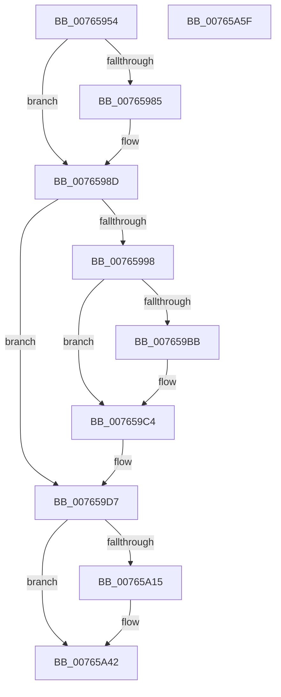

# PopEvaluatePowerButtonSuppressionState

- RVA: `0x00765954`–`0x00765A60` (길이 `268` bytes)
- VA: `0x0000000140765954`
- 실행 섹션: `PAGE`
- PDB 이름 있음: `예`; PDB Function 태그: `아니요`
- unwind 정보 RVA: `0x000C5A00`
- 디코드: `59`개 명령, `268/268` bytes 표시
- 미해석 바이트: `0` (있으면 어셈블리에 `.byte`로 보존)

> 이 문서는 커널 이미지의 기계어와 PDB 기호를 분석해 생성했습니다. 4번과 5번은 함수 원형과 자료형을 바이너리 사용 방식에서 추정한 C 해석이며 원본 소스 복구 결과는 아닙니다.

## 1. Dependencies

- 직접 호출 지점: **8**; 고유 호출 대상: **5**
- 직접 호출자로 확인된 함수: **4**
- RIP 상대 이미지 참조: **13**

### Outgoing calls
- `0x007659A5` → [PopReleaseRwLock](../../text/2D/PopReleaseRwLock_function_002DFBBC.md) (function, `0x002DFBBC`)
- `0x007659BD` → [guard_dispatch_icall](../../text/6B/guard_dispatch_icall_function_006BAAD0.md) (function, `0x006BAAD0`)
- `0x007659D2` → [PopAcquireRwLockExclusive](../../text/43/PopAcquireRwLockExclusive_function_00430B44.md) (function, `0x00430B44`)
- `0x007659FB` → [PopTracePowerButtonSuppressionActionUpdate](../AC/PopTracePowerButtonSuppressionActionUpdate_function_00AC15FC.md) (function, `0x00AC15FC`)
- `0x00765A07` → [PopReleaseRwLock](../../text/2D/PopReleaseRwLock_function_002DFBBC.md) (function, `0x002DFBBC`)
- `0x00765A1C` → [PopAcquireRwLockExclusive](../../text/43/PopAcquireRwLockExclusive_function_00430B44.md) (function, `0x00430B44`)
- `0x00765A31` → [PopBsdHandleRequest](../../text/4B/PopBsdHandleRequest_function_004B27A0.md) (function, `0x004B27A0`)
- `0x00765A3D` → [PopReleaseRwLock](../../text/2D/PopReleaseRwLock_function_002DFBBC.md) (function, `0x002DFBBC`)

### Direct callers
- [PopPowerButtonLidReliabilityUpdated](PopPowerButtonLidReliabilityUpdated_function_00765A68.md) at `0x00765AC6`
- [PopPowerButtonSuppressionUpdateDisableReason](PopPowerButtonSuppressionUpdateDisableReason_function_00765AD8.md) at `0x00765B22`
- [PopWnfInSupCallback](PopWnfInSupCallback_function_00765B50.md) at `0x00765BB9`
- [PopPowerButtonSuppressionInit](../../init/C4/PopPowerButtonSuppressionInit_function_00C40B00.md) at `0x00C40C4C`

### Static image references
- `0x0076596D` → RVA `0x00F09218` (`.data`; read)
- `0x00765976` → RVA `0x00F09201` (`.data`; read)
- `0x00765990` → RVA `0x00F09208` (`.data`; read)
- `0x00765998` → RVA `0x00F09230` (`.data`; read)
- `0x0076599F` → RVA `0x00F09208` (`.data`; write)
- `0x007659AA` → RVA `0x00E67820` (`.data`; read)
- `0x007659C4` → RVA `0x00F09220` (`.data`; read/write)
- `0x007659D7` → RVA `0x00F09220` (`.data`; read)
- `0x007659EB` → RVA `0x00F09204` (`.data`; read)
- `0x00765A0C` → RVA `0x00F0F1F0` (`.data`; read)
- `0x00765A15` → RVA `0x00F0F1E0` (`.data`; read)
- `0x00765A24` → RVA `0x00E673F3` (`.data`; write)
- `0x00765A2B` → RVA `0x00E673F4` (`.data`; write)

## 2. Other-region calls and transfers

- 다른 실행 섹션으로 향하는 call: **7**
  - `0x007659A5` → [PopReleaseRwLock](../../text/2D/PopReleaseRwLock_function_002DFBBC.md) (`PAGE` → `.text`)
  - `0x007659BD` → [guard_dispatch_icall](../../text/6B/guard_dispatch_icall_function_006BAAD0.md) (`PAGE` → `.text`)
  - `0x007659D2` → [PopAcquireRwLockExclusive](../../text/43/PopAcquireRwLockExclusive_function_00430B44.md) (`PAGE` → `.text`)
  - `0x00765A07` → [PopReleaseRwLock](../../text/2D/PopReleaseRwLock_function_002DFBBC.md) (`PAGE` → `.text`)
  - `0x00765A1C` → [PopAcquireRwLockExclusive](../../text/43/PopAcquireRwLockExclusive_function_00430B44.md) (`PAGE` → `.text`)
  - `0x00765A31` → [PopBsdHandleRequest](../../text/4B/PopBsdHandleRequest_function_004B27A0.md) (`PAGE` → `.text`)
  - `0x00765A3D` → [PopReleaseRwLock](../../text/2D/PopReleaseRwLock_function_002DFBBC.md) (`PAGE` → `.text`)
- 별도 외부 분기/꼬리 이동을 확인하지 못했습니다.

## 3. Assembly (complete function range)

```asm
00765954  48 8B C4                        mov rax, rsp
00765957  48 89 58 08                     mov qword ptr [rax + 8], rbx
0076595B  48 89 68 10                     mov qword ptr [rax + 0x10], rbp
0076595F  48 89 70 18                     mov qword ptr [rax + 0x18], rsi
00765963  48 89 78 20                     mov qword ptr [rax + 0x20], rdi
00765967  41 57                           push r15
00765969  48 83 EC 30                     sub rsp, 0x30
0076596D  0F B6 3D A4 38 7A 00            movzx edi, byte ptr [rip + 0x7a38a4]
00765974  33 F6                           xor esi, esi
00765976  40 38 35 84 38 7A 00            cmp byte ptr [rip + 0x7a3884], sil
0076597D  8B DF                           mov ebx, edi
0076597F  44 8D 7E 02                     lea r15d, [rsi + 2]
00765983  75 08                           jne 0x14076598d
00765985  40 80 FF 01                     cmp dil, 1
00765989  41 0F 44 DF                     cmove ebx, r15d
0076598D  0F B6 EB                        movzx ebp, bl
00765990  39 2D 72 38 7A 00               cmp dword ptr [rip + 0x7a3872], ebp
00765996  74 3F                           je 0x1407659d7
00765998  48 8D 0D 91 38 7A 00            lea rcx, [rip + 0x7a3891]
0076599F  89 2D 63 38 7A 00               mov dword ptr [rip + 0x7a3863], ebp
007659A5  E8 12 A2 B7 FF                  call 0x1402dfbbc
007659AA  48 8B 05 6F 1E 70 00            mov rax, qword ptr [rip + 0x701e6f]
007659B1  BE 02 00 00 C0                  mov esi, 0xc0000002
007659B6  48 85 C0                        test rax, rax
007659B9  74 09                           je 0x1407659c4
007659BB  8B CD                           mov ecx, ebp
007659BD  E8 0E 51 F5 FF                  call 0x1406baad0
007659C2  8B F0                           mov esi, eax
007659C4  F0 FF 05 55 38 7A 00            lock inc dword ptr [rip + 0x7a3855]
007659CB  48 8D 0D 5E 38 7A 00            lea rcx, [rip + 0x7a385e]
007659D2  E8 6D B1 CC FF                  call 0x140430b44
007659D7  8B 0D 43 38 7A 00               mov ecx, dword ptr [rip + 0x7a3843]
007659DD  44 8B 0D 34 38 7A 00            mov r9d, dword ptr [rip + 0x7a3834]
007659E4  44 8B 05 1D 38 7A 00            mov r8d, dword ptr [rip + 0x7a381d]
007659EB  8B 15 13 38 7A 00               mov edx, dword ptr [rip + 0x7a3813]
007659F1  89 4C 24 20                     mov dword ptr [rsp + 0x20], ecx
007659F5  8A 0D 06 38 7A 00               mov cl, byte ptr [rip + 0x7a3806]
007659FB  E8 FC BB 35 00                  call 0x140ac15fc
00765A00  48 8D 0D 29 38 7A 00            lea rcx, [rip + 0x7a3829]
00765A07  E8 B0 A1 B7 FF                  call 0x1402dfbbc
00765A0C  80 3D DD 97 7A 00 00            cmp byte ptr [rip + 0x7a97dd], 0
00765A13  75 2D                           jne 0x140765a42
00765A15  48 8D 0D C4 97 7A 00            lea rcx, [rip + 0x7a97c4]
00765A1C  E8 23 B1 CC FF                  call 0x140430b44
00765A21  41 8B CF                        mov ecx, r15d
00765A24  40 88 3D C8 19 70 00            mov byte ptr [rip + 0x7019c8], dil
00765A2B  88 1D C3 19 70 00               mov byte ptr [rip + 0x7019c3], bl
00765A31  E8 6A CD D4 FF                  call 0x1404b27a0
00765A36  48 8D 0D A3 97 7A 00            lea rcx, [rip + 0x7a97a3]
00765A3D  E8 7A A1 B7 FF                  call 0x1402dfbbc
00765A42  48 8B 5C 24 40                  mov rbx, qword ptr [rsp + 0x40]
00765A47  8B C6                           mov eax, esi
00765A49  48 8B 74 24 50                  mov rsi, qword ptr [rsp + 0x50]
00765A4E  48 8B 6C 24 48                  mov rbp, qword ptr [rsp + 0x48]
00765A53  48 8B 7C 24 58                  mov rdi, qword ptr [rsp + 0x58]
00765A58  48 83 C4 30                     add rsp, 0x30
00765A5C  41 5F                           pop r15
00765A5E  C3                              ret
00765A5F  CC                              int3
```

## 4. C-style interpretation (structured pseudocode)

```c
__int64 __fastcall PopEvaluatePowerButtonSuppressionState(void)
{
    __int64 result;
    __int64 v_rbx;
    __int64 v_rsi;
    __int64 v_rsp;
    unsigned int v_stack_m18;
    unsigned __int64 v_stack_p10;
    unsigned __int64 v_stack_p18;
    unsigned __int64 v_stack_p20;
    unsigned __int64 v_stack_p8;

    *(unsigned __int64 *)(v_rsp + 8) = v_rbx;
    *(unsigned __int64 *)(v_rsp + 16) = v_rbp;
    *(unsigned __int64 *)(v_rsp + 24) = v_rsi;
    *(unsigned __int64 *)(v_rsp + 32) = v_rdi;
    v_rsp = (v_rsp) - (48);
    v_rsi = 0;
    v_rbx = (unsigned int)((unsigned int)(*(unsigned __int8 *)(v_rip + 8009892)));
    if ((*(unsigned __int8 *)(v_rip + 8009860)) == 0) {
        v_rbx = (unsigned int)((unsigned int)(*(unsigned __int8 *)(v_rip + 8009892)));
        if (((unsigned __int8)(*(unsigned __int8 *)(v_rip + 8009892))) == 1) { v_rbx = (unsigned int)(v_rsi + 2); }
    }
    if ((*(unsigned int *)(v_rip + 8009842)) == ((unsigned int)((unsigned __int8)(v_rbx)))) goto loc_007659D7;
    *(unsigned int *)(v_rip + 8009827) = (unsigned int)((unsigned __int8)(v_rbx));
    result = PopReleaseRwLock(v_rip + 8009873, a2, a3, a4);
    result = *(unsigned __int64 *)(v_rip + 7347823);
    v_rsi = (unsigned int)(0xC0000002ULL);
    if (*(unsigned __int64 *)(v_rip + 7347823) != 0) {
        a1 = (unsigned int)((unsigned __int8)(v_rbx));
        result = guard_dispatch_icall(a1, a2, a3, a4);
        v_rsi = (unsigned int)(result);
    }
    result = PopAcquireRwLockExclusive(v_rip + 8009822, a2, a3, a4);
loc_007659D7:
    v_stack_m18 = (unsigned int)((unsigned int)(*(unsigned int *)(v_rip + 8009795)));
    result = PopTracePowerButtonSuppressionActionUpdate(*(unsigned __int8 *)(v_rip + 8009734), (unsigned int)(*(unsigned int *)(v_rip + 8009747)), (unsigned int)(*(unsigned int *)(v_rip + 8009757)), (unsigned int)(*(unsigned int *)(v_rip + 8009780)));
    result = PopReleaseRwLock(v_rip + 8009769, (unsigned int)(*(unsigned int *)(v_rip + 8009747)), (unsigned int)(*(unsigned int *)(v_rip + 8009757)), (unsigned int)(*(unsigned int *)(v_rip + 8009780)));
    if ((*(unsigned __int8 *)(v_rip + 8034269)) == 0) {
        a1 = v_rip + 8034244;
        result = PopAcquireRwLockExclusive(a1, (unsigned int)(*(unsigned int *)(v_rip + 8009747)), (unsigned int)(*(unsigned int *)(v_rip + 8009757)), (unsigned int)(*(unsigned int *)(v_rip + 8009780)));
        a1 = (unsigned int)(v_rsi + 2);
        *(unsigned __int8 *)(v_rip + 7346632) = (unsigned __int8)(*(unsigned __int8 *)(v_rip + 8009892));
        *(unsigned __int8 *)(v_rip + 7346627) = (unsigned __int8)(v_rbx);
        result = PopBsdHandleRequest(a1, (unsigned int)(*(unsigned int *)(v_rip + 8009747)), (unsigned int)(*(unsigned int *)(v_rip + 8009757)), (unsigned int)(*(unsigned int *)(v_rip + 8009780)));
        a1 = v_rip + 8034211;
        result = PopReleaseRwLock(a1, (unsigned int)(*(unsigned int *)(v_rip + 8009747)), (unsigned int)(*(unsigned int *)(v_rip + 8009757)), (unsigned int)(*(unsigned int *)(v_rip + 8009780)));
    }
    v_rsp = (v_rsp) + (48);
    return (unsigned int)((unsigned int)(v_rsi));
}
```

## 5. (Beta) C Style

```c
void PopEvaluatePowerButtonSuppressionState(void)
{
    int64_t result;
    int64_t local_rbx;
    int64_t local_rsi;
    int64_t local_rsp;
    uint32_t v_stack_m18;
    uint64_t v_stack_p10;
    uint64_t v_stack_p18;
    uint64_t v_stack_p20;
    uint64_t v_stack_p8;

    *(uint64_t *)(local_rsp + 0x8) = local_rbx;
    *(uint64_t *)(local_rsp + 0x10) = local_rbp;
    *(uint64_t *)(local_rsp + 0x18) = local_rsi;
    *(uint64_t *)(local_rsp + 0x20) = local_rdi;
    local_rsp = (local_rsp) - (48);
    local_rsi = 0;
    local_rbx = (uint32_t)((uint32_t)(*(uint8_t *)(v_rip + 0x7A38A4)));
    if ((*(uint8_t *)(v_rip + 0x7A3884)) == 0) {
        local_rbx = (uint32_t)((uint32_t)(*(uint8_t *)(v_rip + 0x7A38A4)));
        if (((uint8_t)(*(uint8_t *)(v_rip + 0x7A38A4))) == 1) { local_rbx = (uint32_t)(local_rsi + 2); }
    }
    if ((*(uint32_t *)(v_rip + 0x7A3872)) == ((uint32_t)((uint8_t)(local_rbx)))) goto loc_007659D7;
    *(uint32_t *)(v_rip + 0x7A3863) = (uint32_t)((uint8_t)(local_rbx));
    result = PopReleaseRwLock(v_rip + 8009873, a2, a3, a4);
    result = *(uint64_t *)(v_rip + 0x701E6F);
    local_rsi = (uint32_t)(0xC0000002ULL);
    if (*(uint64_t *)(v_rip + 0x701E6F) != 0) {
        a1 = (uint32_t)((uint8_t)(local_rbx));
        result = guard_dispatch_icall(a1, a2, a3, a4);
        local_rsi = (uint32_t)(result);
    }
    result = PopAcquireRwLockExclusive(v_rip + 8009822, a2, a3, a4);
loc_007659D7:
    v_stack_m18 = (uint32_t)((uint32_t)(*(uint32_t *)(v_rip + 0x7A3843)));
    result = PopTracePowerButtonSuppressionActionUpdate(*(uint8_t *)(v_rip + 0x7A3806), (uint32_t)(*(uint32_t *)(v_rip + 0x7A3813)), (uint32_t)(*(uint32_t *)(v_rip + 0x7A381D)), (uint32_t)(*(uint32_t *)(v_rip + 0x7A3834)));
    result = PopReleaseRwLock(v_rip + 8009769, (uint32_t)(*(uint32_t *)(v_rip + 0x7A3813)), (uint32_t)(*(uint32_t *)(v_rip + 0x7A381D)), (uint32_t)(*(uint32_t *)(v_rip + 0x7A3834)));
    if ((*(uint8_t *)(v_rip + 0x7A97DD)) == 0) {
        a1 = v_rip + 8034244;
        result = PopAcquireRwLockExclusive(a1, (uint32_t)(*(uint32_t *)(v_rip + 0x7A3813)), (uint32_t)(*(uint32_t *)(v_rip + 0x7A381D)), (uint32_t)(*(uint32_t *)(v_rip + 0x7A3834)));
        a1 = (uint32_t)(local_rsi + 2);
        *(uint8_t *)(v_rip + 0x7019C8) = (uint8_t)(*(uint8_t *)(v_rip + 0x7A38A4));
        *(uint8_t *)(v_rip + 0x7019C3) = (uint8_t)(local_rbx);
        result = PopBsdHandleRequest(a1, (uint32_t)(*(uint32_t *)(v_rip + 0x7A3813)), (uint32_t)(*(uint32_t *)(v_rip + 0x7A381D)), (uint32_t)(*(uint32_t *)(v_rip + 0x7A3834)));
        a1 = v_rip + 8034211;
        result = PopReleaseRwLock(a1, (uint32_t)(*(uint32_t *)(v_rip + 0x7A3813)), (uint32_t)(*(uint32_t *)(v_rip + 0x7A381D)), (uint32_t)(*(uint32_t *)(v_rip + 0x7A3834)));
    }
    local_rsp = (local_rsp) + (48);
    return (uint32_t)((uint32_t)(local_rsi));
}
```

## 6. Execution-region graph

[열기: 2D/3D 그래프와 함수 탐색 컨트롤 패널](../../../control-panel.html?section=page&rva=0x00765954&view=graph)

- 2D 그래프는 위에서 아래로 흐르고, 3D 그래프는 빈 공간을 드래그해 회전합니다. Shift+드래그는 이동, 휠은 확대·축소, 함수 노드 선택은 대상 보고서 이동입니다.

### Static fallback


