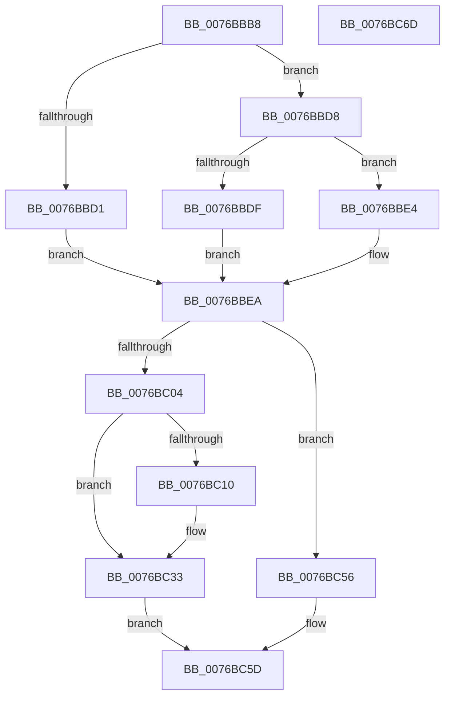

# PopExtendConnectionState

- RVA: `0x0076BBB8`–`0x0076BC6E` (길이 `182` bytes)
- VA: `0x000000014076BBB8`
- 실행 섹션: `PAGE`
- PDB 이름 있음: `예`; PDB Function 태그: `아니요`
- unwind 정보 RVA: `0x00060BC4`
- 디코드: `47`개 명령, `182/182` bytes 표시
- 미해석 바이트: `0` (있으면 어셈블리에 `.byte`로 보존)

> 이 문서는 커널 이미지의 기계어와 PDB 기호를 분석해 생성했습니다. 4번과 5번은 함수 원형과 자료형을 바이너리 사용 방식에서 추정한 C 해석이며 원본 소스 복구 결과는 아닙니다.

## 1. Dependencies

- 직접 호출 지점: **3**; 고유 호출 대상: **3**
- 직접 호출자로 확인된 함수: **2**
- RIP 상대 이미지 참조: **7**

### Outgoing calls
- `0x0076BBF7` → [ExAllocatePool2](../../poolcode/B8/ExAllocatePool2_function_00B820F0.md) (function, `0x00B820F0`)
- `0x0076BC21` → [memcpy](../../text/6C/memcpy_function_006C6840.md) (function, `0x006C6840`)
- `0x0076BC2E` → [ExFreePoolWithTag](../../poolcode/B8/ExFreePoolWithTag_function_00B82870.md) (function, `0x00B82870`)

### Direct callers
- [PopSetGlobalUserStatus](../91/PopSetGlobalUserStatus_function_0091555C.md) at `0x009155B8`
- [PopInitializeAdpm](../../init/C4/PopInitializeAdpm_function_00C43B1C.md) at `0x00C43B63`

### Static image references
- `0x0076BBC7` → RVA `0x00F081D8` (`.data`; read)
- `0x0076BC04` → RVA `0x00F081D0` (`.data`; read)
- `0x0076BC3A` → RVA `0x00F081D0` (`.data`; write)
- `0x0076BC41` → RVA `0x00F081D8` (`.data`; write)
- `0x0076BC47` → RVA `0x00F081E0` (`.data`; write)
- `0x0076BC4D` → RVA `0x00F081E8` (`.data`; write)
- `0x0076BC56` → RVA `0x00F081D8` (`.data`; read/write)

## 2. Other-region calls and transfers

- 다른 실행 섹션으로 향하는 call: **3**
  - `0x0076BBF7` → [ExAllocatePool2](../../poolcode/B8/ExAllocatePool2_function_00B820F0.md) (`PAGE` → `POOLCODE`)
  - `0x0076BC21` → [memcpy](../../text/6C/memcpy_function_006C6840.md) (`PAGE` → `.text`)
  - `0x0076BC2E` → [ExFreePoolWithTag](../../poolcode/B8/ExFreePoolWithTag_function_00B82870.md) (`PAGE` → `POOLCODE`)
- 별도 외부 분기/꼬리 이동을 확인하지 못했습니다.

## 3. Assembly (complete function range)

```asm
0076BBB8  48 89 5C 24 08                  mov qword ptr [rsp + 8], rbx
0076BBBD  48 89 74 24 10                  mov qword ptr [rsp + 0x10], rsi
0076BBC2  57                              push rdi
0076BBC3  48 83 EC 20                     sub rsp, 0x20
0076BBC7  8B 1D 0B C6 79 00               mov ebx, dword ptr [rip + 0x79c60b]
0076BBCD  85 DB                           test ebx, ebx
0076BBCF  75 07                           jne 0x14076bbd8
0076BBD1  BB 08 00 00 00                  mov ebx, 8
0076BBD6  EB 12                           jmp 0x14076bbea
0076BBD8  8D 04 1B                        lea eax, [rbx + rbx]
0076BBDB  3B C1                           cmp eax, ecx
0076BBDD  76 05                           jbe 0x14076bbe4
0076BBDF  C1 EB 02                        shr ebx, 2
0076BBE2  EB 06                           jmp 0x14076bbea
0076BBE4  8D 59 08                        lea ebx, [rcx + 8]
0076BBE7  C1 EB 03                        shr ebx, 3
0076BBEA  8B D3                           mov edx, ebx
0076BBEC  B9 00 01 00 00                  mov ecx, 0x100
0076BBF1  41 B8 50 53 65 73               mov r8d, 0x73655350
0076BBF7  E8 F4 64 41 00                  call 0x140b820f0
0076BBFC  48 8B F8                        mov rdi, rax
0076BBFF  48 85 C0                        test rax, rax
0076BC02  74 52                           je 0x14076bc56
0076BC04  48 8B 35 C5 C5 79 00            mov rsi, qword ptr [rip + 0x79c5c5]
0076BC0B  48 85 F6                        test rsi, rsi
0076BC0E  74 23                           je 0x14076bc33
0076BC10  44 8B 05 C1 C5 79 00            mov r8d, dword ptr [rip + 0x79c5c1]
0076BC17  48 8B D6                        mov rdx, rsi
0076BC1A  49 C1 E8 03                     shr r8, 3
0076BC1E  48 8B C8                        mov rcx, rax
0076BC21  E8 1A AC F5 FF                  call 0x1406c6840
0076BC26  BA 50 53 65 73                  mov edx, 0x73655350
0076BC2B  48 8B CE                        mov rcx, rsi
0076BC2E  E8 3D 6C 41 00                  call 0x140b82870
0076BC33  8D 04 DD 00 00 00 00            lea eax, [rbx*8]
0076BC3A  48 89 3D 8F C5 79 00            mov qword ptr [rip + 0x79c58f], rdi
0076BC41  89 05 91 C5 79 00               mov dword ptr [rip + 0x79c591], eax
0076BC47  89 05 93 C5 79 00               mov dword ptr [rip + 0x79c593], eax
0076BC4D  48 89 3D 94 C5 79 00            mov qword ptr [rip + 0x79c594], rdi
0076BC54  EB 07                           jmp 0x14076bc5d
0076BC56  83 25 7B C5 79 00 00            and dword ptr [rip + 0x79c57b], 0
0076BC5D  48 8B 5C 24 30                  mov rbx, qword ptr [rsp + 0x30]
0076BC62  48 8B 74 24 38                  mov rsi, qword ptr [rsp + 0x38]
0076BC67  48 83 C4 20                     add rsp, 0x20
0076BC6B  5F                              pop rdi
0076BC6C  C3                              ret
0076BC6D  CC                              int3
```

## 4. C-style interpretation (structured pseudocode)

```c
__int64 __fastcall PopExtendConnectionState(__int64 a1)
{
    __int64 result;
    __int64 v_rbx;
    __int64 v_rsp;
    unsigned __int64 v_stack_p10;
    unsigned __int64 v_stack_p8;

    v_stack_p8 = v_rbx;
    v_stack_p10 = v_rsi;
    v_rsp = (v_rsp) - (32);
    if ((unsigned int)((unsigned int)(*(unsigned int *)(v_rip + 7980555))) != 0) goto loc_0076BBD8;
    goto loc_0076BBEA;
loc_0076BBD8:
    if (((unsigned int)(8 + 8 * 1)) <= ((unsigned int)(a1))) goto loc_0076BBE4;
    v_rbx = (unsigned int)((8) >> (2));
    goto loc_0076BBEA;
loc_0076BBE4:
    v_rbx = (unsigned int)((a1 + 8) >> (3));
loc_0076BBEA:
    result = ExAllocatePool2(256, (unsigned int)((unsigned int)(v_rbx)), (unsigned int)(0x73655350ULL), a4);
    if (result == 0) goto loc_0076BC56;
    if (*(unsigned __int64 *)(v_rip + 7980485) != 0) {
        a3 = *(unsigned int *)(v_rip + 7980481);
        a2 = *(unsigned __int64 *)(v_rip + 7980485);
        a3 = (a3) >> (3);
        a1 = result;
        result = memcpy(a1, a2, a3, a4);
        a2 = 0x73655350ULL;
        a1 = *(unsigned __int64 *)(v_rip + 7980485);
        result = ExFreePoolWithTag(a1, a2, a3, a4);
    }
    *(unsigned __int64 *)(v_rip + 7980431) = result;
    *(unsigned int *)(v_rip + 7980433) = (unsigned int)(v_rbx * 8);
    *(unsigned int *)(v_rip + 7980435) = (unsigned int)(v_rbx * 8);
    *(unsigned __int64 *)(v_rip + 7980436) = result;
    goto loc_0076BC5D;
loc_0076BC56:
loc_0076BC5D:
    v_rsp = (v_rsp) + (32);
    return v_rbx * 8;
}
```

## 5. (Beta) C Style

```c
int64_t PopExtendConnectionState(void *Arg1)
{
    uint8_t *arg1 = (uint8_t *)Arg1;

    int64_t result;
    int64_t local_rbx;
    int64_t local_rsp;
    uint64_t v_stack_p10;
    uint64_t v_stack_p8;

    v_stack_p8 = local_rbx;
    v_stack_p10 = local_rsi;
    local_rsp = (local_rsp) - (32);
    if ((uint32_t)((uint32_t)(*(uint32_t *)(v_rip + 0x79C60B))) != 0) goto loc_0076BBD8;
    goto loc_0076BBEA;
loc_0076BBD8:
    if (((uint32_t)(8 + 8 * 1)) <= ((uint32_t)(Arg1))) goto loc_0076BBE4;
    local_rbx = (uint32_t)((8) >> (2));
    goto loc_0076BBEA;
loc_0076BBE4:
    local_rbx = (uint32_t)((Arg1 + 8) >> (3));
loc_0076BBEA:
    result = ExAllocatePool2(256, (uint32_t)((uint32_t)(local_rbx)), (uint32_t)(0x73655350ULL), a4);
    if (result == 0) goto loc_0076BC56;
    if (*(uint64_t *)(v_rip + 0x79C5C5) != 0) {
        a3 = *(uint32_t *)(v_rip + 0x79C5C1);
        a2 = *(uint64_t *)(v_rip + 0x79C5C5);
        a3 = (a3) >> (3);
        Arg1 = result;
        result = memcpy(Arg1, a2, a3, a4);
        a2 = 0x73655350ULL;
        Arg1 = *(uint64_t *)(v_rip + 0x79C5C5);
        result = ExFreePoolWithTag(Arg1, a2, a3, a4);
    }
    *(uint64_t *)(v_rip + 0x79C58F) = result;
    *(uint32_t *)(v_rip + 0x79C591) = (uint32_t)(local_rbx * 8);
    *(uint32_t *)(v_rip + 0x79C593) = (uint32_t)(local_rbx * 8);
    *(uint64_t *)(v_rip + 0x79C594) = result;
    goto loc_0076BC5D;
loc_0076BC56:
loc_0076BC5D:
    local_rsp = (local_rsp) + (32);
    return local_rbx * 8;
}
```

### 관측된 메모리 오프셋

구조체 형식이 확인되지 않은 접근은 인자 기준의 오프셋으로만 기록했습니다.

| 기준 인자 | 오프셋 표현 | 폭 (bit) | 접근 |
|---|---:|---:|---|
| `Arg1` | `+ 0x8` | `32` | `R` |

## 6. Execution-region graph

[열기: 2D/3D 그래프와 함수 탐색 컨트롤 패널](../../../control-panel.html?section=page&rva=0x0076BBB8&view=graph)

- 2D 그래프는 위에서 아래로 흐르고, 3D 그래프는 빈 공간을 드래그해 회전합니다. Shift+드래그는 이동, 휠은 확대·축소, 함수 노드 선택은 대상 보고서 이동입니다.

### Static fallback


