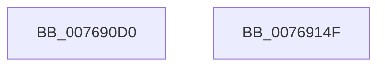

# PopFanAdd

- RVA: `0x007690D0`–`0x00769150` (길이 `128` bytes)
- VA: `0x00000001407690D0`
- 실행 섹션: `PAGE`
- PDB 이름 있음: `예`; PDB Function 태그: `아니요`
- unwind 정보 RVA: `0x0005CAAC`
- 디코드: `29`개 명령, `128/128` bytes 표시
- 미해석 바이트: `0` (있으면 어셈블리에 `.byte`로 보존)

> 이 문서는 커널 이미지의 기계어와 PDB 기호를 분석해 생성했습니다. 4번과 5번은 함수 원형과 자료형을 바이너리 사용 방식에서 추정한 C 해석이며 원본 소스 복구 결과는 아닙니다.

## 1. Dependencies

- 직접 호출 지점: **3**; 고유 호출 대상: **3**
- 직접 호출자로 확인된 함수: **0**
- RIP 상대 이미지 참조: **1**

### Outgoing calls
- `0x00769103` → [KeInitializeEvent](../../text/40/KeInitializeEvent_function_0040DD10.md) (function, `0x0040DD10`)
- `0x00769132` → [PopSqmFanEnumeration](../77/PopSqmFanEnumeration_function_007725FC.md) (function, `0x007725FC`)
- `0x0076913F` → [ExQueueWorkItem](../../text/2F/ExQueueWorkItem_function_002F9520.md) (function, `0x002F9520`)

### Direct callers
- 이 함수 시작 RVA로 연결되는 직접 call은 확인되지 않았습니다. 간접 호출은 완전히 역산할 수 없습니다.

### Static image references
- `0x00769113` → RVA `0x00A9B050` (`PopFanWorker`; read)

## 2. Other-region calls and transfers

- 다른 실행 섹션으로 향하는 call: **2**
  - `0x00769103` → [KeInitializeEvent](../../text/40/KeInitializeEvent_function_0040DD10.md) (`PAGE` → `.text`)
  - `0x0076913F` → [ExQueueWorkItem](../../text/2F/ExQueueWorkItem_function_002F9520.md) (`PAGE` → `.text`)
- 별도 외부 분기/꼬리 이동을 확인하지 못했습니다.

## 3. Assembly (complete function range)

```asm
007690D0  48 89 5C 24 08                  mov qword ptr [rsp + 8], rbx
007690D5  57                              push rdi
007690D6  48 83 EC 20                     sub rsp, 0x20
007690DA  48 8B 41 38                     mov rax, qword ptr [rcx + 0x38]
007690DE  48 8B F9                        mov rdi, rcx
007690E1  C6 41 40 01                     mov byte ptr [rcx + 0x40], 1
007690E5  45 33 C0                        xor r8d, r8d
007690E8  33 D2                           xor edx, edx
007690EA  C7 40 30 9D 00 00 C0            mov dword ptr [rax + 0x30], 0xc000009d
007690F1  83 61 5C 00                     and dword ptr [rcx + 0x5c], 0
007690F5  C7 41 60 01 00 00 00            mov dword ptr [rcx + 0x60], 1
007690FC  48 81 C1 A0 01 00 00            add rcx, 0x1a0
00769103  E8 08 4C CA FF                  call 0x14040dd10
00769108  48 8D 9F 70 01 00 00            lea rbx, [rdi + 0x170]
0076910F  48 83 23 00                     and qword ptr [rbx], 0
00769113  48 8D 05 36 1F 33 00            lea rax, [rip + 0x331f36]
0076911A  48 89 43 10                     mov qword ptr [rbx + 0x10], rax
0076911E  48 89 7B 18                     mov qword ptr [rbx + 0x18], rdi
00769122  48 83 A7 98 01 00 00 00         and qword ptr [rdi + 0x198], 0
0076912A  48 83 A7 90 01 00 00 00         and qword ptr [rdi + 0x190], 0
00769132  E8 C5 94 00 00                  call 0x1407725fc
00769137  BA 01 00 00 00                  mov edx, 1
0076913C  48 8B CB                        mov rcx, rbx
0076913F  E8 DC 03 B9 FF                  call 0x1402f9520
00769144  48 8B 5C 24 30                  mov rbx, qword ptr [rsp + 0x30]
00769149  48 83 C4 20                     add rsp, 0x20
0076914D  5F                              pop rdi
0076914E  C3                              ret
0076914F  CC                              int3
```

## 4. C-style interpretation (structured pseudocode)

```c
__int64 __fastcall PopFanAdd(__int64 a1, int a2, int a3)
{
    __int64 result;
    __int64 v_rsp;
    unsigned __int64 v_stack_p8;

    v_stack_p8 = v_rbx;
    v_rsp = (v_rsp) - (32);
    *(unsigned __int8 *)(a1 + 64) = 1;
    a3 = 0;
    a2 = 0;
    *(unsigned int *)(*(unsigned __int64 *)(a1 + 56) + 48) = 0xC000009DULL;
    *(unsigned int *)(a1 + 96) = 1;
    a1 = (a1) + (416);
    result = KeInitializeEvent(a1, a2, a3, a4);
    *(unsigned __int64 *)(a1 + 368 + 16) = v_rip + 3350326;
    *(unsigned __int64 *)(a1 + 368 + 24) = a1;
    result = PopSqmFanEnumeration(a1, a2, a3, a4);
    result = ExQueueWorkItem(a1 + 368, 1, a3, a4);
    v_rsp = (v_rsp) + (32);
    return result;
}
```

## 5. (Beta) C Style

```c
int64_t PopFanAdd(void *Arg1, int32_t Arg2, int32_t Arg3)
{
    uint8_t *arg1 = (uint8_t *)Arg1;

    int64_t result;
    int64_t local_rsp;
    uint64_t v_stack_p8;

    v_stack_p8 = local_rbx;
    local_rsp = (local_rsp) - (32);
    *(uint8_t *)(arg1 + 0x40) = 1;
    Arg3 = 0;
    Arg2 = 0;
    *(uint32_t *)(*(uint64_t *)(arg1 + 0x38) + 0x30) = 0xC000009DULL;
    *(uint32_t *)(arg1 + 0x60) = 1;
    Arg1 = (Arg1) + (416);
    result = KeInitializeEvent(Arg1, Arg2, Arg3, a4);
    *(uint64_t *)(arg1 + 0x170 + 0x10) = v_rip + 3350326;
    *(void **)(arg1 + 0x170 + 0x18) = Arg1;
    result = PopSqmFanEnumeration(Arg1, Arg2, Arg3, a4);
    result = ExQueueWorkItem(Arg1 + 368, 1, Arg3, a4);
    local_rsp = (local_rsp) + (32);
    return result;
}
```

### 관측된 메모리 오프셋

구조체 형식이 확인되지 않은 접근은 인자 기준의 오프셋으로만 기록했습니다.

| 기준 인자 | 오프셋 표현 | 폭 (bit) | 접근 |
|---|---:|---:|---|
| `Arg1` | `+ 0x0` | `64` | `R/W` |
| `Arg1` | `+ 0x10` | `64` | `W` |
| `Arg1` | `+ 0x18` | `64` | `W` |
| `Arg1` | `+ 0x38` | `64` | `R` |
| `Arg1` | `+ 0x40` | `8` | `W` |
| `Arg1` | `+ 0x5C` | `32` | `R/W` |
| `Arg1` | `+ 0x60` | `32` | `W` |
| `Arg1` | `+ 0x170` | `64` | `R` |
| `Arg1` | `+ 0x190` | `64` | `R/W` |
| `Arg1` | `+ 0x198` | `64` | `R/W` |

## 6. Execution-region graph

[열기: 2D/3D 그래프와 함수 탐색 컨트롤 패널](../../../control-panel.html?section=page&rva=0x007690D0&view=graph)

- 2D 그래프는 위에서 아래로 흐르고, 3D 그래프는 빈 공간을 드래그해 회전합니다. Shift+드래그는 이동, 휠은 확대·축소, 함수 노드 선택은 대상 보고서 이동입니다.

### Static fallback


