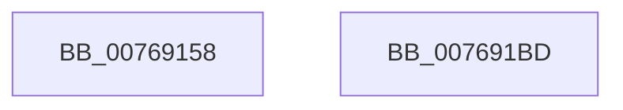

# PopFanEndCsFanPeriod

- RVA: `0x00769158`–`0x007691BE` (길이 `102` bytes)
- VA: `0x0000000140769158`
- 실행 섹션: `PAGE`
- PDB 이름 있음: `예`; PDB Function 태그: `아니요`
- unwind 정보 RVA: `0x0005C788`
- 디코드: `23`개 명령, `102/102` bytes 표시
- 미해석 바이트: `0` (있으면 어셈블리에 `.byte`로 보존)

> 이 문서는 커널 이미지의 기계어와 PDB 기호를 분석해 생성했습니다. 4번과 5번은 함수 원형과 자료형을 바이너리 사용 방식에서 추정한 C 해석이며 원본 소스 복구 결과는 아닙니다.

## 1. Dependencies

- 직접 호출 지점: **1**; 고유 호출 대상: **1**
- 직접 호출자로 확인된 함수: **2**
- RIP 상대 이미지 참조: **2**

### Outgoing calls
- `0x007691B3` → [PopDiagTraceCsFanPerfTrack](../../text/5D/PopDiagTraceCsFanPerfTrack_function_005D6374.md) (function, `0x005D6374`)

### Direct callers
- [PopFanUpdateRunningState](../AD/PopFanUpdateRunningState_function_00AD2440.md) at `0x00AD24AC`
- [PopFanUpdateCsState](../AD/PopFanUpdateCsState_function_00AD5958.md) at `0x00AD59A7`

### Static image references
- `0x0076915C` → RVA `0x00F0C990` (`.data`; read)
- `0x0076916D` → RVA `0x00F0C998` (`.data`; read)

## 2. Other-region calls and transfers

- 다른 실행 섹션으로 향하는 call: **1**
  - `0x007691B3` → [PopDiagTraceCsFanPerfTrack](../../text/5D/PopDiagTraceCsFanPerfTrack_function_005D6374.md) (`PAGE` → `.text`)
- 별도 외부 분기/꼬리 이동을 확인하지 못했습니다.

## 3. Assembly (complete function range)

```asm
00769158  48 83 EC 28                     sub rsp, 0x28
0076915C  4C 8B 15 2D 38 7A 00            mov r10, qword ptr [rip + 0x7a382d]
00769163  49 BB BD 42 7A E5 D5 94 BF D6   movabs r11, 0xd6bf94d5e57a42bd
0076916D  4C 3B 15 24 38 7A 00            cmp r10, qword ptr [rip + 0x7a3824]
00769174  49 8B C3                        mov rax, r11
00769177  49 B9 08 00 00 00 80 F7 FF FF   movabs r9, 0xfffff78000000008
00769181  4C 0F 42 15 0F 38 7A 00         cmovb r10, qword ptr [rip + 0x7a380f]
00769189  49 8B CA                        mov rcx, r10
0076918C  4D 8B 09                        mov r9, qword ptr [r9]
0076918F  48 2B 0D 02 38 7A 00            sub rcx, qword ptr [rip + 0x7a3802]
00769196  4D 2B CA                        sub r9, r10
00769199  48 F7 E1                        mul rcx
0076919C  49 8B C3                        mov rax, r11
0076919F  4C 8B C2                        mov r8, rdx
007691A2  49 F7 E1                        mul r9
007691A5  49 C1 E8 17                     shr r8, 0x17
007691A9  48 8B CA                        mov rcx, rdx
007691AC  41 8B D0                        mov edx, r8d
007691AF  48 C1 E9 17                     shr rcx, 0x17
007691B3  E8 BC D1 E6 FF                  call 0x1405d6374
007691B8  48 83 C4 28                     add rsp, 0x28
007691BC  C3                              ret
007691BD  CC                              int3
```

## 4. C-style interpretation (structured pseudocode)

```c
__int64 __fastcall PopFanEndCsFanPeriod(__int64 a1, __int64 a2)
{
    __int64 result;
    __int64 v_r10;
    __int64 v_rsp;

    v_rsp = (v_rsp) - (40);
    v_r10 = *(unsigned __int64 *)(v_rip + 8009773);
    if ((*(unsigned __int64 *)(v_rip + 8009773)) < (*(unsigned __int64 *)(v_rip + 8009764))) { v_r10 = *(unsigned __int64 *)(v_rip + 8009743); }
    a1 = (v_r10) - (*(unsigned __int64 *)(v_rip + 8009730));
    a4 = (*(unsigned __int64 *)(a4)) - (v_r10);
    a3 = (a2) >> (23);
    a1 = (a2) >> (23);
    result = PopDiagTraceCsFanPerfTrack(a1, (unsigned int)((unsigned int)(a3)), a3, a4);
    v_rsp = (v_rsp) + (40);
    return result;
}
```

## 5. (Beta) C Style

```c
int64_t PopFanEndCsFanPeriod(int64_t Arg1, int64_t Arg2)
{
    int64_t result;
    int64_t local_r10;
    int64_t local_rsp;

    local_rsp = (local_rsp) - (40);
    local_r10 = *(uint64_t *)(v_rip + 0x7A382D);
    if ((*(uint64_t *)(v_rip + 0x7A382D)) < (*(uint64_t *)(v_rip + 0x7A3824))) { local_r10 = *(uint64_t *)(v_rip + 0x7A380F); }
    Arg1 = (local_r10) - (*(uint64_t *)(v_rip + 0x7A3802));
    a4 = (*(uint64_t *)(a4)) - (local_r10);
    a3 = (Arg2) >> (23);
    Arg1 = (Arg2) >> (23);
    result = PopDiagTraceCsFanPerfTrack(Arg1, (uint32_t)((uint32_t)(a3)), a3, a4);
    local_rsp = (local_rsp) + (40);
    return result;
}
```

## 6. Execution-region graph

[열기: 2D/3D 그래프와 함수 탐색 컨트롤 패널](../../../control-panel.html?section=page&rva=0x00769158&view=graph)

- 2D 그래프는 위에서 아래로 흐르고, 3D 그래프는 빈 공간을 드래그해 회전합니다. Shift+드래그는 이동, 휠은 확대·축소, 함수 노드 선택은 대상 보고서 이동입니다.

### Static fallback


