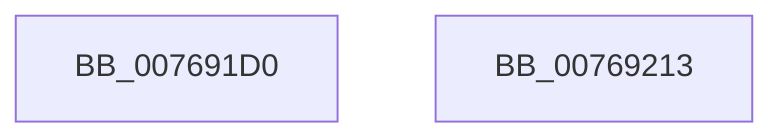

# PopFanRemove

- RVA: `0x007691D0`–`0x00769214` (길이 `68` bytes)
- VA: `0x00000001407691D0`
- 실행 섹션: `PAGE`
- PDB 이름 있음: `예`; PDB Function 태그: `아니요`
- unwind 정보 RVA: `0x00064C80`
- 디코드: `19`개 명령, `68/68` bytes 표시
- 미해석 바이트: `0` (있으면 어셈블리에 `.byte`로 보존)

> 이 문서는 커널 이미지의 기계어와 PDB 기호를 분석해 생성했습니다. 4번과 5번은 함수 원형과 자료형을 바이너리 사용 방식에서 추정한 C 해석이며 원본 소스 복구 결과는 아닙니다.

## 1. Dependencies

- 직접 호출 지점: **3**; 고유 호출 대상: **3**
- 직접 호출자로 확인된 함수: **0**
- RIP 상대 이미지 참조: **0**

### Outgoing calls
- `0x007691E4` → [IoCancelIrp](../../text/27/IoCancelIrp_function_002720E0.md) (function, `0x002720E0`)
- `0x007691FE` → [KeWaitForSingleObject](../../text/20/KeWaitForSingleObject_function_0020E6B0.md) (function, `0x0020E6B0`)
- `0x00769208` → [PopFanSetNoiseImpact](PopFanSetNoiseImpact_function_0076921C.md) (function, `0x0076921C`)

### Direct callers
- 이 함수 시작 RVA로 연결되는 직접 call은 확인되지 않았습니다. 간접 호출은 완전히 역산할 수 없습니다.

### Static image references
- 디코드된 RIP-relative 메모리 참조가 없습니다.

## 2. Other-region calls and transfers

- 다른 실행 섹션으로 향하는 call: **2**
  - `0x007691E4` → [IoCancelIrp](../../text/27/IoCancelIrp_function_002720E0.md) (`PAGE` → `.text`)
  - `0x007691FE` → [KeWaitForSingleObject](../../text/20/KeWaitForSingleObject_function_0020E6B0.md) (`PAGE` → `.text`)
- 별도 외부 분기/꼬리 이동을 확인하지 못했습니다.

## 3. Assembly (complete function range)

```asm
007691D0  40 53                           push rbx
007691D2  48 83 EC 30                     sub rsp, 0x30
007691D6  48 8B D9                        mov rbx, rcx
007691D9  C6 81 B8 01 00 00 01            mov byte ptr [rcx + 0x1b8], 1
007691E0  48 8B 49 38                     mov rcx, qword ptr [rcx + 0x38]
007691E4  E8 F7 8E B0 FF                  call 0x1402720e0
007691E9  48 83 64 24 20 00               and qword ptr [rsp + 0x20], 0
007691EF  48 8D 8B A0 01 00 00            lea rcx, [rbx + 0x1a0]
007691F6  45 33 C9                        xor r9d, r9d
007691F9  45 33 C0                        xor r8d, r8d
007691FC  33 D2                           xor edx, edx
007691FE  E8 AD 54 AA FF                  call 0x14020e6b0
00769203  33 D2                           xor edx, edx
00769205  48 8B CB                        mov rcx, rbx
00769208  E8 0F 00 00 00                  call 0x14076921c
0076920D  48 83 C4 30                     add rsp, 0x30
00769211  5B                              pop rbx
00769212  C3                              ret
00769213  CC                              int3
```

## 4. C-style interpretation (structured pseudocode)

```c
__int64 __fastcall PopFanRemove(__int64 a1, int a2, int a3, int a4)
{
    __int64 result;
    __int64 v_rsp;
    unsigned __int64 v_stack_m18;

    v_rsp = (v_rsp) - (48);
    *(unsigned __int8 *)(a1 + 440) = 1;
    result = IoCancelIrp(*(unsigned __int64 *)(a1 + 56), a2, a3, a4);
    a4 = 0;
    a3 = 0;
    a2 = 0;
    result = KeWaitForSingleObject(a1 + 416, a2, a3, a4);
    a2 = 0;
    result = PopFanSetNoiseImpact(a1, a2, a3, a4);
    v_rsp = (v_rsp) + (48);
    return result;
}
```

## 5. (Beta) C Style

```c
int64_t PopFanRemove(void *Arg1, int32_t Arg2, int32_t Arg3, int32_t Arg4)
{
    uint8_t *arg1 = (uint8_t *)Arg1;

    int64_t result;
    int64_t local_rsp;
    uint64_t v_stack_m18;

    local_rsp = (local_rsp) - (48);
    *(uint8_t *)(arg1 + 0x1B8) = 1;
    result = IoCancelIrp(*(uint64_t *)(arg1 + 0x38), Arg2, Arg3, Arg4);
    Arg4 = 0;
    Arg3 = 0;
    Arg2 = 0;
    result = KeWaitForSingleObject(Arg1 + 416, Arg2, Arg3, Arg4);
    Arg2 = 0;
    result = PopFanSetNoiseImpact(Arg1, Arg2, Arg3, Arg4);
    local_rsp = (local_rsp) + (48);
    return result;
}
```

### 관측된 메모리 오프셋

구조체 형식이 확인되지 않은 접근은 인자 기준의 오프셋으로만 기록했습니다.

| 기준 인자 | 오프셋 표현 | 폭 (bit) | 접근 |
|---|---:|---:|---|
| `Arg1` | `+ 0x38` | `64` | `R` |
| `Arg1` | `+ 0x1A0` | `64` | `R` |
| `Arg1` | `+ 0x1B8` | `8` | `W` |

## 6. Execution-region graph

[열기: 2D/3D 그래프와 함수 탐색 컨트롤 패널](../../../control-panel.html?section=page&rva=0x007691D0&view=graph)

- 2D 그래프는 위에서 아래로 흐르고, 3D 그래프는 빈 공간을 드래그해 회전합니다. Shift+드래그는 이동, 휠은 확대·축소, 함수 노드 선택은 대상 보고서 이동입니다.

### Static fallback


