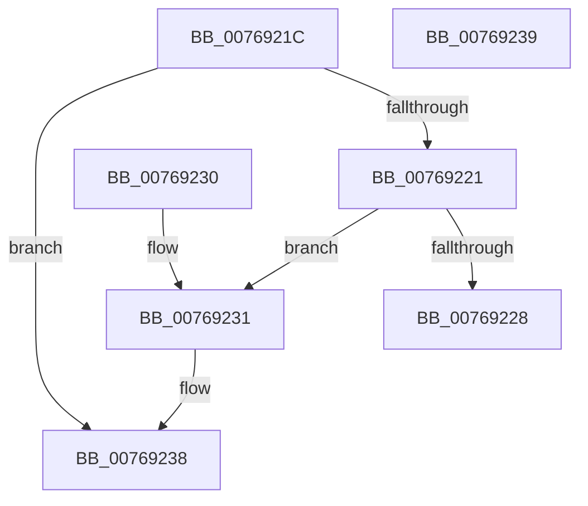

# PopFanSetNoiseImpact

- RVA: `0x0076921C`–`0x0076923A` (길이 `30` bytes)
- VA: `0x000000014076921C`
- 실행 섹션: `PAGE`
- PDB 이름 있음: `예`; PDB Function 태그: `아니요`
- unwind 정보 RVA: `0x000DB714`
- 디코드: `11`개 명령, `30/30` bytes 표시
- 미해석 바이트: `0` (있으면 어셈블리에 `.byte`로 보존)

> 이 문서는 커널 이미지의 기계어와 PDB 기호를 분석해 생성했습니다. 4번과 5번은 함수 원형과 자료형을 바이너리 사용 방식에서 추정한 C 해석이며 원본 소스 복구 결과는 아닙니다.

## 1. Dependencies

- 직접 호출 지점: **0**; 고유 호출 대상: **0**
- 직접 호출자로 확인된 함수: **3**
- RIP 상대 이미지 참조: **1**

### Outgoing calls
- 직접 디코드된 call 명령이 없습니다.

### Direct callers
- [PopFanRemove](PopFanRemove_function_007691D0.md) at `0x00769208`
- [PopFanSetupRpmBuckets](../A9/PopFanSetupRpmBuckets_function_00A9B314.md) at `0x00A9B540`
- [sub_00B48194](../B4/Unknown_function_00B48194.md) at `0x00B48372`
- [sub_00B48194](../B4/Unknown_function_00B48194.md) at `0x00B48388`

### Static image references
- `0x00769228` → RVA `0x00F0C988` (`.data`; read/write)

## 2. Other-region calls and transfers

- 다른 실행 섹션으로 향하는 call: **0**
- 별도 외부 분기/꼬리 이동을 확인하지 못했습니다.

## 3. Assembly (complete function range)

```asm
0076921C  38 51 58                        cmp byte ptr [rcx + 0x58], dl
0076921F  74 17                           je 0x140769238
00769221  88 51 58                        mov byte ptr [rcx + 0x58], dl
00769224  84 D2                           test dl, dl
00769226  74 09                           je 0x140769231
00769228  F0 FF 05 59 37 7A 00            lock inc dword ptr [rip + 0x7a3759]
0076922F  C3                              ret
00769230  CC                              int3
00769231  F0 FF 0D 50 37 7A 00            lock dec dword ptr [rip + 0x7a3750]
00769238  C3                              ret
00769239  CC                              int3
```

## 4. C-style interpretation (structured pseudocode)

```c
void __fastcall PopFanSetNoiseImpact(__int64 a1, unsigned __int8 a2)
{
    if ((*(unsigned __int8 *)(a1 + 88)) == a2) goto loc_00769238;
    *(unsigned __int8 *)(a1 + 88) = a2;
    if (a2 == 0) goto loc_00769231;
    return;
loc_00769231:
loc_00769238:
    return;
}
```

## 5. (Beta) C Style

```c
void PopFanSetNoiseImpact(void *Arg1, uint8_t Arg2)
{
    uint8_t *arg1 = (uint8_t *)Arg1;

    if ((*(uint8_t *)(arg1 + 0x58)) == Arg2) goto loc_00769238;
    *(uint8_t *)(arg1 + 0x58) = Arg2;
    if (Arg2 == 0) goto loc_00769231;
    return;
loc_00769231:
loc_00769238:
    return;
}
```

### 관측된 메모리 오프셋

구조체 형식이 확인되지 않은 접근은 인자 기준의 오프셋으로만 기록했습니다.

| 기준 인자 | 오프셋 표현 | 폭 (bit) | 접근 |
|---|---:|---:|---|
| `Arg1` | `+ 0x58` | `8` | `R` |
| `Arg1` | `+ 0x58` | `8` | `W` |

## 6. Execution-region graph

[열기: 2D/3D 그래프와 함수 탐색 컨트롤 패널](../../../control-panel.html?section=page&rva=0x0076921C&view=graph)

- 2D 그래프는 위에서 아래로 흐르고, 3D 그래프는 빈 공간을 드래그해 회전합니다. Shift+드래그는 이동, 휠은 확대·축소, 함수 노드 선택은 대상 보고서 이동입니다.

### Static fallback


