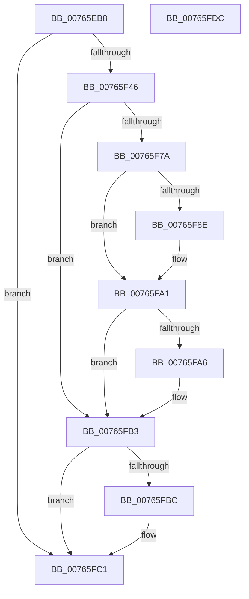

# PopGetPolicyDeviceObject

- RVA: `0x00765EB8`–`0x00765FDD` (길이 `293` bytes)
- VA: `0x0000000140765EB8`
- 실행 섹션: `PAGE`
- PDB 이름 있음: `예`; PDB Function 태그: `아니요`
- unwind 정보 RVA: `0x000CCE08`
- 디코드: `76`개 명령, `293/293` bytes 표시
- 미해석 바이트: `0` (있으면 어셈블리에 `.byte`로 보존)

> 이 문서는 커널 이미지의 기계어와 PDB 기호를 분석해 생성했습니다. 4번과 5번은 함수 원형과 자료형을 바이너리 사용 방식에서 추정한 C 해석이며 원본 소스 복구 결과는 아닙니다.

## 1. Dependencies

- 직접 호출 지점: **6**; 고유 호출 대상: **6**
- 직접 호출자로 확인된 함수: **1**
- RIP 상대 이미지 참조: **1**

### Outgoing calls
- `0x00765F3D` → [ZwCreateFile](../../text/6A/ZwCreateFile_function_006ADB70.md) (function, `0x006ADB70`)
- `0x00765F71` → [ObpReferenceObjectByHandleWithTag](../86/ObpReferenceObjectByHandleWithTag_function_00869650.md) (function, `0x00869650`)
- `0x00765F81` → [IoGetRelatedDeviceObject](../../text/29/IoGetRelatedDeviceObject_function_0029B120.md) (function, `0x0029B120`)
- `0x00765F96` → [ObfReferenceObjectWithTag](../../text/21/ObfReferenceObjectWithTag_function_00210710.md) (function, `0x00210710`)
- `0x00765FAE` → [ObfDereferenceObjectWithTag](../../text/2F/ObfDereferenceObjectWithTag_function_002F78E0.md) (function, `0x002F78E0`)
- `0x00765FBC` → [ZwClose](../../text/6A/ZwClose_function_006AD2B0.md) (function, `0x006AD2B0`)

### Direct callers
- [PopConnectToPolicyDevice](PopConnectToPolicyDevice_function_00765D20.md) at `0x00765DD5`

### Static image references
- `0x00765F46` → RVA `0x00FC6AE0` (`ALMOSTRO`; read)

## 2. Other-region calls and transfers

- 다른 실행 섹션으로 향하는 call: **5**
  - `0x00765F3D` → [ZwCreateFile](../../text/6A/ZwCreateFile_function_006ADB70.md) (`PAGE` → `.text`)
  - `0x00765F81` → [IoGetRelatedDeviceObject](../../text/29/IoGetRelatedDeviceObject_function_0029B120.md) (`PAGE` → `.text`)
  - `0x00765F96` → [ObfReferenceObjectWithTag](../../text/21/ObfReferenceObjectWithTag_function_00210710.md) (`PAGE` → `.text`)
  - `0x00765FAE` → [ObfDereferenceObjectWithTag](../../text/2F/ObfDereferenceObjectWithTag_function_002F78E0.md) (`PAGE` → `.text`)
  - `0x00765FBC` → [ZwClose](../../text/6A/ZwClose_function_006AD2B0.md) (`PAGE` → `.text`)
- 별도 외부 분기/꼬리 이동을 확인하지 못했습니다.

## 3. Assembly (complete function range)

```asm
00765EB8  48 8B C4                        mov rax, rsp
00765EBB  48 89 58 10                     mov qword ptr [rax + 0x10], rbx
00765EBF  48 89 70 20                     mov qword ptr [rax + 0x20], rsi
00765EC3  55                              push rbp
00765EC4  57                              push rdi
00765EC5  41 56                           push r14
00765EC7  48 8D 68 A1                     lea rbp, [rax - 0x5f]
00765ECB  48 81 EC A0 00 00 00            sub rsp, 0xa0
00765ED2  45 33 F6                        xor r14d, r14d
00765ED5  48 89 4D 27                     mov qword ptr [rbp + 0x27], rcx
00765ED9  44 89 70 98                     mov dword ptr [rax - 0x68], r14d
00765EDD  4C 8D 4D 07                     lea r9, [rbp + 7]
00765EE1  4C 89 70 90                     mov qword ptr [rax - 0x70], r14
00765EE5  4C 8D 45 17                     lea r8, [rbp + 0x17]
00765EE9  44 89 70 88                     mov dword ptr [rax - 0x78], r14d
00765EED  48 8D 4D 67                     lea rcx, [rbp + 0x67]
00765EF1  C7 40 80 01 00 00 00            mov dword ptr [rax - 0x80], 1
00765EF8  0F 57 C0                        xorps xmm0, xmm0
00765EFB  C7 44 24 30 03 00 00 00         mov dword ptr [rsp + 0x30], 3
00765F03  48 8B F2                        mov rsi, rdx
00765F06  44 89 74 24 28                  mov dword ptr [rsp + 0x28], r14d
00765F0B  BA FF 01 1F 00                  mov edx, 0x1f01ff
00765F10  4C 89 74 24 20                  mov qword ptr [rsp + 0x20], r14
00765F15  41 8B FE                        mov edi, r14d
00765F18  48 C7 45 17 30 00 00 00         mov qword ptr [rbp + 0x17], 0x30
00765F20  48 C7 45 2F 40 02 00 00         mov qword ptr [rbp + 0x2f], 0x240
00765F28  0F 11 45 07                     movups xmmword ptr [rbp + 7], xmm0
00765F2C  4C 89 75 77                     mov qword ptr [rbp + 0x77], r14
00765F30  4C 89 75 67                     mov qword ptr [rbp + 0x67], r14
00765F34  4C 89 75 1F                     mov qword ptr [rbp + 0x1f], r14
00765F38  F3 0F 7F 45 37                  movdqu xmmword ptr [rbp + 0x37], xmm0
00765F3D  E8 2E 7C F4 FF                  call 0x1406adb70
00765F42  85 C0                           test eax, eax
00765F44  78 7B                           js 0x140765fc1
00765F46  4C 8B 05 93 0B 86 00            mov r8, qword ptr [rip + 0x860b93]
00765F4D  48 8D 45 77                     lea rax, [rbp + 0x77]
00765F51  48 8B 4D 67                     mov rcx, qword ptr [rbp + 0x67]
00765F55  45 33 C9                        xor r9d, r9d
00765F58  4C 89 74 24 38                  mov qword ptr [rsp + 0x38], r14
00765F5D  33 D2                           xor edx, edx
00765F5F  4C 89 74 24 30                  mov qword ptr [rsp + 0x30], r14
00765F64  48 89 44 24 28                  mov qword ptr [rsp + 0x28], rax
00765F69  C7 44 24 20 50 6F 50 64         mov dword ptr [rsp + 0x20], 0x64506f50
00765F71  E8 DA 36 10 00                  call 0x140869650
00765F76  85 C0                           test eax, eax
00765F78  78 39                           js 0x140765fb3
00765F7A  48 8B 5D 77                     mov rbx, qword ptr [rbp + 0x77]
00765F7E  48 8B CB                        mov rcx, rbx
00765F81  E8 9A 51 B3 FF                  call 0x14029b120
00765F86  48 8B F8                        mov rdi, rax
00765F89  48 85 C0                        test rax, rax
00765F8C  74 13                           je 0x140765fa1
00765F8E  BA 50 6F 50 64                  mov edx, 0x64506f50
00765F93  48 8B C8                        mov rcx, rax
00765F96  E8 75 A7 AA FF                  call 0x140210710
00765F9B  48 89 1E                        mov qword ptr [rsi], rbx
00765F9E  41 8B DE                        mov ebx, r14d
00765FA1  48 85 DB                        test rbx, rbx
00765FA4  74 0D                           je 0x140765fb3
00765FA6  BA 50 6F 50 64                  mov edx, 0x64506f50
00765FAB  48 8B CB                        mov rcx, rbx
00765FAE  E8 2D 19 B9 FF                  call 0x1402f78e0
00765FB3  48 8B 4D 67                     mov rcx, qword ptr [rbp + 0x67]
00765FB7  48 85 C9                        test rcx, rcx
00765FBA  74 05                           je 0x140765fc1
00765FBC  E8 EF 72 F4 FF                  call 0x1406ad2b0
00765FC1  4C 8D 9C 24 A0 00 00 00         lea r11, [rsp + 0xa0]
00765FC9  48 8B C7                        mov rax, rdi
00765FCC  49 8B 5B 28                     mov rbx, qword ptr [r11 + 0x28]
00765FD0  49 8B 73 38                     mov rsi, qword ptr [r11 + 0x38]
00765FD4  49 8B E3                        mov rsp, r11
00765FD7  41 5E                           pop r14
00765FD9  5F                              pop rdi
00765FDA  5D                              pop rbp
00765FDB  C3                              ret
00765FDC  CC                              int3
```

## 4. C-style interpretation (structured pseudocode)

```c
__int64 __fastcall PopGetPolicyDeviceObject(__int64 a1, __int64 a2)
{
    __int64 result;
    __int64 v_r14;
    __int64 v_rbx;
    __int64 v_rsp;
    unsigned __int64 v_stack_m18;
    unsigned __int64 v_stack_m80;
    unsigned int v_stack_m88;
    unsigned int v_stack_m90;
    unsigned __int64 v_stack_m98;

    *(unsigned __int64 *)(v_rsp + 16) = v_rbx;
    *(unsigned __int64 *)(v_rsp + 32) = v_rsi;
    v_rsp = (v_rsp) - (160);
    v_r14 = 0;
    *(unsigned __int64 *)(v_rsp - 95 + 39) = a1;
    *(unsigned int *)(v_rsp - 104) = 0;
    *(unsigned __int64 *)(v_rsp - 112) = 0;
    *(unsigned int *)(v_rsp - 120) = 0;
    *(unsigned int *)(v_rsp - 128) = 1;
    v_stack_m88 = 3;
    v_stack_m90 = 0;
    v_stack_m98 = 0;
    *(unsigned __int64 *)(v_rsp - 95 + 23) = 48;
    *(unsigned __int64 *)(v_rsp - 95 + 47) = 576;
    *(unsigned __int64 *)(v_rsp - 95 + 7) = v_xmm0;
    *(unsigned __int64 *)(v_rsp - 95 + 119) = 0;
    *(unsigned __int64 *)(v_rsp - 95 + 103) = 0;
    *(unsigned __int64 *)(v_rsp - 95 + 31) = 0;
    *(unsigned __int64 *)(v_rsp - 95 + 55) = v_xmm0;
    result = ZwCreateFile(v_rsp - 95 + 103, (unsigned int)(0x1F01FFULL), v_rsp - 95 + 23, v_rsp - 95 + 7);
    if (sign_flag) goto loc_00765FC1;
    a4 = 0;
    v_stack_m80 = 0;
    a2 = 0;
    v_stack_m88 = 0;
    v_stack_m90 = v_rsp - 95 + 119;
    v_stack_m98 = 0x64506F50ULL;
    result = ObpReferenceObjectByHandleWithTag(*(unsigned __int64 *)(v_rsp - 95 + 103), a2, *(unsigned __int64 *)(v_rip + 8784787), a4);
    if (sign_flag) goto loc_00765FB3;
    result = IoGetRelatedDeviceObject(*(unsigned __int64 *)(v_rsp - 95 + 119), a2, *(unsigned __int64 *)(v_rip + 8784787), a4);
    v_rbx = *(unsigned __int64 *)(v_rsp - 95 + 119);
    if (result != 0) {
        a2 = 0x64506F50ULL;
        a1 = result;
        result = ObfReferenceObjectWithTag(a1, a2, *(unsigned __int64 *)(v_rip + 8784787), a4);
        *(unsigned __int64 *)(a2) = *(unsigned __int64 *)(v_rsp - 95 + 119);
        v_rbx = 0;
    }
    if (v_rbx != 0) {
        a2 = 0x64506F50ULL;
        a1 = v_rbx;
        result = ObfDereferenceObjectWithTag(a1, a2, *(unsigned __int64 *)(v_rip + 8784787), a4);
    }
    if (*(unsigned __int64 *)(v_rsp - 95 + 103) != 0) {
        result = ZwClose(*(unsigned __int64 *)(v_rsp - 95 + 103), a2, *(unsigned __int64 *)(v_rip + 8784787), a4);
    }
    return result;
}
```

## 5. (Beta) C Style

```c
int64_t PopGetPolicyDeviceObject(int64_t Arg1, void *Arg2)
{
    uint8_t *arg2 = (uint8_t *)Arg2;

    int64_t result;
    int64_t local_r14;
    int64_t local_rbx;
    int64_t local_rsp;
    uint64_t v_stack_m18;
    uint64_t v_stack_m80;
    uint32_t v_stack_m88;
    uint32_t v_stack_m90;
    uint64_t v_stack_m98;

    *(uint64_t *)(local_rsp + 0x10) = local_rbx;
    *(uint64_t *)(local_rsp + 0x20) = local_rsi;
    local_rsp = (local_rsp) - (160);
    local_r14 = 0;
    *(uint64_t *)(local_rsp - 0x5F + 0x27) = Arg1;
    *(uint32_t *)(local_rsp - 0x68) = 0;
    *(uint64_t *)(local_rsp - 0x70) = 0;
    *(uint32_t *)(local_rsp - 0x78) = 0;
    *(uint32_t *)(local_rsp - 0x80) = 1;
    v_stack_m88 = 3;
    v_stack_m90 = 0;
    v_stack_m98 = 0;
    *(uint64_t *)(local_rsp - 0x5F + 0x17) = 48;
    *(uint64_t *)(local_rsp - 0x5F + 0x2F) = 576;
    *(uint64_t *)(local_rsp - 0x5F + 0x7) = v_xmm0;
    *(uint64_t *)(local_rsp - 0x5F + 0x77) = 0;
    *(uint64_t *)(local_rsp - 0x5F + 0x67) = 0;
    *(uint64_t *)(local_rsp - 0x5F + 0x1F) = 0;
    *(uint64_t *)(local_rsp - 0x5F + 0x37) = v_xmm0;
    result = ZwCreateFile(local_rsp - 95 + 103, (uint32_t)(0x1F01FFULL), local_rsp - 95 + 23, local_rsp - 95 + 7);
    if (sign_flag) goto loc_00765FC1;
    a4 = 0;
    v_stack_m80 = 0;
    Arg2 = 0;
    v_stack_m88 = 0;
    v_stack_m90 = local_rsp - 95 + 119;
    v_stack_m98 = 0x64506F50ULL;
    result = ObpReferenceObjectByHandleWithTag(*(uint64_t *)(local_rsp - 0x5F + 0x67), Arg2, *(uint64_t *)(v_rip + 0x860B93), a4);
    if (sign_flag) goto loc_00765FB3;
    result = IoGetRelatedDeviceObject(*(uint64_t *)(local_rsp - 0x5F + 0x77), Arg2, *(uint64_t *)(v_rip + 0x860B93), a4);
    local_rbx = *(uint64_t *)(local_rsp - 0x5F + 0x77);
    if (result != 0) {
        Arg2 = 0x64506F50ULL;
        Arg1 = result;
        result = ObfReferenceObjectWithTag(Arg1, Arg2, *(uint64_t *)(v_rip + 0x860B93), a4);
        *(uint64_t *)(arg2) = *(uint64_t *)(local_rsp - 0x5F + 0x77);
        local_rbx = 0;
    }
    if (local_rbx != 0) {
        Arg2 = 0x64506F50ULL;
        Arg1 = local_rbx;
        result = ObfDereferenceObjectWithTag(Arg1, Arg2, *(uint64_t *)(v_rip + 0x860B93), a4);
    }
    if (*(uint64_t *)(local_rsp - 0x5F + 0x67) != 0) {
        result = ZwClose(*(uint64_t *)(local_rsp - 0x5F + 0x67), Arg2, *(uint64_t *)(v_rip + 0x860B93), a4);
    }
    return result;
}
```

### 관측된 메모리 오프셋

구조체 형식이 확인되지 않은 접근은 인자 기준의 오프셋으로만 기록했습니다.

| 기준 인자 | 오프셋 표현 | 폭 (bit) | 접근 |
|---|---:|---:|---|
| `Arg2` | `+ 0x0` | `64` | `W` |

## 6. Execution-region graph

[열기: 2D/3D 그래프와 함수 탐색 컨트롤 패널](../../../control-panel.html?section=page&rva=0x00765EB8&view=graph)

- 2D 그래프는 위에서 아래로 흐르고, 3D 그래프는 빈 공간을 드래그해 회전합니다. Shift+드래그는 이동, 휠은 확대·축소, 함수 노드 선택은 대상 보고서 이동입니다.

### Static fallback


