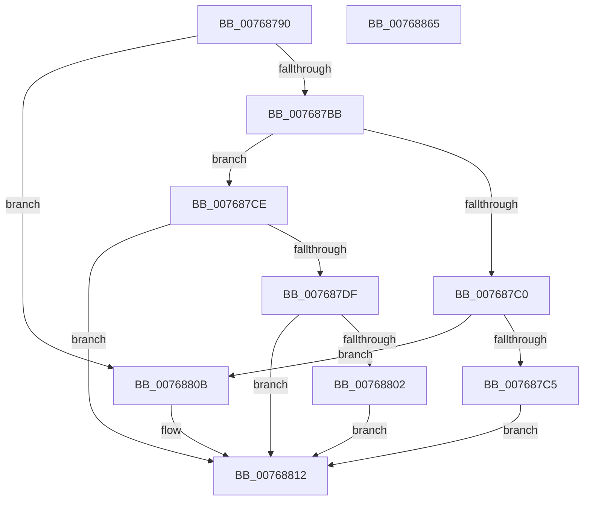

# PopIdleAoAcDozeToS4

- RVA: `0x00768790`–`0x00768866` (길이 `214` bytes)
- VA: `0x0000000140768790`
- 실행 섹션: `PAGE`
- PDB 이름 있음: `예`; PDB Function 태그: `아니요`
- unwind 정보 RVA: `0x0008A308`
- 디코드: `47`개 명령, `214/214` bytes 표시
- 미해석 바이트: `0` (있으면 어셈블리에 `.byte`로 보존)

> 이 문서는 커널 이미지의 기계어와 PDB 기호를 분석해 생성했습니다. 4번과 5번은 함수 원형과 자료형을 바이너리 사용 방식에서 추정한 C 해석이며 원본 소스 복구 결과는 아닙니다.

## 1. Dependencies

- 직접 호출 지점: **5**; 고유 호출 대상: **5**
- 직접 호출자로 확인된 함수: **0**
- RIP 상대 이미지 참조: **4**

### Outgoing calls
- `0x00768799` → [PopAcquirePolicyLock](../../pagelk/B7/PopAcquirePolicyLock_function_00B783C0.md) (function, `0x00B783C0`)
- `0x0076879E` → [PopTraceSystemIdleS0LowPowerDoze](PopTraceSystemIdleS0LowPowerDoze_function_00763E18.md) (function, `0x00763E18`)
- `0x00768843` → [PopExecutePowerAction](../75/PopExecutePowerAction_function_0075E6B4.md) (function, `0x0075E6B4`)
- `0x00768848` → [PopReleasePolicyLock](../../pagelk/B7/PopReleasePolicyLock_function_00B78410.md) (function, `0x00B78410`)
- `0x0076885A` → [PopDeepSleepClearDisengageReason](../../text/39/PopDeepSleepClearDisengageReason_function_0039010C.md) (function, `0x0039010C`)

### Direct callers
- 이 함수 시작 RVA로 연결되는 직접 call은 확인되지 않았습니다. 간접 호출은 완전히 역산할 수 없습니다.

### Static image references
- `0x007687A3` → RVA `0x00F0BC98` (`.data`; read)
- `0x007687CE` → RVA `0x00F0BDA8` (`.data`; read)
- `0x007687E9` → RVA `0x00FC5330` (`ALMOSTRO`; read)
- `0x0076884D` → RVA `0x00F0BC9C` (`.data`; read/write)

## 2. Other-region calls and transfers

- 다른 실행 섹션으로 향하는 call: **3**
  - `0x00768799` → [PopAcquirePolicyLock](../../pagelk/B7/PopAcquirePolicyLock_function_00B783C0.md) (`PAGE` → `PAGELK`)
  - `0x00768848` → [PopReleasePolicyLock](../../pagelk/B7/PopReleasePolicyLock_function_00B78410.md) (`PAGE` → `PAGELK`)
  - `0x0076885A` → [PopDeepSleepClearDisengageReason](../../text/39/PopDeepSleepClearDisengageReason_function_0039010C.md) (`PAGE` → `.text`)
- 별도 외부 분기/꼬리 이동을 확인하지 못했습니다.

## 3. Assembly (complete function range)

```asm
00768790  40 55                           push rbp
00768792  48 8B EC                        mov rbp, rsp
00768795  48 83 EC 60                     sub rsp, 0x60
00768799  E8 22 FC 40 00                  call 0x140b783c0
0076879E  E8 75 B6 FF FF                  call 0x140763e18
007687A3  8B 0D EF 34 7A 00               mov ecx, dword ptr [rip + 0x7a34ef]
007687A9  0F 57 C0                        xorps xmm0, xmm0
007687AC  48 83 65 F8 00                  and qword ptr [rbp - 8], 0
007687B1  F3 0F 7F 45 E8                  movdqu xmmword ptr [rbp - 0x18], xmm0
007687B6  83 E9 01                        sub ecx, 1
007687B9  74 50                           je 0x14076880b
007687BB  83 E9 01                        sub ecx, 1
007687BE  74 0E                           je 0x1407687ce
007687C0  83 F9 04                        cmp ecx, 4
007687C3  75 46                           jne 0x14076880b
007687C5  C7 45 E0 0B 00 00 00            mov dword ptr [rbp - 0x20], 0xb
007687CC  EB 44                           jmp 0x140768812
007687CE  48 83 3D D2 35 7A 00 00         cmp qword ptr [rip + 0x7a35d2], 0
007687D6  C7 45 E0 0B 00 00 00            mov dword ptr [rbp - 0x20], 0xb
007687DD  74 33                           je 0x140768812
007687DF  48 A1 08 00 00 00 80 F7 FF FF   movabs rax, qword ptr [0xfffff78000000008]
007687E9  8B 0D 41 CB 85 00               mov ecx, dword ptr [rip + 0x85cb41]
007687EF  48 2B 05 B2 35 7A 00            sub rax, qword ptr [rip + 0x7a35b2]
007687F6  48 69 D1 80 96 98 00            imul rdx, rcx, 0x989680
007687FD  48 3B C2                        cmp rax, rdx
00768800  76 10                           jbe 0x140768812
00768802  C7 45 E0 0C 00 00 00            mov dword ptr [rbp - 0x20], 0xc
00768809  EB 07                           jmp 0x140768812
0076880B  C7 45 E0 06 00 00 00            mov dword ptr [rbp - 0x20], 6
00768812  83 65 D8 00                     and dword ptr [rbp - 0x28], 0
00768816  4C 8D 45 D0                     lea r8, [rbp - 0x30]
0076881A  41 B9 05 00 00 00               mov r9d, 5
00768820  C7 45 E4 80 00 00 00            mov dword ptr [rbp - 0x1c], 0x80
00768827  33 D2                           xor edx, edx
00768829  C7 45 D0 03 00 00 00            mov dword ptr [rbp - 0x30], 3
00768830  48 8D 4D E0                     lea rcx, [rbp - 0x20]
00768834  C7 45 D4 24 00 00 80            mov dword ptr [rbp - 0x2c], 0x80000024
0076883B  C7 44 24 20 01 00 00 00         mov dword ptr [rsp + 0x20], 1
00768843  E8 6C 5E FF FF                  call 0x14075e6b4
00768848  E8 C3 FB 40 00                  call 0x140b78410
0076884D  F0 83 25 47 34 7A 00 00         lock and dword ptr [rip + 0x7a3447], 0
00768855  B9 04 00 00 00                  mov ecx, 4
0076885A  E8 AD 78 C2 FF                  call 0x14039010c
0076885F  48 83 C4 60                     add rsp, 0x60
00768863  5D                              pop rbp
00768864  C3                              ret
00768865  CC                              int3
```

## 4. C-style interpretation (structured pseudocode)

```c
__int64 __fastcall PopIdleAoAcDozeToS4(void)
{
    __int64 result;
    __int64 v_rsp;
    unsigned __int64 v_stack_m10;
    unsigned __int64 v_stack_m20;
    unsigned int v_stack_m24;
    unsigned int v_stack_m28;
    unsigned int v_stack_m30;
    unsigned int v_stack_m34;
    unsigned __int64 v_stack_m38;
    unsigned int v_stack_m48;

    v_rsp = (v_rsp) - (96);
    result = PopAcquirePolicyLock(a1, a2, a3, a4);
    result = PopTraceSystemIdleS0LowPowerDoze(a1, a2, a3, a4);
    v_stack_m20 = v_xmm0;
    a1 = (unsigned int)(((unsigned int)(*(unsigned int *)(v_rip + 8008943))) - (1));
    if (condition_is_equal) goto loc_0076880B;
    a1 = (unsigned int)((a1) - (1));
    if (condition_is_equal) goto loc_007687CE;
    if (((unsigned int)(a1)) != 4) goto loc_0076880B;
    v_stack_m28 = 11;
    goto loc_00768812;
loc_007687CE:
    v_stack_m28 = 11;
    if ((*(unsigned __int64 *)(v_rip + 8009170)) == 0) goto loc_00768812;
    result = (result) - (*(unsigned __int64 *)(v_rip + 8009138));
    a2 = (a2) * ((unsigned int)(*(unsigned int *)(v_rip + 8768321)));
    if (result <= a2) goto loc_00768812;
    v_stack_m28 = 12;
    goto loc_00768812;
loc_0076880B:
    v_stack_m28 = 6;
loc_00768812:
    v_stack_m24 = 128;
    a2 = 0;
    v_stack_m38 = 3;
    v_stack_m34 = 0x80000024ULL;
    v_stack_m48 = 1;
    result = PopExecutePowerAction(v_stack_m28, a2, v_stack_m38, 5);
    result = PopReleasePolicyLock(v_stack_m28, a2, v_stack_m38, 5);
    result = PopDeepSleepClearDisengageReason(4, a2, v_stack_m38, 5);
    v_rsp = (v_rsp) + (96);
    return result;
}
```

## 5. (Beta) C Style

```c
void PopIdleAoAcDozeToS4(void)
{
    int64_t result;
    int64_t local_rsp;
    uint64_t v_stack_m10;
    uint64_t v_stack_m20;
    uint32_t v_stack_m24;
    uint32_t v_stack_m28;
    uint32_t v_stack_m30;
    uint32_t v_stack_m34;
    uint64_t v_stack_m38;
    uint32_t v_stack_m48;

    local_rsp = (local_rsp) - (96);
    result = PopAcquirePolicyLock(a1, a2, a3, a4);
    result = PopTraceSystemIdleS0LowPowerDoze(a1, a2, a3, a4);
    v_stack_m20 = v_xmm0;
    a1 = (uint32_t)(((uint32_t)(*(uint32_t *)(v_rip + 0x7A34EF))) - (1));
    if (condition_is_equal) goto loc_0076880B;
    a1 = (uint32_t)((a1) - (1));
    if (condition_is_equal) goto loc_007687CE;
    if (((uint32_t)(a1)) != 4) goto loc_0076880B;
    v_stack_m28 = 11;
    goto loc_00768812;
loc_007687CE:
    v_stack_m28 = 11;
    if ((*(uint64_t *)(v_rip + 0x7A35D2)) == 0) goto loc_00768812;
    result = (result) - (*(uint64_t *)(v_rip + 0x7A35B2));
    a2 = (a2) * ((uint32_t)(*(uint32_t *)(v_rip + 0x85CB41)));
    if (result <= a2) goto loc_00768812;
    v_stack_m28 = 12;
    goto loc_00768812;
loc_0076880B:
    v_stack_m28 = 6;
loc_00768812:
    v_stack_m24 = 128;
    a2 = 0;
    v_stack_m38 = 3;
    v_stack_m34 = 0x80000024ULL;
    v_stack_m48 = 1;
    result = PopExecutePowerAction(v_stack_m28, a2, v_stack_m38, 5);
    result = PopReleasePolicyLock(v_stack_m28, a2, v_stack_m38, 5);
    result = PopDeepSleepClearDisengageReason(4, a2, v_stack_m38, 5);
    local_rsp = (local_rsp) + (96);
    return result;
}
```

## 6. Execution-region graph

[열기: 2D/3D 그래프와 함수 탐색 컨트롤 패널](../../../control-panel.html?section=page&rva=0x00768790&view=graph)

- 2D 그래프는 위에서 아래로 흐르고, 3D 그래프는 빈 공간을 드래그해 회전합니다. Shift+드래그는 이동, 휠은 확대·축소, 함수 노드 선택은 대상 보고서 이동입니다.

### Static fallback


