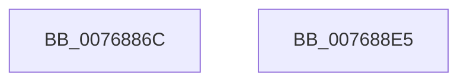

# PopIdleInitAoAcDozeS4Timer

- RVA: `0x0076886C`–`0x007688E6` (길이 `122` bytes)
- VA: `0x000000014076886C`
- 실행 섹션: `PAGE`
- PDB 이름 있음: `예`; PDB Function 태그: `아니요`
- unwind 정보 RVA: `0x0005D2F4`
- 디코드: `23`개 명령, `122/122` bytes 표시
- 미해석 바이트: `0` (있으면 어셈블리에 `.byte`로 보존)

> 이 문서는 커널 이미지의 기계어와 PDB 기호를 분석해 생성했습니다. 4번과 5번은 함수 원형과 자료형을 바이너리 사용 방식에서 추정한 C 해석이며 원본 소스 복구 결과는 아닙니다.

## 1. Dependencies

- 직접 호출 지점: **2**; 고유 호출 대상: **2**
- 직접 호출자로 확인된 함수: **1**
- RIP 상대 이미지 참조: **9**

### Outgoing calls
- `0x0076889F` → [KeInitializeIRTimer](../../text/3A/KeInitializeIRTimer_function_003A4204.md) (function, `0x003A4204`)
- `0x007688DB` → [PoRegisterPowerSettingCallback](../A8/PoRegisterPowerSettingCallback_function_00A82150.md) (function, `0x00A82150`)

### Direct callers
- [PoInitSystem](../../init/C7/PoInitSystem_function_00C72358.md) at `0x00C7314B`

### Static image references
- `0x00768870` → RVA `0x00F08EA8` (`.data`; read/write)
- `0x00768891` → RVA `0x005D9840` (`PopIdleAoAcDozeS4TimerCallback`; read)
- `0x00768898` → RVA `0x00F08EE0` (`.data`; read)
- `0x007688A4` → RVA `0x00F08ED8` (`.data`; read/write)
- `0x007688AC` → RVA `0x00768790` (`PopIdleAoAcDozeToS4`; read)
- `0x007688B3` → RVA `0x00F08EC0` (`.data`; read/write)
- `0x007688BB` → RVA `0x00AD89F0` (`PopIdleGlobalUserPresenceCallback`; read)
- `0x007688C8` → RVA `0x0001ED50` (`.rdata`; read)
- `0x007688D2` → RVA `0x00F08ED0` (`.data`; write)

## 2. Other-region calls and transfers

- 다른 실행 섹션으로 향하는 call: **1**
  - `0x0076889F` → [KeInitializeIRTimer](../../text/3A/KeInitializeIRTimer_function_003A4204.md) (`PAGE` → `.text`)
- 별도 외부 분기/꼬리 이동을 확인하지 못했습니다.

## 3. Assembly (complete function range)

```asm
0076886C  48 83 EC 38                     sub rsp, 0x38
00768870  48 83 25 30 06 7A 00 00         and qword ptr [rip + 0x7a0630], 0
00768878  4C 8D 4C 24 40                  lea r9, [rsp + 0x40]
0076887D  B8 02 00 00 00                  mov eax, 2
00768882  C7 44 24 40 08 00 02 00         mov dword ptr [rsp + 0x40], 0x20008
0076888A  45 33 C0                        xor r8d, r8d
0076888D  89 44 24 20                     mov dword ptr [rsp + 0x20], eax
00768891  48 8D 15 A8 0F E7 FF            lea rdx, [rip - 0x18f058]
00768898  48 8D 0D 41 06 7A 00            lea rcx, [rip + 0x7a0641]
0076889F  E8 60 B9 C3 FF                  call 0x1403a4204
007688A4  48 83 25 2C 06 7A 00 00         and qword ptr [rip + 0x7a062c], 0
007688AC  48 8D 05 DD FE FF FF            lea rax, [rip - 0x123]
007688B3  48 83 25 05 06 7A 00 00         and qword ptr [rip + 0x7a0605], 0
007688BB  4C 8D 05 2E 01 37 00            lea r8, [rip + 0x37012e]
007688C2  48 83 64 24 20 00               and qword ptr [rsp + 0x20], 0
007688C8  48 8D 15 81 64 8B FF            lea rdx, [rip - 0x749b7f]
007688CF  45 33 C9                        xor r9d, r9d
007688D2  48 89 05 F7 05 7A 00            mov qword ptr [rip + 0x7a05f7], rax
007688D9  33 C9                           xor ecx, ecx
007688DB  E8 70 98 31 00                  call 0x140a82150
007688E0  48 83 C4 38                     add rsp, 0x38
007688E4  C3                              ret
007688E5  CC                              int3
```

## 4. C-style interpretation (structured pseudocode)

```c
__int64 __fastcall PopIdleInitAoAcDozeS4Timer(__int64 a1, __int64 a2, int a3)
{
    __int64 result;
    __int64 v_rsp;
    unsigned int v_stack_m18;
    unsigned __int64 v_stack_p8;

    v_rsp = (v_rsp) - (56);
    v_stack_p8 = 0x20008ULL;
    a3 = 0;
    v_stack_m18 = 2;
    result = KeInitializeIRTimer(v_rip + 7996993, v_rip - 1634392, a3, v_stack_p8);
    a4 = 0;
    *(unsigned __int64 *)(v_rip + 7996919) = v_rip - 291;
    a1 = 0;
    result = PoRegisterPowerSettingCallback(a1, v_rip - 7641983, v_rip + 3604782, a4);
    v_rsp = (v_rsp) + (56);
    return result;
}
```

## 5. (Beta) C Style

```c
int64_t PopIdleInitAoAcDozeS4Timer(int64_t Arg1, int64_t Arg2, int32_t Arg3)
{
    int64_t result;
    int64_t local_rsp;
    uint32_t v_stack_m18;
    uint64_t v_stack_p8;

    local_rsp = (local_rsp) - (56);
    v_stack_p8 = 0x20008ULL;
    Arg3 = 0;
    v_stack_m18 = 2;
    result = KeInitializeIRTimer(v_rip + 7996993, v_rip - 1634392, Arg3, v_stack_p8);
    a4 = 0;
    *(uint64_t *)(v_rip + 0x7A05F7) = v_rip - 291;
    Arg1 = 0;
    result = PoRegisterPowerSettingCallback(Arg1, v_rip - 7641983, v_rip + 3604782, a4);
    local_rsp = (local_rsp) + (56);
    return result;
}
```

## 6. Execution-region graph

[열기: 2D/3D 그래프와 함수 탐색 컨트롤 패널](../../../control-panel.html?section=page&rva=0x0076886C&view=graph)

- 2D 그래프는 위에서 아래로 흐르고, 3D 그래프는 빈 공간을 드래그해 회전합니다. Shift+드래그는 이동, 휠은 확대·축소, 함수 노드 선택은 대상 보고서 이동입니다.

### Static fallback


