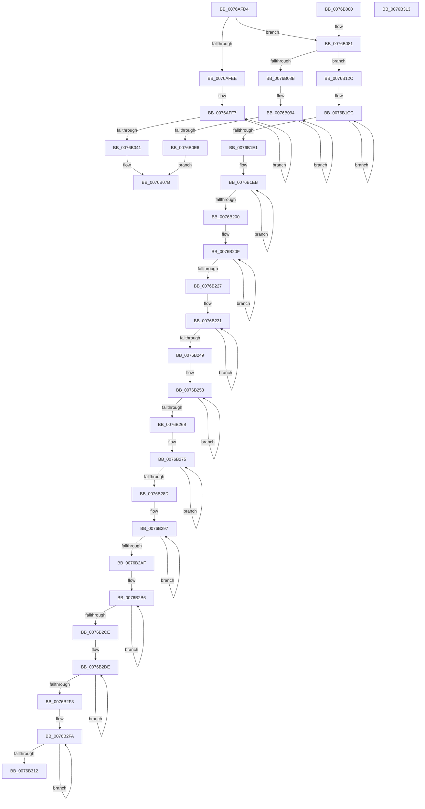

# PopIdleWakeCalculateConvergedBuckets

- RVA: `0x0076AFD4`–`0x0076B314` (길이 `832` bytes)
- VA: `0x000000014076AFD4`
- 실행 섹션: `PAGE`
- PDB 이름 있음: `예`; PDB Function 태그: `아니요`
- unwind 정보 RVA: `0x000DB714`
- 디코드: `198`개 명령, `832/832` bytes 표시
- 미해석 바이트: `0` (있으면 어셈블리에 `.byte`로 보존)

> 이 문서는 커널 이미지의 기계어와 PDB 기호를 분석해 생성했습니다. 4번과 5번은 함수 원형과 자료형을 바이너리 사용 방식에서 추정한 C 해석이며 원본 소스 복구 결과는 아닙니다.

## 1. Dependencies

- 직접 호출 지점: **0**; 고유 호출 대상: **0**
- 직접 호출자로 확인된 함수: **1**
- RIP 상대 이미지 참조: **0**

### Outgoing calls
- 직접 디코드된 call 명령이 없습니다.

### Direct callers
- [sub_00B43DE2](../B4/Unknown_function_00B43DE2.md) at `0x00B43E05`

### Static image references
- 디코드된 RIP-relative 메모리 참조가 없습니다.

## 2. Other-region calls and transfers

- 다른 실행 섹션으로 향하는 call: **0**
- 별도 외부 분기/꼬리 이동을 확인하지 못했습니다.

## 3. Assembly (complete function range)

```asm
0076AFD4  4C 8D 41 08                     lea r8, [rcx + 8]
0076AFD8  4C 8B C9                        mov r9, rcx
0076AFDB  45 8B 10                        mov r10d, dword ptr [r8]
0076AFDE  48 8D 81 80 01 00 00            lea rax, [rcx + 0x180]
0076AFE5  45 85 D2                        test r10d, r10d
0076AFE8  0F 85 93 00 00 00               jne 0x14076b081
0076AFEE  B9 80 00 00 00                  mov ecx, 0x80
0076AFF3  45 8D 4A 02                     lea r9d, [r10 + 2]
0076AFF7  0F 10 00                        movups xmm0, xmmword ptr [rax]
0076AFFA  0F 11 02                        movups xmmword ptr [rdx], xmm0
0076AFFD  0F 10 48 10                     movups xmm1, xmmword ptr [rax + 0x10]
0076B001  0F 11 4A 10                     movups xmmword ptr [rdx + 0x10], xmm1
0076B005  0F 10 40 20                     movups xmm0, xmmword ptr [rax + 0x20]
0076B009  0F 11 42 20                     movups xmmword ptr [rdx + 0x20], xmm0
0076B00D  0F 10 48 30                     movups xmm1, xmmword ptr [rax + 0x30]
0076B011  0F 11 4A 30                     movups xmmword ptr [rdx + 0x30], xmm1
0076B015  0F 10 40 40                     movups xmm0, xmmword ptr [rax + 0x40]
0076B019  0F 11 42 40                     movups xmmword ptr [rdx + 0x40], xmm0
0076B01D  0F 10 48 50                     movups xmm1, xmmword ptr [rax + 0x50]
0076B021  0F 11 4A 50                     movups xmmword ptr [rdx + 0x50], xmm1
0076B025  0F 10 40 60                     movups xmm0, xmmword ptr [rax + 0x60]
0076B029  0F 11 42 60                     movups xmmword ptr [rdx + 0x60], xmm0
0076B02D  48 03 D1                        add rdx, rcx
0076B030  0F 10 48 70                     movups xmm1, xmmword ptr [rax + 0x70]
0076B034  48 03 C1                        add rax, rcx
0076B037  0F 11 4A F0                     movups xmmword ptr [rdx - 0x10], xmm1
0076B03B  49 83 E9 01                     sub r9, 1
0076B03F  75 B6                           jne 0x14076aff7
0076B041  0F 10 00                        movups xmm0, xmmword ptr [rax]
0076B044  0F 11 02                        movups xmmword ptr [rdx], xmm0
0076B047  0F 10 48 10                     movups xmm1, xmmword ptr [rax + 0x10]
0076B04B  0F 11 4A 10                     movups xmmword ptr [rdx + 0x10], xmm1
0076B04F  0F 10 40 20                     movups xmm0, xmmword ptr [rax + 0x20]
0076B053  0F 11 42 20                     movups xmmword ptr [rdx + 0x20], xmm0
0076B057  0F 10 48 30                     movups xmm1, xmmword ptr [rax + 0x30]
0076B05B  0F 11 4A 30                     movups xmmword ptr [rdx + 0x30], xmm1
0076B05F  0F 10 40 40                     movups xmm0, xmmword ptr [rax + 0x40]
0076B063  0F 11 42 40                     movups xmmword ptr [rdx + 0x40], xmm0
0076B067  0F 10 48 50                     movups xmm1, xmmword ptr [rax + 0x50]
0076B06B  0F 11 4A 50                     movups xmmword ptr [rdx + 0x50], xmm1
0076B06F  0F 10 40 60                     movups xmm0, xmmword ptr [rax + 0x60]
0076B073  0F 11 42 60                     movups xmmword ptr [rdx + 0x60], xmm0
0076B077  48 8B 40 70                     mov rax, qword ptr [rax + 0x70]
0076B07B  48 89 42 70                     mov qword ptr [rdx + 0x70], rax
0076B07F  C3                              ret
0076B080  CC                              int3
0076B081  8B 08                           mov ecx, dword ptr [rax]
0076B083  85 C9                           test ecx, ecx
0076B085  0F 85 A1 00 00 00               jne 0x14076b12c
0076B08B  B9 80 00 00 00                  mov ecx, 0x80
0076B090  44 8D 49 82                     lea r9d, [rcx - 0x7e]
0076B094  41 0F 10 00                     movups xmm0, xmmword ptr [r8]
0076B098  0F 11 02                        movups xmmword ptr [rdx], xmm0
0076B09B  41 0F 10 48 10                  movups xmm1, xmmword ptr [r8 + 0x10]
0076B0A0  0F 11 4A 10                     movups xmmword ptr [rdx + 0x10], xmm1
0076B0A4  41 0F 10 40 20                  movups xmm0, xmmword ptr [r8 + 0x20]
0076B0A9  0F 11 42 20                     movups xmmword ptr [rdx + 0x20], xmm0
0076B0AD  41 0F 10 48 30                  movups xmm1, xmmword ptr [r8 + 0x30]
0076B0B2  0F 11 4A 30                     movups xmmword ptr [rdx + 0x30], xmm1
0076B0B6  41 0F 10 40 40                  movups xmm0, xmmword ptr [r8 + 0x40]
0076B0BB  0F 11 42 40                     movups xmmword ptr [rdx + 0x40], xmm0
0076B0BF  41 0F 10 48 50                  movups xmm1, xmmword ptr [r8 + 0x50]
0076B0C4  0F 11 4A 50                     movups xmmword ptr [rdx + 0x50], xmm1
0076B0C8  41 0F 10 40 60                  movups xmm0, xmmword ptr [r8 + 0x60]
0076B0CD  0F 11 42 60                     movups xmmword ptr [rdx + 0x60], xmm0
0076B0D1  48 03 D1                        add rdx, rcx
0076B0D4  41 0F 10 48 70                  movups xmm1, xmmword ptr [r8 + 0x70]
0076B0D9  4C 03 C1                        add r8, rcx
0076B0DC  0F 11 4A F0                     movups xmmword ptr [rdx - 0x10], xmm1
0076B0E0  49 83 E9 01                     sub r9, 1
0076B0E4  75 AE                           jne 0x14076b094
0076B0E6  41 0F 10 00                     movups xmm0, xmmword ptr [r8]
0076B0EA  0F 11 02                        movups xmmword ptr [rdx], xmm0
0076B0ED  41 0F 10 48 10                  movups xmm1, xmmword ptr [r8 + 0x10]
0076B0F2  0F 11 4A 10                     movups xmmword ptr [rdx + 0x10], xmm1
0076B0F6  41 0F 10 40 20                  movups xmm0, xmmword ptr [r8 + 0x20]
0076B0FB  0F 11 42 20                     movups xmmword ptr [rdx + 0x20], xmm0
0076B0FF  41 0F 10 48 30                  movups xmm1, xmmword ptr [r8 + 0x30]
0076B104  0F 11 4A 30                     movups xmmword ptr [rdx + 0x30], xmm1
0076B108  41 0F 10 40 40                  movups xmm0, xmmword ptr [r8 + 0x40]
0076B10D  0F 11 42 40                     movups xmmword ptr [rdx + 0x40], xmm0
0076B111  41 0F 10 48 50                  movups xmm1, xmmword ptr [r8 + 0x50]
0076B116  0F 11 4A 50                     movups xmmword ptr [rdx + 0x50], xmm1
0076B11A  41 0F 10 40 60                  movups xmm0, xmmword ptr [r8 + 0x60]
0076B11F  0F 11 42 60                     movups xmmword ptr [rdx + 0x60], xmm0
0076B123  49 8B 40 70                     mov rax, qword ptr [r8 + 0x70]
0076B127  E9 4F FF FF FF                  jmp 0x14076b07b
0076B12C  42 8D 04 11                     lea eax, [rcx + r10]
0076B130  41 B8 09 00 00 00               mov r8d, 9
0076B136  89 02                           mov dword ptr [rdx], eax
0076B138  49 8B 81 88 01 00 00            mov rax, qword ptr [r9 + 0x188]
0076B13F  49 8B 49 10                     mov rcx, qword ptr [r9 + 0x10]
0076B143  48 3B C8                        cmp rcx, rax
0076B146  45 8D 58 F8                     lea r11d, [r8 - 8]
0076B14A  48 0F 43 C8                     cmovae rcx, rax
0076B14E  48 89 4A 08                     mov qword ptr [rdx + 8], rcx
0076B152  49 8B 81 90 01 00 00            mov rax, qword ptr [r9 + 0x190]
0076B159  49 8B 49 18                     mov rcx, qword ptr [r9 + 0x18]
0076B15D  48 3B C8                        cmp rcx, rax
0076B160  48 0F 46 C8                     cmovbe rcx, rax
0076B164  48 89 4A 10                     mov qword ptr [rdx + 0x10], rcx
0076B168  49 8D 49 28                     lea rcx, [r9 + 0x28]
0076B16C  49 8B 81 98 01 00 00            mov rax, qword ptr [r9 + 0x198]
0076B173  49 03 41 20                     add rax, qword ptr [r9 + 0x20]
0076B177  48 89 42 18                     mov qword ptr [rdx + 0x18], rax
0076B17B  49 8B 81 F0 01 00 00            mov rax, qword ptr [r9 + 0x1f0]
0076B182  49 03 41 78                     add rax, qword ptr [r9 + 0x78]
0076B186  48 89 42 70                     mov qword ptr [rdx + 0x70], rax
0076B18A  49 8B 81 38 02 00 00            mov rax, qword ptr [r9 + 0x238]
0076B191  49 03 81 C0 00 00 00            add rax, qword ptr [r9 + 0xc0]
0076B198  48 89 82 B8 00 00 00            mov qword ptr [rdx + 0xb8], rax
0076B19F  49 8B 81 80 02 00 00            mov rax, qword ptr [r9 + 0x280]
0076B1A6  49 03 81 08 01 00 00            add rax, qword ptr [r9 + 0x108]
0076B1AD  48 89 82 00 01 00 00            mov qword ptr [rdx + 0x100], rax
0076B1B4  49 8B 81 C8 02 00 00            mov rax, qword ptr [r9 + 0x2c8]
0076B1BB  49 03 81 50 01 00 00            add rax, qword ptr [r9 + 0x150]
0076B1C2  48 89 82 48 01 00 00            mov qword ptr [rdx + 0x148], rax
0076B1C9  49 2B D1                        sub rdx, r9
0076B1CC  8B 81 78 01 00 00               mov eax, dword ptr [rcx + 0x178]
0076B1D2  03 01                           add eax, dword ptr [rcx]
0076B1D4  89 44 0A F8                     mov dword ptr [rdx + rcx - 8], eax
0076B1D8  48 8D 49 04                     lea rcx, [rcx + 4]
0076B1DC  4D 2B C3                        sub r8, r11
0076B1DF  75 EB                           jne 0x14076b1cc
0076B1E1  49 8D 49 4C                     lea rcx, [r9 + 0x4c]
0076B1E5  41 B8 0B 00 00 00               mov r8d, 0xb
0076B1EB  8B 81 78 01 00 00               mov eax, dword ptr [rcx + 0x178]
0076B1F1  03 01                           add eax, dword ptr [rcx]
0076B1F3  89 44 11 F8                     mov dword ptr [rcx + rdx - 8], eax
0076B1F7  48 8D 49 04                     lea rcx, [rcx + 4]
0076B1FB  4D 2B C3                        sub r8, r11
0076B1FE  75 EB                           jne 0x14076b1eb
0076B200  B9 05 00 00 00                  mov ecx, 5
0076B205  4D 8D 81 80 00 00 00            lea r8, [r9 + 0x80]
0076B20C  44 8B D1                        mov r10d, ecx
0076B20F  41 8B 80 78 01 00 00            mov eax, dword ptr [r8 + 0x178]
0076B216  41 03 00                        add eax, dword ptr [r8]
0076B219  42 89 44 02 F8                  mov dword ptr [rdx + r8 - 8], eax
0076B21E  4D 8D 40 04                     lea r8, [r8 + 4]
0076B222  4D 2B D3                        sub r10, r11
0076B225  75 E8                           jne 0x14076b20f
0076B227  4D 8D 81 98 00 00 00            lea r8, [r9 + 0x98]
0076B22E  4C 8B D1                        mov r10, rcx
0076B231  49 8B 80 78 01 00 00            mov rax, qword ptr [r8 + 0x178]
0076B238  49 03 00                        add rax, qword ptr [r8]
0076B23B  49 89 44 10 F8                  mov qword ptr [r8 + rdx - 8], rax
0076B240  4D 8D 40 08                     lea r8, [r8 + 8]
0076B244  4D 2B D3                        sub r10, r11
0076B247  75 E8                           jne 0x14076b231
0076B249  4D 8D 81 C8 00 00 00            lea r8, [r9 + 0xc8]
0076B250  4C 8B D1                        mov r10, rcx
0076B253  41 8B 80 78 01 00 00            mov eax, dword ptr [r8 + 0x178]
0076B25A  41 03 00                        add eax, dword ptr [r8]
0076B25D  41 89 44 10 F8                  mov dword ptr [r8 + rdx - 8], eax
0076B262  4D 8D 40 04                     lea r8, [r8 + 4]
0076B266  4D 2B D3                        sub r10, r11
0076B269  75 E8                           jne 0x14076b253
0076B26B  4D 8D 81 E0 00 00 00            lea r8, [r9 + 0xe0]
0076B272  4C 8B D1                        mov r10, rcx
0076B275  49 8B 80 78 01 00 00            mov rax, qword ptr [r8 + 0x178]
0076B27C  49 03 00                        add rax, qword ptr [r8]
0076B27F  49 89 44 10 F8                  mov qword ptr [r8 + rdx - 8], rax
0076B284  4D 8D 40 08                     lea r8, [r8 + 8]
0076B288  4D 2B D3                        sub r10, r11
0076B28B  75 E8                           jne 0x14076b275
0076B28D  4D 8D 81 10 01 00 00            lea r8, [r9 + 0x110]
0076B294  4C 8B D1                        mov r10, rcx
0076B297  41 8B 80 78 01 00 00            mov eax, dword ptr [r8 + 0x178]
0076B29E  41 03 00                        add eax, dword ptr [r8]
0076B2A1  41 89 44 10 F8                  mov dword ptr [r8 + rdx - 8], eax
0076B2A6  4D 8D 40 04                     lea r8, [r8 + 4]
0076B2AA  4D 2B D3                        sub r10, r11
0076B2AD  75 E8                           jne 0x14076b297
0076B2AF  4D 8D 81 28 01 00 00            lea r8, [r9 + 0x128]
0076B2B6  49 8B 80 78 01 00 00            mov rax, qword ptr [r8 + 0x178]
0076B2BD  49 03 00                        add rax, qword ptr [r8]
0076B2C0  49 89 44 10 F8                  mov qword ptr [r8 + rdx - 8], rax
0076B2C5  4D 8D 40 08                     lea r8, [r8 + 8]
0076B2C9  49 2B CB                        sub rcx, r11
0076B2CC  75 E8                           jne 0x14076b2b6
0076B2CE  41 B8 03 00 00 00               mov r8d, 3
0076B2D4  49 8D 89 58 01 00 00            lea rcx, [r9 + 0x158]
0076B2DB  45 8B D0                        mov r10d, r8d
0076B2DE  8B 81 78 01 00 00               mov eax, dword ptr [rcx + 0x178]
0076B2E4  03 01                           add eax, dword ptr [rcx]
0076B2E6  89 44 11 F8                     mov dword ptr [rcx + rdx - 8], eax
0076B2EA  48 8D 49 04                     lea rcx, [rcx + 4]
0076B2EE  4D 2B D3                        sub r10, r11
0076B2F1  75 EB                           jne 0x14076b2de
0076B2F3  49 81 C1 68 01 00 00            add r9, 0x168
0076B2FA  49 8B 81 78 01 00 00            mov rax, qword ptr [r9 + 0x178]
0076B301  49 03 01                        add rax, qword ptr [r9]
0076B304  4A 89 44 0A F8                  mov qword ptr [rdx + r9 - 8], rax
0076B309  4D 8D 49 08                     lea r9, [r9 + 8]
0076B30D  4D 2B C3                        sub r8, r11
0076B310  75 E8                           jne 0x14076b2fa
0076B312  C3                              ret
0076B313  CC                              int3
```

## 4. C-style interpretation (structured pseudocode)

```c
__int64 __fastcall PopIdleWakeCalculateConvergedBuckets(__int64 a1, __int64 a2)
{
    __int64 result;
    __int64 v_r10;

    if ((unsigned int)((unsigned int)(*(unsigned int *)(a1 + 8))) != 0) goto loc_0076B081;
loc_0076AFF7:
    *(unsigned __int64 *)(a2) = v_xmm0;
    *(unsigned __int64 *)(a2 + 16) = v_xmm1;
    *(unsigned __int64 *)(a2 + 32) = v_xmm0;
    *(unsigned __int64 *)(a2 + 48) = v_xmm1;
    *(unsigned __int64 *)(a2 + 64) = v_xmm0;
    *(unsigned __int64 *)(a2 + 80) = v_xmm1;
    *(unsigned __int64 *)(a2 + 96) = v_xmm0;
    a2 = (a2) + (128);
    result = (a1 + 384) + (128);
    *(unsigned __int64 *)(a2 - 16) = v_xmm1;
    a4 = ((unsigned int)(*(unsigned int *)(a1 + 8)) + 2) - (1);
    if (condition_is_not_equal) goto loc_0076AFF7;
    *(unsigned __int64 *)(a2) = v_xmm0;
    *(unsigned __int64 *)(a2 + 16) = v_xmm1;
    *(unsigned __int64 *)(a2 + 32) = v_xmm0;
    *(unsigned __int64 *)(a2 + 48) = v_xmm1;
    *(unsigned __int64 *)(a2 + 64) = v_xmm0;
    *(unsigned __int64 *)(a2 + 80) = v_xmm1;
    *(unsigned __int64 *)(a2 + 96) = v_xmm0;
loc_0076B07B:
    *(unsigned __int64 *)(a2 + 112) = *(unsigned __int64 *)(result + 112);
    return *(unsigned __int64 *)(result + 112);
loc_0076B081:
    if ((unsigned int)((unsigned int)(*(unsigned int *)(*(unsigned __int64 *)(result + 112)))) != 0) goto loc_0076B12C;
loc_0076B094:
    *(unsigned __int64 *)(a2) = v_xmm0;
    *(unsigned __int64 *)(a2 + 16) = v_xmm1;
    *(unsigned __int64 *)(a2 + 32) = v_xmm0;
    *(unsigned __int64 *)(a2 + 48) = v_xmm1;
    *(unsigned __int64 *)(a2 + 64) = v_xmm0;
    *(unsigned __int64 *)(a2 + 80) = v_xmm1;
    *(unsigned __int64 *)(a2 + 96) = v_xmm0;
    a2 = (a2) + (128);
    a3 = (a1 + 8) + (128);
    *(unsigned __int64 *)(a2 - 16) = v_xmm1;
    a4 = (128 - 126) - (1);
    if (condition_is_not_equal) goto loc_0076B094;
    *(unsigned __int64 *)(a2) = v_xmm0;
    *(unsigned __int64 *)(a2 + 16) = v_xmm1;
    *(unsigned __int64 *)(a2 + 32) = v_xmm0;
    *(unsigned __int64 *)(a2 + 48) = v_xmm1;
    *(unsigned __int64 *)(a2 + 64) = v_xmm0;
    *(unsigned __int64 *)(a2 + 80) = v_xmm1;
    *(unsigned __int64 *)(a2 + 96) = v_xmm0;
    goto loc_0076B07B;
loc_0076B12C:
    *(unsigned int *)(a2) = (unsigned int)(128 + (unsigned int)(*(unsigned int *)(a1 + 8)) * 1);
    a1 = *(unsigned __int64 *)(a4 + 16);
    if ((*(unsigned __int64 *)(a4 + 16)) >= (*(unsigned __int64 *)(a4 + 392))) { a1 = *(unsigned __int64 *)(a4 + 392); }
    *(unsigned __int64 *)(a2 + 8) = a1;
    a1 = *(unsigned __int64 *)(a4 + 24);
    if ((*(unsigned __int64 *)(a4 + 24)) <= (*(unsigned __int64 *)(a4 + 400))) { a1 = *(unsigned __int64 *)(a4 + 400); }
    *(unsigned __int64 *)(a2 + 16) = a1;
    result = (*(unsigned __int64 *)(a4 + 408)) + (*(unsigned __int64 *)(a4 + 32));
    *(unsigned __int64 *)(a2 + 24) = result;
    result = (*(unsigned __int64 *)(a4 + 496)) + (*(unsigned __int64 *)(a4 + 120));
    *(unsigned __int64 *)(a2 + 112) = result;
    result = (*(unsigned __int64 *)(a4 + 568)) + (*(unsigned __int64 *)(a4 + 192));
    *(unsigned __int64 *)(a2 + 184) = result;
    result = (*(unsigned __int64 *)(a4 + 640)) + (*(unsigned __int64 *)(a4 + 264));
    *(unsigned __int64 *)(a2 + 256) = result;
    result = (*(unsigned __int64 *)(a4 + 712)) + (*(unsigned __int64 *)(a4 + 336));
    *(unsigned __int64 *)(a2 + 328) = result;
    a2 = (a2) - (a4);
loc_0076B1CC:
    result = (unsigned int)(((unsigned int)(*(unsigned int *)(a4 + 40 + 376))) + (*(unsigned int *)(a4 + 40)));
    *(unsigned int *)(a2 + a4 + 40 * 1 - 8) = (unsigned int)(result);
    a3 = (9) - (9 - 8);
    if (condition_is_not_equal) goto loc_0076B1CC;
loc_0076B1EB:
    result = (unsigned int)(((unsigned int)(*(unsigned int *)(a4 + 76 + 376))) + (*(unsigned int *)(a4 + 76)));
    *(unsigned int *)(a4 + 76 + a2 * 1 - 8) = (unsigned int)(result);
    a3 = (11) - (9 - 8);
    if (condition_is_not_equal) goto loc_0076B1EB;
loc_0076B20F:
    result = (unsigned int)(((unsigned int)(*(unsigned int *)(a4 + 128 + 376))) + (*(unsigned int *)(a4 + 128)));
    *(unsigned int *)(a2 + a4 + 128 * 1 - 8) = (unsigned int)(result);
    v_r10 = (5) - (9 - 8);
    if (condition_is_not_equal) goto loc_0076B20F;
loc_0076B231:
    result = (*(unsigned __int64 *)(a4 + 152 + 376)) + (*(unsigned __int64 *)(a4 + 152));
    *(unsigned __int64 *)(a4 + 152 + a2 * 1 - 8) = result;
    v_r10 = (5) - (9 - 8);
    if (condition_is_not_equal) goto loc_0076B231;
loc_0076B253:
    result = (unsigned int)(((unsigned int)(*(unsigned int *)(a4 + 200 + 376))) + (*(unsigned int *)(a4 + 200)));
    *(unsigned int *)(a4 + 200 + a2 * 1 - 8) = (unsigned int)(result);
    v_r10 = (5) - (9 - 8);
    if (condition_is_not_equal) goto loc_0076B253;
loc_0076B275:
    result = (*(unsigned __int64 *)(a4 + 224 + 376)) + (*(unsigned __int64 *)(a4 + 224));
    *(unsigned __int64 *)(a4 + 224 + a2 * 1 - 8) = result;
    v_r10 = (5) - (9 - 8);
    if (condition_is_not_equal) goto loc_0076B275;
loc_0076B297:
    result = (unsigned int)(((unsigned int)(*(unsigned int *)(a4 + 272 + 376))) + (*(unsigned int *)(a4 + 272)));
    *(unsigned int *)(a4 + 272 + a2 * 1 - 8) = (unsigned int)(result);
    v_r10 = (5) - (9 - 8);
    if (condition_is_not_equal) goto loc_0076B297;
loc_0076B2B6:
    result = (*(unsigned __int64 *)(a4 + 296 + 376)) + (*(unsigned __int64 *)(a4 + 296));
    *(unsigned __int64 *)(a4 + 296 + a2 * 1 - 8) = result;
    a1 = (5) - (9 - 8);
    if (condition_is_not_equal) goto loc_0076B2B6;
loc_0076B2DE:
    result = (unsigned int)(((unsigned int)(*(unsigned int *)(a4 + 344 + 376))) + (*(unsigned int *)(a4 + 344)));
    *(unsigned int *)(a4 + 344 + a2 * 1 - 8) = (unsigned int)(result);
    v_r10 = (3) - (9 - 8);
    if (condition_is_not_equal) goto loc_0076B2DE;
    a4 = (a4) + (360);
loc_0076B2FA:
    result = (*(unsigned __int64 *)(a4 + 376)) + (*(unsigned __int64 *)(a4));
    *(unsigned __int64 *)(a2 + a4 * 1 - 8) = result;
    a3 = (3) - (9 - 8);
    if (condition_is_not_equal) goto loc_0076B2FA;
    return result;
}
```

## 5. (Beta) C Style

```c
int64_t PopIdleWakeCalculateConvergedBuckets(void *Arg1, void *Arg2)
{
    uint8_t *arg1 = (uint8_t *)Arg1;
    uint8_t *arg2 = (uint8_t *)Arg2;

    int64_t result;
    int64_t local_r10;

    if ((uint32_t)((uint32_t)(*(uint32_t *)(arg1 + 0x8))) != 0) goto loc_0076B081;
loc_0076AFF7:
    *(uint64_t *)(arg2) = v_xmm0;
    *(uint64_t *)(arg2 + 0x10) = v_xmm1;
    *(uint64_t *)(arg2 + 0x20) = v_xmm0;
    *(uint64_t *)(arg2 + 0x30) = v_xmm1;
    *(uint64_t *)(arg2 + 0x40) = v_xmm0;
    *(uint64_t *)(arg2 + 0x50) = v_xmm1;
    *(uint64_t *)(arg2 + 0x60) = v_xmm0;
    Arg2 = (Arg2) + (128);
    result = (Arg1 + 384) + (128);
    *(uint64_t *)(arg2 - 0x10) = v_xmm1;
    a4 = ((uint32_t)(*(uint32_t *)(arg1 + 0x8)) + 2) - (1);
    if (condition_is_not_equal) goto loc_0076AFF7;
    *(uint64_t *)(arg2) = v_xmm0;
    *(uint64_t *)(arg2 + 0x10) = v_xmm1;
    *(uint64_t *)(arg2 + 0x20) = v_xmm0;
    *(uint64_t *)(arg2 + 0x30) = v_xmm1;
    *(uint64_t *)(arg2 + 0x40) = v_xmm0;
    *(uint64_t *)(arg2 + 0x50) = v_xmm1;
    *(uint64_t *)(arg2 + 0x60) = v_xmm0;
loc_0076B07B:
    *(uint64_t *)(arg2 + 0x70) = *(uint64_t *)(result + 0x70);
    return *(uint64_t *)(result + 0x70);
loc_0076B081:
    if ((uint32_t)((uint32_t)(*(uint32_t *)(*(uint64_t *)(result + 0x70)))) != 0) goto loc_0076B12C;
loc_0076B094:
    *(uint64_t *)(arg2) = v_xmm0;
    *(uint64_t *)(arg2 + 0x10) = v_xmm1;
    *(uint64_t *)(arg2 + 0x20) = v_xmm0;
    *(uint64_t *)(arg2 + 0x30) = v_xmm1;
    *(uint64_t *)(arg2 + 0x40) = v_xmm0;
    *(uint64_t *)(arg2 + 0x50) = v_xmm1;
    *(uint64_t *)(arg2 + 0x60) = v_xmm0;
    Arg2 = (Arg2) + (128);
    a3 = (Arg1 + 8) + (128);
    *(uint64_t *)(arg2 - 0x10) = v_xmm1;
    a4 = (128 - 126) - (1);
    if (condition_is_not_equal) goto loc_0076B094;
    *(uint64_t *)(arg2) = v_xmm0;
    *(uint64_t *)(arg2 + 0x10) = v_xmm1;
    *(uint64_t *)(arg2 + 0x20) = v_xmm0;
    *(uint64_t *)(arg2 + 0x30) = v_xmm1;
    *(uint64_t *)(arg2 + 0x40) = v_xmm0;
    *(uint64_t *)(arg2 + 0x50) = v_xmm1;
    *(uint64_t *)(arg2 + 0x60) = v_xmm0;
    goto loc_0076B07B;
loc_0076B12C:
    *(uint32_t *)(arg2) = (uint32_t)(128 + (uint32_t)(*(uint32_t *)(arg1 + 0x8)) * 1);
    Arg1 = *(uint64_t *)(a4 + 0x10);
    if ((*(uint64_t *)(a4 + 0x10)) >= (*(uint64_t *)(a4 + 0x188))) { Arg1 = *(uint64_t *)(a4 + 0x188); }
    *(void **)(arg2 + 0x8) = Arg1;
    Arg1 = *(uint64_t *)(a4 + 0x18);
    if ((*(uint64_t *)(a4 + 0x18)) <= (*(uint64_t *)(a4 + 0x190))) { Arg1 = *(uint64_t *)(a4 + 0x190); }
    *(void **)(arg2 + 0x10) = Arg1;
    result = (*(uint64_t *)(a4 + 0x198)) + (*(uint64_t *)(a4 + 0x20));
    *(uint64_t *)(arg2 + 0x18) = result;
    result = (*(uint64_t *)(a4 + 0x1F0)) + (*(uint64_t *)(a4 + 0x78));
    *(uint64_t *)(arg2 + 0x70) = result;
    result = (*(uint64_t *)(a4 + 0x238)) + (*(uint64_t *)(a4 + 0xC0));
    *(uint64_t *)(arg2 + 0xB8) = result;
    result = (*(uint64_t *)(a4 + 0x280)) + (*(uint64_t *)(a4 + 0x108));
    *(uint64_t *)(arg2 + 0x100) = result;
    result = (*(uint64_t *)(a4 + 0x2C8)) + (*(uint64_t *)(a4 + 0x150));
    *(uint64_t *)(arg2 + 0x148) = result;
    Arg2 = (Arg2) - (a4);
loc_0076B1CC:
    result = (uint32_t)(((uint32_t)(*(uint32_t *)(a4 + 0x28 + 0x178))) + (*(uint32_t *)(a4 + 0x28)));
    *(uint32_t *)(arg2 + a4 + 0x28 * 1 - 0x8) = (uint32_t)(result);
    a3 = (9) - (9 - 8);
    if (condition_is_not_equal) goto loc_0076B1CC;
loc_0076B1EB:
    result = (uint32_t)(((uint32_t)(*(uint32_t *)(a4 + 0x4C + 0x178))) + (*(uint32_t *)(a4 + 0x4C)));
    *(uint32_t *)(a4 + 0x4C + arg2 * 1 - 0x8) = (uint32_t)(result);
    a3 = (11) - (9 - 8);
    if (condition_is_not_equal) goto loc_0076B1EB;
loc_0076B20F:
    result = (uint32_t)(((uint32_t)(*(uint32_t *)(a4 + 0x80 + 0x178))) + (*(uint32_t *)(a4 + 0x80)));
    *(uint32_t *)(arg2 + a4 + 0x80 * 1 - 0x8) = (uint32_t)(result);
    local_r10 = (5) - (9 - 8);
    if (condition_is_not_equal) goto loc_0076B20F;
loc_0076B231:
    result = (*(uint64_t *)(a4 + 0x98 + 0x178)) + (*(uint64_t *)(a4 + 0x98));
    *(uint64_t *)(a4 + 0x98 + arg2 * 1 - 0x8) = result;
    local_r10 = (5) - (9 - 8);
    if (condition_is_not_equal) goto loc_0076B231;
loc_0076B253:
    result = (uint32_t)(((uint32_t)(*(uint32_t *)(a4 + 0xC8 + 0x178))) + (*(uint32_t *)(a4 + 0xC8)));
    *(uint32_t *)(a4 + 0xC8 + arg2 * 1 - 0x8) = (uint32_t)(result);
    local_r10 = (5) - (9 - 8);
    if (condition_is_not_equal) goto loc_0076B253;
loc_0076B275:
    result = (*(uint64_t *)(a4 + 0xE0 + 0x178)) + (*(uint64_t *)(a4 + 0xE0));
    *(uint64_t *)(a4 + 0xE0 + arg2 * 1 - 0x8) = result;
    local_r10 = (5) - (9 - 8);
    if (condition_is_not_equal) goto loc_0076B275;
loc_0076B297:
    result = (uint32_t)(((uint32_t)(*(uint32_t *)(a4 + 0x110 + 0x178))) + (*(uint32_t *)(a4 + 0x110)));
    *(uint32_t *)(a4 + 0x110 + arg2 * 1 - 0x8) = (uint32_t)(result);
    local_r10 = (5) - (9 - 8);
    if (condition_is_not_equal) goto loc_0076B297;
loc_0076B2B6:
    result = (*(uint64_t *)(a4 + 0x128 + 0x178)) + (*(uint64_t *)(a4 + 0x128));
    *(uint64_t *)(a4 + 0x128 + arg2 * 1 - 0x8) = result;
    Arg1 = (5) - (9 - 8);
    if (condition_is_not_equal) goto loc_0076B2B6;
loc_0076B2DE:
    result = (uint32_t)(((uint32_t)(*(uint32_t *)(a4 + 0x158 + 0x178))) + (*(uint32_t *)(a4 + 0x158)));
    *(uint32_t *)(a4 + 0x158 + arg2 * 1 - 0x8) = (uint32_t)(result);
    local_r10 = (3) - (9 - 8);
    if (condition_is_not_equal) goto loc_0076B2DE;
    a4 = (a4) + (360);
loc_0076B2FA:
    result = (*(uint64_t *)(a4 + 0x178)) + (*(uint64_t *)(a4));
    *(uint64_t *)(arg2 + a4 * 1 - 0x8) = result;
    a3 = (3) - (9 - 8);
    if (condition_is_not_equal) goto loc_0076B2FA;
    return result;
}
```

### 관측된 메모리 오프셋

구조체 형식이 확인되지 않은 접근은 인자 기준의 오프셋으로만 기록했습니다.

| 기준 인자 | 오프셋 표현 | 폭 (bit) | 접근 |
|---|---:|---:|---|
| `Arg1` | `- 0x8 + rdx*1` | `32` | `W` |
| `Arg1` | `- 0x8 + rdx*1` | `64` | `W` |
| `Arg1` | `+ 0x0` | `32` | `R` |
| `Arg1` | `+ 0x0` | `64` | `R` |
| `Arg1` | `+ 0x0` | `128` | `R` |
| `Arg1` | `+ 0x4` | `64` | `R` |
| `Arg1` | `+ 0x8` | `64` | `R` |
| `Arg1` | `+ 0x10` | `64` | `R` |
| `Arg1` | `+ 0x10` | `128` | `R` |
| `Arg1` | `+ 0x18` | `64` | `R` |
| `Arg1` | `+ 0x20` | `64` | `R` |
| `Arg1` | `+ 0x20` | `128` | `R` |
| `Arg1` | `+ 0x28` | `64` | `R` |
| `Arg1` | `+ 0x30` | `128` | `R` |
| `Arg1` | `+ 0x40` | `128` | `R` |
| `Arg1` | `+ 0x4C` | `64` | `R` |
| `Arg1` | `+ 0x50` | `128` | `R` |
| `Arg1` | `+ 0x60` | `128` | `R` |
| `Arg1` | `+ 0x70` | `64` | `R` |
| `Arg1` | `+ 0x70` | `128` | `R` |
| `Arg1` | `+ 0x78` | `64` | `R` |
| `Arg1` | `+ 0x80` | `64` | `R` |
| `Arg1` | `+ 0x98` | `64` | `R` |
| `Arg1` | `+ 0xC0` | `64` | `R` |
| `Arg1` | `+ 0xC8` | `64` | `R` |
| `Arg1` | `+ 0xE0` | `64` | `R` |
| `Arg1` | `+ 0x108` | `64` | `R` |
| `Arg1` | `+ 0x110` | `64` | `R` |
| `Arg1` | `+ 0x128` | `64` | `R` |
| `Arg1` | `+ 0x150` | `64` | `R` |
| `Arg1` | `+ 0x158` | `64` | `R` |
| `Arg1` | `+ 0x178` | `32` | `R` |

추가 오프셋 28개는 표에서 생략했습니다.

## 6. Execution-region graph

[열기: 2D/3D 그래프와 함수 탐색 컨트롤 패널](../../../control-panel.html?section=page&rva=0x0076AFD4&view=graph)

- 2D 그래프는 위에서 아래로 흐르고, 3D 그래프는 빈 공간을 드래그해 회전합니다. Shift+드래그는 이동, 휠은 확대·축소, 함수 노드 선택은 대상 보고서 이동입니다.

### Static fallback


