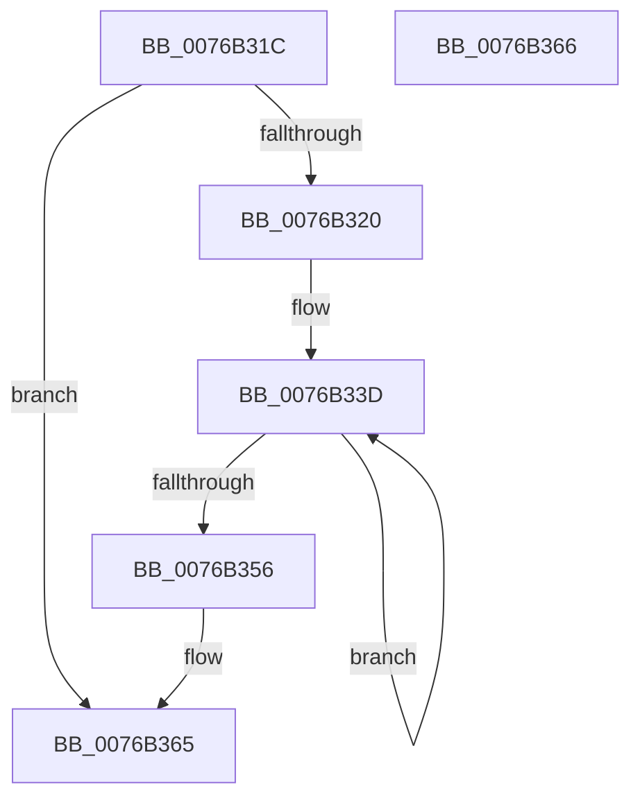

# PopIdleWakeConvertIntervalBucketsFrom

- RVA: `0x0076B31C`–`0x0076B367` (길이 `75` bytes)
- VA: `0x000000014076B31C`
- 실행 섹션: `PAGE`
- PDB 이름 있음: `예`; PDB Function 태그: `아니요`
- unwind 정보 RVA: `0x000C9474`
- 디코드: `24`개 명령, `75/75` bytes 표시
- 미해석 바이트: `0` (있으면 어셈블리에 `.byte`로 보존)

> 이 문서는 커널 이미지의 기계어와 PDB 기호를 분석해 생성했습니다. 4번과 5번은 함수 원형과 자료형을 바이너리 사용 방식에서 추정한 C 해석이며 원본 소스 복구 결과는 아닙니다.

## 1. Dependencies

- 직접 호출 지점: **1**; 고유 호출 대상: **1**
- 직접 호출자로 확인된 함수: **1**
- RIP 상대 이미지 참조: **0**

### Outgoing calls
- `0x0076B344` → [PpmConvertTimeFrom](../../text/44/PpmConvertTimeFrom_function_00447510.md) (function, `0x00447510`)

### Direct callers
- [PopIdleWakeInitialize](PopIdleWakeInitialize_function_0076B438.md) at `0x0076B470`
- [PopIdleWakeInitialize](PopIdleWakeInitialize_function_0076B438.md) at `0x0076B487`
- [PopIdleWakeInitialize](PopIdleWakeInitialize_function_0076B438.md) at `0x0076B49E`
- [PopIdleWakeInitialize](PopIdleWakeInitialize_function_0076B438.md) at `0x0076B4B5`
- [PopIdleWakeInitialize](PopIdleWakeInitialize_function_0076B438.md) at `0x0076B4CC`
- [PopIdleWakeInitialize](PopIdleWakeInitialize_function_0076B438.md) at `0x0076B4EC`
- [PopIdleWakeInitialize](PopIdleWakeInitialize_function_0076B438.md) at `0x0076B50F`

### Static image references
- 디코드된 RIP-relative 메모리 참조가 없습니다.

## 2. Other-region calls and transfers

- 다른 실행 섹션으로 향하는 call: **1**
  - `0x0076B344` → [PpmConvertTimeFrom](../../text/44/PpmConvertTimeFrom_function_00447510.md) (`PAGE` → `.text`)
- 별도 외부 분기/꼬리 이동을 확인하지 못했습니다.

## 3. Assembly (complete function range)

```asm
0076B31C  85 C9                           test ecx, ecx
0076B31E  74 45                           je 0x14076b365
0076B320  48 89 5C 24 08                  mov qword ptr [rsp + 8], rbx
0076B325  48 89 74 24 10                  mov qword ptr [rsp + 0x10], rsi
0076B32A  57                              push rdi
0076B32B  48 83 EC 20                     sub rsp, 0x20
0076B32F  48 8B DA                        mov rbx, rdx
0076B332  8B F9                           mov edi, ecx
0076B334  49 2B D8                        sub rbx, r8
0076B337  49 8B F1                        mov rsi, r9
0076B33A  4D 8B D8                        mov r11, r8
0076B33D  4A 8B 0C 1B                     mov rcx, qword ptr [rbx + r11]
0076B341  48 8B D6                        mov rdx, rsi
0076B344  E8 C7 C1 CD FF                  call 0x140447510
0076B349  49 89 03                        mov qword ptr [r11], rax
0076B34C  4D 8D 5B 08                     lea r11, [r11 + 8]
0076B350  48 83 EF 01                     sub rdi, 1
0076B354  75 E7                           jne 0x14076b33d
0076B356  48 8B 5C 24 30                  mov rbx, qword ptr [rsp + 0x30]
0076B35B  48 8B 74 24 38                  mov rsi, qword ptr [rsp + 0x38]
0076B360  48 83 C4 20                     add rsp, 0x20
0076B364  5F                              pop rdi
0076B365  C3                              ret
0076B366  CC                              int3
```

## 4. C-style interpretation (structured pseudocode)

```c
__int64 __fastcall PopIdleWakeConvertIntervalBucketsFrom(int a1, __int64 a2, __int64 a3, __int64 a4)
{
    __int64 result;
    __int64 v_rbx;
    __int64 v_rdi;
    __int64 v_rsp;
    unsigned __int64 v_stack_p10;
    unsigned __int64 v_stack_p8;

    if (a1 == 0) goto loc_0076B365;
    v_stack_p8 = v_rbx;
    v_stack_p10 = v_rsi;
    v_rsp = (v_rsp) - (32);
    v_rbx = (a2) - (a3);
loc_0076B33D:
    result = PpmConvertTimeFrom(*(unsigned __int64 *)(v_rbx + a3 * 1), a4, a3, a4);
    *(unsigned __int64 *)(a3) = result;
    v_rdi = ((unsigned int)(a1)) - (1);
    if (condition_is_not_equal) goto loc_0076B33D;
    v_rsp = (v_rsp) + (32);
loc_0076B365:
    return result;
}
```

## 5. (Beta) C Style

```c
int64_t PopIdleWakeConvertIntervalBucketsFrom(int32_t Arg1, void *Arg2, int64_t Arg3, int64_t Arg4)
{
    uint8_t *arg2 = (uint8_t *)Arg2;

    int64_t result;
    int64_t local_rbx;
    int64_t local_rdi;
    int64_t local_rsp;
    uint64_t v_stack_p10;
    uint64_t v_stack_p8;

    if (Arg1 == 0) goto loc_0076B365;
    v_stack_p8 = local_rbx;
    v_stack_p10 = local_rsi;
    local_rsp = (local_rsp) - (32);
    local_rbx = (Arg2) - (Arg3);
loc_0076B33D:
    result = PpmConvertTimeFrom(*(uint64_t *)(local_rbx + Arg3 * 1), Arg4, Arg3, Arg4);
    *(uint64_t *)(Arg3) = result;
    local_rdi = ((uint32_t)(Arg1)) - (1);
    if (condition_is_not_equal) goto loc_0076B33D;
    local_rsp = (local_rsp) + (32);
loc_0076B365:
    return result;
}
```

### 관측된 메모리 오프셋

구조체 형식이 확인되지 않은 접근은 인자 기준의 오프셋으로만 기록했습니다.

| 기준 인자 | 오프셋 표현 | 폭 (bit) | 접근 |
|---|---:|---:|---|
| `Arg2` | `+ 0x0 + r11*1` | `64` | `R` |

## 6. Execution-region graph

[열기: 2D/3D 그래프와 함수 탐색 컨트롤 패널](../../../control-panel.html?section=page&rva=0x0076B31C&view=graph)

- 2D 그래프는 위에서 아래로 흐르고, 3D 그래프는 빈 공간을 드래그해 회전합니다. Shift+드래그는 이동, 휠은 확대·축소, 함수 노드 선택은 대상 보고서 이동입니다.

### Static fallback


